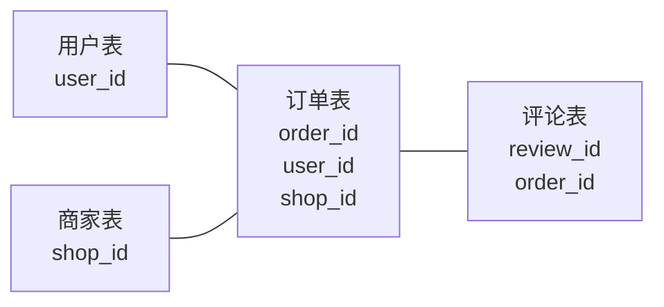
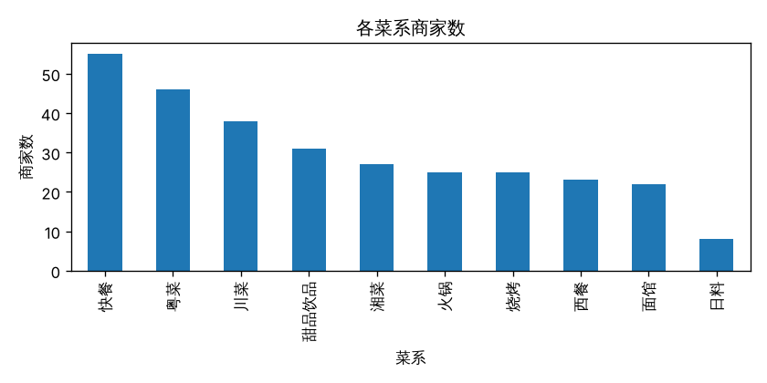
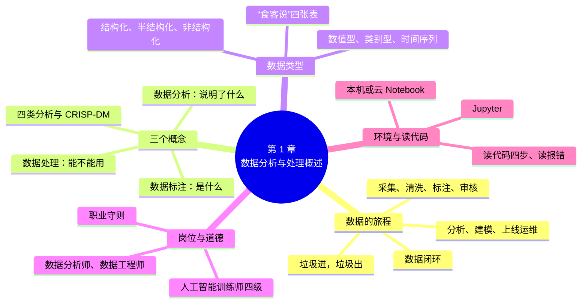

# 第 1 章 数据分析与处理概述

!!! abstract "本章学时"
    理论 4 学时 · 实验 1 学时（本章共 3 个实验，教师可任选）

## 学习目标

学完本章，你应该能够：

1. **说出**一个人工智能项目中数据要经过的主要环节，以及人工智能训练师四级的三个职业功能（记忆）；
2. **区分**结构化、半结构化和非结构化数据，以及数值型、类别型和时间序列数据（理解）；
3. **解释**数据分析、数据处理、数据标注三者的关系，说明“数据决定模型上限”的含义（理解）；
4. **运行并修改**给定代码，完成环境自检，读入“食客说”的四张表并生成数据字典初稿（应用）；
5. **找出**一段数据分析代码中的错误，并说明错在哪里（分析）。

!!! info "先修要求"
    本章是全书的起点，不要求你写过程序。你需要：

    - 会用电脑安装软件、新建文件夹、解压文件；
    - 用过 Excel 或 WPS 表格，知道“行”“列”“筛选”“排序”是什么意思；
    - 学过“Python 程序设计”更好，忘了也没关系，[附录 A](../../appendix/a-python.md) 从零讲起。

??? abstract "本章概念清单（19 个，点击查看定义和例子）"
    1. [数据](../../appendix/glossary.md#g-数据)
    2. [数据生命周期](../../appendix/glossary.md#g-数据生命周期)
    3. [训练数据](../../appendix/glossary.md#g-训练数据)
    4. [数据处理](../../appendix/glossary.md#g-数据处理)
    5. [数据分析](../../appendix/glossary.md#g-数据分析)
    6. [数据驱动](../../appendix/glossary.md#g-数据驱动)
    7. [CRISP-DM](../../appendix/glossary.md#g-CRISP-DM)
    8. [结构化数据](../../appendix/glossary.md#g-结构化数据)
    9. [半结构化数据](../../appendix/glossary.md#g-半结构化数据)
    10. [非结构化数据](../../appendix/glossary.md#g-非结构化数据)
    11. [数值型数据](../../appendix/glossary.md#g-数值型数据)
    12. [类别型数据](../../appendix/glossary.md#g-类别型数据)
    13. [时间序列数据](../../appendix/glossary.md#g-时间序列数据)
    14. [人工智能训练师](../../appendix/glossary.md#g-人工智能训练师)
    15. [数据标注员](../../appendix/glossary.md#g-数据标注员)
    16. [职业守则](../../appendix/glossary.md#g-职业守则)
    17. [数据字典](../../appendix/glossary.md#g-数据字典)
    18. [虚拟环境](../../appendix/glossary.md#g-虚拟环境)
    19. [Jupyter](../../appendix/glossary.md#g-Jupyter)

## 情景导入

小林在一家叫“食客说”的城市美食点评平台做运营。平台上有 300 家合作餐厅、5000 多位常用用户，2025 年一年产生了 5.6 万多笔外卖订单和 1 万多条评论。最近，平台老板提了一个要求：“每天几百条评论，靠人看不过来。我们做一个‘评论情感分析’功能吧，差评一出来就自动提醒商家。”

技术部的回复让小林有点意外：“模型不难做，难的是数据。你们先把评论从各个系统里导出来，把乱码、广告、重复的评论清理掉，再找人给几千条评论标上‘好评’‘差评’‘中评’，标得准不准还要有人审核。模型上线以后，还得有人天天盯着，看它判错了哪些，整理出来给我们改。”

小林这才发现，一个看起来是“人工智能”的项目，大部分工作其实是围着数据转的：采集、清洗、标注、审核、分析、上线以后的监控。这些工作不需要会推导复杂的数学公式，但需要细心、懂业务、会用工具，还要守规矩，这正是人工智能训练师、数据标注员、数据分析师这些岗位每天在做的事。本书就跟着“食客说”这个项目，从头到尾把这些工作做一遍。

## 1.1 数据在人工智能项目中的位置

### 1.1.1 一份数据的旅程

人工智能，特别是今天最常用的机器学习，是让计算机从大量的例子里自己总结规律。所以[数据](../../appendix/glossary.md#g-数据 "对客观事物的记录，可以是数字、文字、图片、声音等形式"){ .term }是人工智能的“原材料”。“食客说”的评论情感分析项目里，一条评论从用户写下到变成模型的一部分，要走下面这条路：


1. **采集**：评论散落在订单数据库、商家后台、开放接口里，格式各不相同，先要把它们收集到一起（第 3 章）。
2. **清洗**：收集来的数据有乱码、广告、重复、缺失，要按规范清理干净（第 4 章）。
3. **标注**：模型要学会区分好评和差评，得先有人告诉它几千条评论各是什么，这一步叫标注（第 5 章）。
4. **审核**：标注员也会标错，要抽查、统计一致程度，不合格就返工（第 6 章）。
5. **分析**：用统计和图表了解数据，例如差评集中在哪些菜系、哪些时段（第 7、8 章）。
6. **建模**：用整理好的数据训练模型（第 9 章），或者做推荐（第 10 章）。
7. **上线运维**：模型上线后要盯着它的表现，把判错的“坏案例”收集起来补充标注，再交给工程师改进，形成一个循环（第 11 章）。

整个过程中，还要始终注意不泄露用户的个人信息，遵守法律法规（第 12 章）。图中最后那条从“上线运维”回到“标注”的箭头很重要：数据工作不是做一次就完了，而是一圈一圈地循环改进，这个循环叫作[**数据闭环**](../../appendix/glossary.md#g-数据闭环 "上线后收集问题数据、补标注、再训练、再上线的循环过程"){ .term }。一份数据从产生、采集、存储、使用直到最后归档或销毁的全过程，叫作[**数据生命周期**](../../appendix/glossary.md#g-数据生命周期 "数据从产生、采集、存储、加工、使用到归档或销毁的全过程"){ .term }。

!!! tip "怎样使用本书"
    每一章对应上图中的一个环节。读的时候可以随时回到这张图，想一想“我现在在数据旅程的哪一站”。

### 1.1.2 数据决定模型的上限

业内有句常说的话：“数据和特征决定了模型的上限，算法只是逼近这个上限。”意思是，如果喂给模型的数据本身就错漏百出，算法再先进也学不好。英文里有一句更直白的话：**垃圾进，垃圾出**（Garbage In, Garbage Out）。

举个例子。假设负责标注的同学把一半的“送餐太慢，菜都凉了”标成了“好评”，模型就会学到“凉了”是一句夸奖；假设采集评论时漏掉了晚上 10 点以后的订单，模型就从来没见过夜宵评论，上线以后遇到夜宵评论就容易判错。这些问题都不是改模型能解决的，只能从数据上解决。

近几年，人工智能研究界也越来越重视数据本身，提出了“以数据为中心的人工智能”（Data-centric AI）的说法：与其不停地换更复杂的模型，不如把力气花在提高数据的质量和数量上。<sup class="cite">[[1]](#ref1-1)</sup> 大模型时代更是如此，各家大模型的差别，很大程度上来自训练数据的规模和质量。用来训练模型的这部分数据，叫作[**训练数据**](../../appendix/glossary.md#g-训练数据 "用来训练模型的、通常带有标签的数据"){ .term }。

## 1.2 数据分析、数据处理与数据标注

### 1.2.1 几个容易混的词

本书的书名里有“数据分析”和“数据处理”两个词，再加上第 5、6 章的“数据标注”，初学者容易混。可以这样区分：

| 词 | 要回答的问题 | “食客说”里的例子 | 主要产出 |
|---|---|---|---|
| [**数据处理**](../../appendix/glossary.md#g-数据处理 "对数据进行采集、清洗、转换、整合等加工，使它能够被分析和使用"){ .term } | 数据能不能用？ | 把三个系统导出的订单合并成一张表，删掉重复的，把“天河区”“天河”统一写法 | 干净、规整的数据表 |
| [**数据标注**](../../appendix/glossary.md#g-数据标注 "按照规范为数据添加标签，供模型训练和评估使用"){ .term } | 每条数据“是什么”？ | 给每条评论标上“好评 / 中评 / 差评” | 带标签的训练数据 |
| [**数据分析**](../../appendix/glossary.md#g-数据分析 "用统计、图表等方法从数据中发现规律、得出结论、支持决策的过程"){ .term } | 数据说明了什么？ | 发现下雨天送达时间平均多 6 分钟，建议雨天给骑手加补贴 | 结论、图表和报告 |

三者不是先后分开的，而是交织在一起：处理数据时要先分析一下数据有什么问题，标注前要处理好数据，标注完了要分析标注质量。本书把它们放在一起讲，就是因为在真实工作中它们本来就是一个人、一个团队一起做的。

!!! note "数据挖掘、商业智能又是什么？"
    “数据挖掘”侧重用算法从大量数据中自动发现规律，比如关联规则、聚类，和数据分析的边界很模糊；“商业智能”（BI）侧重用报表和看板支持企业经营决策，第 8 章会用到 BI 工具。这些词不必死记，知道它们都是“从数据中得到有用的东西”就可以了。

### 1.2.2 四类数据分析

同样是“分析数据”，要回答的问题深浅不同。业内常把数据分析分成四类，从易到难依次是：

1. **描述性分析：发生了什么？** 例如“2025 年平台一共 56655 笔订单，平均实付 133.2 元”。这是最基础、用得最多的分析。
2. **诊断性分析：为什么会这样？** 例如“7 月的平均送达时间比 1 月长，是因为 7 月雨天多”。
3. **预测性分析：将来会怎样？** 例如“根据距离、天气、时段，预计这一单 32 分钟送达”。
4. **指导性分析：应该怎么做？** 例如“雨天晚高峰把配送范围从 5 公里缩到 3 公里，可以把超时率降到 5% 以下”。

越往后越难，也越有价值。本书第 7、8 章以描述性和诊断性分析为主，第 9 章开始做预测，第 10 章的推荐系统可以看作一种简单的“指导”：告诉用户“你可能喜欢这几家店”。用数据而不是凭感觉来做决定，叫作[**数据驱动**](../../appendix/glossary.md#g-数据驱动 "以数据分析的结果而不是个人经验或直觉作为决策依据的工作方式"){ .term }。

### 1.2.3 数据分析的一般流程 { #123 }

做一次完整的数据分析，大体按下面六步走。这个流程来自数据挖掘领域使用很广的 [**CRISP-DM**](../../appendix/glossary.md#g-CRISP-DM "跨行业数据挖掘标准流程，把项目分为业务理解、数据理解、数据准备、建模、评估、部署六个阶段"){ .term }（跨行业数据挖掘标准流程），它在 2000 年前后由几家企业联合提出，至今仍是最常被引用的项目流程。<sup class="cite">[[2]](#ref1-2)</sup><sup class="cite">[[3]](#ref1-3)</sup>


1. **业务理解**：先弄清楚要解决什么问题、怎样算解决了。“提高用户满意度”太笼统，“把差评率从 18% 降到 15%”就清楚了。
2. **数据理解**：有哪些数据，每一列是什么意思，数据质量怎样。本章实验 1-2 就是在做这一步。
3. **数据准备**：采集、清洗、整合、标注，往往占整个项目一半以上的时间。
4. **建模**：用统计方法或机器学习模型找出规律。
5. **评估**：结果对业务有没有用？一个准确率 99% 的模型，如果漏掉了所有差评，也是没用的。
6. **部署**：把结论写成报告、做成看板，或者把模型上线。

图中有几条往回走的箭头：理解数据以后可能发现业务问题提得不对，要回去改；建模时发现数据不够，要回去补。数据分析很少一次走通，来回几轮是正常的。

## 1.3 数据有哪些类型

### 1.3.1 按“有没有固定格式”分

打开“食客说”的数据文件夹，你会看到各种各样的数据。按照有没有固定格式，可以分成三类：

| 类型 | 特点 | “食客说”里的例子 | 用什么工具处理 |
|---|---|---|---|
| [**结构化数据**](../../appendix/glossary.md#g-结构化数据 "能整理成行列分明的二维表、每一列含义和类型固定的数据"){ .term } | 行列分明的表格，每一列的含义、类型固定 | 订单表：订单号、下单时间、实付金额…… | Excel、数据库、pandas |
| [**半结构化数据**](../../appendix/glossary.md#g-半结构化数据 "有一定结构但不是固定二维表的数据，如 JSON、XML、日志"){ .term } | 有标记、有层次，但每条记录的字段可以不一样 | 开放接口返回的 JSON、服务器日志 | 先“展平”成表格再处理（第 3 章） |
| [**非结构化数据**](../../appendix/glossary.md#g-非结构化数据 "没有预先定义格式的数据，如自由文本、图片、音频、视频"){ .term } | 没有预先定义的格式 | 评论正文、菜品照片、客服通话录音 | 需要先标注或用模型提取信息（第 5、9 章） |

据业内估计，企业里八成以上的数据是非结构化的。非结构化数据信息量大，但计算机不能直接“算”它，要么人工标注，要么用模型把它转换成结构化的信息，例如把一条评论变成“情感 = 差评，涉及方面 = 配送”。这正是数据标注的价值所在。

### 1.3.2 按“一列里装的是什么”分

在一张结构化的表里，每一列装的数据又分几种，后面做统计和画图时要区别对待：

- [**数值型数据**](../../appendix/glossary.md#g-数值型数据 "用数字表示、可以做加减乘除和比较大小的数据"){ .term }：能做加减乘除的数，例如实付金额 64.9 元、送达时长 24 分钟。可以算平均数。
- [**类别型数据**](../../appendix/glossary.md#g-类别型数据 "取值是有限几个类别的数据，类别之间只能比较相同与否"){ .term }：取值是有限的几类，例如城区（天河、越秀……）、配送方式（平台专送、商家自送）。只能数个数、算比例，算“平均城区”没有意义。有些类别型数据有顺序，例如年龄段“18-24、25-30……”、评分 1～5 星，这种叫有序类别。
- [**时间序列数据**](../../appendix/glossary.md#g-时间序列数据 "按时间先后顺序记录的一串数据"){ .term }：按时间先后排列的数据，例如每天的订单量。分析时要关注趋势、周期（周末多、工作日少）和季节。

!!! warning "数字不一定是数值型"
    商家编号 S0001、用户编号 U00001、手机号 13812345678，虽然由数字组成，但它们是“名字”，不是“数量”，算平均数没有意义，应该当作类别型（或者叫标识）来处理。判断方法很简单：问问自己“这一列算平均数有意义吗？”

### 1.3.3 “食客说”的四张表

本书的大部分实验都围绕“食客说”的四张表展开。这些数据是编者按照真实点评平台的大致情况虚构生成的，不对应任何真实的人和店，可以放心地拿来练习。<sup class="cite">[[4]](#ref1-4)</sup>

| 表 | 文件 | 行数 | 主要字段 |
|---|---|---|---|
| 商家表 | `shops.csv` | 300 | shop_id、店名、城区、菜系、人均价格、开业日期、标签 |
| 用户表 | `users.csv` | 5000 | user_id、昵称、姓名、性别、年龄段、手机号、常住城区、收货地址、注册日期 |
| 订单表 | `orders.csv` | 56655 | order_id、user_id、shop_id、下单时间、就餐人数、订单金额、优惠金额、实付金额、配送方式、配送距离、天气、送达时长 |
| 评论表 | `reviews.csv` | 12000 | review_id、order_id、user_id、shop_id、评分、评论内容、评论时间 |

四张表靠编号连在一起：订单表里的 `user_id` 对应用户表，`shop_id` 对应商家表；评论表里的 `order_id` 对应订单表。这种“用编号把几张表关联起来”的结构，就是数据库里最常见的关系模型，第 2、3 章会大量用到。



<iframe class="sim-frame" src="../../sims/data-journey/main.html" height="520" loading="lazy" title="数据的旅程"></iframe>
动画：数据的旅程。把 12 项日常工作拖到数据旅程的六个环节里，检查自己是否分得清每个环节在做什么。[全屏打开](../../sims/data-journey/main.html){ target=_blank }
{ .sim-caption }

## 1.4 数据岗位与职业道德

### 1.4.1 人工智能训练师

2020 年初，人力资源和社会保障部会同国家市场监督管理总局、国家统计局向社会发布了 16 个新职业，[**人工智能训练师**](../../appendix/glossary.md#g-人工智能训练师 "使用智能训练软件，在人工智能产品使用过程中进行数据库管理、算法参数设置、人机交互设计、性能测试跟踪等工作的人员"){ .term }是其中之一。<sup class="cite">[[5]](#ref1-5)</sup> 这个职业下面包括[**数据标注员**](../../appendix/glossary.md#g-数据标注员 "按照标注规范对文本、图像、语音等数据进行分类、框选、转写等加工的人员"){ .term }和人工智能算法测试员两个工种。2021 年，人力资源和社会保障部、工业和信息化部颁布了《人工智能训练师国家职业技能标准》，把这个职业分成五个等级：五级 / 初级工、四级 / 中级工、三级 / 高级工、二级 / 技师、一级 / 高级技师。<sup class="cite">[[6]](#ref1-6)</sup>

本课程对应的是**四级 / 中级工**，它要求掌握三个职业功能，在理论考试和技能考试中的分量大致如下：

| 职业功能 | 主要工作 | 理论考试占比 | 技能考试占比 | 本书章节 |
|---|---|---|---|---|
| 数据采集和处理 | 采集业务数据，检查和清洗数据质量 | 20% | 30% | 第 2、3、4、7 章 |
| 数据标注 | 定义标签、按规范标注、审核标注质量、写审核报告 | 40% | 50% | 第 5、6 章 |
| 智能系统运维 | 维护上线的智能系统，分析运行情况，提出优化需求 | 20% | 20% | 第 9、11 章 |

理论考试另有 20% 是职业道德和基础知识，对应本章和第 12 章。可以看出，**数据标注**是四级考试的重中之重，所以本书用了两章来讲。三级 / 高级工在此基础上要求能制定清洗和标注规范、训练和测试算法、写测试报告，对应“机器学习”课程。

!!! cert "证书考点 · 人工智能训练师（四级）· 基础知识与职业道德"
    理论考试中职业道德和基础知识约占 20%。常考：人工智能训练师属于哪一类职业、分几个等级、各等级的主要职业功能；数据的类型（结构化 / 非结构化）；职业守则中关于保守秘密、保护个人信息的要求。容易错在把“数据标注员”当成和人工智能训练师并列的独立职业，实际上它是人工智能训练师下面的工种。

### 1.4.2 其他数据岗位

除了人工智能训练师，和本书内容相关的岗位还有：

- **数据分析师**：在电商、餐饮、金融、政务等各行各业，用统计和图表分析业务数据、写分析报告，是招聘量最大的数据岗位。主要技能对应本书第 2、4、7、8 章。
- **数据工程师**：搭建数据采集、存储、加工的管道，让数据自动、按时、准确地流到需要的地方。主要技能对应第 3、4 章和“大数据技术处理技术”课程。
- **算法工程师**：设计和训练模型。他们是数据岗位的“下游”，非常依赖前面的人把数据准备好。

对于在职学习的同学来说，即使不换工作，学会本书的内容也很有用：会用 pandas 处理表格，原来在 Excel 里要做一下午的汇总几秒钟就能做完；会用大模型辅助分析，又能识别它的错误，在任何岗位上都是加分项。

### 1.4.3 数据工作的职业道德

数据工作接触的往往是用户的姓名、电话、地址、消费记录，是企业的经营数据，有的还涉及国家安全。国家职业技能标准对人工智能训练师提出了职业道德方面的要求，结合法律法规，数据岗位最需要做到下面四点：

1. **遵纪守法**：遵守《个人信息保护法》《数据安全法》等法律，不采集、不使用、不买卖不该碰的数据。第 12 章会详细讲。
2. **保守秘密**：工作中接触的数据不外传、不拷贝到私人设备、不发到私人网盘和聊天群。标注项目通常要签保密协议。
3. **实事求是**：不编造数据，不为了“好看”篡改结果，不隐瞒对结论不利的发现。标注时拿不准就标出来问，不随便蒙。
4. **严谨细致**：一个标注员每天要标几百上千条数据，一时的马虎就会变成模型永远的错误。

这些要求统称为[**职业守则**](../../appendix/glossary.md#g-职业守则 "从业人员在职业活动中应当遵守的行为准则"){ .term }。它们听起来像套话，但在数据行业是有真实后果的：泄露个人信息可能构成违法甚至犯罪，篡改数据会让企业做出错误决策。

## 1.5 实验环境与读代码的方法

### 1.5.1 两种实验环境，任选一种

本书的实验用 Python 语言完成。Python 是数据分析领域使用最多的语言，免费、库多、资料多。你可以选择下面两种方式之一：

| 方式 | 优点 | 缺点 | 适合谁 |
|---|---|---|---|
| **本机安装**（推荐 Anaconda 或 uv） | 不用联网也能做，速度快，数据留在自己电脑上 | 第一次安装要花半小时左右 | 有自己的电脑、以后还要继续用 Python 的同学 |
| **云 Notebook**（百度飞桨 AI Studio、魔搭社区等） | 打开网页就能用，不用安装 | 要联网、要注册账号，免费额度有限 | 电脑配置低或者只想先试一试的同学 |

本书所有实验都在普通笔记本电脑上测试过，不需要显卡。安装的详细步骤见[附录 C](../../appendix/c-environment.md)。装好以后，按实验 1-1 运行环境自检程序，看到所有库都显示“通过”就可以了。

做 Python 项目时，常把不同项目需要的库分别装在各自独立的“小环境”里，互不干扰，这叫[**虚拟环境**](../../appendix/glossary.md#g-虚拟环境 "为一个项目单独准备的、互不干扰的 Python 运行环境"){ .term }。Anaconda 和 uv 都能方便地创建虚拟环境，具体做法见附录 C。

### 1.5.2 Jupyter：一格一格地运行代码

初学者最推荐用 [**Jupyter**](../../appendix/glossary.md#g-Jupyter "在网页里一格一格编写和运行代码、并直接显示结果和图表的交互式编程工具"){ .term } 写代码。它是一个在浏览器里运行的“笔记本”，代码分成一个个小格子，每运行一格，结果和图表就直接显示在格子下面，改了哪一格就重新运行哪一格，特别适合边试边学。

Jupyter 里最常用的几个操作：

- **Shift + Enter**：运行当前格子并跳到下一格；
- 格子左边的 `[ ]` 里出现数字，表示这一格已经运行过，数字是运行顺序；出现 `[*]` 表示正在运行；
- 程序“卡住”或者想从头再来，点菜单 **Kernel → Restart**（重启内核），再从第一格开始依次运行。

!!! warning "Jupyter 最常见的坑：运行顺序"
    Jupyter 允许你先运行第 5 格再运行第 2 格，结果就可能和书上不一样，甚至报“变量没有定义”的错。遇到奇怪的错误，先重启内核，再从上到下按顺序运行一遍。

本书配套的代码都是 `.py` 文件，既可以在命令行里运行（`python lab1_1_check_env.py`），也可以把内容复制到 Jupyter 的格子里一段一段运行。

### 1.5.3 怎样读懂一段别人写的代码

本书面向零基础的同学，对代码的要求是**先读懂，再会改，最后能自己写**。基础实验（★）的代码都是写好的，你要做的是运行它、读懂它、按要求改几个地方；拓展实验（☆）才要求自己写一些代码。读代码有个小窍门，按下面四步来：

1. **先看注释和输出**：书上的代码每一行都配了中文注释（`#` 后面的文字），先把注释连起来读一遍，就知道这段代码在干什么；再对照运行结果，看每一步输出了什么。
2. **找“输入”和“输出”**：这段代码读了哪个文件（输入）？最后打印或保存了什么（输出）？中间的部分就是“从输入变到输出”的过程。
3. **一次只改一个地方**：书上标了“可以改这里”的地方，比如把 `"菜系"` 改成 `"城区"`，运行一下，看结果怎么变。一次改一处，出了错也知道是哪里改坏了。
4. **加 `print` 看中间结果**：看不懂某一行在干什么，就在它下面加一行 `print(变量名)`，把中间结果打印出来看。

来看实验 1-1 中的一小段代码，按上面的方法读一读：

```python
shops = pd.read_csv("../data/shops.csv")      # 读入商家表，存到变量 shops 里
counts = shops["菜系"].value_counts()          # 取出“菜系”这一列，数一数每种菜系有几家店
counts.plot(kind="bar", title="各菜系商家数")    # 把结果画成柱状图
```

输入是 `shops.csv` 这个文件，输出是一张柱状图。中间一行 `shops["菜系"]` 是“取出菜系这一列”，`.value_counts()` 是“数一数每个值出现几次”，相当于 Excel 里对“菜系”列做一次“分类汇总 → 计数”。如果想看各城区有几家店，只要把 `"菜系"` 改成 `"城区"`。

### 1.5.4 报错不可怕：读懂报错信息

刚开始写代码，报错是家常便饭，有经验的程序员每天也要遇到几十次。Python 报错时会打印一大段红字，看起来吓人，其实只要看**最后一行**：

```text
Traceback (most recent call last):
  File "lab1_1_check_env.py", line 22, in <module>
    shops = pd.read_csv("../data/shop.csv")
FileNotFoundError: [Errno 2] No such file or directory: '../data/shop.csv'
```

最后一行冒号前面的 `FileNotFoundError` 是错误类型（“找不到文件”），冒号后面是具体说明（找不到 `../data/shop.csv`）；倒数第二、三行告诉你出错的是第 22 行。对照一下就发现，文件名少了一个字母 s。下表是本书实验中最常见的几种报错：

| 报错类型 | 意思 | 最常见的原因 |
|---|---|---|
| `ModuleNotFoundError` | 找不到这个库 | 库没装，或者装到了别的虚拟环境里 |
| `FileNotFoundError` | 找不到文件 | 文件名写错，或者没在正确的文件夹下运行程序 |
| `KeyError` | 找不到这一列（或这个键） | 列名写错，常见的是多了空格、中英文括号不同 |
| `NameError` | 变量没有定义 | 变量名写错，或者 Jupyter 里没运行前面定义它的格子 |
| `SyntaxError` | 语法错误 | 括号、引号没配对，用了中文标点 |
| `UnicodeDecodeError` | 文件编码不对 | 用 UTF-8 去读一个 GBK 编码的文件（第 3 章细讲） |

实在看不懂，可以把代码和完整的报错信息复制给大模型（如 DeepSeek、通义千问、文心一言、豆包、Kimi），请它“解释这个报错的原因，并告诉我怎么改”。大模型很擅长解释代码和报错，但要注意两点：一是不要把含有真实客户信息的数据发给它；二是它给的代码也可能有错，要自己运行检查，实验 1-3 专门练习这件事。

## 1.6 前沿视窗

**数据标注成为一个产业。** 大模型的训练需要海量的高质量数据，数据标注从过去的“劳动密集型”零活儿，变成了一个受到国家重视的产业。2024 年 12 月，国家发展改革委、国家数据局、财政部、人力资源社会保障部联合印发《关于促进数据标注产业高质量发展的实施意见》（2025 年 1 月公开发布），提出到 2027 年数据标注产业专业化、智能化及科技创新能力显著提升，产业规模大幅跃升，年均复合增长率超过 20%，并建设一批成效明显、特色鲜明的数据标注基地。<sup class="cite">[[7]](#ref1-7)</sup> 对学习本课程的同学来说，这意味着数据标注、数据处理相关岗位在未来几年会持续有需求，而且对专业能力的要求越来越高：从简单的“画框打勾”，变成要懂业务、会写规范、会用工具辅助、会审核质量。

**大模型改变了数据工作的做法。** 一方面，大模型本身就是数据工作的好帮手：它能帮你写 pandas 代码、解释报错、给评论预先打上标签再由人来复核，第 4、6、9 章都会用到。另一方面，大模型自己也需要大量新型的数据：给它的回答打分、排序的“偏好数据”，示范“好回答长什么样”的“指令数据”，都要人来写、来标。数据岗位的工作内容正在从“标注海量简单数据”向“生产少量高质量数据、审核机器生成的数据”转变。

!!! tip "截至 2026 年 10 月"
    数据标注产业政策和相关职业标准还在不断更新，学习时请以国家数据局、人力资源和社会保障部网站发布的最新文件为准。

## 本章实验

!!! abstract "实验总览"
    | 实验 | 类型 | 建议时长 | 内容 |
    |---|---|---|---|
    | 实验 1-1 | ★ 基础 | 45 分钟 | 搭建数据分析环境并运行自检程序 |
    | 实验 1-2 | ★ 基础 | 45 分钟 | 读入“食客说”四张表，生成数据字典初稿 |
    | 实验 1-3 | ☆ 拓展 | 45 分钟 | 读一段“AI 写的”分析代码，找出其中的错误 |

    代码见配套资源 `labs/ch01/` 目录。本章实验学时为 1 学时，教师可任选一个在课内完成，其余课后练习。

### 实验 1-1 ★ 搭建数据分析环境

**实验目的**

1. 在本机或云 Notebook 上搭好 Python 数据分析环境；
2. 学会运行一个 `.py` 程序，看懂它的输出；
3. 解决 matplotlib 画图时中文显示成方框的问题。

**实验环境**：本机 CPU（或云 Notebook）。Python 3.11，本书用到的库及版本见 `labs/requirements.txt`。

**实验数据**：`labs/data/shops.csv`，“食客说”商家表，由 `labs/data/make_datasets.py` 按固定随机种子生成（来源说明见 `labs/data/README.md`）。

**实验步骤与代码**

第 1 步，按[附录 C](../../appendix/c-environment.md) 安装 Python 和本书用到的库。用 Anaconda 的同学打开“Anaconda Prompt”，用 uv 的同学打开终端，进入配套资源所在的文件夹，运行：

```bash
pip install -r labs/requirements.txt -i https://pypi.tuna.tsinghua.edu.cn/simple
```

`-i` 后面是清华大学的国内镜像源，下载速度比国外快得多。

第 2 步，进入 `labs/ch01` 文件夹，运行环境自检程序：

```bash
cd labs/ch01
python lab1_1_check_env.py
```

程序的核心部分如下。它逐个尝试导入本书用到的库，导入成功就打印版本号，失败就提示你安装：

```python
libs = ["numpy", "pandas", "matplotlib", "openpyxl", "scipy", "sklearn", "requests", "jieba"]
for name in libs:                                     # 对列表里的每一个库名，依次执行下面几行
    try:
        module = importlib.import_module(name)        # 尝试导入
        print(f"  [通过] {name:<11}{module.__version__}")
    except ImportError:                                # 导入失败时执行这里
        print(f"  [缺少] {name:<11}请运行 pip install {name}")
```

第 3 步，程序最后读入商家表、画一张“各菜系商家数”的柱状图，保存为 `lab1_1_check.png`。打开这张图，看中文是否正常显示。完整代码见 `labs/ch01/lab1_1_check_env.py`。

**运行结果**

```text
Python 版本： 3.11.18
  [通过] numpy      2.4.6
  [通过] pandas     3.1.0
  [通过] matplotlib 3.11.2
  [通过] openpyxl   3.1.5
  [通过] scipy      1.17.1
  [通过] sklearn    1.9.1
  [通过] requests   2.34.2
  [通过] jieba      0.42.1
商家表读取成功： 300 行 7 列
图已保存为 lab1_1_check.png，打开看看中文是否显示正常
```

你的版本号可能比书上新一些，只要都显示“通过”就可以。



**实验记录表**

| 项目 | 你的结果 |
|---|---|
| 使用的环境（本机 Anaconda / 本机 uv / 云 Notebook） | |
| Python 版本 | |
| 没有通过的库及解决办法 | |
| 中文是否正常显示？如果不正常，怎样解决的 | |
| 商家数最多的菜系是什么，有几家 | |

**常见问题排查**

| 现象 | 原因 | 解决办法 |
|---|---|---|
| `'python' 不是内部或外部命令` | Python 没装好，或者没加到系统路径 | Windows 用“Anaconda Prompt”而不是普通命令行；重新安装时勾选“Add to PATH” |
| 某个库显示“缺少” | 没装或装到了别的环境 | 在同一个命令行窗口里运行 `pip install 库名` |
| `FileNotFoundError: ../data/shops.csv` | 没有在 `labs/ch01` 文件夹下运行 | 先 `cd labs/ch01` 再运行；Jupyter 里把 Notebook 文件放在 `labs/ch01` 下 |
| 图里的中文是一个个方框 | 电脑上没有程序里列出的中文字体 | Windows 一般有 SimHei，macOS 有 PingFang SC，Linux 装文泉驿正黑；装好后删除 `~/.cache/matplotlib` 文件夹再试 |
| 下载很慢或超时 | 默认从国外下载 | 命令后面加 `-i https://pypi.tuna.tsinghua.edu.cn/simple` |

**思考与练习**

1. 把程序里的 `shops["菜系"]` 改成 `shops["城区"]`，图会变成什么？哪个城区的商家最多？
2. 程序中 `matplotlib.use("Agg")` 这一行有什么作用？删掉它在 Jupyter 里运行会怎样？

**实验报告要求**

提交环境自检的运行结果截图、生成的柱状图和实验记录表。如果安装过程中遇到了书上没有提到的问题，写下问题和你的解决办法，这是给后面同学最有用的经验。

### 实验 1-2 ★ 初识“食客说”数据

**实验目的**

1. 用 pandas 读入 CSV 文件，查看一张表的行数、列数、列名和数据类型；
2. 理解数据字典的作用，生成一份数据字典初稿并补写字段含义；
3. 初步判断每一列是数值型、类别型还是时间。

**实验环境**：本机 CPU。

**实验数据**：`labs/data/` 下的 `shops.csv`、`users.csv`、`orders.csv`、`reviews.csv` 四张表，字段说明见 1.3.3 节。

**实验步骤与代码**

[**数据字典**](../../appendix/glossary.md#g-数据字典 "说明一份数据中每个字段的名称、含义、类型、取值范围和来源的文档"){ .term }是说明“每一列是什么意思”的文档，就像一本书的目录和注释。拿到一份新数据，第一件事就是建数据字典。手工一列一列地看太慢，可以先用程序把能自动统计的信息（类型、缺失数、不同取值数、示例值）列出来，再由人补写含义：

```python
files = {"商家表": "shops.csv", "用户表": "users.csv", "订单表": "orders.csv", "评论表": "reviews.csv"}
dictionary = []                                          # 空列表，用来收集每一列的信息
for table, file in files.items():                        # 依次处理四张表
    df = pd.read_csv("../data/" + file)                  # 读入一张表
    print(f"{table}（{file}）：{df.shape[0]} 行，{df.shape[1]} 列")
    for col in df.columns:                               # 依次处理这张表的每一列
        dictionary.append({
            "表": table, "字段": col, "类型": str(df[col].dtype),
            "缺失数": int(df[col].isna().sum()),           # 这一列有几个空值
            "不同取值数": int(df[col].nunique()),           # 这一列有几种不同的值
            "示例值": df[col].iloc[0],                     # 第一行的值
        })
dict_df = pd.DataFrame(dictionary)                       # 把收集到的信息变成一张表
dict_df.to_csv("数据字典_初稿.csv", index=False, encoding="utf-8-sig")
```

最后一行的 `encoding="utf-8-sig"` 是为了让 Excel 打开时中文不乱码，第 3 章会解释原因。完整代码见 `labs/ch01/lab1_2_first_look.py`。

**运行结果**

```text
商家表（shops.csv）：300 行，7 列
用户表（users.csv）：5000 行，9 列
订单表（orders.csv）：56655 行，12 列
评论表（reviews.csv）：12000 行，7 列

  表       字段      类型  缺失数  不同取值数                 示例值 含义（请补写）
订单表 order_id     str    0  56655             O000001
订单表  user_id     str    0   4670              U02185
订单表  shop_id     str    0    300               S0067
订单表     下单时间     str    0  56546 2025-01-01 00:58:19
订单表     就餐人数   int64    0      4                   4
订单表     订单金额 float64    0   5444               199.1
订单表     优惠金额 float64    0    175                 0.0
订单表     实付金额 float64    0   5450               199.1
订单表     配送方式     str    0      2                平台专送
订单表     配送距离 float64    0    118                 3.3
订单表       天气     str    0      2                   晴
订单表     送达时长   int64    0     63                  17

数据字典初稿已保存：数据字典_初稿.csv，共 35 个字段
```

读这份结果，可以得到不少信息：

- “类型”一列中，`int64` 是整数，`float64` 是小数，`str` 是文字。“下单时间”被读成了文字（`str`），要做时间计算得先转换类型，第 2 章会讲。
- `order_id` 有 56655 个不同的值，正好等于行数，说明每笔订单的编号都不重复，它可以唯一地标识一行，叫作主键。
- `user_id` 只有 4670 个不同的值，比用户表的 5000 人少，说明有 330 位用户一年里一单都没下。
- “配送方式”“天气”只有 2 种取值，是典型的类别型数据；“就餐人数”只有 1～4 四个值，虽然是数字，但更像有序类别。

**实验记录表**

打开 `数据字典_初稿.csv`，在“含义（请补写）”一列补写每个字段的含义，并完成下表：

| 问题 | 你的答案 |
|---|---|
| 四张表中，哪些列是数值型？哪些是类别型？哪些是时间？ | |
| 哪一列能把订单表和商家表连起来？ | |
| 用户表中，哪些字段属于个人信息，使用时要特别小心？ | |
| 评论表中“评分”只有 1～5 五个值，你认为它是数值型还是有序类别？为什么？ | |

**常见问题排查**

| 现象 | 原因 | 解决办法 |
|---|---|---|
| 用 Excel 打开 `数据字典_初稿.csv` 中文是乱码 | 保存时没有用 `utf-8-sig` | 确认代码最后一行有 `encoding="utf-8-sig"` |
| 打印的表格列没有对齐 | 中文和英文字符宽度不同 | 不影响结果；在 Jupyter 里直接输入 `dict_df` 查看会整齐很多 |
| 类型显示 `object` 而不是 `str` | pandas 版本低于 3.0 | 不影响使用，`object` 和 `str` 在这里都表示文字 |

**思考与练习**

1. 把 `df[col].iloc[0]` 改成 `df[col].iloc[-1]`，“示例值”会变成什么？
2. 为什么数据字典里的“含义”一栏程序写不出来，必须由人来写？

**实验报告要求**

提交补写完整的数据字典（CSV 或 Excel 文件）和实验记录表。数据字典是后面各章都要用到的“说明书”，请认真完成。

### 实验 1-3 ☆ 让大模型写分析代码，再找出它的错

**实验目的**

1. 体会用大模型辅助写数据分析代码的效率和风险；
2. 学会用“核对总数”“对照常识”等方法检查代码结果对不对；
3. 认识 `count`（计数）和 `nunique`（去重计数）的区别。

**实验环境**：本机 CPU。有条件的同学可以同时打开任意一款国产大模型网页版，把下面的任务发给它，比较它写的代码。

**实验数据**：`orders.csv`、`shops.csv`。

**实验步骤与代码**

任务是：**统计 2025 年每个城区的订单数、下单用户数和平均实付金额**。程序 `lab1_3_check_ai_code.py` 里有两个版本的代码。第一个版本是编者模仿大模型常见的错误写成的“AI 答案”，它看上去很专业，也能顺利运行：

```python
df = orders.merge(shops, on="shop_id")              # 把订单和商家两张表按 shop_id 连起来
result = df.groupby("城区").agg(                     # 按城区分组统计
    订单数=("order_id", "count"),
    下单用户数=("user_id", "count"),
    平均实付金额=("订单金额", "mean"),
)
```

运行后得到：

```text
      订单数  下单用户数  平均实付金额
城区
天河  11063  11063   140.1
海珠   8127   8127   134.2
番禺   8211   8211   149.7
……
```

第 1 步，**对照常识检查**。每个区的“下单用户数”和“订单数”一模一样，这合理吗？天河区一年 11063 单，不可能每一单都是不同的人下的，一定有回头客。所以“下单用户数”的算法有问题。

第 2 步，**对照任务要求检查**。任务要的是“平均**实付**金额”，代码里却写的是“订单金额”。订单金额是优惠前的，实付金额是优惠后的，二者不一样。

第 3 步，改正这两处错误：`count` 改成 `nunique`（数一数有几个不同的用户），“订单金额”改成“实付金额”：

```python
result = df.groupby("城区").agg(
    订单数=("order_id", "count"),
    下单用户数=("user_id", "nunique"),         # 去重后再数
    平均实付金额=("实付金额", "mean"),
)
```

第 4 步，**核对总数**：各区订单数加起来应该等于订单表的总行数。完整代码见 `labs/ch01/lab1_3_check_ai_code.py`。

**运行结果**

```text
改正后：
      订单数  下单用户数  平均实付金额
城区
天河  11063   2568   136.2
越秀   8374   2156   135.5
番禺   8211   2103   145.9
海珠   8127   1906   130.4
白云   7569   2068   126.4
荔湾   5353   1485   131.4
黄埔   4642   1515   116.2
花都   3316   1011   134.2

核对：订单表共 56655 行；改正后各区订单数之和 56655
核对：全部订单的平均实付金额 133.2
```

改正以后，天河区 11063 单是 2568 位用户下的，平均每人约 4.3 单，这才合乎常理。注意错误的版本没有报任何错，程序“跑通了”不等于结果对了。这类“能运行但算错了”的问题最危险，必须靠人来把关。

**实验记录表**

| 检查方法 | 发现的问题 | 怎样改正 |
|---|---|---|
| 对照常识 | | |
| 对照任务要求 | | |
| 核对总数 | | |
| （选做）你用的大模型写的代码有没有错？ | | |

**常见问题排查**

| 现象 | 原因 | 解决办法 |
|---|---|---|
| `KeyError: '城区'` | 合并前订单表里没有“城区”，合并语句没运行 | 先运行 `merge` 那一行 |
| 合并后多出 `店名_x`、`店名_y` 这样的列 | 两张表有同名的列 | 合并前只取需要的列，如 `shops[["shop_id", "城区"]]` |

**思考与练习**

1. 如果要统计“每个城区有多少家**有订单的**商家”，应该对哪一列用什么函数？
2. 把同样的任务发给一个大模型，它写的代码对吗？如果不对，错在哪里？

**实验报告要求**

提交改正后的代码、运行结果和实验记录表。用两三句话总结：用大模型写数据分析代码时，你会怎样检查它的结果？

## 本章小结

- 人工智能项目中，数据要经过**采集、清洗、标注、审核、分析、建模、上线运维**几个环节，上线后的问题数据再回流补充标注，形成**数据闭环**。
- “垃圾进，垃圾出”：数据的质量决定了模型的上限，很多问题只能从数据上解决。
- **数据处理**让数据能用，**数据标注**说明数据是什么，**数据分析**回答数据说明了什么，三者在工作中交织在一起。数据分析分为描述性、诊断性、预测性、指导性四类，一般按 **CRISP-DM** 的六个阶段进行，并且常常要来回几轮。
- 按格式，数据分为**结构化、半结构化、非结构化**；按一列中装的内容，分为**数值型、类别型、时间序列**。由数字组成的编号不是数值型。
- **人工智能训练师**是 2020 年发布的新职业，分五个等级，四级的职业功能是**数据采集和处理、数据标注、智能系统运维**，其中数据标注分量最重。数据岗位要遵纪守法、保守秘密、实事求是、严谨细致。
- 实验环境可以本机安装，也可以用云 Notebook。读代码先看注释和输出，一次只改一处；报错先看最后一行。大模型能帮忙写代码、解释报错，但它写的代码要自己检查。



**下一章预告**

本章我们只是“看了看”数据。下一章开始真正动手：用 pandas 把 Excel 里做过的筛选、排序、分类汇总、VLOOKUP 一样一样地做一遍。你会发现，几行代码就能完成原来要点几十下鼠标的工作，而且换一份数据，代码不用改就能再算一遍。

## 参考文献

正文中的上标编号（如<sup class="cite">[[1]](#ref1-1)</sup>）对应下面的文献。带链接的可以直接打开；书籍可在图书馆或电子书平台查阅。

<div class="refs" markdown>

**教材与专著**

- <span id="ref1-4"></span>[4] MCKINNEY W. Python for data analysis: data wrangling with pandas, NumPy, and Jupyter[M]. 3rd ed. Sebastopol: O'Reilly Media, 2022.
    <span class="ref-note">pandas 作者编写的入门书，本书第 1～4 章的工具用法主要参考此书；在线免费版见 https://wesmckinney.com/book/ 。对应 1.3.3、1.5 节。</span>

**经典论文与标准**

- <span id="ref1-1"></span>[1] ZHA D, BHAT Z P, LAI K H, et al. Data-centric artificial intelligence: a survey[J]. ACM Computing Surveys, 2025, 57(5): 1-42.
    <span class="ref-note">“以数据为中心的人工智能”的综述，系统介绍训练数据开发、推理数据开发和数据维护，对应 1.1.2 节。</span>
- <span id="ref1-2"></span>[2] CHAPMAN P, CLINTON J, KERBER R, et al. CRISP-DM 1.0: step-by-step data mining guide[R]. SPSS Inc., 2000.
    <span class="ref-note">CRISP-DM 流程的官方指南，详细说明六个阶段的任务和产出，对应 1.2.3 节。</span>
- <span id="ref1-3"></span>[3] WIRTH R, HIPP J. CRISP-DM: towards a standard process model for data mining[C]//Proceedings of the 4th International Conference on the Practical Applications of Knowledge Discovery and Data Mining. Manchester, 2000: 29-39.
    <span class="ref-note">介绍 CRISP-DM 提出的背景和设计思路，对应 1.2.3 节。</span>
- <span id="ref1-6"></span>[6] 人力资源社会保障部，工业和信息化部. 人工智能训练师国家职业技能标准（职业编码 4-04-05-05）[S]. 2021.
    <span class="ref-note">规定人工智能训练师的职业定义、五个等级和各等级的职业功能、工作内容与考核权重，对应 1.4.1、1.4.3 节和全书的证书考点。</span>

**在线资源与数据**

- <span id="ref1-5"></span>[5] 中国证券网. 人社部等发布 16 个新职业[EB/OL]. (2020-03-02)[2026-10-31]. https://cs.com.cn/xwzx/hg/202003/t20200302_6031371.html.
    <span class="ref-note">报道人力资源和社会保障部会同市场监管总局、国家统计局发布第二批 16 个新职业，人工智能训练师在其中，对应 1.4.1 节。</span>
- <span id="ref1-7"></span>[7] 国家发展改革委，国家数据局，财政部，人力资源社会保障部. 关于促进数据标注产业高质量发展的实施意见：发改数据〔2024〕1822 号[EB/OL]. (2025-01-13)[2026-10-31]. https://www.ndrc.gov.cn/xxgk/zcfb/tz/202501/t20250113_1395643.html.
    <span class="ref-note">提出到 2027 年数据标注产业年均复合增长率超过 20%、建设一批数据标注基地等目标，对应 1.6 节。</span>
- <span id="ref1-8"></span>[8] Project Jupyter. Jupyter documentation[EB/OL]. [2026-10-31]. https://docs.jupyter.org/.
    <span class="ref-note">Jupyter Notebook 和 JupyterLab 的官方文档，对应 1.5.2 节。</span>

</div>

## 课后练习

选择题和判断题可以直接点击选项作答，系统会马上告诉你对错，并展开答案与解析；多选题选好后点“提交答案”。简答和实操题请先自己作答，再点开“答案与解析”核对。每道题的解析下方都有“回看”链接，做错了可以直接跳回正文复习。本课程期末为开卷考试，题目以读懂、判断、解释为主。

**一、单项选择题**

<div class="quiz" data-answer="C" markdown>

**1.** 给几千条评论逐条标上“好评”“中评”“差评”，这项工作属于（　　）。

- A. 数据采集
- B. 数据清洗
- C. 数据标注
- D. 数据可视化

</div>

??? tip "答案与解析"
    **答案：C**

    按照规范给数据加上标签，供模型学习，就是数据标注。采集是把数据收集来，清洗是把错漏去掉，可视化是画图展示。

    考查：数据的旅程 · 认知层次：理解 · [回看 1.1.1](#111)
    { .quiz-meta }

<div class="quiz" data-answer="B" markdown>

**2.** “垃圾进，垃圾出”这句话主要说明（　　）。

- A. 数据量越大越好
- B. 数据质量差，模型也学不好
- C. 不需要的数据要及时删除
- D. 模型越复杂效果越好

</div>

??? tip "答案与解析"
    **答案：B**

    输入的数据有错漏，再好的算法也得不到好结果，所以说数据决定模型的上限。A 不全面，数据量大但质量差同样不行。

    考查：数据决定模型上限 · 认知层次：理解 · [回看 1.1.2](#112)
    { .quiz-meta }

<div class="quiz" data-answer="D" markdown>

**3.** 下列数据中，属于非结构化数据的是（　　）。

- A. 订单表中的实付金额
- B. 商家表中的城区
- C. 开放接口返回的 JSON
- D. 用户上传的菜品照片

</div>

??? tip "答案与解析"
    **答案：D**

    照片没有预先定义的格式，是非结构化数据。A、B 是结构化表格中的列；C 有层次和标记，属于半结构化数据。

    考查：结构化、半结构化、非结构化数据 · 认知层次：理解 · [回看 1.3.1](#131)
    { .quiz-meta }

<div class="quiz" data-answer="A" markdown>

**4.** 订单表中的 `user_id`（如 U04631）应当看作（　　）。

- A. 类别型数据（标识）
- B. 数值型数据
- C. 时间序列数据
- D. 非结构化数据

</div>

??? tip "答案与解析"
    **答案：A**

    编号是“名字”而不是“数量”，算平均没有意义，应当作类别型或标识处理。判断方法：问一问“这一列算平均数有意义吗”。

    考查：数值型与类别型数据 · 认知层次：应用 · [回看 1.3.2](#132)
    { .quiz-meta }

<div class="quiz" data-answer="C" markdown>

**5.** “根据距离、天气、时段，预计这一单 32 分钟送达”属于（　　）。

- A. 描述性分析
- B. 诊断性分析
- C. 预测性分析
- D. 指导性分析

</div>

??? tip "答案与解析"
    **答案：C**

    回答“将来会怎样”的是预测性分析。描述性回答“发生了什么”，诊断性回答“为什么”，指导性回答“应该怎么做”。

    考查：四类数据分析 · 认知层次：理解 · [回看 1.2.2](#122)
    { .quiz-meta }

<div class="quiz" data-answer="B" markdown>

**6.** CRISP-DM 流程的第一个阶段是（　　）。

- A. 数据理解
- B. 业务理解
- C. 数据准备
- D. 建模

</div>

??? tip "答案与解析"
    **答案：B**

    先弄清要解决什么业务问题，再去看有什么数据。很多项目失败，就是因为一上来就埋头处理数据，最后发现解决的不是业务真正关心的问题。

    考查：CRISP-DM · 认知层次：记忆 · [回看 1.2.3](#123)
    { .quiz-meta }

<div class="quiz" data-answer="A" markdown>

**7.** 人工智能训练师（四级）的职业功能中，在理论和技能考试里占比最大的是（　　）。

- A. 数据标注
- B. 数据采集和处理
- C. 智能系统运维
- D. 智能系统设计

</div>

??? tip "答案与解析"
    **答案：A**

    四级中数据标注约占理论考试的 40%、技能考试的 50%。D 是更高等级（二级、一级）的职业功能。

    考查：人工智能训练师四级 · 认知层次：记忆 · [回看 1.4.1](#141)
    { .quiz-meta }

<div class="quiz" data-answer="D" markdown>

**8.** Python 报错 `KeyError: '城区 '` 最可能的原因是（　　）。

- A. 没有安装 pandas
- B. 文件不存在
- C. 括号没有配对
- D. 列名写错，多了一个空格

</div>

??? tip "答案与解析"
    **答案：D**

    `KeyError` 表示找不到这一列，仔细看引号里的 `'城区 '` 末尾多了一个空格。A 会报 `ModuleNotFoundError`，B 会报 `FileNotFoundError`，C 会报 `SyntaxError`。

    考查：读懂报错信息 · 认知层次：应用 · [回看 1.5.4](#154)
    { .quiz-meta }

<div class="quiz" data-answer="B" markdown>

**9.** 要统计一个城区“有多少位不同的用户下过单”，应该对 `user_id` 列使用（　　）。

- A. `count`
- B. `nunique`
- C. `sum`
- D. `mean`

</div>

??? tip "答案与解析"
    **答案：B**

    `nunique` 先去重再计数；`count` 数的是行数，同一个用户下多单会被重复计算，这正是实验 1-3 中“AI 答案”的错误。编号不能求和、求平均。

    考查：count 与 nunique · 认知层次：应用 · [回看实验 1-3](#1-3)
    { .quiz-meta }

**二、多项选择题**

<div class="quiz quiz-multi" data-answer="ABD" markdown>

**10.** 人工智能训练师（四级）的职业功能包括（　　）。

- A. 数据采集和处理
- B. 数据标注
- C. 算法原理推导
- D. 智能系统运维

</div>

??? tip "答案与解析"
    **答案：ABD**

    四级的三个职业功能是数据采集和处理、数据标注、智能系统运维。算法原理推导不是训练师的职业功能。

    考查：人工智能训练师四级 · 认知层次：记忆 · [回看 1.4.1](#141)
    { .quiz-meta }

<div class="quiz quiz-multi" data-answer="BC" markdown>

**11.** 下列字段中，属于类别型数据的有（　　）。

- A. 实付金额
- B. 配送方式
- C. 城区
- D. 送达时长

</div>

??? tip "答案与解析"
    **答案：BC**

    配送方式、城区的取值是有限的几类。实付金额、送达时长可以做加减乘除，是数值型。

    考查：数值型与类别型数据 · 认知层次：应用 · [回看 1.3.2](#132)
    { .quiz-meta }

<div class="quiz quiz-multi" data-answer="ACD" markdown>

**12.** 检查一段数据分析代码的结果是否正确，可以用的方法有（　　）。

- A. 核对各组之和是否等于总数
- B. 只要程序没有报错，结果就是对的
- C. 对照常识判断结果是否合理
- D. 对照任务要求检查用的列是否正确

</div>

??? tip "答案与解析"
    **答案：ACD**

    实验 1-3 中错误的代码完全没有报错，所以 B 是错的。核对总数、对照常识、对照任务要求都是有效的检查方法。

    考查：检查代码结果 · 认知层次：分析 · [回看实验 1-3](#1-3)
    { .quiz-meta }

<div class="quiz quiz-multi" data-answer="ABC" markdown>

**13.** 关于数据岗位的职业道德，下列做法正确的有（　　）。

- A. 工作中接触的用户数据不拷贝到私人网盘
- B. 标注时拿不准的样本标记出来请教，不随便蒙
- C. 分析结果对自己的结论不利时，也如实报告
- D. 为了让大模型帮忙清洗数据，把含有客户姓名电话的原始表发给它

</div>

??? tip "答案与解析"
    **答案：ABC**

    D 会把客户的个人信息泄露给第三方服务，违反保守秘密和个人信息保护的要求。使用大模型时，只发代码、表头或脱敏后的少量示例。

    考查：职业守则 · 认知层次：评价 · [回看 1.4.3](#143)
    { .quiz-meta }

**三、判断题**

<div class="quiz quiz-judge" data-answer="×" markdown>

**14.** 数据标注员是与人工智能训练师并列的另一个独立职业。

</div>

??? tip "答案与解析"
    **答案：×**

    数据标注员是人工智能训练师职业下面的工种之一，另一个工种是人工智能算法测试员。

    考查：人工智能训练师 · 认知层次：记忆 · [回看 1.4.1](#141)
    { .quiz-meta }

<div class="quiz quiz-judge" data-answer="√" markdown>

**15.** 数据分析项目经常需要在业务理解、数据理解、数据准备、建模等阶段之间来回多次。

</div>

??? tip "答案与解析"
    **答案：√**

    CRISP-DM 图中有多条往回走的箭头，数据分析很少一次走通。

    考查：CRISP-DM · 认知层次：理解 · [回看 1.2.3](#123)
    { .quiz-meta }

<div class="quiz quiz-judge" data-answer="×" markdown>

**16.** 手机号由数字组成，所以是数值型数据，可以计算平均值。

</div>

??? tip "答案与解析"
    **答案：×**

    手机号是标识，不是数量，计算平均值没有意义，而且手机号属于个人信息，要谨慎使用。

    考查：数值型与类别型数据 · 认知层次：理解 · [回看 1.3.2](#132)
    { .quiz-meta }

<div class="quiz quiz-judge" data-answer="√" markdown>

**17.** 在 Jupyter 中遇到奇怪的“变量没有定义”错误，可以先重启内核，再从上到下按顺序运行所有格子。

</div>

??? tip "答案与解析"
    **答案：√**

    Jupyter 允许不按顺序运行格子，变量可能还没定义或者已被改动，重启后按顺序运行能排除这类问题。

    考查：Jupyter 的使用 · 认知层次：应用 · [回看 1.5.2](#152-jupyter)
    { .quiz-meta }

<div class="quiz quiz-judge" data-answer="√" markdown>

**18.** 模型上线后收集判错的样本、补充标注后再训练，这个循环叫作数据闭环。

</div>

??? tip "答案与解析"
    **答案：√**

    这正是 1.1.1 节流程图中从“上线运维”回到“标注”的那条箭头，第 11 章会详细讲。

    考查：数据闭环 · 认知层次：记忆 · [回看 1.1.1](#111)
    { .quiz-meta }

**四、简答题**

**19.** 用自己的话说明数据处理、数据标注、数据分析三者的区别和联系，各举一个“食客说”平台中的例子。

??? tip "答案与解析"
    **参考答案**：数据处理解决“数据能不能用”，例如把三个系统导出的订单合并、去重、统一写法；数据标注解决“每条数据是什么”，例如给评论标上好评、中评、差评；数据分析解决“数据说明了什么”，例如发现雨天送达时间更长并提出建议。三者交织在一起：处理前要先分析数据有什么问题，标注前要先处理好数据，标注完要分析标注质量。

    评分要点：三个概念各 2 分，例子 2 分，联系 2 分。

    考查：三个概念的关系 · 认知层次：理解 · [回看 1.2.1](#121)
    { .quiz-meta }

**20.** 为什么说“数据标注是人工智能训练师四级考试的重中之重”？本书怎样安排这部分内容？

??? tip "答案与解析"
    **参考答案**：四级的三个职业功能中，数据标注在理论考试中约占 40%、技能考试中约占 50%，是占比最大的一项。本书用第 5、6 两章讲数据标注：第 5 章讲标注任务、标注规范和 Label Studio 工具，第 6 章讲标注质量审核、一致性指标和审核报告，两章各安排 2 学时线下课。

    考查：人工智能训练师四级 · 认知层次：理解 · [回看 1.4.1](#141)
    { .quiz-meta }

**21.** 小王用大模型写了一段统计各菜系“平均客单价”的代码，程序顺利运行并输出了结果。他说：“没报错，结果肯定对。”你同意吗？请给出至少三种检查方法。

??? tip "答案与解析"
    **参考答案**：不同意，程序能运行不等于算对了。检查方法：① 对照任务要求，看用的是不是正确的列（客单价应该用实付金额还是订单金额，要先和需求方确认）；② 对照常识，看结果是否合理，例如日料的客单价应明显高于快餐；③ 核对总数或整体值，例如各菜系的订单数之和应等于总订单数；④ 抽几行数据手工算一算，和程序结果比较。

    考查：检查代码结果 · 认知层次：评价 · [回看实验 1-3](#1-3)
    { .quiz-meta }

**五、实操题**

**22.** 修改实验 1-1 的程序，画出“各城区商家数”的柱状图，并写出商家最多和最少的城区。

??? tip "答案与解析"
    **参考答案**：把 `counts = shops["菜系"].value_counts()` 改成 `counts = shops["城区"].value_counts()`，标题改成“各城区商家数”。运行后柱状图从高到低排列，第一根柱子是商家最多的城区，最后一根是最少的。可以再加一行 `print(counts)` 看具体数字。

    考查：读懂并修改代码 · 认知层次：应用 · [回看 1.5.3](#153)
    { .quiz-meta }

**23.** 参照实验 1-2，统计评论表中“评分”一列每个分数各有多少条评论（提示：`value_counts()`），并判断评论以好评为主还是差评为主。

??? tip "答案与解析"
    **参考答案**：

    ```python
    reviews = pd.read_csv("../data/reviews.csv")
    print(reviews["评分"].value_counts().sort_index())
    ```

    `sort_index()` 让结果按 1～5 分的顺序排列。运行后可以看到 4、5 分的评论约占 63%，平台的评论以好评为主。

    考查：读懂并修改代码 · 认知层次：应用 · [回看实验 1-2](#1-2)
    { .quiz-meta }
