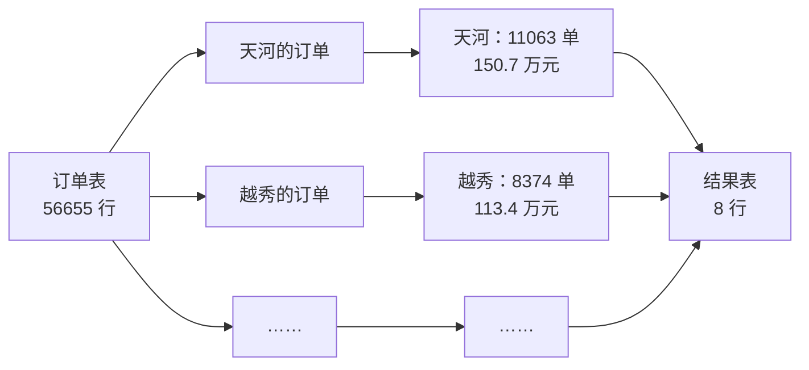
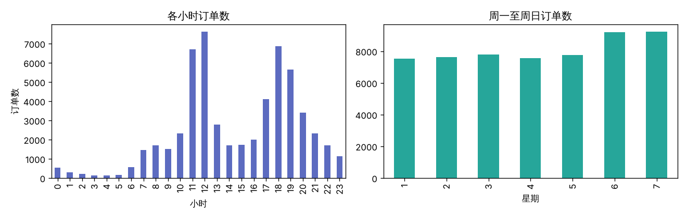
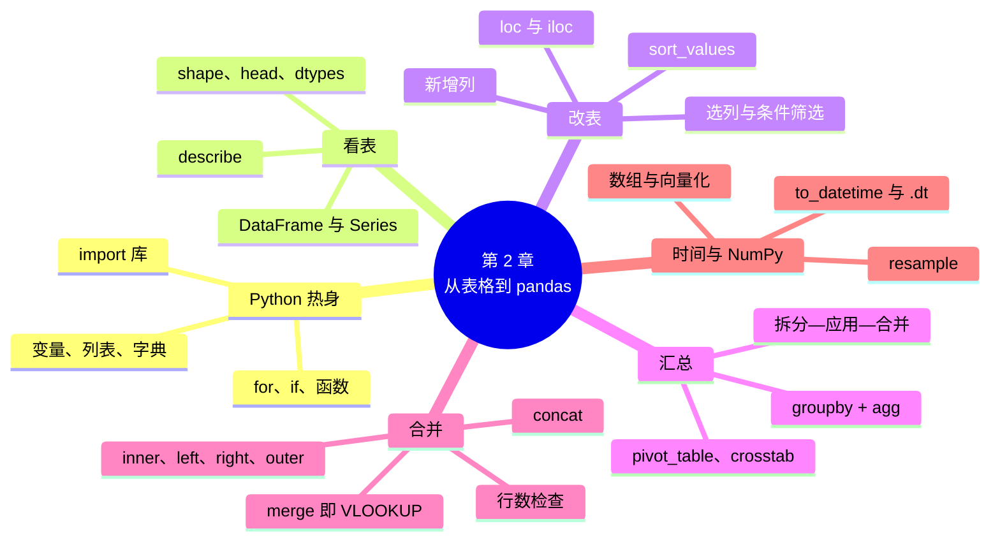

# 第 2 章 Python 数据处理入门：从表格到 pandas

!!! abstract "本章学时"
    理论 5 学时 · 实验 2 学时（本章共 3 个实验，教师可任选）

## 学习目标

学完本章，你应该能够：

1. **说出** DataFrame、Series、索引、数据类型的含义，以及 pandas 常用操作对应的 Excel 操作（记忆）；
2. **解释**分组统计“拆分—应用—合并”的过程，以及四种表格连接方式的区别（理解）；
3. **运行并修改**给定代码，完成读表、筛选、排序、新增列、分组统计、透视表和两表合并（应用）；
4. **运行并修改**给定代码，把文字形式的时间转换成日期时间，按月、按小时统计订单（应用）；
5. **判断**一次合并后行数变多是否正常，找出原因（分析）。

!!! info "先修要求"
    学习本章前，你需要：

    - 搭好实验环境，会运行 `.py` 程序或在 Jupyter 里运行代码（[实验 1-1](../01-overview/index.md#1-1)）；
    - 知道“食客说”四张表的字段，以及它们靠编号连在一起（[1.3.3 “食客说”的四张表](../01-overview/index.md#133)）；
    - 用过 Excel 或 WPS 表格的筛选、排序、分类汇总，会写简单的公式；
    - Python 的变量、列表、字典、函数忘了也没关系，2.1 节会快速复习，详细内容见[附录 A](../../appendix/a-python.md)。

??? abstract "本章概念清单（24 个，点击查看定义和例子）"
    1. [变量](../../appendix/glossary.md#g-变量)
    2. [列表](../../appendix/glossary.md#g-列表)
    3. [字典](../../appendix/glossary.md#g-字典)
    4. [函数](../../appendix/glossary.md#g-函数)
    5. [库](../../appendix/glossary.md#g-库)
    6. [DataFrame](../../appendix/glossary.md#g-DataFrame)
    7. [Series](../../appendix/glossary.md#g-Series)
    8. [索引](../../appendix/glossary.md#g-索引)
    9. [数据类型](../../appendix/glossary.md#g-数据类型)
    10. [条件筛选](../../appendix/glossary.md#g-条件筛选)
    11. [loc 与 iloc](../../appendix/glossary.md#g-loc-与-iloc)
    12. [分组聚合](../../appendix/glossary.md#g-分组聚合)
    13. [拆分-应用-合并](../../appendix/glossary.md#g-拆分-应用-合并)
    14. [透视表](../../appendix/glossary.md#g-透视表)
    15. [交叉表](../../appendix/glossary.md#g-交叉表)
    16. [合并](../../appendix/glossary.md#g-合并)
    17. [连接方式](../../appendix/glossary.md#g-连接方式)
    18. [拼接](../../appendix/glossary.md#g-拼接)
    19. [日期时间类型](../../appendix/glossary.md#g-日期时间类型)
    20. [重采样](../../appendix/glossary.md#g-重采样)
    21. [NumPy 数组](../../appendix/glossary.md#g-NumPy-数组)
    22. [形状](../../appendix/glossary.md#g-形状)
    23. [广播](../../appendix/glossary.md#g-广播)
    24. [向量化](../../appendix/glossary.md#g-向量化)

## 情景导入

小林每个月初都要给老板交一份“上月经营简报”：各城区的订单数和销售额、各菜系的客单价、哪个时段订单最多。以前他的做法是：从后台导出订单表，在 Excel 里用 VLOOKUP 从商家表查出每笔订单的城区，再插入数据透视表，调格式、复制到 Word 里，一套下来要一下午。有一次商家表更新了，他忘了重新 VLOOKUP，报上去的数字全错了。

技术部的同事看了以后说：“这些用 pandas 写十几行代码就行了，下个月换一份新数据，代码一个字都不用改，运行一下几秒钟就出来，还不会漏步骤。”小林心动了，但又担心：“我没学过编程，能学会吗？”

同事说：“你在 Excel 里会做的事，pandas 里都有对应的写法，而且名字都差不多。筛选就是筛选，排序就是排序，分类汇总叫 groupby，数据透视表就叫 pivot_table，VLOOKUP 叫 merge。你把它当成‘用打字代替点鼠标的 Excel’就行了。”本章就照着这个思路，把 Excel 里最常用的操作一样一样地换成 pandas 来做。

## 2.1 Python 热身：够用就好

本节只复习后面马上要用到的几样东西。每样都配一个“食客说”的例子，读懂就可以，不用背。

### 2.1.1 变量、列表和字典

[**变量**](../../appendix/glossary.md#g-变量 "给一个值起的名字，用 = 把值存进去，之后用名字取用"){ .term }就是给一个值起的名字，用 `=` 把值“装进”名字里，以后用名字就能取到这个值：

```python
shop_count = 300                  # 整数
avg_price = 85.5                  # 小数
city = "广州"                      # 文字（字符串），要用引号括起来
print(city, shop_count)           # 打印出：广州 300
```

[**列表**](../../appendix/glossary.md#g-列表 "Python 中按顺序存放多个值的容器，用方括号表示，从 0 开始编号"){ .term }用方括号把多个值按顺序放在一起，[**字典**](../../appendix/glossary.md#g-字典 "Python 中按“键—值”成对存放数据的容器，用花括号表示，通过键取值"){ .term }用花括号把“名字：值”成对地放在一起：

```python
districts = ["天河", "越秀", "海珠"]            # 列表：有顺序的一串值
print(districts[0])                            # 取第 1 个，打印“天河”（Python 从 0 开始数）
price = {"粤菜": 85, "快餐": 28}                # 字典：按名字查值
print(price["快餐"])                            # 打印 28
```

Python 从 0 开始数，`districts[0]` 是第一个，这是初学者最容易搞错的地方。

### 2.1.2 循环、判断和函数

`for` 让同样的几行代码对列表里的每一个值各做一次，`if` 让代码按条件选择做不做：

```python
for d in districts:               # 依次把“天河”“越秀”“海珠”装进变量 d
    if d == "天河":                # 两个等号表示“是否相等”
        print(d, "是商家最多的区")
    else:
        print(d)
```

注意 `for` 和 `if` 下面的行要**缩进**（往右空 4 格），Python 靠缩进判断哪些代码属于这个循环或判断。冒号、缩进是新手最常出错的两个地方。

[**函数**](../../appendix/glossary.md#g-函数 "把一段完成特定功能的代码打包起来、起个名字，用“名字(参数)”调用"){ .term }是把一段代码打包起来、起个名字，用的时候“调用”它。`print()`、`len()`（求长度）是 Python 自带的函数，我们也可以自己写：

```python
def actual_pay(amount, discount):   # 定义函数：输入订单金额和优惠，返回实付金额
    return amount - discount

print(actual_pay(64.9, 10))         # 调用函数，打印 54.9
```

### 2.1.3 库：别人写好的工具箱

Python 的强大在于有大量别人写好的[**库**](../../appendix/glossary.md#g-库 "别人写好、打包发布的一组功能代码，安装后用 import 导入使用，也叫包"){ .term }（也叫包），装好以后用 `import` 导入就能用。本书最常用的两个库是 pandas（处理表格）和 NumPy（处理数组），导入时习惯起个简称：

```python
import pandas as pd        # 以后写 pd 就代表 pandas
import numpy as np         # 以后写 np 就代表 numpy
```

库里的函数用“库名.函数名”调用，例如 `pd.read_csv(...)`。对着一张表或一列数据用的函数，写成“表.函数名”，例如 `orders.head()`，这种写法叫“方法”。看到 `.` 就理解为“的”：`orders.head()` 就是“订单表的前几行”。

!!! tip "本章代码怎么读"
    本章每段代码都标出了对应的 Excel 操作。读代码时先找这一行在 Excel 里相当于点了哪个按钮，再看括号里填了什么参数。

## 2.2 从 Excel 到 pandas

### 2.2.1 DataFrame 就是一张表

pandas 里最重要的东西叫 [**DataFrame**](../../appendix/glossary.md#g-DataFrame "pandas 中的二维表格，有行索引和列名，相当于 Excel 的一个工作表"){ .term }，它就是一张二维表格，和 Excel 的一个工作表几乎一样：有行、有列，每一列有一个列名。DataFrame 中的一列叫 [**Series**](../../appendix/glossary.md#g-Series "pandas 中带索引的一列数据，DataFrame 的每一列都是一个 Series"){ .term }，可以理解为“带名字的一列数”。

| Excel 里 | pandas 里 | 例子 |
|---|---|---|
| 一个工作表 | DataFrame | `orders` |
| 一列 | Series | `orders["实付金额"]` |
| 行号（1、2、3……） | 索引 | `0, 1, 2, ...` |
| 列标题 | 列名 | `"实付金额"` |
| 单元格的格式（数字、文本、日期） | 数据类型 | `float64`、`str`、`datetime64` |

每一行左边那个编号叫[**索引**](../../appendix/glossary.md#g-索引 "DataFrame 或 Series 中用来标识和定位行的标签，默认是 0、1、2……"){ .term }，默认从 0 开始。索引就像 Excel 的行号，用来定位行。

### 2.2.2 读表和看表

打开一个 Excel 文件，你首先会看看有多少行、多少列、前几行长什么样、每列是什么格式。pandas 里对应的写法是：

```python
orders = pd.read_csv("../data/orders.csv")   # 打开文件（Excel：文件 → 打开）
print(orders.shape)                          # 几行几列：(56655, 12)
print(orders.head(3))                        # 前 3 行（Excel：看最上面几行）
print(orders.dtypes)                         # 每一列的数据类型（Excel：单元格格式）
```

`read_csv` 读 CSV 文件，`read_excel` 读 Excel 文件，用法差不多，第 3 章细讲。运行结果中每一列的[**数据类型**](../../appendix/glossary.md#g-数据类型 "一列数据的存储类型，决定了能对它做哪些运算"){ .term }（dtype）很重要：`int64` 是整数，`float64` 是小数，`str` 是文字，`datetime64` 是日期时间。数据类型不对，后面的计算就会出错，例如“下单时间”读进来是 `str`（文字），不能直接取出月份，要先转换（2.6 节）。

### 2.2.3 一行看完整列：描述统计

Excel 里要分别对一列写 `=AVERAGE()`、`=MAX()`、`=MIN()` 等公式，pandas 一行 `describe()` 全部算出来：

```python
print(orders[["实付金额", "配送距离", "送达时长"]].describe().round(1))
```

```text
          实付金额     配送距离     送达时长
count  56655.0  56655.0  56655.0
mean     133.2      2.4     28.3
std      120.7      1.6      8.3
min        6.2      0.2      8.0
25%       51.1      1.2     22.0
50%       93.6      2.1     28.0
75%      175.7      3.2     34.0
max     1288.4     12.0     71.0
```

`count` 是个数，`mean` 是平均值，`std` 是标准差（数据的分散程度），`min`、`max` 是最小、最大值，`25%`、`50%`、`75%` 是把数据从小到大排好后处在这些位置上的数，其中 `50%` 就是中位数。这些统计量第 7 章会详细讲，现在只要会读：平均每单实付 133.2 元，一半订单在 93.6 元以下；平均送达时长 28.3 分钟，最长 71 分钟。`.round(1)` 是保留一位小数。

## 2.3 选行选列、筛选、排序、新增列

### 2.3.1 选列

取一列用一对方括号，取多列用两对方括号（里面那对是列表）：

```python
orders["实付金额"]                          # 取一列，得到 Series
orders[["order_id", "实付金额"]]            # 取两列，得到 DataFrame
```

### 2.3.2 条件筛选

Excel 的“筛选”是点下拉箭头勾选条件，pandas 是在方括号里写条件，这叫[**条件筛选**](../../appendix/glossary.md#g-条件筛选 "用一个或多个条件选出满足条件的行，多个条件用 &（并且）、\"){ .term }。比如找出“雨天、送达时长超过 45 分钟”的订单：

```python
slow_rain = orders[(orders["天气"] == "雨") & (orders["送达时长"] > 45)]
print(len(slow_rain))          # 804
```

拆开来读：`orders["天气"] == "雨"` 对每一行判断“天气是不是雨”，得到一列“是 / 否”（`True` / `False`）；`orders["送达时长"] > 45` 也得到一列“是 / 否”；`&` 表示“并且”，两个条件都满足的行留下。几个要点：

- “等于”要写两个等号 `==`，一个等号是赋值；
- “并且”用 `&`，“或者”用 `|`，每个条件**都要用圆括号括起来**；
- 想筛选“城区是天河或越秀”，可以写 `orders["城区"].isin(["天河", "越秀"])`，`isin` 是“在这个名单里”。

### 2.3.3 按位置或按标签选：loc 与 iloc

有时候要同时指定行和列，就用 [**loc 与 iloc**](../../appendix/glossary.md#g-loc-与-iloc "pandas 选取行列的两种方式：loc 按标签（索引和列名）选，iloc 按位置（第几行第几列）选"){ .term }。`loc` 按“名字”选（行用索引、列用列名），`iloc` 按“第几个”选（都从 0 开始）：

```python
orders.loc[0:2, ["order_id", "实付金额"]]      # 索引 0 到 2 的行，这两列
orders.iloc[0:3, 0:2]                          # 第 1～3 行，第 1～2 列
orders.loc[orders["送达时长"] > 60, "order_id"] # 送达超过 60 分钟的订单号
```

初学阶段，会用方括号选列、筛选就够了，`loc` 和 `iloc` 能读懂即可。

### 2.3.4 排序

Excel 里点“排序”选列、选升序降序；pandas 用 `sort_values`，`ascending=False` 表示降序（从大到小）：

```python
top5 = orders.sort_values("实付金额", ascending=False).head(5)
```

这一行先排序，再取前 5 行，两个操作用 `.` 连在一起，从左往右读就行：“订单表，按实付金额降序排，取前 5 行”。

### 2.3.5 新增列

Excel 里新建一列、写公式、往下拖；pandas 里直接给新列名赋值，整列一次算完：

```python
orders["人均实付"] = (orders["实付金额"] / orders["就餐人数"]).round(1)
orders["优惠比例"] = (orders["优惠金额"] / orders["订单金额"]).round(3)
```

不用写循环，也不用往下拖，5 万多行一次算完。这种“整列一起算”的写法就是 2.7 节要讲的向量化。

下表把本节的操作和 Excel 对照一下：

| 想做的事 | Excel | pandas |
|---|---|---|
| 打开文件 | 文件 → 打开 | `pd.read_csv("文件名")` |
| 看前几行 | 看最上面 | `df.head()` |
| 几行几列 | 看行号和列号 | `df.shape` |
| 求平均、最大、最小 | `=AVERAGE()` 等公式 | `df.describe()`、`df["列"].mean()` |
| 筛选 | 数据 → 筛选 | `df[条件]` |
| 排序 | 数据 → 排序 | `df.sort_values("列")` |
| 新增一列 | 插入列、写公式、往下拖 | `df["新列"] = 计算式` |
| 另存为 | 文件 → 另存为 | `df.to_csv("文件名", index=False, encoding="utf-8-sig")` |

## 2.4 分组统计与透视表

### 2.4.1 分组统计：pandas 版的“分类汇总”

“各城区的订单数和销售额”这类问题，Excel 里用“分类汇总”或数据透视表，pandas 里用 `groupby`，叫作[**分组聚合**](../../appendix/glossary.md#g-分组聚合 "按某一列的取值把数据分成若干组，对每组分别计算汇总值"){ .term }：

```python
by_district = df.groupby("城区").agg(
    订单数=("order_id", "count"),       # 新列名=("对哪一列", "怎么算")
    销售额=("实付金额", "sum"),
    客单价=("实付金额", "mean"),
)
```

`groupby("城区")` 是“按城区分组”，`agg(...)` 是“每组算什么”。括号里每一行的意思是：新的一列叫“订单数”，它是对 `order_id` 列做 `count`（计数）。常用的计算方式有 `count`（个数）、`nunique`（去重后的个数）、`sum`（求和）、`mean`（平均）、`median`（中位数）、`max`、`min`。

分组统计的过程可以拆成三步，叫作[**拆分-应用-合并**](../../appendix/glossary.md#g-拆分-应用-合并 "分组聚合的三个步骤：按类别拆成小表，对每张小表计算，再把结果合成一张表"){ .term }（split-apply-combine）：

1. **拆分**：按城区把 5 万多笔订单拆成 8 堆；
2. **应用**：对每一堆分别计算订单数、销售额、平均值；
3. [**合并**](../../appendix/glossary.md#g-合并 "按一个或多个共同的列（键），把两张表横向连接成一张表，相当于 Excel 的 VLOOKUP"){ .term }：把 8 个结果拼成一张新表，每个城区一行。



<iframe class="sim-frame" src="../../sims/split-apply-combine/main.html" height="560" loading="lazy" title="拆分—应用—合并"></iframe>
动画：拆分—应用—合并。选择分组的列和计算方式，一步一步看一张小订单表怎样被拆开、计算、再合成结果表。[全屏打开](../../sims/split-apply-combine/main.html){ target=_blank }
{ .sim-caption }

!!! cert "证书考点 · Python 技术应用工程师（中级）· 数据处理"
    数据处理部分要求会用 pandas 读取数据、筛选、排序、分组统计。常考：`groupby` 后接 `count`、`sum`、`mean` 的结果是什么样；`count` 和 `nunique` 的区别；筛选条件中 `&`、`|` 两边要加括号。容易错在把 `==` 写成 `=`，以及忘了多列要用两对方括号。

### 2.4.2 透视表

Excel 的数据透视表能把一个类别放在行、另一个类别放在列，格子里放统计值。pandas 的 [**透视表**](../../appendix/glossary.md#g-透视表 "把一个类别放在行、另一个类别放在列，格子里放汇总值的二维汇总表"){ .term }`pivot_table` 用法几乎一样，四个参数对应透视表的四个区域：

```python
pivot = pd.pivot_table(df, index="菜系",          # 行区域
                       columns="配送方式",          # 列区域
                       values="送达时长",            # 值区域
                       aggfunc="mean")              # 值的汇总方式：平均
```

```text
配送方式  商家自送  平台专送
菜系
川菜    31.1  27.0
快餐    31.4  27.0
日料    32.2  26.7
……
```

一眼就能看出：不管什么菜系，平台专送都比商家自送快 4 分钟左右。如果只想数个数，可以用[**交叉表**](../../appendix/glossary.md#g-交叉表 "统计两个类别变量各种组合出现次数的表格"){ .term }，例如 `pd.crosstab(orders["天气"], orders["配送方式"])` 统计晴天和雨天各种配送方式各有多少单。

!!! warning "pivot_table 的默认汇总方式是平均值"
    Excel 数据透视表对数字默认求和，pandas 的 `pivot_table` 默认求平均。想要求和，一定要写 `aggfunc="sum"`。

## 2.5 两张表合并：pandas 版的 VLOOKUP

### 2.5.1 merge 就是 VLOOKUP

订单表里只有 `shop_id`，没有城区和菜系，要按城区统计，就得先从商家表里把城区“查”过来。Excel 用 VLOOKUP，pandas 用 `merge`，这个操作叫**合并**（也叫连接）：

```python
df = orders.merge(shops[["shop_id", "城区", "菜系"]], on="shop_id", how="left")
print("合并前", orders.shape, "合并后", df.shape)   # 合并前 (56655, 12) 合并后 (56655, 14)
```

读法：“订单表，按 `shop_id` 去商家表里找，把城区和菜系两列带过来”。`on="shop_id"` 是两张表共同的那一列，相当于 VLOOKUP 的“查找值”；`shops[["shop_id", "城区", "菜系"]]` 只取需要的列，避免把无关的列都带过来。合并后行数不变、多了两列，说明每笔订单都找到了唯一的商家。

和 VLOOKUP 相比，merge 一次能带回很多列，不用担心“列号数错了”，也不要求查找列在最左边。

### 2.5.2 四种连接方式

`how` 参数决定两张表对不上的行怎么处理，叫[**连接方式**](../../appendix/glossary.md#g-连接方式 "合并两张表时对“对不上”的行的处理方式，有 inner、left、right、outer 四种"){ .term }。用一个小例子看最清楚：左表有 S1、S2、S3 三家店的订单数，右表有 S1、S2、S4 三家店的城区。

| how | 留下哪些行 | 结果 |
|---|---|---|
| `inner`（内连接） | 两边都有的 | S1、S2 |
| `left`（左连接） | 左表的全部 | S1、S2、S3（S3 的城区为空） |
| `right`（右连接） | 右表的全部 | S1、S2、S4（S4 的订单数为空） |
| `outer`（外连接） | 两边的全部 | S1、S2、S3、S4 |

对不上的地方 pandas 会填上 `NaN`，表示“空值”（Not a Number），相当于 Excel 里 VLOOKUP 返回的 `#N/A`。业务中最常用的是 `left`：以订单表为主，商家表能查到就带过来，查不到就空着，这样订单一笔都不会丢。

<iframe class="sim-frame" src="../../sims/join-types/main.html" height="520" loading="lazy" title="四种连接方式"></iframe>
动画：四种连接方式。切换 inner、left、right、outer，看结果表里哪些行留下、哪些格子变成空值。[全屏打开](../../sims/join-types/main.html){ target=_blank }
{ .sim-caption }

### 2.5.3 合并后行数变多了？

合并时最常见的坑是：**合并后的行数比原来多了**。原因是右表中用来匹配的那一列有重复值。比如商家表里 S0001 不小心录了两遍，那么 S0001 的每一笔订单都会匹配到两行，结果就翻倍了，销售额也跟着虚增。

所以每次合并完，都要像实验 2-2 那样打印一下“合并前、合并后”的行数。以订单表为左表、做 `left` 合并时，正常情况下行数应该不变；如果变多了，就去检查右表的匹配列有没有重复：

```python
print(shops["shop_id"].duplicated().sum())    # 有几个重复的 shop_id，正常应为 0
```

不过，行数变多不一定都是错。比如用商家表去合并订单表，一家店对应很多笔订单，这叫“一对多”，结果行数等于订单数，这是正常的。关键是要清楚自己想要的是“一行一笔订单”还是“一行一家店”。

### 2.5.4 上下拼接

还有一种“合并”是把结构相同的几张表上下摞起来，比如 1 月、2 月、3 月的订单分别导出成三个文件，要拼成一张，这叫[**拼接**](../../appendix/glossary.md#g-拼接 "把结构相同的多张表上下首尾相接（或左右并排）成一张表"){ .term }，用 `pd.concat`：

```python
all_orders = pd.concat([jan, feb, mar], ignore_index=True)   # 上下拼接，重新编索引
```

## 2.6 日期和时间

### 2.6.1 把文字转换成日期时间

订单表的“下单时间”读进来是 `str` 类型，在计算机看来它只是一串字，不知道“2025-01-01 00:58:19”是哪年哪月。要先用 `pd.to_datetime` 把它转换成[**日期时间类型**](../../appendix/glossary.md#g-日期时间类型 "pandas 中表示日期和时间的数据类型，可以直接取出年、月、星期、小时，也能相减算间隔"){ .term }，才能做和时间有关的计算：

```python
df["下单时间"] = pd.to_datetime(df["下单时间"])   # 转换类型
df["月份"] = df["下单时间"].dt.month              # 取出月份
df["小时"] = df["下单时间"].dt.hour               # 取出小时
df["星期"] = df["下单时间"].dt.day_of_week + 1    # 星期几（星期一是 0，所以加 1）
```

`.dt` 后面可以接 `year`（年）、`month`（月）、`day`（日）、`hour`（时）、`day_of_week`（星期几）等。也可以在读表时就转换：`pd.read_csv("orders.csv", parse_dates=["下单时间"])`。

### 2.6.2 按天、按月汇总

取出月份以后，就可以按月份分组统计了。实验 2-2 的结果显示，2 月只有 2887 单，是全年最少的月份，12 月有 5965 单，是最多的，差了一倍多：

```text
     订单数       销售额
月份
1   4075  538728.0
2   2887  394235.0
……
11  5649  767265.0
12  5965  782868.0
```

2 月少是因为春节期间很多人回老家，平台全年订单在增长，年底最多。这就是 1.3.2 节说的时间序列数据的“季节”和“趋势”。

另一种按时间汇总的方法是[**重采样**](../../appendix/glossary.md#g-重采样 "把时间序列按新的时间频率重新分组汇总，例如把每笔订单汇总成每天、每周、每月"){ .term }（resample），它把时间看成一条轴，按“每天”“每月”切段统计：

```python
daily = orders.set_index("下单时间").resample("D")["order_id"].count()   # 每天多少单
```

`set_index("下单时间")` 把下单时间设为索引，`resample("D")` 按天切段，`"MS"` 是按月，`"W"` 是按周。实验 2-3 用它算出：全年平均每天 155.2 单，最多的一天是 2025 年 11 月 16 日，234 单。

## 2.7 NumPy 一瞥：为什么整列一起算更快

### 2.7.1 数组

pandas 的底层是 NumPy。NumPy 的核心是 [**NumPy 数组**](../../appendix/glossary.md#g-NumPy-数组 "NumPy 库提供的同一类型数值组成的多维数组，计算速度很快，pandas 的底层就是它"){ .term }，一种存放同一类型数字的“格子串”，和列表很像，但可以直接整体做运算：

```python
a = np.array([30, 45, 60])      # 三个订单的金额
print(a * 0.9)                  # 打九折：[27.  40.5 54. ]
print(a + np.array([1, 2, 3]))  # 对应位置相加：[31 47 63]
print(a.shape, a.dtype)         # 形状 (3,)，类型 int64
```

`a * 0.9` 让数组里每个数都乘 0.9，不用写循环。一个数和一个数组运算，这个数会自动“铺开”到每个位置，这叫[**广播**](../../appendix/glossary.md#g-广播 "形状不同的数组做运算时，自动把较小的数组扩展成相同形状再逐个计算的规则"){ .term }。数组的[**形状**](../../appendix/glossary.md#g-形状 "数组或表格在各个维度上的大小"){ .term }（shape）告诉你它有几行几列，`(3,)` 表示一维、3 个数。

### 2.7.2 向量化：快几十倍

对整个数组（或整列）一次性做运算，叫作[**向量化**](../../appendix/glossary.md#g-向量化 "对整列或整个数组一次性做运算，代替逐个元素写循环，代码更短、速度快几十到上百倍"){ .term }。它和“写一个循环、一个一个地算”结果一样，但快得多。演示程序 `labs/ch02/demo_vectorize.py` 分别用两种方法计算 5 万多笔订单的实付金额：

```text
订单数： 56655
循环用时：23.3 毫秒
向量化用时：0.36 毫秒
两种方法结果一致： True
```

向量化快了六十多倍（你电脑上的时间会不一样，但差距大致相同）。原因是循环每算一个数都要经过 Python 解释器“翻译”一遍，而向量化运算是交给 NumPy 底层用 C 语言写好的程序一次性完成的。数据量到几百万行时，这个差别就是“几秒钟”和“几分钟”的区别。

所以用 pandas 时有一条经验：**能整列算的，就不要写循环**。2.3.5 节新增列的写法就是向量化。

## 2.8 前沿视窗

**用中文“说”出 pandas 代码。** 2023 年以来，大模型写代码的能力突飞猛进。把“统计每个城区雨天的平均送达时长，按从高到低排序”这样一句中文发给 DeepSeek、通义千问等大模型，它通常能直接给出正确的 pandas 代码。一些数据分析产品更进一步，让用户直接用中文提问，由大模型在后台写代码、运行、出图。这并不意味着不用学 pandas 了，恰恰相反：你要能**读懂**它写的代码，才能判断它是不是理解错了你的意思（实验 1-3 就是一个例子）。本章学的这些操作，正好是大模型最常写出来的代码。

**pandas 3.0 的变化。** pandas 是数据分析领域使用最广的库，由 Wes McKinney 在 2008 年开始开发。<sup class="cite">[[1]](#ref2-1)</sup> 2026 年发布的 pandas 3.0 有两个初学者能感受到的变化：一是文字列默认显示为 `str` 类型，以前是 `object`；二是全面采用“写时复制”（Copy-on-Write），从一张表里取出一部分再修改，不会再悄悄改动原表，也不会再弹出让很多人困惑的 `SettingWithCopyWarning` 警告。<sup class="cite">[[2]](#ref2-2)</sup> 网上很多旧教程是按 pandas 1.x、2.x 写的，遇到个别写法不一样时，以官方文档为准。

**更快的新工具。** 数据量到了几千万行，pandas 会变慢、占内存。近几年出现了 Polars、DuckDB 等新工具，它们能利用多核 CPU 并行计算，速度快很多，写法也和 pandas 相近。<sup class="cite">[[3]](#ref2-3)</sup><sup class="cite">[[4]](#ref2-4)</sup> 对本课程来说 pandas 完全够用，知道有这些工具，以后遇到大数据时知道往哪里找就行。真正的海量数据要用 Spark 等分布式工具，见“大数据技术处理技术”课程。

## 本章实验

!!! abstract "实验总览"
    | 实验 | 类型 | 建议时长 | 内容 |
    |---|---|---|---|
    | 实验 2-1 | ★ 基础 | 45 分钟 | 用 pandas 做一遍 Excel 里做过的事：读表、筛选、排序、新增列 |
    | 实验 2-2 | ★ 基础 | 45 分钟 | 订单表关联商家表，按城区、菜系、月份统计 |
    | 实验 2-3 | ☆ 拓展 | 60 分钟 | 按小时、星期统计订单，找出订单高峰 |

    代码见配套资源 `labs/ch02/` 目录。

### 实验 2-1 ★ 用 pandas 做一遍 Excel 里做过的事

**实验目的**

1. 会用 pandas 读表、看表、做描述统计；
2. 会写筛选条件、排序、新增列，并把结果保存成 Excel 能打开的文件；
3. 每做一步，能说出它对应的 Excel 操作。

**实验环境**：本机 CPU。

**实验数据**：`labs/data/orders.csv`，“食客说”2025 年全部订单，56655 行。

**实验步骤与代码**

第 1 步，读表、看表，见 2.2.2 节。

第 2 步，对三个数值列做描述统计，见 2.2.3 节。

第 3 步，筛选出雨天、送达时长超过 45 分钟的订单：

```python
slow_rain = orders[(orders["天气"] == "雨") & (orders["送达时长"] > 45)]
print("雨天且超过 45 分钟的订单：", len(slow_rain), "单")
```

第 4 步，按实付金额从高到低排序，取前 5 单：

```python
top5 = orders.sort_values("实付金额", ascending=False).head(5)
print(top5[["order_id", "下单时间", "就餐人数", "实付金额"]])
```

第 5 步，新增“人均实付”和“优惠比例”两列，见 2.3.5 节。

第 6 步，把筛选结果保存下来：

```python
slow_rain.to_csv("雨天慢单.csv", index=False, encoding="utf-8-sig")
```

`index=False` 表示不把索引存进去，`encoding="utf-8-sig"` 保证 Excel 打开时中文不乱码。完整代码见 `labs/ch02/lab2_1_excel_to_pandas.py`。

**运行结果**

```text
行数和列数： (56655, 12)
……（描述统计见 2.2.3 节）
雨天且超过 45 分钟的订单： 804 单
      order_id                 下单时间  就餐人数    实付金额
46329  O046330  2025-11-08 08:34:04     4  1288.4
53298  O053299  2025-12-14 15:53:08     4  1179.7
19431  O019432  2025-05-30 14:24:40     4  1159.4
11662  O011663  2025-04-06 09:58:54     4  1128.9
992    O000993  2025-01-08 17:59:58     4  1087.4
  order_id   实付金额  就餐人数  人均实付   优惠比例
0  O000001  199.1     4  49.8  0.000
1  O000002   38.6     2  19.3  0.301
2  O000003  134.0     3  44.7  0.000
已保存 雨天慢单.csv
```

排序结果最左边的一列是索引（原来的行号），说明这几单在原表中的位置。金额最高的 5 单都是 4 个人就餐。

**实验记录表**

| 操作 | 对应的 Excel 操作 | 你的结果 |
|---|---|---|
| `orders.shape` | | |
| 雨天且超过 45 分钟的订单数 | | |
| 改成“晴天且超过 45 分钟”，有多少单？ | | |
| 实付金额最高的一单是哪天下的？ | | |
| 用 Excel 打开 `雨天慢单.csv`，行数和程序打印的一致吗？ | | |

**常见问题排查**

| 现象 | 原因 | 解决办法 |
|---|---|---|
| `TypeError: unsupported operand type(s) for &` | 筛选的两个条件没有加圆括号 | 每个条件都用 `( )` 括起来 |
| `ValueError: The truth value of a Series is ambiguous` | 用了 `and` / `or` | pandas 里要用 `&` / `|` |
| 筛选结果是 0 行 | 等号写成了一个，或者文字没加引号、有空格 | 写成 `== "雨"`，检查引号里有没有多余空格 |
| 打印的表格中间出现省略号 `...` | 列太多，pandas 默认省略中间的列 | 加一行 `pd.set_option("display.max_columns", None)` |

**思考与练习**

1. 把筛选条件改成“商家自送或者配送距离超过 5 公里”，应该怎么写？有多少单？
2. 优惠比例为 0 的订单占多少？（提示：`(orders["优惠比例"] == 0).mean()`，`True` 当作 1、`False` 当作 0，求平均就是比例。）

**实验报告要求**

提交运行结果截图和实验记录表，并完成两道思考题，写出你修改后的代码。

### 实验 2-2 ★ 订单数据的合并与分组统计

**实验目的**

1. 会用 `merge` 把两张表按编号合并，并检查合并前后的行数；
2. 会用 `groupby` + `agg` 做分组统计，用 `pivot_table` 做透视表；
3. 会把文字转换成日期时间，按月份统计。

**实验环境**：本机 CPU。

**实验数据**：`orders.csv`、`shops.csv`。

**实验步骤与代码**

第 1 步，给每笔订单查出商家的城区和菜系（2.5.1 节）。第 2 步，按城区统计订单数、销售额和客单价（2.4.1 节），按销售额从高到低排序。第 3 步，做“菜系 × 配送方式”的平均送达时长透视表（2.4.2 节）。第 4 步，转换日期，按月统计（2.6 节）：

```python
df["下单时间"] = pd.to_datetime(df["下单时间"])
df["月份"] = df["下单时间"].dt.month
by_month = df.groupby("月份").agg(订单数=("order_id", "count"), 销售额=("实付金额", "sum")).round(0)
print(by_month)
```

完整代码见 `labs/ch02/lab2_2_merge_groupby.py`。

**运行结果**

```text
合并前 (56655, 12) 合并后 (56655, 14)
      订单数        销售额    客单价
城区
天河  11063  1507118.0  136.2
番禺   8211  1198036.4  145.9
越秀   8374  1134487.6  135.5
海珠   8127  1060152.2  130.4
白云   7569   957013.8  126.4
荔湾   5353   703365.7  131.4
黄埔   4642   539339.0  116.2
花都   3316   444950.7  134.2
（透视表见 2.4.2 节）
     订单数       销售额
月份
1   4075  538728.0
2   2887  394235.0
3   4011  539075.0
4   4148  542957.0
5   4557  609766.0
6   4769  639707.0
7   5143  693328.0
8   5445  723045.0
9   4874  644936.0
10  5132  668555.0
11  5649  767265.0
12  5965  782868.0
```

读结果：天河区销售额最高，150.7 万元；番禺区订单数比越秀少，但客单价最高（145.9 元），所以销售额反超越秀。黄埔区客单价最低。月份上，2 月最少、12 月最多。

**实验记录表**

| 问题 | 你的结果 |
|---|---|
| 合并前后行数是否一致？说明了什么？ | |
| 把 `groupby("城区")` 改成 `groupby("菜系")`，客单价最高和最低的菜系是？ | |
| 透视表中，平台专送平均比商家自送快几分钟？ | |
| 全年销售额最高和最低的月份，相差多少元？ | |

**常见问题排查**

| 现象 | 原因 | 解决办法 |
|---|---|---|
| `KeyError: '城区'` | 订单表本身没有城区，合并那一行没运行或写错 | 先运行合并，打印 `df.columns` 检查 |
| 合并后多了 `城区_x`、`城区_y` | 两张表都有“城区”列 | 合并前只从右表取需要的列 |
| `.dt` 报错 `Can only use .dt accessor with datetimelike values` | “下单时间”还是文字 | 先 `pd.to_datetime` 转换 |
| 透视表的数字比预期大很多倍 | 想求平均却求了和，或反过来 | 检查 `aggfunc` |

**思考与练习**

1. 统计每个菜系“有多少位不同的用户下过单”，应该怎么改 `agg` 里的写法？
2. 做一个透视表：行是城区，列是天气，值是平均送达时长。雨天比晴天平均慢多少？

**实验报告要求**

提交运行结果截图、实验记录表和思考题代码。用两三句话写一段“经营简报”：哪个城区卖得最好、客单价最高，订单最少的是哪个月，你认为原因是什么。

### 实验 2-3 ☆ 找出订单高峰

**实验目的**

1. 会从日期时间中取出小时、星期几；
2. 会用 `crosstab` 做交叉表、用 `resample` 按天汇总；
3. 根据统计结果给出骑手排班的建议。

**实验环境**：本机 CPU。

**实验数据**：`orders.csv`。

**实验步骤与代码**

```python
orders = pd.read_csv("../data/orders.csv", parse_dates=["下单时间"])   # 读入时直接转成日期时间
orders["小时"] = orders["下单时间"].dt.hour
orders["星期"] = orders["下单时间"].dt.day_of_week + 1               # 星期一 = 1
by_hour = orders.groupby("小时")["order_id"].count()                 # 每个小时多少单
by_week = orders.groupby("星期")["order_id"].count()                 # 星期几多少单
table = pd.crosstab(orders["星期"], orders["小时"])                   # 星期 × 小时 交叉表
daily = orders.set_index("下单时间").resample("D")["order_id"].count()  # 每天多少单
```

`groupby("小时")["order_id"].count()` 是 `agg` 的简写，只对一列做一种计算时这样写更短。最后把小时和星期的统计画成两张柱状图。这个实验要求你**先自己试着写**每一步，写不出来再看完整代码 `labs/ch02/lab2_3_peak_hours.py`。

**运行结果**

```text
订单最多的 3 个小时：
小时
12    7606
18    6865
11    6695
每个星期几的订单数：
星期
1    7519
2    7609
3    7804
4    7569
5    7749
6    9191
7    9214
周六 12 点的订单数： 1291 ；周三 12 点： 1005
全年平均每天 155.2 单；最多的一天 2025-11-16 234 单
```



午餐（11～12 点）和晚餐（18～19 点）是两个高峰，12 点最多；周六、周日每天的订单比工作日多约 20%。

**实验记录表**

| 问题 | 你的结果 |
|---|---|
| 订单最多的 3 个小时 | |
| 订单最少的小时 | |
| 周末比工作日平均每天多多少单？ | |
| 你建议在哪些时段多排骑手？ | |

**常见问题排查**

| 现象 | 原因 | 解决办法 |
|---|---|---|
| `resample` 报错 `Only valid with DatetimeIndex` | 没有先 `set_index("下单时间")` | 按示例先设索引 |
| 星期几的数字和日历对不上 | `day_of_week` 中星期一是 0 | 加 1，或者用 `.dt.day_name()` 得到英文星期名 |
| 旧版 pandas 报 `day_of_week` 不存在 | 版本太老 | 用 `dayofweek`，或升级 pandas |

**思考与练习**

1. 用 `table.loc[6, 12]` 取出了周六 12 点的订单数。怎样取出周日 18 点的？
2. 把 `resample("D")` 改成 `resample("W")`，结果代表什么？

**实验报告要求**

提交两张柱状图、实验记录表，以及一段 100 字左右的骑手排班建议。

## 本章小结

- pandas 可以看作“用打字代替点鼠标的 Excel”。**DataFrame** 是一张表，**Series** 是一列，**索引**相当于行号，每列有自己的**数据类型**。
- 读表用 `read_csv`，看表用 `shape`、`head`、`dtypes`、`describe`；选列用方括号，**条件筛选**用 `df[条件]`，多个条件用 `&`、`|` 并加括号；排序用 `sort_values`；新增列直接赋值。
- **分组聚合**用 `groupby` + `agg`，过程是**拆分—应用—合并**；**透视表**用 `pivot_table`（默认求平均），**交叉表**用 `crosstab`。
- **合并**用 `merge`，相当于 VLOOKUP；四种**连接方式**中业务最常用 `left`；合并后要检查行数，行数变多多半是右表匹配列有重复。上下摞表用 `concat` **拼接**。
- 文字时间要用 `to_datetime` 转换成**日期时间类型**，再用 `.dt` 取出月份、小时、星期；**重采样** `resample` 按天、周、月汇总。
- NumPy **数组**可以整体运算，**向量化**比写循环快几十倍；能整列算就不写循环。



**下一章预告**

本章的数据都是整整齐齐的 CSV 文件，但现实中的数据可没这么听话：有的是 GBK 编码的 CSV，一打开全是乱码；有的藏在 Excel 的好几个工作表里；有的在数据库里，要写 SQL 才能取出来；有的要通过网络接口一页一页地下载。下一章就去这些地方把数据“采集”回来。

## 参考文献

正文中的上标编号（如<sup class="cite">[[1]](#ref2-1)</sup>）对应下面的文献。带链接的可以直接打开；书籍可在图书馆或电子书平台查阅。

<div class="refs" markdown>

**教材与专著**

- <span id="ref2-1"></span>[1] MCKINNEY W. Python for data analysis: data wrangling with pandas, NumPy, and Jupyter[M]. 3rd ed. Sebastopol: O'Reilly Media, 2022.
    <span class="ref-note">pandas 作者编写，第 5、8、10、11 章分别讲 pandas 入门、合并与重塑、分组聚合、时间序列，对应本章 2.2～2.6 节。</span>
- <span id="ref2-5"></span>[5] HARRIS C R, MILLMAN K J, VAN DER WALT S J, et al. Array programming with NumPy[J]. Nature, 2020, 585(7825): 357-362.
    <span class="ref-note">NumPy 的论文，介绍数组、向量化和广播的设计，对应 2.7 节。</span>

**在线资源与数据**

- <span id="ref2-2"></span>[2] pandas development team. What's new in 3.0.0[EB/OL]. [2026-10-31]. https://pandas.pydata.org/docs/whatsnew/v3.0.0.html.
    <span class="ref-note">pandas 3.0 的更新说明，包括默认字符串类型和写时复制，对应 2.8 节。</span>
- <span id="ref2-3"></span>[3] Polars. Polars user guide[EB/OL]. [2026-10-31]. https://docs.pola.rs/.
    <span class="ref-note">Polars 的官方文档，对应 2.8 节。</span>
- <span id="ref2-4"></span>[4] DuckDB Foundation. DuckDB documentation[EB/OL]. [2026-10-31]. https://duckdb.org/docs/.
    <span class="ref-note">DuckDB 的官方文档，对应 2.8 节。</span>
- <span id="ref2-6"></span>[6] pandas development team. Comparison with spreadsheets[EB/OL]. [2026-10-31]. https://pandas.pydata.org/docs/getting_started/comparison/comparison_with_spreadsheets.html.
    <span class="ref-note">pandas 官方文档中“和电子表格对比”一节，逐项对照 Excel 操作与 pandas 写法，是本章写法的主要依据，对应 2.3～2.5 节。</span>

</div>

## 课后练习

选择题和判断题可以直接点击选项作答，系统会马上告诉你对错，并展开答案与解析；多选题选好后点“提交答案”。简答和实操题请先自己作答，再点开“答案与解析”核对。每道题的解析下方都有“回看”链接，做错了可以直接跳回正文复习。

**一、单项选择题**

<div class="quiz" data-answer="B" markdown>

**1.** `districts = ["天河", "越秀", "海珠"]`，`districts[1]` 的值是（　　）。

- A. 天河
- B. 越秀
- C. 海珠
- D. 报错

</div>

??? tip "答案与解析"
    **答案：B**

    Python 从 0 开始数，`[0]` 是天河，`[1]` 是越秀。

    考查：列表 · 认知层次：应用 · [回看 2.1.1](#211)
    { .quiz-meta }

<div class="quiz" data-answer="C" markdown>

**2.** pandas 中，相当于 Excel 一个工作表的对象是（　　）。

- A. Series
- B. 索引
- C. DataFrame
- D. NumPy 数组

</div>

??? tip "答案与解析"
    **答案：C**

    DataFrame 是二维表；Series 是其中的一列；索引相当于行号。

    考查：DataFrame · 认知层次：记忆 · [回看 2.2.1](#221-dataframe)
    { .quiz-meta }

<div class="quiz" data-answer="D" markdown>

**3.** 要看一张表有几行几列，应该用（　　）。

- A. `df.head()`
- B. `df.dtypes`
- C. `df.describe()`
- D. `df.shape`

</div>

??? tip "答案与解析"
    **答案：D**

    `shape` 返回（行数，列数）。`head` 看前几行，`dtypes` 看数据类型，`describe` 做描述统计。

    考查：读表看表 · 认知层次：记忆 · [回看 2.2.2](#222)
    { .quiz-meta }

<div class="quiz" data-answer="A" markdown>

**4.** 筛选“雨天并且商家自送”的订单，正确的写法是（　　）。

- A. `df[(df["天气"] == "雨") & (df["配送方式"] == "商家自送")]`
- B. `df[df["天气"] == "雨" and df["配送方式"] == "商家自送"]`
- C. `df[(df["天气"] = "雨") & (df["配送方式"] = "商家自送")]`
- D. `df[(df["天气"] == "雨") | (df["配送方式"] == "商家自送")]`

</div>

??? tip "答案与解析"
    **答案：A**

    B 用了 `and`，pandas 会报错；C 把 `==` 写成了 `=`；D 的 `|` 表示“或者”，不是“并且”。

    考查：条件筛选 · 认知层次：应用 · [回看 2.3.2](#232)
    { .quiz-meta }

<div class="quiz" data-answer="B" markdown>

**5.** `df.sort_values("实付金额", ascending=False)` 的作用是（　　）。

- A. 按实付金额从小到大排序
- B. 按实付金额从大到小排序
- C. 删除实付金额为 False 的行
- D. 只保留实付金额这一列

</div>

??? tip "答案与解析"
    **答案：B**

    `ascending` 是“升序”，设为 `False` 就是降序，即从大到小。

    考查：排序 · 认知层次：理解 · [回看 2.3.4](#234)
    { .quiz-meta }

<div class="quiz" data-answer="C" markdown>

**6.** 在 pandas 中，与 Excel 的 VLOOKUP 作用最接近的是（　　）。

- A. `groupby`
- B. `pivot_table`
- C. `merge`
- D. `concat`

</div>

??? tip "答案与解析"
    **答案：C**

    `merge` 按共同的列把另一张表的信息查过来。`groupby` 相当于分类汇总，`pivot_table` 相当于数据透视表，`concat` 是上下拼接。

    考查：合并 · 认知层次：理解 · [回看 2.5.1](#251-merge-vlookup)
    { .quiz-meta }

<div class="quiz" data-answer="A" markdown>

**7.** 以订单表为左表、用 `how="left"` 合并商家表后，行数比原订单表多了 500 行，最可能的原因是（　　）。

- A. 商家表中有重复的 `shop_id`
- B. 订单表中有空值
- C. 用错了连接方式，应该用 inner
- D. 商家表中的列太多

</div>

??? tip "答案与解析"
    **答案：A**

    右表的匹配列有重复值时，左表的一行会匹配到多行，行数就变多了。应先用 `shops["shop_id"].duplicated().sum()` 检查。

    考查：合并后行数检查 · 认知层次：分析 · [回看 2.5.3](#253)
    { .quiz-meta }

<div class="quiz" data-answer="D" markdown>

**8.** `pd.pivot_table(df, index="菜系", values="实付金额")` 没有写 `aggfunc`，格子里的数字是（　　）。

- A. 每个菜系的实付金额之和
- B. 每个菜系的订单数
- C. 每个菜系的实付金额最大值
- D. 每个菜系的实付金额平均值

</div>

??? tip "答案与解析"
    **答案：D**

    `pivot_table` 默认求平均，这和 Excel 数据透视表对数字默认求和不同，是常见的错误来源。

    考查：透视表 · 认知层次：理解 · [回看 2.4.2](#242)
    { .quiz-meta }

<div class="quiz" data-answer="B" markdown>

**9.** “下单时间”读进来是 `str` 类型，要取出月份，正确的做法是（　　）。

- A. 直接写 `df["下单时间"].dt.month`
- B. 先 `pd.to_datetime(df["下单时间"])`，再用 `.dt.month`
- C. 用 `df["下单时间"].mean()`
- D. 把这一列删掉

</div>

??? tip "答案与解析"
    **答案：B**

    `.dt` 只能用在日期时间类型上，文字要先用 `to_datetime` 转换，否则报错。

    考查：日期时间类型 · 认知层次：应用 · [回看 2.6.1](#261)
    { .quiz-meta }

**二、多项选择题**

<div class="quiz quiz-multi" data-answer="ABC" markdown>

**10.** 下列关于 `groupby` 分组统计的说法，正确的有（　　）。

- A. 过程可以概括为拆分、应用、合并
- B. `count` 计数，`nunique` 去重后计数
- C. 可以在 `agg` 中一次算出多个统计量
- D. 分组统计后的行数一定等于原表的行数

</div>

??? tip "答案与解析"
    **答案：ABC**

    分组统计后每组一行，行数等于组数（如 8 个城区就是 8 行），不等于原表行数。

    考查：分组聚合 · 认知层次：理解 · [回看 2.4.1](#241-pandas)
    { .quiz-meta }

<div class="quiz quiz-multi" data-answer="AD" markdown>

**11.** 左表有 S1、S2、S3，右表有 S1、S2、S4，下列连接方式中，结果包含 S3 的有（　　）。

- A. left
- B. inner
- C. right
- D. outer

</div>

??? tip "答案与解析"
    **答案：AD**

    S3 只在左表中。left 保留左表全部，outer 保留两边全部；inner 只留两边都有的，right 保留右表全部。

    考查：连接方式 · 认知层次：应用 · [回看 2.5.2](#252)
    { .quiz-meta }

<div class="quiz quiz-multi" data-answer="ACD" markdown>

**12.** 下列 pandas 操作与 Excel 操作的对应，正确的有（　　）。

- A. `df.sort_values()`——排序
- B. `df.merge()`——数据透视表
- C. `df[条件]`——筛选
- D. `df.groupby().agg()`——分类汇总

</div>

??? tip "答案与解析"
    **答案：ACD**

    `merge` 对应 VLOOKUP；数据透视表对应 `pivot_table`。

    考查：pandas 与 Excel 对照 · 认知层次：记忆 · [回看 2.3.5](#235)
    { .quiz-meta }

<div class="quiz quiz-multi" data-answer="BD" markdown>

**13.** 关于向量化，下列说法正确的有（　　）。

- A. 向量化和循环的计算结果不同
- B. `orders["实付金额"] / orders["就餐人数"]` 是向量化写法
- C. 数据量越大，循环比向量化越快
- D. 向量化把计算交给底层用 C 语言写好的程序一次完成

</div>

??? tip "答案与解析"
    **答案：BD**

    两种方法结果一致（A 错）；数据量越大，向量化的优势越明显（C 错）。

    考查：向量化 · 认知层次：理解 · [回看 2.7.2](#272)
    { .quiz-meta }

**三、判断题**

<div class="quiz quiz-judge" data-answer="×" markdown>

**14.** pandas 中筛选条件的“并且”可以写成 `and`。

</div>

??? tip "答案与解析"
    **答案：×**

    对整列做判断时要用 `&`（并且）和 `|`（或者），用 `and`、`or` 会报 `The truth value of a Series is ambiguous` 错误。

    考查：条件筛选 · 认知层次：记忆 · [回看 2.3.2](#232)
    { .quiz-meta }

<div class="quiz quiz-judge" data-answer="√" markdown>

**15.** `for` 和 `if` 下面属于它们的代码行要缩进。

</div>

??? tip "答案与解析"
    **答案：√**

    Python 靠缩进判断代码的归属，习惯缩进 4 个空格。

    考查：循环与判断 · 认知层次：记忆 · [回看 2.1.2](#212)
    { .quiz-meta }

<div class="quiz quiz-judge" data-answer="√" markdown>

**16.** merge 合并后对不上的格子，pandas 会填上表示空值的 NaN。

</div>

??? tip "答案与解析"
    **答案：√**

    相当于 VLOOKUP 返回的 `#N/A`。第 4 章会讲怎样处理这些空值。

    考查：连接方式 · 认知层次：记忆 · [回看 2.5.2](#252)
    { .quiz-meta }

<div class="quiz quiz-judge" data-answer="×" markdown>

**17.** 用商家表（300 行）为左表去合并订单表，结果有 56655 行，说明合并出错了。

</div>

??? tip "答案与解析"
    **答案：×**

    一家店对应很多笔订单，这是“一对多”合并，结果行数等于订单数是正常的。关键要清楚自己想要一行代表什么。

    考查：合并后行数检查 · 认知层次：分析 · [回看 2.5.3](#253)
    { .quiz-meta }

<div class="quiz quiz-judge" data-answer="√" markdown>

**18.** 把 1 月、2 月、3 月三张结构相同的订单表上下摞成一张，应该用 `pd.concat`。

</div>

??? tip "答案与解析"
    **答案：√**

    `concat` 上下拼接，`merge` 左右合并。

    考查：拼接 · 认知层次：应用 · [回看 2.5.4](#254)
    { .quiz-meta }

**四、简答题**

**19.** 用自己的话解释分组统计的“拆分—应用—合并”，以“按菜系统计平均客单价”为例。

??? tip "答案与解析"
    **参考答案**：拆分是按菜系把所有订单分成 10 堆，每堆是同一个菜系的订单；应用是对每一堆分别计算实付金额的平均值；合并是把 10 个平均值拼成一张表，每个菜系一行。对应代码是 `df.groupby("菜系")["实付金额"].mean()`。

    考查：拆分—应用—合并 · 认知层次：理解 · [回看 2.4.1](#241-pandas)
    { .quiz-meta }

**20.** 什么情况下合并后的行数会变多？怎样检查？行数变多一定是错的吗？

??? tip "答案与解析"
    **参考答案**：右表用来匹配的列有重复值时，左表的一行会匹配到右表的多行，行数就变多了。检查方法是合并前后打印行数，并用 `右表["匹配列"].duplicated().sum()` 看有没有重复。不一定是错的：如果本来就是“一对多”（比如商家表去合并订单表），行数变多是正常的；但如果想要的是“一行一笔订单”，行数变多就说明有重复，会导致金额虚增。

    考查：合并后行数检查 · 认知层次：分析 · [回看 2.5.3](#253)
    { .quiz-meta }

**21.** 小林说：“我用 for 循环一行一行算新列，结果也是对的，为什么非要学向量化？”请你回答他。

??? tip "答案与解析"
    **参考答案**：结果一样，但速度差几十倍。5 万多行时循环要二十多毫秒、向量化不到一毫秒；数据到几百万行时，就是几秒和几分钟的区别。而且向量化写法更短、更好读，一行就表达清楚“这一列等于那两列相除”，不容易写错。所以能整列算的就不写循环。

    考查：向量化 · 认知层次：评价 · [回看 2.7.2](#272)
    { .quiz-meta }

**五、实操题**

**22.** 统计每种配送方式的订单数、平均送达时长和最长送达时长。

??? tip "答案与解析"
    **参考答案**：

    ```python
    result = orders.groupby("配送方式").agg(
        订单数=("order_id", "count"),
        平均送达时长=("送达时长", "mean"),
        最长送达时长=("送达时长", "max"),
    ).round(1)
    print(result)
    ```

    运行结果：商家自送 18270 单，平均 31.3 分钟；平台专送 38385 单，平均 26.9 分钟；两者最长都是 71 分钟。

    考查：分组聚合 · 认知层次：应用 · [回看 2.4.1](#241-pandas)
    { .quiz-meta }

**23.** 做一张透视表：行是天气，列是配送方式，值是订单数。雨天的订单占全部订单的比例约是多少？

??? tip "答案与解析"
    **参考答案**：

    ```python
    print(pd.crosstab(orders["天气"], orders["配送方式"]))
    ```

    或者 `pd.pivot_table(orders, index="天气", columns="配送方式", values="order_id", aggfunc="count")`。结果：晴天商家自送 14232 单、平台专送 29953 单；雨天分别是 4038 单和 8432 单。雨天共 12470 单，占 56655 单的约 22%。

    考查：透视表与交叉表 · 认知层次：应用 · [回看 2.4.2](#242)
    { .quiz-meta }
