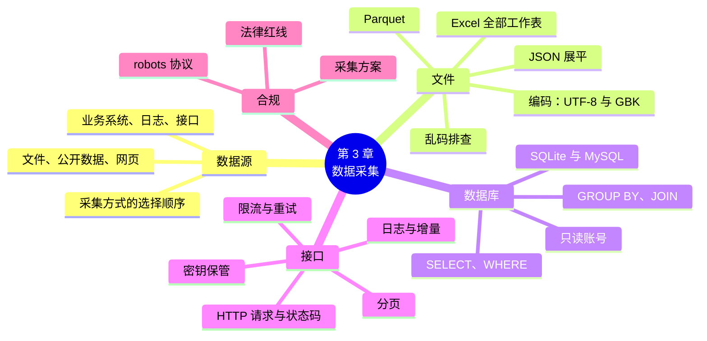

# 第 3 章 数据采集：文件、数据库与接口

!!! abstract "本章学时"
    理论 4 学时 · 实验 2 学时（本章共 3 个实验，教师可任选）

## 学习目标

学完本章，你应该能够：

1. **说出**常见的数据源和采集方式，以及 CSV、Excel、JSON、Parquet 四种文件格式各自的特点（记忆）；
2. **解释**乱码产生的原因、接口返回的状态码含义，以及为什么采集要分页、限流和重试（理解）；
3. **运行并修改**给定代码，读取 GBK 编码的 CSV、多工作表 Excel 和嵌套 JSON，把它们整理成一张表（应用）；
4. **运行并修改**给定的 SQL 语句，从数据库中按条件取数、分组汇总（应用）；
5. **判断**一个网页采集需求是否合规，写出一份简单的采集方案（评价）。

!!! info "先修要求"
    学习本章前，你需要：

    - 会用 `read_csv` 读表、用 `merge` 合并两张表、用 `concat` 上下拼接（[2.2.2 读表和看表](../02-pandas/index.md#222)、[2.5 两张表合并](../02-pandas/index.md#25-pandas-vlookup)）；
    - 会用 `groupby` 分组统计（[2.4.1](../02-pandas/index.md#241-pandas)）；
    - 知道 Python 的字典和列表（[2.1.1](../02-pandas/index.md#211)），读 JSON 时要用到。

??? abstract "本章概念清单（24 个，点击查看定义和例子）"
    1. [数据源](../../appendix/glossary.md#g-数据源)
    2. [数据采集](../../appendix/glossary.md#g-数据采集)
    3. [文件编码](../../appendix/glossary.md#g-文件编码)
    4. [UTF-8](../../appendix/glossary.md#g-UTF-8)
    5. [GBK](../../appendix/glossary.md#g-GBK)
    6. [乱码](../../appendix/glossary.md#g-乱码)
    7. [JSON](../../appendix/glossary.md#g-JSON)
    8. [展平](../../appendix/glossary.md#g-展平)
    9. [Parquet](../../appendix/glossary.md#g-Parquet)
    10. [数据库](../../appendix/glossary.md#g-数据库)
    11. [SQL](../../appendix/glossary.md#g-SQL)
    12. [SQLite](../../appendix/glossary.md#g-SQLite)
    13. [应用程序接口](../../appendix/glossary.md#g-应用程序接口)
    14. [HTTP 请求](../../appendix/glossary.md#g-HTTP-请求)
    15. [状态码](../../appendix/glossary.md#g-状态码)
    16. [分页](../../appendix/glossary.md#g-分页)
    17. [限流](../../appendix/glossary.md#g-限流)
    18. [重试](../../appendix/glossary.md#g-重试)
    19. [API 密钥](../../appendix/glossary.md#g-API-密钥)
    20. [采集日志](../../appendix/glossary.md#g-采集日志)
    21. [增量采集](../../appendix/glossary.md#g-增量采集)
    22. [网络爬虫](../../appendix/glossary.md#g-网络爬虫)
    23. [robots 协议](../../appendix/glossary.md#g-robots-协议)
    24. [采集方案](../../appendix/glossary.md#g-采集方案)

## 情景导入

“食客说”要做一个“评论情感分析”模型，第一步是把数据凑齐。数据组的小周接到任务后列了一张清单，发现要的数据散落在五六个地方：商家名录是市场部用老系统导出的 CSV，一打开全是“锟斤拷”之类的乱码；商家评分在一个 Excel 文件里，每个城区一个工作表，共 8 个；订单在公司的数据库里，要写 SQL 才能取；评论要通过开放平台的接口一页一页地下载，每页最多 100 条，一共 1 万多条，而且接口每秒只允许请求几次，请求太快会被拒绝。

更让小周犹豫的是，产品经理还提了一句：“竞争对手网站上的评论也爬一些下来做对比吧。”这能做吗？

本章就跟着小周，从文件、数据库和接口三个地方把数据采集回来，并弄清楚网页采集的法律边界。

## 3.1 数据从哪里来

### 3.1.1 常见的数据源

[**数据源**](../../appendix/glossary.md#g-数据源 "数据的来处，如业务系统、日志、开放接口、文件、公开数据、网页、传感器"){ .term }就是数据的来处。企业里做数据分析和人工智能项目，常见的数据源有下面几类：

| 数据源 | 例子（“食客说”） | 常见形式 |
|---|---|---|
| 业务系统 | 下单系统、商家管理后台 | 数据库表 |
| 日志 | 用户点击、搜索记录，服务器运行日志 | 文本文件、JSON 行 |
| 开放接口 | 合作的地图平台、天气服务 | 接口返回的 JSON |
| 文件 | 市场部的商家名录、财务报表 | CSV、Excel |
| 公开数据 | 政府公共数据开放平台上的人口、交通数据 | 文件下载或接口 |
| 网页 | 公开的新闻、公告 | HTML 网页 |
| 传感器与设备 | 骑手手机上的定位、门店的客流计数器 | 实时数据流 |

[**数据采集**](../../appendix/glossary.md#g-数据采集 "按照分析目的，从各种数据源把需要的数据收集过来、保存下来的过程"){ .term }就是按照分析目的，从这些数据源把需要的数据收集过来、保存下来的过程。它是数据旅程的第一站（[1.1.1](../01-overview/index.md#111)），后面的清洗、标注、分析都建立在它之上。采集环节漏了数据、取错了时间段，后面做得再好也是白费。

### 3.1.2 采集方式怎么选

不同的数据源，采集方式不同。初学者可以按“能用现成的就不自己造”的顺序来考虑：

1. **找人要文件**：同事手里有现成的导出文件，直接要来读。最简单，但要问清楚文件是什么时候导出的、包含哪些范围；
2. **从数据库取数**：公司自己的业务数据，申请数据库的只读权限，写 SQL 查询；
3. **调用接口**：别人提供了接口（如开放平台、合作伙伴），按接口文档调用；
4. **网页采集**：以上都没有，数据只在网页上公开显示时，才考虑写程序从网页上抓取，而且要先确认合规（3.5 节）。

!!! cert "证书考点 · 人工智能训练师（四级）· 业务数据采集"
    四级“数据采集和处理”职业功能中的第一项工作内容就是业务数据采集，技能考核常见的形式是：给出一份采集需求和几个不同格式的数据文件，要求把需要的字段读出来、合并成一张表并保存。常考：CSV 的编码设置、Excel 多工作表的读取、按条件筛选所需时间段的数据。容易错在只读了 Excel 的第一个工作表，或保存的 CSV 用 Excel 打开出现乱码。

## 3.2 文件采集：CSV、Excel、JSON 与 Parquet

### 3.2.1 CSV 与文件编码：乱码是怎么来的

CSV 是最常见的数据文件格式，它其实就是一个纯文本文件，每行一条记录，字段之间用逗号隔开。用记事本就能打开它，这是它的优点；但它不记录“这个文件用的是哪种编码”，这就埋下了乱码的祸根。

计算机里只有 0 和 1，要存一个汉字，得先约定“哪个汉字对应哪串数字”，这个约定就是[**文件编码**](../../appendix/glossary.md#g-文件编码 "规定文字和计算机中字节如何一一对应的规则，读文件时用错编码就会出现乱码"){ .term }。中文常见的编码有两种：

- [**UTF-8**](../../appendix/glossary.md#g-UTF-8 "国际通用的文字编码，能表示几乎所有文字，一个汉字通常占 3 个字节，是 Python 和网页的默认编码"){ .term }：国际通用的编码，能表示世界上几乎所有文字，一个汉字通常占 3 个字节。现在的网页、Python、Mac 和 Linux 默认都用它；
- [**GBK**](../../appendix/glossary.md#g-GBK "我国早期的汉字编码，一个汉字占 2 个字节，中文 Windows 的老软件导出的文件常用"){ .term }：我国早期制定的汉字编码，一个汉字占 2 个字节。中文版 Windows 的一些老软件、老系统导出的文件常用它。

同一个“食客说”，两种编码存下来的字节完全不同。如果文件用 GBK 存、却按 UTF-8 去读，就会把字节对错号，出现[**乱码**](../../appendix/glossary.md#g-乱码 "用错误的编码解读文字字节而显示出的无意义字符"){ .term }：

```python
text = "食客说"
print("UTF-8 字节：", text.encode("utf-8"))        # 每个汉字 3 个字节
print("GBK   字节：", text.encode("gbk"))          # 每个汉字 2 个字节
print("GBK 存、UTF-8 读：", text.encode("gbk").decode("utf-8", errors="replace"))
print("UTF-8 存、GBK 读：", text.encode("utf-8").decode("gbk", errors="replace"))
```

```text
UTF-8 字节： b'\xe9\xa3\x9f\xe5\xae\xa2\xe8\xaf\xb4'
GBK   字节： b'\xca\xb3\xbf\xcd\xcb\xb5'
GBK 存、UTF-8 读： ʳ��˵
UTF-8 存、GBK 读： 椋熷�㈣��
```

`encode` 是“把文字变成字节”，`decode` 是“把字节还原成文字”。用错了编码，要么像第三行那样变成一堆问号和怪字符，要么像第四行那样变成一串看起来像汉字、其实毫无意义的“天书”。网上流传的“锟斤拷”“烫烫烫”，都是编码用错的产物。

在 pandas 里读 GBK 编码的文件，不写编码会直接报错：

```python
shops = pd.read_csv("商家名录_gbk.csv")                 # 报 UnicodeDecodeError
shops = pd.read_csv("商家名录_gbk.csv", encoding="gbk")  # 告诉 pandas 文件是 GBK 编码
```

`UnicodeDecodeError` 的意思就是“按 UTF-8 解不开”。遇到它，第一反应就是换成 `encoding="gbk"` 试试。排查乱码可以按下面的顺序：

1. 报 `UnicodeDecodeError`：先试 `encoding="gbk"`，不行再试 `"gb18030"`（GBK 的扩展，能多认一些生僻字）；
2. 能读但中文是乱码：说明编码猜错了但碰巧没报错，换另一种编码再读；
3. 第一列的列名前面多了一个奇怪的 ``：文件是“带 BOM 的 UTF-8”，用 `encoding="utf-8-sig"` 读；
4. 自己保存 CSV 给别人用 Excel 打开时，写 `encoding="utf-8-sig"`，Excel 才能正确识别中文（实验 2-1 已经这样做过）。

!!! tip "Excel 里怎么做"
    用 Excel 直接双击打开 UTF-8 编码的 CSV，中文常常是乱码。正确做法是：“数据”选项卡 →“从文本 / CSV”→ 在弹出的窗口里把“文件原始格式”选成“65001: Unicode (UTF-8)”或“936: 简体中文 (GB2312)”，预览正常后再加载。WPS 表格打开时会自动识别大部分编码。

### 3.2.2 Excel：别忘了其他工作表

Excel 文件可以有多个工作表。`read_excel` 默认只读第一个工作表，这是初学者最容易漏数据的地方。随书的 `商家评分_按城区.xlsx` 按城区分成 8 个工作表，要全部读出来：

```python
sheets = pd.read_excel("商家评分_按城区.xlsx", sheet_name=None)  # None 表示读全部工作表
print("工作表：", list(sheets.keys()))
scores = pd.concat(sheets.values(), ignore_index=True)        # 8 张表上下拼成一张
print("评分表：", scores.shape)
```

```text
工作表： ['天河', '越秀', '海珠', '荔湾', '白云', '番禺', '黄埔', '花都']
评分表： (300, 3)
```

`sheet_name=None` 时，结果是一个**字典**：键是工作表名，值是这个工作表读出来的 DataFrame。再用第 2 章学过的 `concat` 把它们[**拼接**](../../appendix/glossary.md#g-拼接 "把结构相同的多张表上下首尾相接（或左右并排）成一张表")起来。如果只要某一个工作表，就写 `sheet_name="天河"`。

读 Excel 还有几个常见的坑：表头不在第一行（前面有标题、说明），用 `header=2` 指定第 3 行是表头；有合并单元格，读出来只有第一个格子有值，其余是空值，要用第 4 章的填充方法补上；同一列里有的是数字、有的是文字，读出来类型会乱，要在第 4 章统一。

### 3.2.3 JSON：一层套一层的数据

接口返回的数据和很多日志文件都是 [**JSON**](../../appendix/glossary.md#g-JSON "用花括号表示“键: 值”、方括号表示列表、可以多层嵌套的文本数据格式，接口返回和日志常用"){ .term } 格式。JSON 的写法和 Python 的字典、列表几乎一样：花括号 `{ }` 里是“键: 值”，方括号 `[ ]` 里是一串值，而且可以一层套一层。下面是“食客说”评论接口返回的第一页数据（节选）：

```json
{
  "code": 0,
  "msg": "ok",
  "data": {
    "page": 1, "page_size": 30, "total": 12000,
    "items": [
      {"review_id": "R000001",
       "shop": {"shop_id": "S0017"},
       "user": {"user_id": "U04295"},
       "rating": 5,
       "content": "鸭肠一绝，回味无穷 送到还是热的 ……",
       "created_at": "2025-01-02T06:04:13"}
    ]
  }
}
```

这就是一种典型的**半结构化数据**（[1.3.1](../01-overview/index.md#131)）：外层是“状态码 + 提示 + 数据”，数据里是“页码 + 每页条数 + 总条数 + 评论列表”，每条评论里的商家和用户又各是一个小字典。要把它变成表格，分两步：先用 `json.load` 读成 Python 字典，一层层取到评论列表；再用 `pd.json_normalize` 把嵌套的字段[**展平**](../../appendix/glossary.md#g-展平 "把多层嵌套的数据转换成一行一条记录、一列一个字段的二维表"){ .term }成列：

```python
import json
with open("reviews_page1.json", encoding="utf-8") as f:
    payload = json.load(f)                       # 读成 Python 字典
items = payload["data"]["items"]                 # 一层层取到评论列表
reviews = pd.json_normalize(items)               # 嵌套的字段展平成列
print(reviews.shape, list(reviews.columns))
```

```text
(30, 6) ['review_id', 'rating', 'content', 'created_at', 'shop.shop_id', 'user.user_id']
```

原来藏在 `shop` 里面的 `shop_id` 变成了一列，列名是 `shop.shop_id`，用点号表示“shop 里面的 shop_id”。如果直接用 `pd.DataFrame(items)`，`shop` 这一列里放的会是一个个小字典，没法分组统计。

!!! tip "怎样看清一个 JSON 的结构"
    JSON 文件可以直接拖进浏览器（Edge、Chrome、Firefox）打开，浏览器会把它排版成可以折叠、展开的树形结构，一眼就能看出有几层、列表在哪一层。用 VS Code 打开也会自动高亮。先看清结构，再写 `payload["data"]["items"]` 这样的取值代码。

### 3.2.4 Parquet：为分析而生的格式

CSV 简单通用，但有两个缺点：不记录每列的数据类型（日期读进来是文字，要再转换），文件也比较大。数据量大的时候，数据团队常用 [**Parquet**](../../appendix/glossary.md#g-Parquet "一种按列存储、自带数据类型、自动压缩的数据文件格式，适合存储和分析大量数据"){ .term } 格式保存。它是一种按列存储、自带数据类型、自动压缩的文件格式，pandas 用 `to_parquet` 写、`read_parquet` 读（需要安装 pyarrow 库）。同一张订单表存成两种格式比较一下（`labs/ch03/demo_parquet.py`）：

```text
../data/orders.csv       4.4 MB  读取   128 毫秒  下单时间类型 str
orders.parquet           1.4 MB  读取    99 毫秒  下单时间类型 datetime64[us]
```

Parquet 文件只有 CSV 的三分之一，读出来“下单时间”已经是日期时间类型，不用再转换。它的缺点是不能用记事本或 Excel 直接打开查看。所以一般的做法是：给人看、交给别的部门的用 CSV 或 Excel；程序之间传递、长期存档的大数据用 Parquet。

| 格式 | 打开方式 | 记录数据类型 | 文件大小 | 适合 |
|---|---|---|---|---|
| CSV | 记事本、Excel | 否 | 大 | 交换数据、给人看 |
| Excel | Excel、WPS | 部分 | 中 | 业务人员手工维护的表、多个工作表 |
| JSON | 浏览器、记事本 | 部分 | 大 | 接口返回、嵌套结构、日志 |
| Parquet | 只能用程序 | 是 | 小 | 大数据量的存储和分析 |

## 3.3 从数据库取数：SQL 入门

### 3.3.1 数据库和 SQL

“食客说”每天新产生上千笔订单，这些数据不是存在 Excel 里，而是存在[**数据库**](../../appendix/glossary.md#g-数据库 "按一定结构长期存储、统一管理、可供多人同时安全读写的数据集合及其管理系统"){ .term }里。数据库是按一定结构长期存储、统一管理数据的系统，可以理解为一个由很多张表组成、能同时让很多人安全地读写的“超级 Excel”。企业里常见的数据库有 MySQL、PostgreSQL、Oracle，以及国产的达梦、人大金仓、OceanBase 等。

和数据库“说话”要用 [**SQL**](../../appendix/glossary.md#g-SQL "结构化查询语言，用来在关系型数据库中查询和管理数据的标准语言"){ .term }（结构化查询语言）。好消息是，数据分析用到的 SQL 只有很少的几个关键字，而且和第 2 章学的 pandas 操作一一对应：

| 想做的事 | SQL | pandas | Excel |
|---|---|---|---|
| 选几列 | `SELECT 列1, 列2` | `df[["列1", "列2"]]` | 隐藏其他列 |
| 按条件筛选 | `WHERE 条件` | `df[条件]` | 筛选 |
| 分组统计 | `GROUP BY 列` | `groupby` | 分类汇总 |
| 排序 | `ORDER BY 列 DESC` | `sort_values` | 排序 |
| 两表关联 | `JOIN … ON …` | `merge` | VLOOKUP |

本书用 [**SQLite**](../../appendix/glossary.md#g-SQLite "一种轻量级的数据库，整个数据库就是一个文件，Python 自带连接它的 sqlite3 模块"){ .term } 练习。它是一个很小的数据库，整个数据库就是一个文件（随书的 `shike.db`），Python 自带连接它的 `sqlite3` 模块，什么都不用安装。在 SQLite 上学会的 SQL，拿到 MySQL 上基本照样能用。

### 3.3.2 SELECT 和 WHERE：取出想要的行和列

先连上数据库，看看里面有哪些表：

```python
import sqlite3
conn = sqlite3.connect("../data/ch03/shike.db")    # 连接数据库（SQLite 就是一个文件）
tables = pd.read_sql("SELECT name FROM sqlite_master WHERE type='table'", conn)
print("表：", tables["name"].tolist())             # 表： ['orders', 'shops']
```

`pd.read_sql(查询语句, 连接)` 把 SQL 发给数据库执行，结果直接变成 DataFrame。接下来取 2025 年 12 月、雨天的订单，只要 5 列：

```python
sql = """
SELECT order_id, shop_id, 下单时间, 实付金额, 送达时长
FROM orders
WHERE 下单时间 >= '2025-12-01' AND 下单时间 < '2026-01-01'
  AND 天气 = '雨'
"""
dec_rain = pd.read_sql(sql, conn)
print("12 月雨天订单：", dec_rain.shape)          # 12 月雨天订单： (736, 5)
```

读这段 SQL 就像读一句英文：“从 orders 表中（FROM），选出 order_id 等 5 列（SELECT），条件是（WHERE）下单时间在 12 月、并且天气是雨”。几个要点：

- 三对双引号 `"""…"""` 是 Python 里写多行文字的方法，SQL 较长时这样写更清楚；
- SQL 里的文字用单引号 `'雨'`；“等于”只写一个等号 `=`（pandas 里是两个）；“并且”就写 `AND`，“或者”写 `OR`；
- 时间范围写成“大于等于月初、小于下月初”，比写 `<= '2025-12-31'` 更稳妥，因为 `'2025-12-31 18:00:00'` 比 `'2025-12-31'` 大，会被漏掉；
- SQL 关键字不区分大小写，习惯上大写，便于和列名区分。

为什么不把整张订单表读进来再用 pandas 筛选？在本书的小数据上两种做法都行，但真实业务的订单表可能有上亿行，全部读进来电脑内存放不下，网络也传不动。**让数据库先筛选、只把需要的部分取回来**，是从数据库取数的基本原则。

### 3.3.3 GROUP BY 和 JOIN：让数据库帮你汇总

更进一步，分组统计也可以交给数据库来做，只把汇总结果取回来：

```python
sql2 = """
SELECT s.城区, COUNT(*) AS 订单数, ROUND(AVG(o.送达时长), 1) AS 平均送达时长
FROM orders o JOIN shops s ON o.shop_id = s.shop_id
WHERE o.下单时间 >= '2025-12-01' AND o.下单时间 < '2026-01-01' AND o.天气 = '雨'
GROUP BY s.城区
ORDER BY 平均送达时长 DESC
"""
print(pd.read_sql(sql2, conn))
```

```text
   城区  订单数  平均送达时长
0  花都   39    35.1
1  番禺   99    34.5
2  海珠  102    34.2
3  越秀  112    33.0
4  荔湾   58    32.6
5  黄埔   64    32.4
6  天河  143    32.4
7  白云  119    32.3
```

这段 SQL 多了三样东西：

- `FROM orders o JOIN shops s ON o.shop_id = s.shop_id`：把订单表（简称 o）和商家表（简称 s）按商家编号关联起来，相当于 pandas 的 `merge`。`JOIN` 默认是内连接，想保留左表全部行就写 `LEFT JOIN`；
- `COUNT(*)`、`AVG(…)`、`ROUND(…, 1)`：计数、求平均、保留 1 位小数，`AS 订单数` 是给结果列起名字；
- `GROUP BY s.城区` 按城区分组，`ORDER BY 平均送达时长 DESC` 按平均送达时长从大到小排序（`DESC` 是降序，不写或写 `ASC` 是升序）。

对照 2.4 节的 pandas 写法，你会发现思路完全一样：先关联、再筛选、再分组、最后排序。用完数据库要 `conn.close()` 关闭连接。

!!! warning "取数只用只读账号"
    在公司里，从生产数据库取数要用只读账号，只写 `SELECT` 查询。`DELETE`（删除）、`UPDATE`（修改）、`DROP`（删表）这些语句不要在生产库上运行，一旦写错条件就可能删掉真实业务数据。大的查询尽量在业务低峰（如夜间）运行，或者在专门用于分析的“从库”上运行，以免拖慢正在下单的用户。

### 3.3.4 连接 MySQL 等其他数据库

公司的数据库一般是 MySQL 这类“服务器数据库”，数据不在你的电脑上，而在一台服务器上。连接时需要知道五样东西：服务器地址、端口、数据库名、用户名和密码，这些由数据库管理员提供。用 Python 连接 MySQL 要先安装 pymysql 库，连上以后的用法和 SQLite 一样，也是 `pd.read_sql(sql, conn)`。

很多公司还提供网页版的查询工具（如 DBeaver、Navicat 或公司自己的数据平台），在网页里写 SQL、点运行，结果可以直接导出成 CSV 或 Excel。初学者可以先在这些工具里把 SQL 调试通，再复制到 Python 里。

## 3.4 开放接口：一页一页地取数据

### 3.4.1 接口是什么

[**应用程序接口**](../../appendix/glossary.md#g-应用程序接口 "一个系统按约定格式向别的程序提供数据或功能的“窗口”，调用方按接口文档发请求、拿结果"){ .term }（API）是一个系统按约定的格式向别的程序提供数据或功能的“窗口”。打个比方：餐厅的厨房（别人的系统）不让顾客进去，但提供了一份菜单（接口文档）和一个服务员（接口），你按菜单的格式点菜（发请求），服务员把菜端出来（返回数据）。你不需要知道厨房里怎么做，只需要按菜单点。

“食客说”的评论数据通过开放平台的评论接口提供。我们日常用的天气预报、地图导航、快递查询，背后也都是在调用接口。为了让大家在自己电脑上就能练习，本书在 `labs/ch03/mock_api.py` 中提供了一个本地模拟接口，它的行为和真实接口一样：要密钥、分页返回、限制请求频率，还会偶尔出错。

### 3.4.2 一次请求和它的回答

调用接口用的是 [**HTTP 请求**](../../appendix/glossary.md#g-HTTP-请求 "按 HTTP 协议向服务器发出的请求，包括地址、方法、参数和请求头"){ .term }，也就是浏览器打开网页时用的那一套规则。一次请求包括：地址（URL）、方法（取数据一般用 `GET`）、参数（如第几页、每页几条）和请求头（如密钥）。Python 里用 requests 库发请求：

```python
import requests
url = "http://127.0.0.1:8800/api/reviews"
r = requests.get(url, params={"page": 1, "page_size": 2},
                 headers={"X-API-Key": "shike-demo-key"}, timeout=10)
print(r.status_code)                       # 状态码：200 表示成功
data = r.json()["data"]                    # 返回的 JSON 转成 Python 字典
print(data["total"], data["items"][0])
```

```text
200
11226 {'review_id': 'R000002', 'order_id': 'O000013', 'shop': {'shop_id': 'S0113'}, 'user': {'user_id': 'U01719'}, 'rating': 5, 'content': '外卖送得很快。猪脚饭一点味道都没有。推荐！', 'created_at': '2025-01-01T19:12:25'}
```

`params` 是请求参数，requests 会自动把它拼到网址后面，变成 `…/api/reviews?page=1&page_size=2`；`headers` 是请求头；`timeout=10` 表示最多等 10 秒，对方一直不回答就放弃，防止程序卡死。

每次请求，接口都会先回一个三位数的[**状态码**](../../appendix/glossary.md#g-状态码 "服务器对每次 HTTP 请求返回的三位数代码，说明请求的结果；2 开头成功，4 开头是请求方的问题，5 开头是服务器的问题"){ .term }，告诉你这次请求怎么样了。要记住的只有几个：

| 状态码 | 含义 | 该怎么办 |
|---|---|---|
| 200 | 成功 | 读取数据 |
| 400 | 请求参数有误 | 对照接口文档检查参数 |
| 401 / 403 | 没有权限：密钥缺失、错误或过期 | 检查密钥 |
| 404 | 地址不存在 | 检查网址是否写错 |
| 429 | 请求太频繁，被限流了 | 等一会儿再试 |
| 500 / 502 / 503 | 服务器出错或暂时不可用 | 等一会儿再试，多次失败就联系对方 |

简单记：2 开头是成功，4 开头是“你的问题”，5 开头是“对方的问题”。不带密钥去请求模拟接口，会得到 `401 {'code': 401, 'msg': 'API 密钥缺失或错误'}`。

### 3.4.3 分页：数据太多，一页一页给

1 万多条评论，接口不会一次全给你，而是每页最多给 100 条，要的话一页一页地取，这叫[**分页**](../../appendix/glossary.md#g-分页 "数据量大时，接口把数据分成若干页，每次请求只返回一页"){ .term }。返回结果里的 `total`（总条数）和 `page_size`（每页条数）告诉你一共有多少页。取数的逻辑就是一个循环：

```python
items, page = [], 1
while True:
    data = get_page(page)                           # 取第 page 页
    items += data["items"]                          # 把这一页的评论加进列表
    if page * data["page_size"] >= data["total"]:   # 已经取到最后一页
        break
    page += 1
    time.sleep(0.3)                                 # 每页之间稍等
reviews = pd.json_normalize(items)
```

`while True` 是“一直循环”，直到遇到 `break` 才停下。每取一页，就判断一下“已经取到的页数 × 每页条数”是否超过了总条数，超过了说明这是最后一页。`time.sleep(0.3)` 让程序每页之间休息 0.3 秒，下一小节说为什么。

### 3.4.4 限流与重试：做一个“有礼貌”的采集程序

接口是很多人共用的。如果有人写个程序每秒请求几百次，服务器就会被拖垮，别人都用不了。所以接口一般都有[**限流**](../../appendix/glossary.md#g-限流 "接口限制每个调用方在一段时间内的请求次数，超过就拒绝，防止服务器被拖垮"){ .term }规则，比如“每秒最多 4 次”，超过了就返回 429。随书的模拟接口就是这样设置的。

另外，网络和服务器都可能偶尔出故障，返回 500。一个可靠的采集程序，遇到 429 和 500 时不应该直接崩溃，而是等一会儿再试，这叫[**重试**](../../appendix/glossary.md#g-重试 "请求因临时故障或限流失败后，等待一段时间再次请求；连续多次失败则停止并报错"){ .term }。下面的函数最多试 5 次：

```python
def get_page(page, max_try=5):
    for i in range(1, max_try + 1):                        # 第 1 次到第 5 次
        r = requests.get(URL, headers=HEADERS, timeout=10,
                         params={"page": page, "page_size": 100})
        if r.status_code == 200:                            # 成功就返回数据
            return r.json()["data"]
        wait = int(r.headers.get("Retry-After", 2))         # 对方说等几秒，没说就等 2 秒
        log(f"第 {page} 页第 {i} 次请求失败，状态码 {r.status_code}，{wait} 秒后重试")
        time.sleep(wait)
    raise RuntimeError(f"第 {page} 页连续 {max_try} 次失败，停止采集")
```

接口限流时常会在回答的请求头 `Retry-After` 里告诉你“等几秒再来”，听它的就好。连续 5 次都失败，说明不是偶尔的故障，就用 `raise` 主动报错停下来，让人来检查，而不是无休止地重试。

!!! warning "API 密钥不要写在代码里"
    [**API 密钥**](../../appendix/glossary.md#g-API-密钥 "接口用来识别调用者身份和权限的一串字符，相当于钥匙，应放在环境变量中，不能写进公开的代码"){ .term }是接口用来识别“你是谁、有没有权限”的一串字符，相当于钥匙。真实项目中的密钥一旦泄露，别人就能用你的身份调用接口，产生的费用和后果都算在你头上。不要把密钥直接写在代码里，更不要把带密钥的代码上传到网上（每年都有人因此泄露密钥）。常见做法是把密钥放在电脑的环境变量里，代码用 `os.environ.get("SHIKE_API_KEY")` 读取。实验 3-3 的代码就是这样写的，读不到环境变量时才使用演示密钥。

### 3.4.5 采集日志与增量采集

采集程序常常要在夜里自动运行几个小时，第二天早上怎么知道它采了多少、有没有出错？办法是让它边干边记，写一份[**采集日志**](../../appendix/glossary.md#g-采集日志 "采集程序运行时逐条记录的开始时间、采集数量、失败和重试情况的文本，用来事后检查"){ .term }：什么时候开始、取了多少页、哪一页失败了几次、最后存了多少条。实验 3-3 的日志长这样：

```text
2026-10-31 09:55:05 开始采集，since = （全量）
2026-10-31 09:55:10 第 17 页第 1 次请求失败，状态码 500，2 秒后重试
……
2026-10-31 09:55:53 本次共 113 页，新增 11226 条
2026-10-31 09:55:53 已保存 reviews_api.csv，累计 11226 条
```

评论每天都在增加。如果每天都把全部评论重新采一遍，既浪费时间，又给对方服务器增加负担。更好的做法是[**增量采集**](../../appendix/glossary.md#g-增量采集 "只采集上次采集之后新增或变化的数据，而不是每次全部重采"){ .term }：记住上次采到的最新一条评论的时间，下次只要这个时间之后的新评论。模拟接口提供了 `since` 参数来支持这一点，实验 3-3 ☆ 会让你体验：第一天采了 11226 条，第二天只新增 774 条。增量采集要注意“去重”，万一有评论被重复取到，用 `drop_duplicates("review_id")` 按评论编号去掉重复。

## 3.5 网页采集与合规边界

### 3.5.1 网络爬虫的原理

有些数据只在网页上显示，没有文件、数据库，也没有接口。这时可以写程序模拟浏览器访问网页，把网页的源代码下载下来，再从中找出需要的内容，这种程序叫[**网络爬虫**](../../appendix/glossary.md#g-网络爬虫 "模拟浏览器自动访问网页、下载并提取网页内容的程序"){ .term }。它的基本步骤是：

1. 用 requests 请求网页地址，得到网页的 HTML 源代码；
2. 用 BeautifulSoup 等库解析 HTML，按标签找到标题、价格、评论等内容；
3. 找到“下一页”的链接，重复以上步骤；
4. 把提取出来的内容存成表格。

爬虫的技术细节（网页结构、解析方法、动态网页）在“网络爬虫技术”课程中专门学习，人工智能数据处理工程师（中级）考试中也只要求了解原理。本节重点讲另一件更重要的事：**能不能爬**。

### 3.5.2 robots 协议

很多网站会在网站根目录放一个 `robots.txt` 文件（例如 `https://某网站/robots.txt`），写明哪些目录允许爬虫访问、哪些不允许，这叫 [**robots 协议**](../../appendix/glossary.md#g-robots-协议 "网站在根目录的 robots.txt 中声明允许或不允许爬虫访问哪些页面的约定，2022 年成为互联网标准 RFC 9309"){ .term }。它在 2022 年被正式写成互联网标准 RFC 9309。<sup class="cite">[[1]](#ref3-1)</sup> 一个简单的例子：

```text
User-agent: *
Disallow: /user/
Disallow: /order/
Allow: /news/
```

意思是：对所有爬虫（`*`），不允许访问 `/user/` 和 `/order/` 下的页面，允许访问 `/news/`。robots 协议是网站表明意愿的方式，本身没有技术上的强制力，但遵守它是爬虫行业公认的基本规矩。在我国的司法实践中，违反 robots 协议抓取数据，也会被作为认定不正当竞争的考虑因素之一。

### 3.5.3 法律边界：哪些不能做

我国的《网络安全法》《数据安全法》《个人信息保护法》以及 2025 年 1 月 1 日起施行的《网络数据安全管理条例》，对收集网络数据提出了明确要求。<sup class="cite">[[2]](#ref3-2)</sup><sup class="cite">[[3]](#ref3-3)</sup><sup class="cite">[[4]](#ref3-4)</sup> 《数据安全法》规定，任何组织、个人收集数据，应当采取合法、正当的方式，不得窃取或者以其他非法方式获取数据。对于做数据工作的同学，可以记住下面几条红线：

1. **不绕过技术措施**：网站设置了登录、验证码、访问频率限制，就不要想办法破解、绕过。《刑法》第二百八十五条规定了非法获取计算机信息系统数据罪，情节严重的要承担刑事责任；
2. **不采集个人信息**：用户的姓名、手机号、住址、行踪等个人信息，没有法律依据或本人同意不能收集。即使是网页上公开的信息，大量收集、汇总起来使用，也可能侵犯个人信息权益；
3. **不影响网站正常运行**：请求频率过高，导致对方服务器卡顿甚至瘫痪，可能构成破坏计算机信息系统；
4. **不拿来“搬运”**：把别人辛苦积累的内容（如商品评价、文章）大量抓取后直接用在自己的产品里，与对方竞争，可能构成不正当竞争；
5. **有疑问先问**：不确定能不能采时，先请教公司的法务或数据合规部门，留下书面意见。

回到情景导入中产品经理的要求：“爬一些竞争对手网站上的评论做对比”。竞争对手的评论是其经营积累的数据，评论中还可能有用户昵称等个人信息，大量抓取用于商业对比存在明显的法律风险。小周应该把风险告诉产品经理，建议改为购买第三方的合规行业报告，或者只对少量公开内容做人工调研。

!!! cert "证书考点 · 人工智能数据处理工程师（中级）· 网络爬虫"
    该证书的课程标准中有网络爬虫的内容，本书只要求了解原理和合规要求。常考：爬虫的基本步骤；robots.txt 的作用和写法（`User-agent`、`Disallow`、`Allow` 的含义）；哪些采集行为违法。容易错在认为“网页上公开的数据就可以随便爬”。

## 3.6 写一份采集方案

真实工作中，动手写代码之前，先要写一份[**采集方案**](../../appendix/glossary.md#g-采集方案 "动手采集前写的说明文档，写明目的、数据、来源、范围、频率、合规措施、质量检查和负责人"){ .term }，和需求方、数据提供方对齐。一份方案不用很长，回答清楚下面几个问题就行。以“评论情感分析”项目为例：

| 项目 | 内容 |
|---|---|
| 采集目的 | 为评论情感分析模型准备训练数据，并统计各商家的好评率 |
| 需要哪些数据 | 评论（评论编号、商家、用户、评分、内容、时间）；商家名录（城区、菜系） |
| 数据源和方式 | 评论：开放平台评论接口；商家名录：市场部提供的 CSV；订单：订单库，只读账号 |
| 时间范围 | 2025 年 1 月 1 日至 12 月 31 日；之后每天增量采集一次 |
| 数据量估计 | 评论约 1.2 万条，接口每页 100 条，约 120 次请求 |
| 频率与时间 | 每秒不超过 3 次；每日凌晨 2 点运行 |
| 合规与安全 | 评论中的用户只保留编号，不采集昵称、头像；密钥放环境变量；数据存放在公司服务器，不拷贝到个人电脑 |
| 质量检查 | 采集条数与接口 total 一致；评论编号无重复；每次运行写采集日志 |
| 负责人与交付 | 小周负责，3 个工作日内交付 `reviews_api.csv` 和采集日志 |

附录 E 提供了采集方案的模板。方案中“合规与安全”和“质量检查”两项最容易被忽略，但它们往往决定了项目能不能顺利上线。

## 3.7 前沿视窗

**公共数据开放与数据交易。** 越来越多的数据可以通过正规渠道获得。各地政府建设了公共数据开放平台，如上海市公共数据开放平台，提供交通、气象、企业登记等数据的下载和接口。<sup class="cite">[[5]](#ref3-5)</sup> 2021 年起，北京、上海、深圳等地相继成立数据交易所，企业可以在场内合规地购买和出售数据产品。2022 年 12 月，中共中央、国务院印发《关于构建数据基础制度更好发挥数据要素作用的意见》（“数据二十条”），提出建立数据产权、流通交易、收益分配、安全治理等制度。<sup class="cite">[[6]](#ref3-6)</sup> 对数据工作者来说，“先找合规的现成数据，再考虑自己采”会越来越成为常态。

**大模型帮你“抽取”数据。** 很多数据藏在 PDF 报告、扫描的表格、网页正文里，以前要人工一条条录入，或者为每种格式单独写规则。现在把一份 PDF 或网页内容交给大模型，告诉它“请把其中的商家名称、地址、评分整理成表格，以 JSON 格式输出”，它往往能直接给出结构化的结果。这种做法省时省力，但也要注意：大模型偶尔会“编造”原文中没有的内容，抽取的结果一定要抽查核对；涉及个人信息和商业秘密的文件，不要上传到外部的大模型服务。

## 本章实验

!!! abstract "实验总览"
    | 实验 | 类型 | 建议时长 | 内容 |
    |---|---|---|---|
    | 实验 3-1 | ★ 基础 | 45 分钟 | 读取 GBK 编码的 CSV、多工作表 Excel、嵌套 JSON，统一成一张商家汇总表 |
    | 实验 3-2 | ★ 基础 | 45 分钟 | 用 SQL 从 SQLite 订单库取出指定时间段的数据，与文件数据合并 |
    | 实验 3-3 | ☆ 拓展 | 60 分钟 | 调用本地模拟接口分页采集评论，处理限流和错误，写采集日志，做增量采集 |

    代码见配套资源 `labs/ch03/` 目录。

### 实验 3-1 ★ 多格式文件读取与乱码排查

**实验目的**

1. 会读取 GBK 编码的 CSV，能根据报错判断是编码问题；
2. 会一次读取 Excel 的全部工作表并拼接；
3. 会把嵌套的 JSON 展平成表格；
4. 会把几份数据按商家编号合并成一张表，并以 Excel 能打开的编码保存。

**实验环境**：本机 CPU。

**实验数据**：`labs/data/ch03/` 下的 `商家名录_gbk.csv`（300 家商家，GBK 编码）、`商家评分_按城区.xlsx`（8 个工作表）、`reviews_page1.json`（评论接口第 1 页的原始返回）。

**实验步骤与代码**

第 1 步，先故意不写编码读 GBK 文件，看看报什么错，再改正：

```python
try:
    shops = pd.read_csv(D + "商家名录_gbk.csv")                 # 默认按 UTF-8 读
except UnicodeDecodeError as e:
    print("出错了：", type(e).__name__, "——文件不是 UTF-8 编码")
shops = pd.read_csv(D + "商家名录_gbk.csv", encoding="gbk")     # 告诉 pandas 文件是 GBK 编码
print("商家名录：", shops.shape)
```

`try … except` 的意思是“试着运行 try 下面的代码，如果出了 except 后面写的这种错，就运行 except 下面的代码，而不是让程序崩溃”。这里用它来演示报错，实际工作中直接写对编码就行。`D` 是程序开头定义的数据目录 `"../data/ch03/"`。

第 2 步，读 Excel 的全部工作表并拼接，见 3.2.2 节。

第 3 步，读嵌套 JSON 并展平，见 3.2.3 节。

第 4 步，合并成一张商家汇总表并保存：

```python
cnt = reviews.groupby("shop.shop_id").size().rename("第1页评论数")
result = shops.merge(scores[["shop_id", "平均评分"]], on="shop_id", how="left")
result = result.merge(cnt, left_on="shop_id", right_index=True, how="left")
result["第1页评论数"] = result["第1页评论数"].fillna(0).astype(int)
result.to_csv("商家汇总.csv", index=False, encoding="utf-8-sig")
```

第二次合并时，`cnt` 的商家编号在索引里而不在列里，所以写 `left_on="shop_id", right_index=True`：左表用 `shop_id` 列，右表用索引。第 1 页只有 30 条评论，大部分商家没有，合并后是空值，`fillna(0)` 把空值填成 0（第 4 章细讲），`astype(int)` 再转成整数。完整代码见 `labs/ch03/lab3_1_read_files.py`。

**运行结果**

```text
出错了： UnicodeDecodeError ——文件不是 UTF-8 编码
商家名录： (300, 7)
工作表： ['天河', '越秀', '海珠', '荔湾', '白云', '番禺', '黄埔', '花都']
评分表： (300, 3)
评论（第 1 页）： (30, 6) ['review_id', 'rating', 'content', 'created_at', 'shop.shop_id', 'user.user_id']
  shop_id         店名  城区  菜系  人均价格        开业日期           标签  平均评分  第1页评论数
0   S0001  好味粤菜（番禺店）  番禺  粤菜    84  2024-02-03     深夜营业|网红店   3.7       0
1   S0002  老居快餐（越秀店）  越秀  快餐    27  2019-06-24     环境好|深夜营业   3.9       0
2   S0003  大味火锅（天河店）  天河  火锅   115  2024-03-06         适合约会   3.2       0
3   S0004  鸿记川菜（荔湾店）  荔湾  川菜    82  2022-07-27     出餐快|深夜营业   3.6       0
4   S0005  福坊川菜（天河店）  天河  川菜    86  2021-01-24  老字号|出餐快|有包间   3.8       0
已保存 商家汇总.csv，共 300 行
```

**实验记录表**

| 检查项 | 你的结果 |
|---|---|
| 不写编码时报的错误类型 | |
| 商家名录的行数、列数 | |
| Excel 有几个工作表？如果只用 `pd.read_excel(文件)` 读，得到几行？ | |
| JSON 展平后有哪几列？哪两列是从嵌套里展开的？ | |
| 用 Excel 打开 `商家汇总.csv`，中文是否正常？ | |

**常见问题排查**

| 现象 | 原因 | 解决办法 |
|---|---|---|
| `UnicodeDecodeError: 'utf-8' codec can't decode byte` | 文件不是 UTF-8 编码 | 加 `encoding="gbk"` 或 `"gb18030"` |
| `ImportError: Missing optional dependency 'openpyxl'` | 读 xlsx 需要 openpyxl 库 | `pip install openpyxl` |
| `FileNotFoundError` | 没在 `labs/ch03` 目录下运行，相对路径找不到文件 | 先 `cd` 到 `labs/ch03` 再运行 |
| `KeyError: 'items'` | 取 JSON 时少了一层 | 先 `print(payload.keys())` 看清每一层的键 |
| Excel 打开 CSV 中文乱码 | 保存时用的是 `utf-8` | 改用 `encoding="utf-8-sig"` |

**思考与练习**

1. 把第 1 步的 `encoding="gbk"` 改成 `encoding="utf-8", encoding_errors="replace"`，能读出来吗？店名变成什么样了？这说明了什么？
2. 只读取“天河”和“越秀”两个工作表，应该怎么写？（提示：`sheet_name` 可以是一个列表。）

**实验报告要求**

提交运行结果截图、实验记录表和两道思考题的代码与结果，并用两三句话总结排查乱码的步骤。

### 实验 3-2 ★ 从数据库取数

**实验目的**

1. 会用 Python 连接 SQLite 数据库，查看有哪些表；
2. 会写 `SELECT`、`WHERE` 取出指定时间段、指定条件的数据；
3. 会写 `GROUP BY`、`JOIN` 让数据库完成分组汇总；
4. 会把数据库取出的数据与文件数据合并。

**实验环境**：本机 CPU。

**实验数据**：`labs/data/ch03/shike.db`（含 orders、shops 两张表）；实验 3-1 保存的 `商家汇总.csv`。

**实验步骤与代码**

第 1 步，连接数据库，查看表名，见 3.3.2 节。

第 2 步，取 2025 年 12 月雨天的订单，见 3.3.2 节。

第 3 步，在数据库里关联商家表，按城区分组汇总，见 3.3.3 节。

第 4 步，给 12 月雨天订单加上实验 3-1 得到的商家平均评分，比较评分高低不同的商家送达时长：

```python
summary = pd.read_csv("商家汇总.csv")                         # 实验 3-1 保存的文件
df = dec_rain.merge(summary[["shop_id", "店名", "平均评分"]], on="shop_id", how="left")
print(df.head(3))
print("评分 4.0 以上：", df[df["平均评分"] >= 4.0]["送达时长"].mean().round(1))
print("评分 4.0 以下：", df[df["平均评分"] < 4.0]["送达时长"].mean().round(1))
conn.close()                                                 # 用完关闭连接
```

完整代码见 `labs/ch03/lab3_2_sql.py`。

**运行结果**

```text
表： ['orders', 'shops']
12 月雨天订单： (736, 5)
  order_id shop_id                 下单时间   实付金额  送达时长
0  O050694   S0167  2025-12-01 02:29:33   61.6    41
1  O050702   S0280  2025-12-01 08:43:41  373.0    31
2  O050710   S0095  2025-12-01 10:39:16  149.8    27
   城区  订单数  平均送达时长
0  花都   39    35.1
1  番禺   99    34.5
……（共 8 个城区，见 3.3.3 节）
  order_id shop_id                 下单时间   实付金额  送达时长         店名  平均评分
0  O050694   S0167  2025-12-01 02:29:33   61.6    41  大轩面馆（海珠店）   4.2
1  O050702   S0280  2025-12-01 08:43:41  373.0    31  小哥火锅（白云店）   4.1
2  O050710   S0095  2025-12-01 10:39:16  149.8    27  鸿轩快餐（白云店）   4.3
评分 4.0 以上的商家 平均送达时长： 33.3
评分 4.0 以下的商家 平均送达时长： 32.8
```

评分高低不同的商家，雨天送达时长差不多。这说明送达快慢主要受距离、天气、配送方式影响，和商家评分关系不大。第 7 章会学习怎样判断这样的差别是不是“真的”。

**实验记录表**

| 检查项 | 你的结果 |
|---|---|
| 2025 年 12 月雨天订单有多少笔？ | |
| 把条件改成 2025 年 12 月晴天，有多少笔？ | |
| 12 月雨天平均送达时长最长的城区 | |
| 把第 3 步的 `AVG(o.送达时长)` 改成 `AVG(o.实付金额)`，客单价最高的城区 | |

**常见问题排查**

| 现象 | 原因 | 解决办法 |
|---|---|---|
| `no such table: order` | 表名写错（应为 orders） | 先运行第 1 步查看表名 |
| `no such column: 雨` | SQL 里文字没加单引号 | 写成 `天气 = '雨'` |
| 结果是 0 行 | 时间格式写错，如 `'2025/12/01'` | 和库里的格式一致：`'2025-12-01'` |
| `ambiguous column name: shop_id` | 两张表都有 shop_id，没说是哪张表的 | 写成 `o.shop_id` 或 `s.shop_id` |
| `FileNotFoundError: 商家汇总.csv` | 还没做实验 3-1 | 先运行 `lab3_1_read_files.py` |

**思考与练习**

1. 用 SQL 统计 2025 年每个菜系的订单数和平均实付金额，按订单数从多到少排列。（提示：要 JOIN 商家表，`GROUP BY s.菜系`。）
2. 同样的统计用第 2 章的 pandas 写法再做一遍，两种结果一致吗？你觉得哪种写法更好读？

**实验报告要求**

提交运行结果截图、实验记录表和两道思考题的 SQL、pandas 代码及结果。

### 实验 3-3 ☆ 调用接口分页采集评论

**实验目的**

1. 会调用 HTTP 接口，读懂状态码，处理分页；
2. 会写带重试的取数函数，应对限流（429）和服务器临时故障（500）；
3. 会写采集日志，会用 `since` 参数做增量采集。

**实验环境**：本机 CPU。需要同时开两个命令行窗口（或在 VS Code 里开两个终端）。

**实验数据**：本地模拟接口 `labs/ch03/mock_api.py`，它读取 `labs/data/ch03/api_reviews_all.csv` 中的 12000 条评论对外提供。“第一天”只提供 2025 年 12 月 15 日之前的 11226 条，“第二天”提供全部 12000 条。

**实验步骤与代码**

第 1 步，在第一个窗口进入 `labs/ch03`，启动模拟接口，看到“接口已启动”后不要关闭这个窗口：

```bash
python mock_api.py
```

```text
接口已启动（模拟第一天，共 11226 条评论）：http://127.0.0.1:8800/api/reviews  按 Ctrl + C 停止
```

第 2 步，在第二个窗口进入 `labs/ch03`，先用 3.4.2 节的代码试着请求一次，再去掉 `headers` 请求一次，看看状态码有什么不同。

第 3 步，**先自己写**：参照 3.4.3、3.4.4 节，写一个程序，带重试地取出全部评论，存成 `reviews_api.csv`。写不出来时再参考 `lab3_3_fetch_reviews.py`，它在你写的基础上增加了两样东西：

```python
def log(text):
    """同时打印到屏幕和写进采集日志"""
    line = f"{datetime.now():%Y-%m-%d %H:%M:%S} {text}"
    print(line)
    with open(LOG, "a", encoding="utf-8") as f:     # "a" 表示追加，不覆盖以前的日志
        f.write(line + "\n")

# 增量采集：如果以前采过，只要上次最新一条评论之后的数据
old = pd.read_csv(OUT) if os.path.exists(OUT) else None
since = old["created_at"].max() if old is not None else ""
```

第 4 步，运行采集程序，观察日志中的失败和重试：

```bash
python lab3_3_fetch_reviews.py
```

第 5 步，模拟“第二天”：在第一个窗口按 Ctrl + C 停止接口，改用 `python mock_api.py --day 2` 启动；在第二个窗口再运行一次采集程序，看看这次采了几页、新增了多少条。

**运行结果**

第一次采集（第一天）：

```text
2026-10-31 09:55:05 开始采集，since = （全量）
2026-10-31 09:55:10 第 17 页第 1 次请求失败，状态码 500，2 秒后重试
2026-10-31 09:55:16 第 33 页第 1 次请求失败，状态码 500，2 秒后重试
……（第 49、65、81、97、113 页各失败 1 次，重试后成功）
2026-10-31 09:55:53 本次共 113 页，新增 11226 条
2026-10-31 09:55:53 已保存 reviews_api.csv，累计 11226 条
```

第二次采集（第二天）：

```text
2026-10-31 09:55:55 开始采集，since = 2025-12-14T23:38:59
2026-10-31 09:55:57 本次共 8 页，新增 774 条
2026-10-31 09:55:57 已保存 reviews_api.csv，累计 12000 条
```

第一次 113 页中有 7 页第一次请求失败（模拟接口大约每 17 次请求出一次错），重试后全部成功，最终条数与接口给出的总数一致。第二次只取了 8 页，比全量重采省了九成以上的请求。如果把程序里的 `time.sleep(0.3)` 改成 `time.sleep(0.1)`，还会看到很多 429 限流。

**实验记录表**

| 检查项 | 你的结果 |
|---|---|
| 不带密钥请求时的状态码 | |
| 第一次采集共几页？失败重试了几次？ | |
| 第一次采集的条数与接口 total 是否一致？ | |
| 第二次采集的 since 是什么？新增几条？ | |
| 把 `sleep(0.3)` 改成 `sleep(0.1)`，出现了什么状态码？ | |

**常见问题排查**

| 现象 | 原因 | 解决办法 |
|---|---|---|
| `ConnectionError` / `Max retries exceeded` | 模拟接口没有启动，或启动窗口被关了 | 在另一个窗口运行 `python mock_api.py` |
| `OSError: Address already in use` | 接口已经在运行，又启动了一次 | 关掉之前的窗口，或按 Ctrl + C 停止后再启动 |
| 一直是 401 | 请求头的名字或密钥写错 | 请求头是 `X-API-Key`，演示密钥是 `shike-demo-key` |
| 第二次采集又从头采了 | 第一次的 `reviews_api.csv` 被删了，或不在当前目录 | 在同一目录下运行 |

**思考与练习**

1. 如果某一页连续 5 次都失败，程序会怎样？已经采到的前面几页数据会保存下来吗？怎样改进？
2. 采集到的评论里有广告、HTML 标签、手机号等“脏东西”（打开 `reviews_api.csv` 找一找），把你发现的问题列成清单，第 4 章会清洗它们。

**实验报告要求**

提交两次采集的日志截图、实验记录表，附上你自己写的采集程序（哪怕没有完全写对），说明它和参考代码的差别。

## 本章小结

- 常见的**数据源**有业务系统、日志、开放接口、文件、公开数据、网页和传感器；**数据采集**按“要文件、查数据库、调接口、最后才考虑网页采集”的顺序选择方式。
- 乱码来自**文件编码**不一致：**UTF-8** 是国际通用编码，**GBK** 是老的中文编码。报 `UnicodeDecodeError` 就试 `encoding="gbk"`；保存给 Excel 用的 CSV 写 `utf-8-sig`。
- `read_excel(…, sheet_name=None)` 读全部工作表；**JSON** 用 `json.load` 读、`json_normalize` **展平**；**Parquet** 按列存储、带类型、体积小，适合存大数据。
- **数据库**用 **SQL** 取数：`SELECT` 选列、`WHERE` 筛选、`GROUP BY` 分组、`ORDER BY` 排序、`JOIN` 关联，和 pandas 一一对应；让数据库先筛选汇总，只取回需要的部分；**SQLite** 是一个文件就能用的小数据库。
- 调用**接口**发的是 **HTTP 请求**，先看**状态码**：2 开头成功，4 开头是自己的问题，5 开头是对方的问题。数据多时要**分页**取；遵守**限流**，遇到 429、500 要**重试**；**API 密钥**放环境变量，不写进代码。
- **采集日志**记录每次采了什么、哪里出错；**增量采集**只取上次之后的新数据。
- **网络爬虫**要遵守 **robots 协议**和法律法规：不绕过技术措施、不采集个人信息、不影响网站运行、不搬运他人数据。动手之前先写**采集方案**。



**下一章预告**

数据采集回来了，但打开一看问题不少：有的订单没有配送距离，有的日期写成“2025年3月5日”，有的城区写成“天河区”，有的实付金额按“分”记录，还有 120 行一模一样的重复记录；评论里混着广告、网页标签和手机号。下一章学习怎样评估数据质量，并按规范把这些问题一一清洗干净。

## 参考文献

正文中的上标编号（如<sup class="cite">[[1]](#ref3-1)</sup>）对应下面的文献。带链接的可以直接打开；书籍可在图书馆或电子书平台查阅。

<div class="refs" markdown>

**标准与法规**

- <span id="ref3-1"></span>[1] KOSTER M, ILLYES G, ZELLER H, et al. RFC 9309: Robots exclusion protocol[S/OL]. Internet Engineering Task Force, 2022. https://www.rfc-editor.org/rfc/rfc9309.
    <span class="ref-note">robots 协议的正式标准，规定了 robots.txt 的位置和 User-agent、Allow、Disallow 的写法，对应 3.5.2 节。</span>
- <span id="ref3-2"></span>[2] 全国人民代表大会常务委员会. 中华人民共和国数据安全法[Z]. 2021-06-10.
    <span class="ref-note">第三十二条规定收集数据应当采取合法、正当的方式，不得窃取或者以其他非法方式获取数据，对应 3.5.3 节。</span>
- <span id="ref3-3"></span>[3] 全国人民代表大会常务委员会. 中华人民共和国个人信息保护法[Z]. 2021-08-20.
    <span class="ref-note">规定了处理个人信息的合法性基础和告知同意规则，对应 3.5.3 节，第 12 章还会详细学习。</span>
- <span id="ref3-4"></span>[4] 国务院. 网络数据安全管理条例：国务院令第 790 号[Z]. 2024-09-24.
    <span class="ref-note">2025 年 1 月 1 日起施行，对网络数据处理活动中的个人信息保护、重要数据安全等作了细化规定，对应 3.5.3 节。</span>
- <span id="ref3-6"></span>[6] 中共中央, 国务院. 关于构建数据基础制度更好发挥数据要素作用的意见[Z]. 2022-12-02.
    <span class="ref-note">即“数据二十条”，提出数据产权、流通交易、收益分配、安全治理四项制度，对应 3.7 节。</span>

**在线资源与数据**

- <span id="ref3-5"></span>[5] 上海市大数据中心. 上海市公共数据开放平台[EB/OL]. [2026-10-31]. https://data.sh.gov.cn/.
    <span class="ref-note">地方政府公共数据开放平台的例子，可以按领域浏览、下载数据集或申请接口，对应 3.7 节。</span>
- <span id="ref3-7"></span>[7] pandas development team. IO tools (text, CSV, HDF5, …)[EB/OL]. [2026-10-31]. https://pandas.pydata.org/docs/user_guide/io.html.
    <span class="ref-note">pandas 读写 CSV、Excel、JSON、Parquet、SQL 的官方说明，包括 encoding、sheet_name 等参数，对应 3.2、3.3 节。</span>
- <span id="ref3-8"></span>[8] Python Software Foundation. Requests: HTTP for humans[EB/OL]. [2026-10-31]. https://requests.readthedocs.io/.
    <span class="ref-note">requests 库的官方文档，快速上手部分讲了 params、headers、timeout 和状态码，对应 3.4 节。</span>

</div>

## 课后练习

选择题和判断题可以直接点击选项作答，系统会马上告诉你对错，并展开答案与解析；多选题选好后点“提交答案”。简答和实操题请先自己作答，再点开“答案与解析”核对。每道题的解析下方都有“回看”链接，做错了可以直接跳回正文复习。

**一、单项选择题**

<div class="quiz" data-answer="C" markdown>

**1.** 用 `pd.read_csv` 读一个文件时报 `UnicodeDecodeError`，最可能的原因是（　　）。

- A. 文件不存在
- B. 文件中有空值
- C. 文件的编码不是 UTF-8
- D. 文件太大

</div>

??? tip "答案与解析"
    **答案：C**

    `read_csv` 默认按 UTF-8 解码，文件是 GBK 等其他编码时就会报 `UnicodeDecodeError`，加 `encoding="gbk"` 即可。文件不存在报的是 `FileNotFoundError`。

    考查：文件编码 · 认知层次：理解 · [回看 3.2.1](#321-csv)
    { .quiz-meta }

<div class="quiz" data-answer="B" markdown>

**2.** 保存一个 CSV 文件，要让同事用 Excel 双击打开时中文不乱码，`encoding` 参数最好写（　　）。

- A. `"utf-8"`
- B. `"utf-8-sig"`
- C. `"ascii"`
- D. 不写

</div>

??? tip "答案与解析"
    **答案：B**

    `utf-8-sig` 会在文件开头写一个标记（BOM），Excel 看到它就知道这是 UTF-8 编码。只写 `utf-8` 时，Excel 常常按 GBK 打开，中文变成乱码。

    考查：文件编码 · 认知层次：应用 · [回看 3.2.1](#321-csv)
    { .quiz-meta }

<div class="quiz" data-answer="D" markdown>

**3.** 一个 Excel 文件有 8 个工作表，要一次全部读出来，应该写（　　）。

- A. `pd.read_excel(文件)`
- B. `pd.read_excel(文件, sheet_name=0)`
- C. `pd.read_excel(文件, header=None)`
- D. `pd.read_excel(文件, sheet_name=None)`

</div>

??? tip "答案与解析"
    **答案：D**

    `sheet_name=None` 读全部工作表，结果是一个“表名 → DataFrame”的字典。不写 `sheet_name` 或写 0 只读第一个工作表；`header=None` 是说明没有表头。

    考查：Excel 多工作表 · 认知层次：应用 · [回看 3.2.2](#322-excel)
    { .quiz-meta }

<div class="quiz" data-answer="A" markdown>

**4.** 评论 JSON 中每条评论里嵌着 `"shop": {"shop_id": "S0017"}`，用 `pd.json_normalize` 展平后，商家编号所在的列名是（　　）。

- A. `shop.shop_id`
- B. `shop`
- C. `shop_id`
- D. `shop[shop_id]`

</div>

??? tip "答案与解析"
    **答案：A**

    `json_normalize` 用点号连接各层的键作为列名，`shop` 里面的 `shop_id` 就变成 `shop.shop_id`。

    考查：展平 · 认知层次：理解 · [回看 3.2.3](#323-json)
    { .quiz-meta }

<div class="quiz" data-answer="C" markdown>

**5.** SQL 语句中，相当于 pandas 的 `groupby` 的关键字是（　　）。

- A. `WHERE`
- B. `ORDER BY`
- C. `GROUP BY`
- D. `JOIN`

</div>

??? tip "答案与解析"
    **答案：C**

    `WHERE` 对应条件筛选，`ORDER BY` 对应 `sort_values`，`JOIN` 对应 `merge`，`GROUP BY` 对应 `groupby`。

    考查：SQL · 认知层次：记忆 · [回看 3.3.1](#331-sql)
    { .quiz-meta }

<div class="quiz" data-answer="B" markdown>

**6.** 要取出 2025 年 12 月的全部订单（下单时间格式如 `2025-12-31 18:00:00`），下列 WHERE 条件中最稳妥的是（　　）。

- A. `下单时间 >= '2025-12-01' AND 下单时间 <= '2025-12-31'`
- B. `下单时间 >= '2025-12-01' AND 下单时间 < '2026-01-01'`
- C. `下单时间 = '2025-12'`
- D. `下单时间 > '2025-11-30' AND 下单时间 < '2025-12-31'`

</div>

??? tip "答案与解析"
    **答案：B**

    A 会漏掉 12 月 31 日当天 0 点以后的订单，因为 `'2025-12-31 18:00:00'` 比 `'2025-12-31'` 大；D 漏掉整个 31 日；C 一笔也取不到。“大于等于月初、小于下月初”最稳妥。

    考查：SQL · 认知层次：分析 · [回看 3.3.2](#332-select-where)
    { .quiz-meta }

<div class="quiz" data-answer="D" markdown>

**7.** 调用接口时返回状态码 429，表示（　　）。

- A. 请求成功
- B. 地址不存在
- C. 服务器内部错误
- D. 请求太频繁，被限流了

</div>

??? tip "答案与解析"
    **答案：D**

    429 是“请求太多”，应该等一会儿（看 `Retry-After`）再试。200 是成功，404 是地址不存在，500 是服务器内部错误。

    考查：状态码 · 认知层次：记忆 · [回看 3.4.2](#342)
    { .quiz-meta }

<div class="quiz" data-answer="A" markdown>

**8.** 接口返回 `total` 为 12000，`page_size` 为 100，要取完全部数据，至少需要请求（　　）次。

- A. 120
- B. 100
- C. 12000
- D. 1

</div>

??? tip "答案与解析"
    **答案：A**

    12000 ÷ 100 = 120 页，每页请求一次，至少 120 次（如果有失败重试，次数会更多）。

    考查：分页 · 认知层次：应用 · [回看 3.4.3](#343)
    { .quiz-meta }

<div class="quiz" data-answer="C" markdown>

**9.** 下列关于 robots 协议的说法，正确的是（　　）。

- A. robots.txt 放在网站的任意目录下都有效
- B. robots.txt 中 `Disallow: /news/` 表示允许访问 /news/
- C. robots.txt 用来说明网站允许或不允许爬虫访问哪些页面
- D. 遵守了 robots 协议，采集任何数据都是合法的

</div>

??? tip "答案与解析"
    **答案：C**

    robots.txt 放在网站根目录；`Disallow` 是“不允许”。遵守 robots 协议是基本规矩，但不等于合法：即使网站没有禁止，采集个人信息、绕过技术措施等仍然可能违法。

    考查：robots 协议 · 认知层次：理解 · [回看 3.5.2](#352-robots)
    { .quiz-meta }

**二、多项选择题**

<div class="quiz quiz-multi" data-answer="ABD" markdown>

**10.** 下列关于 Parquet 和 CSV 的说法，正确的有（　　）。

- A. Parquet 文件会记录每列的数据类型
- B. 同样的数据，Parquet 文件通常比 CSV 小
- C. Parquet 文件可以用记事本直接查看
- D. CSV 是纯文本文件，通用性好

</div>

??? tip "答案与解析"
    **答案：ABD**

    Parquet 按列存储、带类型、自动压缩，本书的订单表从 4.4 MB 降到 1.4 MB；但它是二进制文件，不能用记事本或 Excel 直接查看。

    考查：Parquet · 认知层次：理解 · [回看 3.2.4](#324-parquet)
    { .quiz-meta }

<div class="quiz quiz-multi" data-answer="ACD" markdown>

**11.** 一个可靠的接口采集程序应该做到（　　）。

- A. 遇到 429、500 时等一会儿再重试
- B. 为了尽快采完，请求越快越好
- C. 连续多次失败时停下来报错，而不是无限重试
- D. 写采集日志，记录采了多少、哪里出错

</div>

??? tip "答案与解析"
    **答案：ACD**

    请求太快会触发限流，甚至影响对方服务器正常运行，应该遵守限流规则，每次请求之间适当等待。

    考查：限流与重试 · 认知层次：理解 · [回看 3.4.4](#344)
    { .quiz-meta }

<div class="quiz quiz-multi" data-answer="ABC" markdown>

**12.** 下列网页采集行为中，存在法律风险的有（　　）。

- A. 破解网站的验证码，批量抓取数据
- B. 抓取网站上用户公开的手机号和住址，汇总后出售
- C. 每秒请求上千次，导致对方网站无法访问
- D. 遵守 robots 协议，低频抓取政府网站公开发布的政策文件，用于学习研究

</div>

??? tip "答案与解析"
    **答案：ABC**

    A 绕过技术措施，B 侵犯个人信息，C 影响网站正常运行，都有法律风险。D 是低频、公开、非个人信息、遵守 robots 协议的学习用途，风险很低。

    考查：数据采集合规 · 认知层次：评价 · [回看 3.5.3](#353)
    { .quiz-meta }

<div class="quiz quiz-multi" data-answer="BCD" markdown>

**13.** 一份采集方案中应当写明的内容有（　　）。

- A. 采集程序的全部源代码
- B. 数据源、采集方式和时间范围
- C. 合规与安全措施
- D. 质量检查方法

</div>

??? tip "答案与解析"
    **答案：BCD**

    采集方案写在动手编程之前，用来和需求方、数据提供方对齐，写清目的、数据、来源、范围、频率、合规、质量检查、负责人即可，不需要源代码。

    考查：采集方案 · 认知层次：理解 · [回看 3.6](#36)
    { .quiz-meta }

**三、判断题**

<div class="quiz quiz-judge" data-answer="×" markdown>

**14.** 同一个汉字，用 UTF-8 和 GBK 编码保存的字节是一样的。

</div>

??? tip "答案与解析"
    **答案：×**

    “食客说”三个字，UTF-8 是 9 个字节，GBK 是 6 个字节，内容完全不同。用错编码去读就会乱码。

    考查：文件编码 · 认知层次：理解 · [回看 3.2.1](#321-csv)
    { .quiz-meta }

<div class="quiz quiz-judge" data-answer="√" markdown>

**15.** 从数据库取数时，应该尽量让数据库先筛选和汇总，只把需要的结果取回来。

</div>

??? tip "答案与解析"
    **答案：√**

    真实业务表可能有上亿行，全部读到本机既放不下也传不动。用 `WHERE`、`GROUP BY` 在数据库里先处理，只取回需要的部分。

    考查：SQL · 认知层次：理解 · [回看 3.3.2](#332-select-where)
    { .quiz-meta }

<div class="quiz quiz-judge" data-answer="×" markdown>

**16.** 为了方便，可以把 API 密钥直接写在代码里，再把代码上传到公开的代码仓库。

</div>

??? tip "答案与解析"
    **答案：×**

    密钥泄露后别人就能以你的身份调用接口。密钥应该放在环境变量中，代码用 `os.environ.get` 读取，带密钥的代码不能公开。

    考查：API 密钥 · 认知层次：评价 · [回看 3.4.4](#344)
    { .quiz-meta }

<div class="quiz quiz-judge" data-answer="√" markdown>

**17.** 状态码 5 开头一般表示服务器一方出了问题，可以等一会儿再重试。

</div>

??? tip "答案与解析"
    **答案：√**

    500、502、503 等表示服务器出错或暂时不可用。多次重试仍失败，就要联系接口提供方。

    考查：状态码 · 认知层次：记忆 · [回看 3.4.2](#342)
    { .quiz-meta }

<div class="quiz quiz-judge" data-answer="×" markdown>

**18.** 网页上公开显示的数据，都可以随意大量采集并用于商业用途。

</div>

??? tip "答案与解析"
    **答案：×**

    公开不等于可以随意使用。大量采集公开的个人信息可能侵犯个人信息权益；把别人积累的内容大量搬运到自己的产品中，可能构成不正当竞争。

    考查：数据采集合规 · 认知层次：评价 · [回看 3.5.3](#353)
    { .quiz-meta }

**四、简答题**

**19.** 同事发来一个 CSV 文件，你用 `pd.read_csv` 读取时报错 `UnicodeDecodeError`。请写出你的排查步骤。

??? tip "答案与解析"
    **参考答案**：（1）这个错误说明文件不是 UTF-8 编码，先加 `encoding="gbk"` 再读；（2）还报错就试 `encoding="gb18030"`；（3）能读出来后打印前几行，检查中文是否正常，不正常说明编码仍然不对，换另一种再试；（4）如果第一列列名前有 ``，改用 `encoding="utf-8-sig"`；（5）问清楚同事文件是用什么软件导出的，以后统一用 UTF-8 导出。

    考查：文件编码 · 认知层次：应用 · [回看 3.2.1](#321-csv)
    { .quiz-meta }

**20.** 为什么调用接口采集数据时要分页、限流和重试？各解决什么问题？

??? tip "答案与解析"
    **参考答案**：**分页**：数据量大时接口不会一次全部返回，一次返回太多也会拖慢服务器和网络，所以每次只取一页，循环取完。**限流**：接口是很多人共用的，限制每个人的请求频率，防止个别程序请求太快拖垮服务器；采集程序要主动放慢速度，每次请求之间等一会儿。**重试**：网络和服务器偶尔会出故障（500）或因请求太快被拒绝（429），这些都是暂时的，等一会儿再试通常就能成功；但连续多次失败要停下来报错，不能无限重试。

    考查：分页、限流与重试 · 认知层次：理解 · [回看 3.4.3](#343)
    { .quiz-meta }

**21.** 产品经理让你“把竞争对手网站上的评论都爬下来做对比”，你会怎么回应？

??? tip "答案与解析"
    **参考答案**：先说明风险：竞争对手的评论是其经营积累的数据，评论中还有用户昵称等个人信息；大量抓取并用于商业对比，可能构成不正当竞争、侵犯个人信息；如果对方有登录、验证码、频率限制，绕过这些措施还可能触犯刑法。再给出替代方案：购买第三方的合规行业报告；在数据交易所寻找合规的数据产品；只对少量公开内容做人工调研。最后建议请公司法务或合规部门出具书面意见再决定。

    考查：数据采集合规 · 认知层次：评价 · [回看 3.5.3](#353)
    { .quiz-meta }

**五、实操题**

**22.** 用 SQL 从 `shike.db` 中统计 2025 年各菜系的订单数和平均实付金额（保留 1 位小数），按订单数从多到少排序。

??? tip "答案与解析"
    **参考答案**：

    ```python
    sql = """
    SELECT s.菜系, COUNT(*) AS 订单数, ROUND(AVG(o.实付金额), 1) AS 平均实付
    FROM orders o JOIN shops s ON o.shop_id = s.shop_id
    GROUP BY s.菜系
    ORDER BY 订单数 DESC
    """
    print(pd.read_sql(sql, conn))
    ```

    订单表只有 2025 年的数据，所以不用加时间条件；如果库里有多年的数据，要加 `WHERE o.下单时间 >= '2025-01-01' AND o.下单时间 < '2026-01-01'`。可以用 pandas 的 `merge` + `groupby` 再算一遍核对结果。

    考查：SQL · 认知层次：应用 · [回看 3.3.3](#333-group-by-join)
    { .quiz-meta }

**23.** 读取 `商家评分_按城区.xlsx` 的全部工作表，在拼接时加一列“来源工作表”，记录每行来自哪个工作表，然后统计每个城区的平均评分。

??? tip "答案与解析"
    **参考答案**：

    ```python
    sheets = pd.read_excel("../data/ch03/商家评分_按城区.xlsx", sheet_name=None)
    parts = []
    for name, df in sheets.items():          # name 是工作表名，df 是这张表
        df["来源工作表"] = name
        parts.append(df)
    scores = pd.concat(parts, ignore_index=True)
    print(scores.groupby("来源工作表")["平均评分"].mean().round(2))
    ```

    `sheets.items()` 每次取出字典的一对“键、值”。拼接前记录来源，是合并多份文件时的好习惯，出了问题能追查到是哪个文件、哪个工作表。

    考查：Excel 多工作表 · 认知层次：应用 · [回看 3.2.2](#322-excel)
    { .quiz-meta }
