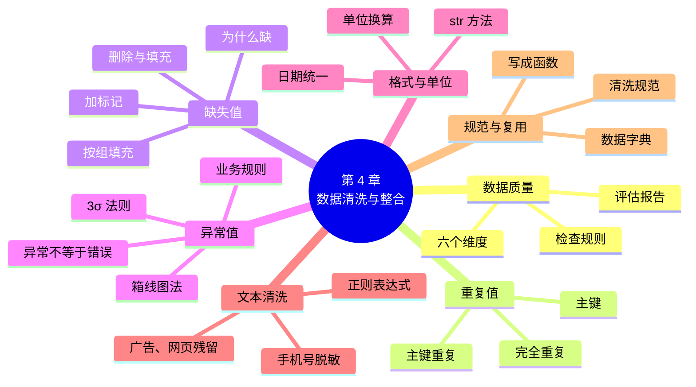

# 第 4 章 数据清洗与整合

!!! abstract "本章学时"
    理论 5 学时 · 实验 2 学时（本章共 3 个实验，教师可任选）

## 学习目标

学完本章，你应该能够：

1. **说出**数据质量的六个维度，以及每个维度常见的问题（记忆）；
2. **解释**几种缺失值处理方法的利弊，以及为什么“异常值不一定是错误”（理解）；
3. **运行并修改**给定代码，检查一张表的数据质量，写出数据质量评估表（应用）；
4. **运行并修改**给定代码，按清洗规范处理重复、缺失、异常、格式和单位问题，并核对清洗前后的结果（应用）；
5. **判断**一个异常值或缺失值应该删除、修正、填充还是保留，并说明理由（评价）。

!!! info "先修要求"
    学习本章前，你需要：

    - 会用 pandas 读表、条件筛选、新增列、分组统计、合并（[第 2 章](../02-pandas/index.md)）；
    - 知道 `to_datetime` 把文字转换成日期时间（[2.6.1](../02-pandas/index.md#261)）；
    - 做过实验 3-3，或者至少打开看过采集回来的评论，知道里面有哪些“脏东西”（[实验 3-3](../03-collection/index.md#3-3)）。

??? abstract "本章概念清单（22 个，点击查看定义和例子）"
    1. [数据质量](../../appendix/glossary.md#g-数据质量)
    2. [数据质量维度](../../appendix/glossary.md#g-数据质量维度)
    3. [完整性](../../appendix/glossary.md#g-完整性)
    4. [唯一性](../../appendix/glossary.md#g-唯一性)
    5. [有效性](../../appendix/glossary.md#g-有效性)
    6. [一致性](../../appendix/glossary.md#g-一致性)
    7. [准确性](../../appendix/glossary.md#g-准确性)
    8. [及时性](../../appendix/glossary.md#g-及时性)
    9. [数据质量评估报告](../../appendix/glossary.md#g-数据质量评估报告)
    10. [主键](../../appendix/glossary.md#g-主键)
    11. [缺失值](../../appendix/glossary.md#g-缺失值)
    12. [中位数](../../appendix/glossary.md#g-中位数)
    13. [按组填充](../../appendix/glossary.md#g-按组填充)
    14. [异常值](../../appendix/glossary.md#g-异常值)
    15. [3σ 法则](../../appendix/glossary.md#g-3σ-法则)
    16. [箱线图法](../../appendix/glossary.md#g-箱线图法)
    17. [业务规则校验](../../appendix/glossary.md#g-业务规则校验)
    18. [正则表达式](../../appendix/glossary.md#g-正则表达式)
    19. [脱敏](../../appendix/glossary.md#g-脱敏)
    20. [无效评论](../../appendix/glossary.md#g-无效评论)
    21. [清洗规范](../../appendix/glossary.md#g-清洗规范)
    22. [数据处理流水线](../../appendix/glossary.md#g-数据处理流水线)

## 情景导入

小周把订单数据交给分析组的小林，没过半天小林就找上门来：“你给的数据有问题啊。我按城区算销售额，怎么出来 16 个城区？广州哪有这么多区？”小周一看，原来同一个城区有的写“天河”，有的写“天河区”，被当成了两个。

小林接着说：“还有，有一单实付 45950 元，一顿外卖吃了四万多？有些送达时长是负数，有些订单号出现了两次，日期一会儿是 2025-03-05，一会儿是 2025/03/05，一会儿是 2025年03月05日……我算的平均客单价比财务报的高了一大截，老板问我为什么，我答不上来。”

业内有句老话：“垃圾进，垃圾出”（Garbage in, garbage out）。数据有问题，分析和模型做得再漂亮也是错的。据各种行业调查，数据分析师和算法工程师往往要把一半以上的时间花在整理和清洗数据上。本章就来学习怎样系统地发现数据的问题，并按规范把它们处理干净。

## 4.1 数据质量：从哪几个方面检查

### 4.1.1 数据质量的六个维度

[**数据质量**](../../appendix/glossary.md#g-数据质量 "数据满足使用要求的程度，通常从完整性、唯一性、有效性、一致性、准确性、及时性等维度衡量"){ .term }是指数据满足使用要求的程度。“质量好不好”太笼统，没法检查，所以业界把它拆成几个可以逐项检查的方面，叫作[**数据质量维度**](../../appendix/glossary.md#g-数据质量维度 "把“数据质量”拆成的若干个可以逐项检查、用数字衡量的方面"){ .term }。最常用的是下面六个维度：<sup class="cite">[[1]](#ref4-1)</sup>

| 维度 | 问的问题 | “食客说”订单表中的例子 |
|---|---|---|
| [**完整性**](../../appendix/glossary.md#g-完整性 "该有的数据是否齐全，没有缺失"){ .term } | 该有的数据有没有缺？ | 有的订单没有配送距离、没有城区 |
| [**唯一性**](../../appendix/glossary.md#g-唯一性 "同一个对象是否只被记录一次，没有重复"){ .term } | 同一个东西有没有被记录多次？ | 同一笔订单出现了两行 |
| [**有效性**](../../appendix/glossary.md#g-有效性 "数据的格式、类型、取值范围是否符合规定"){ .term } | 数据的格式、类型、取值范围对不对？ | 日期写成“2025年03月05日”；配送距离写成“3.2km”；送达时长是负数 |
| [**一致性**](../../appendix/glossary.md#g-一致性 "同一件事在不同地方、不同时间的记录是否一致"){ .term } | 同一件事在不同地方的记录是否一致？ | “天河”和“天河区”；订单表的城区和商家表的城区不同 |
| [**准确性**](../../appendix/glossary.md#g-准确性 "数据是否如实反映真实情况"){ .term } | 数据是否符合真实情况？ | 实付金额按“分”录入，比真实值大了 100 倍；优惠金额比订单金额还大 |
| [**及时性**](../../appendix/glossary.md#g-及时性 "数据是否足够新、是否按时到达"){ .term } | 数据是不是足够新、有没有按时到？ | 报表要的是 2025 年数据，里面却混了 2023 年的旧订单 |

我国的国家标准 GB/T 36344—2018《信息技术 数据质量评价指标》也给出了类似的框架，它把评价指标分为规范性、完整性、准确性、一致性、时效性、可访问性六类。<sup class="cite">[[2]](#ref4-2)</sup> 不同资料的叫法略有不同，但核心思想一样：把“数据质量”拆成一项项可以用规则检查、用数字衡量的指标。

### 4.1.2 把检查写成规则

每个维度都可以写成一条或几条能用代码检查的规则。比如“唯一性”可以写成“订单号不能重复”，“准确性”可以写成“实付金额 = 订单金额 − 优惠金额”。每条规则对每一行给出一个 `True`（有问题）或 `False`（没问题），数一数 `True` 有几个，就知道有多少行有问题：

```python
num = lambda col: pd.to_numeric(raw[col], errors="coerce")   # 转成数字，转不了的变成空值
checks = [
    ("完整性", "配送距离为空", raw["配送距离"].isna()),
    ("唯一性", "完全重复的行", raw.duplicated()),
    ("有效性", "送达时长为负数", num("送达时长") < 0),
    ("准确性", "实付 ≠ 订单 − 优惠",
     (num("实付金额") - (num("订单金额") - num("优惠金额"))).abs() > 0.05),
]
```

`lambda` 是一种写“一行小函数”的方法，`num("送达时长")` 就等于 `pd.to_numeric(raw["送达时长"], errors="coerce")`。`errors="coerce"` 的意思是：能转成数字的转成数字，转不了的（如“3.2km”）变成空值，而不是报错停下。“实付 ≠ 订单 − 优惠”的规则用“差的绝对值大于 0.05”来判断，因为小数计算会有极小的误差，不能直接用 `!=`。

实验 4-1 按六个维度共检查了 13 项，得到“食客说”原始订单表的**数据质量评估表**：

```text
 维度           检查项  问题行数    占比
完整性          城区为空   166 2.04%
完整性        配送距离为空   315 3.88%
唯一性        完全重复的行   120 1.48%
唯一性         订单号重复   120 1.48%
有效性    下单时间不是标准格式   697 8.58%
有效性      配送距离不是数字   364 4.48%
有效性       送达时长为负数    22 0.27%
一致性   城区不在标准城区列表中   635 7.82%
一致性     城区与商家表不一致   635 7.82%
准确性  实付 ≠ 订单 − 优惠   118 1.45%
准确性    优惠金额大于订单金额    24 0.30%
准确性 送达时长超过 180 分钟    29 0.36%
及时性 下单时间不在 2025 年     0 0.00%
```

一张评估表把问题的种类、数量、比例都摆清楚了，接下来就可以逐项决定怎么处理。正式的[**数据质量评估报告**](../../appendix/glossary.md#g-数据质量评估报告 "说明一份数据的概况、各维度检查结果、问题示例、影响和处理建议的文档"){ .term }还要加上数据的基本情况（来源、行数、时间范围）、每个问题的示例、对后续分析的影响和处理建议，模板见附录 E。

!!! cert "证书考点 · 人工智能训练师（四级）· 业务数据处理"
    “业务数据处理”是四级“数据采集和处理”职业功能的第二项工作内容，技能考核中常见的题目是：给一份有问题的数据，要求检查数据质量、按要求清洗并保存结果。常考：缺失值的检查和处理（`isna`、`dropna`、`fillna`）、重复值的检查和删除（`duplicated`、`drop_duplicates`）、数据类型转换、异常值的判断。容易错在清洗后不核对行数，或者把真实的大额订单当成异常值删掉。

## 4.2 重复值与主键

能唯一标识表中每一行的列叫[**主键**](../../appendix/glossary.md#g-主键 "能唯一标识表中每一行的列或列的组合，不能为空、不能重复"){ .term }。订单表的主键是订单号，商家表的主键是商家编号。主键不能为空、不能重复，这是唯一性检查的第一条。

重复分两种情况：

- **完全重复**：整行一模一样，通常是采集或导出时同一批数据被写了两遍。直接删除，只保留一行；
- **主键重复但内容不同**：同一个订单号对应两行不同的内容，可能是订单被修改过、两个系统记录不同。不能随便删，要查清楚哪一行是对的，通常保留最新的一行。

```python
print("完全重复的行：", raw.duplicated().sum())               # 120
print("订单号重复的行：", raw["order_id"].duplicated().sum())   # 120
df = raw.drop_duplicates()                                    # 删除完全重复的行，保留第一次出现的
print("删除后：", len(df), "行；订单号还有重复吗？", df["order_id"].duplicated().any())
```

```text
完全重复的行： 120
订单号重复的行： 120
删除后： 8000 行；订单号还有重复吗？ False
```

两个数字都是 120，删除完全重复的行以后订单号不再重复，说明这批数据中的重复都是“完全重复”，可以放心删除。如果删除后订单号还有重复，就要用 `df[df["order_id"].duplicated(keep=False)]` 把这些行全部找出来，逐一查看。`keep=False` 的意思是“重复的每一行都标出来”，默认只标第二次及以后出现的。

!!! tip "Excel 里怎么做"
    Excel：“数据”选项卡 →“删除重复值”，勾选要比较的列。勾选全部列就是删除完全重复的行，只勾选“订单号”就是按主键去重。想先看看哪些重复，可以用“开始”→“条件格式”→“突出显示单元格规则”→“重复值”。

## 4.3 缺失值：删、填，还是留着

### 4.3.1 先看缺了多少、缺在哪

[**缺失值**](../../appendix/glossary.md#g-缺失值 "该有值却没有值的格子，pandas 中显示为 NaN（日期为 NaT）"){ .term }就是该有值却没有值的格子，pandas 里显示为 `NaN`（对日期是 `NaT`）。先数一数每一列缺了多少：

```python
print(raw.isna().sum()[raw.isna().sum() > 0])    # 只显示有空值的列
```

```text
城区      166
配送距离    315
```

`isna()` 对每个格子判断是否为空，`sum()` 按列数一数有几个 `True`。在决定怎么处理之前，先要弄清楚两件事：

1. **为什么缺**：是系统没记录、用户没填，还是本来就没有？比如“优惠金额”为空，可能是“没有优惠”，那就应该是 0；“配送距离”为空，是定位失败没记下来，真实距离肯定不是 0；
2. **缺失有没有规律**：如果缺的都是远距离订单（比如超出定位范围），删掉它们会让平均距离偏小。这时要特别小心，删除和简单填充都会带来偏差。

### 4.3.2 四种处理方法

| 方法 | 写法 | 适用情况 | 风险 |
|---|---|---|---|
| 删除 | `df.dropna(subset=["配送距离"])` | 缺得很少、缺失没有规律，或者这一行没法用了 | 丢掉这一行的其他有用信息 |
| 填固定值 | `df["优惠金额"].fillna(0)` | 空值有明确含义，如“没有优惠” | 用错了会严重扭曲数据 |
| 填统计值 | `fillna(df["配送距离"].median())` | 数值列，缺得不多 | 分布变“尖”，掩盖真实差异 |
| 按组填充 | 见下文 | 同一组内的值相近 | 仍然是估计值 |
| 保留为“未知” | `df["城区"].fillna("未知")` | 类别列，缺失本身有意义 | 后面统计时多出一类 |

数值列填统计值时，一般用[**中位数**](../../appendix/glossary.md#g-中位数 "把数据从小到大排列后处在正中间的值，不受极端值影响"){ .term }而不是平均值，因为中位数不受极端值的影响。比实验 4-2 更进一步的做法是[**按组填充**](../../appendix/glossary.md#g-按组填充 "用缺失值所在分组（如同一城区）的统计值填充，比用全体统计值更接近真实值"){ .term }：同一城区的配送距离比较接近，就用每个城区自己的中位数去填。

```python
med = df.groupby("城区")["配送距离"].transform("median")   # 每一行对应它所在城区的中位数
df["距离为填充值"] = df["配送距离"].isna()                # 先记下哪些是填的
df["配送距离"] = df["配送距离"].fillna(med)
```

`transform("median")` 和第 2 章学的 `agg` 不同：`agg` 每组只返回一行，`transform` 把每组的计算结果“铺”回原表的每一行，所以结果的行数和原表一样，可以直接用来填充。

有时候缺失值不用估计，可以从别的表里**查回来**。订单表的城区缺了，但商家表里有每家商家的城区，按商家编号查一下就能补上真实值：

```python
df["城区"] = df["城区"].fillna(df["shop_id"].map(shops.set_index("shop_id")["城区"]))
```

`map` 相当于 VLOOKUP：拿每一行的 `shop_id` 去商家表里查对应的城区。能查回真实值的，优先查回来；查不到的，才考虑估计填充。

!!! warning "填进去的只是估计值"
    无论哪种方法，填进去的值都不是真实值。实验 4-2 用随书的“标准答案”核对后发现，按城区中位数填充的配送距离只有很少一部分恰好等于真实值。所以填充时要加一列标记（如“距离为填充值”），后面做分析、训练模型时可以把它们区分开，在报告中也要说明“有多少值是填充的”。交互动画“缺失值与异常值处理”可以直观比较几种方法的误差。

<iframe class="sim-frame" src="../../sims/missing-outliers/main.html" height="780" loading="lazy" title="缺失值与异常值处理"></iframe>
动画：缺失值与异常值处理。上半部分调异常值的判断标准，看被判为异常的订单里有多少是真实的大单；下半部分换缺失值的填充方法，看填充值和真实值差多少。[全屏打开](../../sims/missing-outliers/main.html){ target=_blank }
{ .sim-caption }

## 4.4 异常值：异常不一定是错误

### 4.4.1 用统计方法找“离群”的值

[**异常值**](../../appendix/glossary.md#g-异常值 "明显偏离大多数数据的值，也叫离群值；可能是错误，也可能是真实的极端情况"){ .term }是明显偏离大多数数据的值，也叫离群值。找异常值常用两种统计方法：

[**3σ 法则**](../../appendix/glossary.md#g-3σ-法则 "把离平均值超过 3 个标准差的值判为异常值的方法，适用于大致呈钟形分布的数据"){ .term }：σ（读作“西格玛”）是标准差，表示数据的分散程度。如果数据大致呈“中间高、两边低”的钟形分布，绝大多数（约 99.7%）的值都落在“平均值 ± 3 个标准差”的范围内，超出这个范围的就认为是异常值。

[**箱线图法**](../../appendix/glossary.md#g-箱线图法 "把小于 Q1 − 1.5×IQR 或大于 Q3 + 1.5×IQR 的值判为异常值的方法，IQR 是上下四分位数之差"){ .term }：把数据从小到大排好，处在 1/4 位置的值叫下四分位数 Q1，处在 3/4 位置的叫上四分位数 Q3，两者之差叫四分位距 IQR。超出“Q1 − 1.5 × IQR”到“Q3 + 1.5 × IQR”范围的值认为是异常值。这正是箱线图上“须”的位置，第 8 章画箱线图时还会见到。<sup class="cite">[[3]](#ref4-3)</sup>

用这两种方法检查清洗后订单的实付金额（`labs/ch04/demo_outliers.py`）：

```python
x = df["实付金额"]
mean, std = x.mean(), x.std()
out1 = df[(x - mean).abs() > 3 * std]                       # 3σ 法则
q1, q3 = x.quantile(0.25), x.quantile(0.75)
iqr = q3 - q1
out2 = df[(x < q1 - 1.5 * iqr) | (x > q3 + 1.5 * iqr)]       # 箱线图法
```

```text
平均 135.0，标准差 124.0，3σ 上界 507.0，异常 163 行
Q1 50.8，Q3 177.8，IQR 127.0，上须 368.3，异常 463 行
```

两种方法找出的“异常”数量差别很大：3σ 法则找出 163 行，箱线图法找出 463 行。这是因为订单金额不是对称的钟形分布，而是大多数集中在几十元、少数大单拖出一条长长的“尾巴”，这时箱线图法会判出更多的异常。

### 4.4.2 先问为什么，再决定怎么办

这 163 笔“异常”订单是录入错误吗？看看它们的就餐人数：

```text
3σ 异常订单的就餐人数分布：      全部订单的就餐人数分布：
2      4                         1    0.437
3     34                         2    0.277
4    125                         3    0.142
                                 4    0.143
```

全部订单中 4 人就餐的只占 14%，而“异常”订单中 4 人就餐的占了 125 ÷ 163 ≈ 77%，菜系也多是火锅、西餐、日料。它们是几个人聚餐点的大单，是**真实的业务数据**，删掉它们，平均客单价就被人为压低了，“大单从哪来”这样有价值的问题也就没法分析了。

所以统计方法找出的只是“可疑值”，要不要处理，必须结合业务判断。处理异常值可以参考下面的思路：

| 情况 | 例子 | 处理 |
|---|---|---|
| 违反常识或业务规则，能确定是错误，且能找回真实值 | 送达时长为负数（多录了负号）；实付金额按分录入 | 修正 |
| 能确定是错误，但找不回真实值 | 送达时长 600 分钟 | 置为空值，按缺失值处理 |
| 真实但极端 | 4 人火锅 900 元 | 保留；分析时可以单独看，或用中位数代替平均值 |
| 拿不准 | 新开的店一天 300 单 | 标记出来，问业务部门 |

[**业务规则校验**](../../appendix/glossary.md#g-业务规则校验 "用业务上必须成立的规则检查数据，如金额关系、取值范围、先后顺序"){ .term }往往比统计方法更可靠，因为它直接利用了“什么是不可能的”这类知识，例如：送达时长不能为负、优惠不能大于订单金额、实付金额 = 订单金额 − 优惠金额、下单时间不能晚于送达时间。实验 4-2 就是靠“实付 = 订单 − 优惠”这条规则，准确地找出了 93 笔按“分”录入的订单。

## 4.5 格式与单位统一

### 4.5.1 文字的写法：城区、日期

同一个意思有多种写法，是一致性问题最常见的来源。处理文字列要用 pandas 的 `.str` 系列方法，它们和 Python 字符串的方法一一对应，作用在整列上：

| 写法 | 作用 | 例子 |
|---|---|---|
| `.str.strip()` | 去掉首尾空格 | `" 天河 "` → `"天河"` |
| `.str.replace(a, b)` | 把 a 替换成 b | `"3.2km"` → `"3.2"` |
| `.str.removesuffix(s)` | 去掉末尾的 s | `"天河区"` → `"天河"` |
| `.str.contains(s)` | 是否包含 s | 找出含“km”的行 |
| `.str.len()` | 字数 | 找出过短的评论 |

城区多了“区”字，一行就能统一：

```python
df["城区"] = df["城区"].str.removesuffix("区")
print(sorted(df["城区"].dropna().unique()))      # 8 个城区，不再有“天河区”
```

日期有三种写法：`2025-03-05 12:30:00`、`2025/03/05 12:30`、`2025年03月05日 12:30`。办法是先用 `str.replace` 把它们变成同一种写法，再用 `to_datetime` 转换：

```python
t = (df["下单时间"].str.replace("/", "-")
     .str.replace("年", "-").str.replace("月", "-").str.replace("日", ""))
df["下单时间"] = pd.to_datetime(t, format="mixed")    # mixed：允许有的带秒、有的不带秒
print("转换失败的行数：", df["下单时间"].isna().sum())  # 0
```

把一长串方法写成多行时，要用圆括号括起来，Python 才知道它们是一句话。转换完一定要检查有没有转换失败（变成空值）的行。

### 4.5.2 数字的单位和类型

“3.2km”是文字，不能参与计算；按“分”录入的金额比真实值大 100 倍。这两类问题都要先找出来，再统一：

```python
df["配送距离"] = pd.to_numeric(df["配送距离"].str.replace("km", ""))   # 去掉单位再转数字
fen = (df["实付金额"] / 100 - (df["订单金额"] - df["优惠金额"])).abs() < 0.05
df.loc[fen, "实付金额"] = (df.loc[fen, "实付金额"] / 100).round(1)       # 分换算成元
print("按分录入、已换算：", fen.sum())                                  # 93
```

第二行的判断逻辑是：如果实付金额除以 100 以后正好等于“订单 − 优惠”，那它一定是按分录入的。用业务规则来判断，比“金额大于 1000 就除以 100”这种猜测可靠得多，因为真实订单中也有超过 1000 元的大单。

`df.loc[条件, 列名] = 新值` 是只修改满足条件的那些行，这是清洗中最常用的写法，相当于 Excel 里先筛选、再在筛选结果中修改。

!!! warning "清洗前先备份，清洗后要核对"
    清洗时不要直接修改原始文件，原始数据要原样保留一份，清洗结果另存新文件，万一清洗规则写错了还能从头再来。每做一步，都要核对行数、空值数和关键指标（如销售额合计）的变化，说得清每一处变化的原因。

## 4.6 文本清洗与正则表达式

### 4.6.1 评论里的“脏东西”

实验 3-3 采集回来的评论里混着各种“脏东西”。在 12000 条评论中，有 1461 条需要清洗，主要有这几类：

```text
。。。
肠粉鲜嫩入味 关注公众号“美食小达人”抽免单
味道很一般，芒果班戟踩雷了！环境太吵！不会再来了，有事打我电话18545161843
口味很赞，披萨必点，不过外卖送了一个多小时 强烈推荐给大家 代写好评，私聊 wx53129
味道很一般&nbsp;鸡腿饭踩雷了 不会再来了😡<br>
外卖送得很快，牛肉面做得特别好吃，价格实惠，强烈推荐给大家！！！！！
```

广告、手机号、网页残留（`&nbsp;` 是网页里的空格，`<br>` 是换行标签）、重复的标点、没有意义的“。。。”。这些内容不清洗掉，后面做标注时会干扰标注员，做情感分析时会干扰模型；手机号还涉及个人信息，必须去掉或打码。

### 4.6.2 正则表达式：描述“一类文字”的规则

手机号有成千上万个，不可能一个个列出来去替换。我们需要一种方法来描述“1 开头、第二位是 3 到 9、一共 11 位数字”这样的一类文字，这就是[**正则表达式**](../../appendix/glossary.md#g-正则表达式 "描述一类文字模式的规则，用来查找、提取、替换符合模式的文字"){ .term }。它是一种描述文字模式的小语言，几乎所有编程语言和很多文本编辑器都支持。<sup class="cite">[[4]](#ref4-4)</sup> 常用的写法不多：

| 写法 | 意思 | 例子 |
|---|---|---|
| `\d` | 一个数字 | `\d{11}` 连续 11 个数字 |
| `[3-9]` | 方括号里任选一个 | `1[3-9]` 匹配 13～19 |
| `{n}`、`{n,}` | 前一个重复 n 次、至少 n 次 | `！{2,}` 两个以上感叹号 |
| `+` | 前一个出现一次或更多 | `\s+` 一个或多个空白 |
| `.` | 任意一个字符 | `.*` 任意长度的任意内容 |
| `^`、`$` | 开头、结尾 | `\s+$` 末尾的空白 |
| `a|b` | a 或者 b | `加微信|代写好评` |
| `( )`、`\1` | 分组、引用第 1 组的内容 | `([！。])\1+` 同一个标点连续重复 |

于是，手机号的规则就是 `1[3-9]\d{9}`：1，加一个 3～9 的数字，再加 9 个数字。Python 的 `re` 模块用来写正则表达式，`re.compile` 先把规则“编译”好，再用 `.sub(替换成什么, 原文)` 做替换：

```python
import re
PHONE = re.compile(r"1[3-9]\d{9}")                    # 手机号
AD = re.compile(r"(加微信|代写好评|关注公众号).*$")     # 广告：从关键词开始到结尾
HTML = re.compile(r"&nbsp;|<[^>]+>")                  # 网页残留
PUNCT = re.compile(r"([！!？?。，])\1+")                # 重复的标点
text = "外卖送得很快，强烈推荐给大家！！！！！"
print(PUNCT.sub(r"\1", text))                         # 外卖送得很快，强烈推荐给大家！
```

规则前面的 `r` 表示“原样字符串”，让 `\d` 里的反斜杠不被 Python 当成特殊字符，写正则时都要加上。`<[^>]+>` 的意思是“小于号，加一个或多个不是大于号的字符，再加大于号”，正好能匹配 `<br>`、`<p>` 这类网页标签。`PUNCT.sub(r"\1", text)` 把“同一个标点连续出现多次”替换成“第 1 组的内容”，也就是只留一个。

写正则表达式最容易犯的错是规则**太宽**或**太窄**：写成 `\d+` 会把“第2次”“168元”这些正常的数字也替换掉；只写手机号的规则，又会漏掉“020-12345678”这样的固定电话。在交互动画“正则表达式试验台”里可以边写边看效果。

<iframe class="sim-frame" src="../../sims/regex-lab/main.html" height="640" loading="lazy" title="正则表达式试验台"></iframe>
动画：正则表达式试验台。点现成规则或自己写规则，评论中匹配到的部分会标黄，并显示替换后的效果。[全屏打开](../../sims/regex-lab/main.html){ target=_blank }
{ .sim-caption }

### 4.6.3 把清洗写成一个函数

把几条规则组合起来，写成一个清洗一条评论的函数，再用 `apply` 对整列每一条评论都调用一次：

```python
def clean_review(text):
    """清洗一条评论：去广告、去网页残留、手机号打码、重复标点只留一个、去首尾空格"""
    text = AD.sub("", text)
    text = HTML.sub("，", text)
    text = PHONE.sub("[手机号]", text)
    text = PUNCT.sub(r"\1", text)
    return text.strip(" ，")

rv["清洗后"] = rv["评论内容"].apply(clean_review)
```

手机号没有直接删除，而是替换成“[手机号]”，这样标注员看到时知道这里原来有一个电话号码，评论的意思也保持完整。这种把敏感信息替换成占位符的做法叫[**脱敏**](../../appendix/glossary.md#g-脱敏 "对敏感信息进行替换、遮挡或删除，使其不能识别到具体个人，同时尽量保留数据的可用性"){ .term }，第 12 章会系统学习。清洗以后只剩一两个字（如“。”）的评论没有分析价值，实验 4-3 把 158 条这样的[**无效评论**](../../appendix/glossary.md#g-无效评论 "清洗后几乎没有内容、没有分析价值的评论"){ .term }去掉了。

## 4.7 清洗规范：让别人照着就能做

### 4.7.1 为什么要写清洗规范

同一份数据，两个人各自清洗，结果往往不一样：一个人把配送距离为空的行删了，另一个人填了平均值；一个人把 900 元的订单当异常删了，另一个人保留了。这样算出来的指标就对不上。所以团队里要先写好[**清洗规范**](../../appendix/glossary.md#g-清洗规范 "规定每类数据问题如何识别、如何处理、为什么这样处理的文档，保证不同人清洗结果一致"){ .term }，规定每类问题怎样识别、怎样处理，大家照着执行，结果才能一致、可以复查。

一份清洗规范通常是一张表，每条规则写清“查什么、怎么判断、怎么处理、为什么”。“食客说”订单数据清洗规范的主体如下（实验 4-2 照此执行）：

| 编号 | 问题 | 识别方法 | 处理方法 | 理由 |
|---|---|---|---|---|
| 1 | 完全重复的行 | `duplicated()` | 删除，保留一行 | 导出时重复写入 |
| 2 | 日期写法不统一 | 不能按标准格式解析 | 统一转换为日期时间 | 三种写法含义相同 |
| 3 | 城区写法不一、城区为空 | 不在标准城区列表中；为空 | 去掉“区”字；为空的按商家表补全 | 商家表是城区的权威来源 |
| 4 | 配送距离带单位 | 含“km” | 去掉单位，转为数字 | 统一以公里为单位 |
| 5 | 实付金额按分录入 | 除以 100 后等于订单 − 优惠 | 除以 100 | 业务规则可以确定 |
| 6 | 优惠大于订单金额 | 优惠金额 > 订单金额 | 优惠 = 订单 − 实付 | 实付金额来自支付系统，最可靠 |
| 7 | 送达时长为负 | < 0 | 取绝对值 | 录入时多了负号 |
| 8 | 送达时长过长 | > 180 分钟 | 置为空值，不参与时长统计 | 无法确定真实值 |
| 9 | 配送距离为空 | 为空 | 按城区中位数填充，加标记列 | 同城区距离相近 |
| 10 | 实付金额极端值 | 3σ 法则 | 保留 | 核查为多人聚餐的真实大单 |

规范还应当配一份更新后的**数据字典**（[实验 1-2](../01-overview/index.md#1-2)），说明清洗后每个字段的含义、类型、单位和取值范围，以及新增的“距离为填充值”等字段是什么意思。清洗规范和数据字典的模板见附录 E。

### 4.7.2 把清洗步骤写成函数

清洗规范定好以后，下个月又来一批新数据，难道再把代码复制一遍？更好的做法是把整个清洗过程写成一个**函数**，放在一个单独的文件（如 `cleaning.py`）里，以后新数据到了，导入这个函数调用一次就行：

```python
from cleaning import clean_orders                 # 从 cleaning.py 导入自己写的函数
first = raw[raw["order_id"] < "O028000"]          # 假装这是“上半年”到的一批
second = raw[raw["order_id"] >= "O028000"]        # 这是“下半年”到的一批
parts = [clean_orders(first, shops), clean_orders(second, shops)]
```

这样做的好处是：同样的规则只写一次，不会因为复制粘贴而改漏；规则要改时只改一处；别人拿到 `cleaning.py` 就能复现你的清洗过程。这种把多个处理步骤串起来、可以反复使用的处理过程，常被称为[**数据处理流水线**](../../appendix/glossary.md#g-数据处理流水线 "把多个数据处理步骤按顺序串起来、可以对新数据反复执行的处理过程"){ .term }。实验 4-3 会验证：分两批清洗和一次清洗，得到的结果完全一样。

??? microvideo "思维工具微课｜“重复的就删掉”，这条规则会误伤谁？　4 分 05 秒"

    <video class="mv-video" controls preload="none" playsinline poster="../../assets/video/a2.jpg">
      <source src="../../assets/video/a2.mp4" type="video/mp4">
    </video>

    **这一集的思维工具：找反例。** 什么时候用：定下一条规则，交给程序执行。怎么用：想一个它会误伤的真实情况。局限：想不到的，要靠抽查。

    **看完选两件做：**

    - 玩一玩：给实验里的每条清洗规则，各写一个反例。
    - 审一审 AI：让它写清洗代码，再问它会误删什么。
    - 想一想自己：你定过的哪条“一刀切”，误伤过谁。

    <p class="mv-note">本片配音和部分画面由 AI 生成。</p>

## 4.8 前沿视窗

**数据质量校验工具。** 本章是用自己写的规则一项项检查数据质量的。在企业中，常用专门的工具把质量规则写成“数据契约”，每次新数据到达时自动检查，不合格就报警、不让它进入下游。Python 中比较流行的有 pandera 和 Great Expectations：前者可以给 DataFrame 定义“这一列必须是整数、必须大于 0、不能为空”这样的规则；后者能自动生成数据质量报告。<sup class="cite">[[5]](#ref4-5)</sup><sup class="cite">[[6]](#ref4-6)</sup> 大型企业的数据平台（如阿里云 DataWorks、华为云 DataArts）也都内置了数据质量监控模块。

**大模型辅助清洗。** 大模型擅长处理“规则说不清楚”的清洗任务，比如把“天河区体育西路 xx 号”“广州天河体育西”这样五花八门的地址统一成标准写法，或者判断一条评论是不是广告。它也可以根据几行样例数据帮你写出清洗代码和正则表达式。但要注意它的风险：大模型可能会“自作主张”地修改本来正确的数据，也可能给出看起来正确、实际漏掉某些情况的规则。所以用大模型清洗时，一定要像本章这样保留原始数据、抽样核对结果、统计修改了多少行。涉及个人信息的数据不要发给外部的大模型服务。

## 本章实验

!!! abstract "实验总览"
    | 实验 | 类型 | 建议时长 | 内容 |
    |---|---|---|---|
    | 实验 4-1 | ★ 基础 | 40 分钟 | 按六个维度检查原始订单表，生成数据质量评估表 |
    | 实验 4-2 | ★ 基础 | 50 分钟 | 按清洗规范处理重复、格式、单位、异常、缺失问题，与标准答案核对 |
    | 实验 4-3 | ☆ 拓展 | 60 分钟 | 把清洗步骤写成函数，清洗两批订单；用正则表达式清洗 1.2 万条评论 |

    代码见配套资源 `labs/ch04/` 目录。

### 实验 4-1 ★ 数据质量评估

**实验目的**

1. 会用 `isna`、`duplicated`、`to_numeric`、`to_datetime` 检查数据问题；
2. 会把数据质量维度写成检查规则，生成数据质量评估表；
3. 能根据评估表说出这份数据的主要问题。

**实验环境**：本机 CPU。

**实验数据**：`labs/data/orders_raw.csv`，从“食客说”订单中抽取的 8000 笔订单，人为加入了各种质量问题，共 8120 行。`orders_raw_问题清单.json` 记录了加入的每类问题的数量，做完实验再打开核对。

**实验步骤与代码**

第 1 步，全部按文字读入，查看空值：

```python
raw = pd.read_csv("../data/orders_raw.csv", dtype=str)   # 全部按文字读，先不让 pandas 自作主张
print("原始订单表：", raw.shape)
print(raw.isna().sum()[raw.isna().sum() > 0])
```

`dtype=str` 让每一列都按文字读入。如果让 pandas 自动判断类型，“配送距离”列因为有“3.2km”会被读成文字，“实付金额”列却会被读成数字，后面检查时容易混乱。检查阶段统一按文字读，需要时再转换。

第 2 步，按六个维度写检查规则，见 4.1.2 节。完整的 13 条规则见 `labs/ch04/lab4_1_quality_check.py`。

第 3 步，汇总成评估表并保存：

```python
report = pd.DataFrame([(d, item, int(bad.sum()), f"{bad.mean():.2%}") for d, item, bad in checks],
                      columns=["维度", "检查项", "问题行数", "占比"])
print(report.to_string(index=False))
report.to_csv("数据质量评估表.csv", index=False, encoding="utf-8-sig")
```

方括号里的写法叫“列表推导式”，意思是“对 checks 里的每一条规则，算出（维度、检查项、问题行数、占比），组成一个列表”。`bad.mean()` 是 `True` 所占的比例，`:.2%` 把它显示成保留两位小数的百分数。

**运行结果**

```text
原始订单表： (8120, 13)
城区      166
配送距离    315
dtype: int64
```

评估表见 4.1.2 节。和问题清单对照：城区缺失 166 行，比清单中的 165 多 1 行；配送距离缺失 315 行，比清单的 309 多 6 行。这是因为 120 行重复行是在加入其他问题之后复制出来的，有问题的行被复制后也算了两次。这提醒我们：**先去重，再统计其他问题**，数字才准确。

**实验记录表**

| 维度 | 问题最多的检查项 | 问题行数 | 你建议的处理方法 |
|---|---|---|---|
| 完整性 | | | |
| 唯一性 | | | |
| 有效性 | | | |
| 一致性 | | | |
| 准确性 | | | |

**常见问题排查**

| 现象 | 原因 | 解决办法 |
|---|---|---|
| `TypeError: '<' not supported between instances of 'str' and 'int'` | 按文字读入的列直接和数字比较 | 先用 `pd.to_numeric(…, errors="coerce")` 转换 |
| 所有日期都“不是标准格式” | `format` 写错，如少了秒 | 和数据中的标准写法对照：`"%Y-%m-%d %H:%M:%S"` |
| “实付 ≠ 订单 − 优惠”有几千行 | 直接用 `!=` 比较小数 | 改为“差的绝对值大于 0.05” |

**思考与练习**

1. 增加一条有效性检查：“就餐人数不在 1～10 之间”，有多少行？
2. 增加一条及时性检查：“下单时间在凌晨 3 点到 5 点之间”算不算有问题？说说你的看法。

**实验报告要求**

提交数据质量评估表，并在此基础上写一份不超过一页的数据质量评估报告（数据概况、主要问题、对分析的影响、处理建议），可以用附录 E 的模板。

### 实验 4-2 ★ 按规范实施清洗

**实验目的**

1. 会按清洗规范处理重复、格式、单位、业务规则、异常和缺失问题；
2. 会在每一步之后核对行数和空值；
3. 会把清洗结果和标准答案逐列核对，理解“填充值只是估计值”。

**实验环境**：本机 CPU。

**实验数据**：`orders_raw.csv`、`shops.csv`；核对用 `orders.csv`（干净的订单表，相当于“标准答案”）。

**实验步骤与代码**

按 4.7.1 节清洗规范的 10 条规则依次处理，各步代码见 4.2～4.5 节。完整代码见 `labs/ch04/lab4_2_clean_orders.py`。程序的最后用标准答案逐列核对：

```python
truth = pd.read_csv("../data/orders.csv", parse_dates=["下单时间"]).set_index("order_id").loc[df["order_id"]]
mine = df.set_index("order_id")
for col in ["实付金额", "优惠金额", "送达时长", "配送距离"]:
    same = (mine[col] - truth[col]).abs().lt(0.05)        # 差距小于 0.05 算一致
    print(f"{col}：与标准答案一致 {same.mean():.2%}")
```

`set_index("order_id")` 把订单号设为索引，两张表就能按订单号逐行对齐比较；`.loc[df["order_id"]]` 从标准答案中取出这 8000 笔订单。

**运行结果**

```text
日期转换后为空的行数： 0
城区取值： ['天河', '海珠', '番禺', '白云', '花都', '荔湾', '越秀', '黄埔']
按分录入、已换算的行数： 93
按业务规则修正优惠金额的行数： 24
负数改正： 22  超长置空： 27
                步骤   行数
              原始数据 8120
        1 删除完全重复的行 8000
2–8 格式、单位、异常、缺失处理后 8000
送达时长    27
dtype: int64
下单时间：与标准答案一致 100.00%
实付金额：与标准答案一致 100.00%
优惠金额：与标准答案一致 100.00%
送达时长：与标准答案一致 99.66%
配送距离：与标准答案一致 96.17%
```

去重后订单从 8120 行变成 8000 行，之后每一步都只修改、不删除行。送达时长有 27 个超长值被置为空值，所以和标准答案的一致率是 99.66%；配送距离有 300 多个值是按城区中位数填充的，所以一致率只有 96.17%。下单时间、实付金额、优惠金额通过格式统一和业务规则修正，全部恢复成了真实值。

**实验记录表**

| 检查项 | 清洗前 | 清洗后 |
|---|---|---|
| 行数 | | |
| 城区的取值个数 | | |
| 实付金额合计（元） | | |
| 实付金额最大值（元） | | |
| 平均送达时长（分钟） | | |

**常见问题排查**

| 现象 | 原因 | 解决办法 |
|---|---|---|
| `AttributeError: Can only use .str accessor with string values` | 这一列已经是数字了，又用 `.str` | 检查是否重复运行了转换的代码 |
| `ValueError: Unable to parse string "3.2km"` | 没去掉单位就转数字 | 先 `str.replace("km", "")` |
| 日期转换后有空值 | 还有没统一的写法 | 打印转换失败的原始值看看是什么写法 |
| 修改后出现 `SettingWithCopyWarning` | 在筛选出的子表上修改（旧版 pandas） | 用 `df.loc[条件, 列] = 值` 的写法 |

**思考与练习**

1. 把规则 9 改成“配送距离为空的行直接删除”，清洗后还有多少行？平均配送距离变了多少？
2. 不用清洗规范中的规则 5，而改用“实付金额大于 1000 就除以 100”，会出什么问题？用代码验证你的判断。

**实验报告要求**

提交运行结果截图、实验记录表和两道思考题的答案。用一段话说明：为什么配送距离的一致率不是 100%？

### 实验 4-3 ☆ 清洗流水线与评论文本清洗

**实验目的**

1. 会把清洗步骤写成函数，放在单独的文件中导入使用；
2. 会写正则表达式，清洗评论中的广告、网页残留、手机号和重复标点；
3. 会用 `apply` 对一列中的每个值调用函数。

**实验环境**：本机 CPU。

**实验数据**：`orders_raw.csv`、`shops.csv`；`reviews_raw.csv`（与实验 3-3 采集的评论相同，共 12000 条）。

**实验步骤与代码**

第 1 步，**先自己写**：新建 `my_cleaning.py`，把实验 4-2 的清洗代码改写成函数 `clean_orders(df, shops)`，输入原始表，返回清洗后的表。写完后和 `labs/ch04/cleaning.py` 对照。

第 2 步，把原始订单分成两批，分别调用函数清洗，再和一次清洗全部的结果比较，见 4.7.2 节。

第 3 步，**先自己写**正则表达式：找出评论中的手机号、广告。可以先在交互动画“正则表达式试验台”里调试规则，调好了再写进代码。

第 4 步，用 `clean_review` 函数清洗全部评论，去掉无效评论并保存：

```python
rv = pd.read_csv("../data/reviews_raw.csv")
rv["清洗后"] = rv["评论内容"].apply(clean_review)          # 对每一条评论调用 clean_review
changed = rv[rv["清洗后"] != rv["评论内容"]]
print("被修改的评论：", len(changed), "条")
useless = rv["清洗后"].str.len() < 4                        # 清洗后不到 4 个字的视为无效评论
rv[~useless][["review_id", "清洗后"]].rename(columns={"清洗后": "评论内容"}).to_csv(
    "reviews_clean.csv", index=False, encoding="utf-8-sig")
```

`~useless` 中的 `~` 是“取反”，即“不是无效评论的”。完整代码见 `labs/ch04/lab4_3_pipeline.py`。

**运行结果**

```text
第一批 清洗后 (3980, 14) 实付合计 544285.3
第二批 清洗后 (4020, 14) 实付合计 535458.1
分两批清洗 与 一次清洗 的实付合计是否相同： True
被修改的评论： 1461 条
  原文： 。。。
  清洗： 。
  原文： 肠粉鲜嫩入味 关注公众号“美食小达人”抽免单
  清洗： 肠粉鲜嫩入味
  原文： 味道很一般，芒果班戟踩雷了！环境太吵！不会再来了，有事打我电话18545161843
  清洗： 味道很一般，芒果班戟踩雷了！环境太吵！不会再来了，有事打我电话[手机号]
  原文： 口味很赞，披萨必点，不过外卖送了一个多小时 强烈推荐给大家 代写好评，私聊 wx53129
  清洗： 口味很赞，披萨必点，不过外卖送了一个多小时 强烈推荐给大家
  原文： 味道很一般&nbsp;鸡腿饭踩雷了 不会再来了😡<br>
  清洗： 味道很一般，鸡腿饭踩雷了 不会再来了😡
无效评论： 158 条，例如： ['。。。', '。。。', '。。。']
已保存 reviews_clean.csv，共 11842 条
```

清洗后的 11842 条评论 `reviews_clean.csv` 将在第 5 章用于标注。表情符号（如😡）保留了下来，因为它们往往表达了情感，对情感分析有用。

**实验记录表**

| 检查项 | 你的结果 |
|---|---|
| 你写的 `clean_orders` 与参考代码的结果是否一致？ | |
| 你写的手机号正则表达式 | |
| 被修改的评论条数 | |
| 无效评论条数 | |
| 随机抽 20 条清洗后的评论，还有没清干净的吗？ | |

**常见问题排查**

| 现象 | 原因 | 解决办法 |
|---|---|---|
| `ModuleNotFoundError: No module named 'cleaning'` | `cleaning.py` 不在当前目录 | 在 `labs/ch04` 目录下运行 |
| 正则表达式什么都没匹配到 | 中文标点和英文标点不同，如“！”和“!” | 两种都写进去：`[！!]` |
| `re.error: unbalanced parenthesis` | 括号没有成对 | 检查每个 `(` 都有对应的 `)` |
| 修改了 `cleaning.py` 但结果没变 | Jupyter 里已经导入过旧版本 | 重启内核（Kernel → Restart）再运行 |

**思考与练习**

1. 修改手机号规则，把“020-12345678”这样的固定电话也替换成“[电话]”。
2. 有的评论在句末写了“五星好评，私聊返现”，这是广告吗？你会怎样修改广告规则？会不会误伤正常评论？

**实验报告要求**

提交你自己写的 `my_cleaning.py`、运行结果截图、实验记录表和两道思考题的代码。

## 本章小结

- **数据质量**可以从**完整性**、**唯一性**、**有效性**、**一致性**、**准确性**、**及时性**六个**数据质量维度**来检查。把每个维度写成规则，统计问题行数和比例，就得到**数据质量评估报告**的核心内容。
- **主键**不能为空、不能重复。完全重复的行可以直接删除；主键重复但内容不同的，要查清再处理。
- **缺失值**先弄清为什么缺、有没有规律，再选择删除、填固定值、填统计值（优先**中位数**）、**按组填充**或保留为“未知”；能从别的表查回真实值的优先查回；填充的值要加标记。
- **异常值**可以用 **3σ 法则**或**箱线图法**找出来，但异常不一定是错误。**业务规则校验**往往更可靠。能确定是错误的就修正或置空，真实的极端值要保留。
- 格式统一用 `.str` 方法和 `to_datetime`，单位统一要先找出、再换算，用 `df.loc[条件, 列] = 值` 只改有问题的行。
- **正则表达式**用来描述一类文字，清洗评论中的广告、手机号、网页残留和重复标点；手机号等个人信息要**脱敏**；清洗后过短的**无效评论**要去掉。
- 团队清洗前先写**清洗规范**，更新数据字典；把清洗步骤写成函数，形成可以反复使用的**数据处理流水线**。清洗前备份原始数据，清洗后核对每一步的变化。



**下一章预告**

数据干净了，但要训练一个“读评论判断好评差评”的模型，光有评论还不够，还需要有人告诉模型每条评论“是好评还是差评”，这就是数据标注。人工智能训练师四级考试中分量最重的就是数据标注。下一章学习标注任务的类型、怎样写一份好的标注规范，并用开源工具 Label Studio 亲手标注评论和图片。

## 参考文献

正文中的上标编号（如<sup class="cite">[[1]](#ref4-1)</sup>）对应下面的文献。带链接的可以直接打开；书籍可在图书馆或电子书平台查阅。

<div class="refs" markdown>

**教材与专著**

- <span id="ref4-3"></span>[3] TUKEY J W. Exploratory data analysis[M]. Reading: Addison-Wesley, 1977.
    <span class="ref-note">探索性数据分析的奠基之作，提出了箱线图和用四分位距判断离群值的方法，对应 4.4.1 节。</span>
- <span id="ref4-7"></span>[7] MCKINNEY W. Python for data analysis: data wrangling with pandas, NumPy, and Jupyter[M]. 3rd ed. Sebastopol: O'Reilly Media, 2022.
    <span class="ref-note">第 7 章“数据清洗和准备”讲缺失值、重复值、字符串处理和正则表达式，对应 4.2～4.6 节。</span>

**标准与报告**

- <span id="ref4-1"></span>[1] DAMA UK Working Group. The six primary dimensions for data quality assessment[R]. DAMA UK, 2013.
    <span class="ref-note">英国数据管理协会的白皮书，提出完整性、唯一性、及时性、有效性、准确性、一致性六个维度，是本章 4.1 节的主要依据。</span>
- <span id="ref4-2"></span>[2] 国家市场监督管理总局, 中国国家标准化管理委员会. 信息技术 数据质量评价指标：GB/T 36344—2018[S]. 北京: 中国标准出版社, 2018.
    <span class="ref-note">我国数据质量评价的国家标准，提出规范性、完整性、准确性、一致性、时效性、可访问性六类指标，对应 4.1.1 节。</span>

**在线资源**

- <span id="ref4-4"></span>[4] Python Software Foundation. re: Regular expression operations[EB/OL]. [2026-10-31]. https://docs.python.org/3/library/re.html.
    <span class="ref-note">Python 正则表达式模块的官方文档，列出全部写法，对应 4.6 节。</span>
- <span id="ref4-5"></span>[5] Union.ai. Pandera documentation[EB/OL]. [2026-10-31]. https://pandera.readthedocs.io/.
    <span class="ref-note">pandera 的官方文档，介绍怎样给 DataFrame 定义数据校验规则，对应 4.8 节。</span>
- <span id="ref4-6"></span>[6] Great Expectations. Great Expectations documentation[EB/OL]. [2026-10-31]. https://docs.greatexpectations.io/.
    <span class="ref-note">数据质量校验工具 Great Expectations 的官方文档，对应 4.8 节。</span>
- <span id="ref4-8"></span>[8] pandas development team. Working with missing data[EB/OL]. [2026-10-31]. https://pandas.pydata.org/docs/user_guide/missing_data.html.
    <span class="ref-note">pandas 官方文档中处理缺失值的一节，包括 isna、dropna、fillna 的用法，对应 4.3 节。</span>

</div>

## 课后练习

选择题和判断题可以直接点击选项作答，系统会马上告诉你对错，并展开答案与解析；多选题选好后点“提交答案”。简答和实操题请先自己作答，再点开“答案与解析”核对。每道题的解析下方都有“回看”链接，做错了可以直接跳回正文复习。

**一、单项选择题**

<div class="quiz" data-answer="B" markdown>

**1.** 订单表中同一城区有的写“天河”、有的写“天河区”，这属于数据质量的（　　）问题。

- A. 完整性
- B. 一致性
- C. 唯一性
- D. 及时性

</div>

??? tip "答案与解析"
    **答案：B**

    同一个意思有不同写法，是一致性问题。完整性是“缺没缺”，唯一性是“有没有重复”，及时性是“新不新”。

    考查：数据质量维度 · 认知层次：理解 · [回看 4.1.1](#411)
    { .quiz-meta }

<div class="quiz" data-answer="C" markdown>

**2.** 统计每一列有多少个空值，应该写（　　）。

- A. `df.duplicated().sum()`
- B. `df.dropna()`
- C. `df.isna().sum()`
- D. `df.fillna(0)`

</div>

??? tip "答案与解析"
    **答案：C**

    `isna()` 判断每个格子是否为空，`sum()` 按列统计 `True` 的个数。A 是统计重复行，B 是删除含空值的行，D 是把空值填成 0。

    考查：缺失值 · 认知层次：应用 · [回看 4.3.1](#431)
    { .quiz-meta }

<div class="quiz" data-answer="A" markdown>

**3.** 订单表的“优惠金额”为空，经核实表示该订单没有使用优惠。最合适的处理是（　　）。

- A. 填 0
- B. 填平均值
- C. 删除这些行
- D. 填中位数

</div>

??? tip "答案与解析"
    **答案：A**

    空值有明确含义“没有优惠”，真实值就是 0。填平均值、中位数会凭空捏造优惠，删除会丢掉这些订单。

    考查：缺失值处理 · 认知层次：评价 · [回看 4.3.2](#432)
    { .quiz-meta }

<div class="quiz" data-answer="D" markdown>

**4.** 一列数值有少量极端大的值，填充这一列的缺失值时，用（　　）比平均值更稳妥。

- A. 最大值
- B. 最小值
- C. 0
- D. 中位数

</div>

??? tip "答案与解析"
    **答案：D**

    中位数是排在中间的值，不受极端值影响；平均值会被少数极大的值拉高。

    考查：缺失值处理 · 认知层次：理解 · [回看 4.3.2](#432)
    { .quiz-meta }

<div class="quiz" data-answer="B" markdown>

**5.** 箱线图法判断异常值时，上界是（　　）。

- A. 平均值 + 3 × 标准差
- B. Q3 + 1.5 × IQR
- C. Q3 + 3 × 标准差
- D. 最大值

</div>

??? tip "答案与解析"
    **答案：B**

    IQR = Q3 − Q1，上界 Q3 + 1.5 × IQR，下界 Q1 − 1.5 × IQR。A 是 3σ 法则的上界。

    考查：箱线图法 · 认知层次：记忆 · [回看 4.4.1](#441)
    { .quiz-meta }

<div class="quiz" data-answer="C" markdown>

**6.** 实验中用 3σ 法则找出 163 笔实付金额“异常”的订单，其中 125 笔是 4 人就餐。对这些订单最合适的处理是（　　）。

- A. 全部删除
- B. 全部改成平均值
- C. 保留，它们是真实的大单
- D. 全部除以 100

</div>

??? tip "答案与解析"
    **答案：C**

    几个人聚餐金额大是正常的业务现象，异常不一定是错误。删除或修改会使客单价等指标失真。

    考查：异常值 · 认知层次：评价 · [回看 4.4.2](#442)
    { .quiz-meta }

<div class="quiz" data-answer="A" markdown>

**7.** 正则表达式 `1[3-9]\d{9}` 能匹配的是（　　）。

- A. 13812345678
- B. 12812345678
- C. 1381234567
- D. 020-12345678

</div>

??? tip "答案与解析"
    **答案：A**

    规则是“1，加一个 3～9 的数字，再加 9 个数字”，共 11 位。B 第二位是 2，C 只有 10 位，D 是固定电话。

    考查：正则表达式 · 认知层次：应用 · [回看 4.6.2](#462)
    { .quiz-meta }

<div class="quiz" data-answer="D" markdown>

**8.** 要把“配送距离”列中的“3.2km”变成可以计算的数字 3.2，正确的写法是（　　）。

- A. `df["配送距离"].astype(int)`
- B. `pd.to_datetime(df["配送距离"])`
- C. `df["配送距离"].fillna(0)`
- D. `pd.to_numeric(df["配送距离"].str.replace("km", ""))`

</div>

??? tip "答案与解析"
    **答案：D**

    先用 `str.replace` 去掉单位，再用 `to_numeric` 转成数字。直接 `astype(int)` 会因为有“km”而报错，而且 3.2 不是整数。

    考查：格式与单位统一 · 认知层次：应用 · [回看 4.5.2](#452)
    { .quiz-meta }

<div class="quiz" data-answer="B" markdown>

**9.** 把评论中的手机号替换成“[手机号]”，这种处理叫（　　）。

- A. 去重
- B. 脱敏
- C. 展平
- D. 填充

</div>

??? tip "答案与解析"
    **答案：B**

    把敏感信息替换成占位符或部分遮挡，叫脱敏，既保护个人信息，又保留了评论的完整意思。

    考查：脱敏 · 认知层次：记忆 · [回看 4.6.3](#463)
    { .quiz-meta }

**二、多项选择题**

<div class="quiz quiz-multi" data-answer="ABD" markdown>

**10.** 下列属于“有效性”问题的有（　　）。

- A. 下单时间写成“2025年03月05日”，不能按标准格式解析
- B. 送达时长为负数
- C. 同一笔订单出现两行
- D. 配送距离写成“3.2km”

</div>

??? tip "答案与解析"
    **答案：ABD**

    有效性关心格式、类型、取值范围是否合乎要求。C 是唯一性问题。

    考查：数据质量维度 · 认知层次：理解 · [回看 4.1.1](#411)
    { .quiz-meta }

<div class="quiz quiz-multi" data-answer="ACD" markdown>

**11.** 关于缺失值的处理，下列说法正确的有（　　）。

- A. 处理前要先弄清楚为什么缺
- B. 填平均值不会改变数据的分布
- C. 能从其他表查回真实值的，优先查回
- D. 填充的值最好加一列标记

</div>

??? tip "答案与解析"
    **答案：ACD**

    填平均值会让很多值堆在同一个位置，分布变“尖”，标准差变小，B 错误。

    考查：缺失值处理 · 认知层次：理解 · [回看 4.3.2](#432)
    { .quiz-meta }

<div class="quiz quiz-multi" data-answer="ABC" markdown>

**12.** 下列可以作为订单数据“业务规则校验”的有（　　）。

- A. 实付金额 = 订单金额 − 优惠金额
- B. 送达时长不能为负数
- C. 优惠金额不能大于订单金额
- D. 实付金额必须小于平均值的 3 倍

</div>

??? tip "答案与解析"
    **答案：ABC**

    A、B、C 都是业务上必须成立的规则。D 不是业务规则，大单金额超过平均值 3 倍是完全可能的。

    考查：业务规则校验 · 认知层次：分析 · [回看 4.4.2](#442)
    { .quiz-meta }

<div class="quiz quiz-multi" data-answer="ABD" markdown>

**13.** 把清洗步骤写成函数的好处有（　　）。

- A. 新数据到了调用一次就能清洗，不用复制代码
- B. 规则要改时只改一处
- C. 函数一定比不写函数运行得快
- D. 别人拿到函数文件就能复现清洗过程

</div>

??? tip "答案与解析"
    **答案：ABD**

    写成函数主要是为了复用、一致、可复查，并不会让代码变快。

    考查：数据处理流水线 · 认知层次：理解 · [回看 4.7.2](#472)
    { .quiz-meta }

**三、判断题**

<div class="quiz quiz-judge" data-answer="×" markdown>

**14.** 用 3σ 法则找出的异常值都是录入错误，应该删除。

</div>

??? tip "答案与解析"
    **答案：×**

    统计方法找出的只是“可疑值”。本章的例子中，大部分“异常”订单是多人聚餐的真实大单，应该保留。

    考查：异常值 · 认知层次：评价 · [回看 4.4.2](#442)
    { .quiz-meta }

<div class="quiz quiz-judge" data-answer="√" markdown>

**15.** `drop_duplicates()` 不加参数时，删除的是所有列都相同的重复行。

</div>

??? tip "答案与解析"
    **答案：√**

    不加参数时比较全部列；要按主键去重，写 `drop_duplicates("order_id")`。

    考查：重复值 · 认知层次：记忆 · [回看 4.2](#42)
    { .quiz-meta }

<div class="quiz quiz-judge" data-answer="×" markdown>

**16.** 正则表达式规则写得越宽越好，这样不会漏掉要清洗的内容。

</div>

??? tip "答案与解析"
    **答案：×**

    规则太宽会误伤正常内容，比如用 `\d+` 找手机号，会把“第2次”“168元”也替换掉。规则要宽窄合适，并抽样检查结果。

    考查：正则表达式 · 认知层次：理解 · [回看 4.6.2](#462)
    { .quiz-meta }

<div class="quiz quiz-judge" data-answer="√" markdown>

**17.** 清洗数据时应保留原始数据，清洗结果另存为新文件。

</div>

??? tip "答案与解析"
    **答案：√**

    万一清洗规则写错，保留的原始数据可以让你从头再来，也便于别人复查。

    考查：清洗规范 · 认知层次：记忆 · [回看 4.5.2](#452)
    { .quiz-meta }

<div class="quiz quiz-judge" data-answer="×" markdown>

**18.** 用中位数填充的配送距离，就是该订单真实的配送距离。

</div>

??? tip "答案与解析"
    **答案：×**

    填充值只是估计值。实验 4-2 中配送距离和标准答案的一致率只有 96.17%，不一致的正是那些填充值。

    考查：缺失值处理 · 认知层次：理解 · [回看 4.3.2](#432)
    { .quiz-meta }

**四、简答题**

**19.** 什么是数据质量的六个维度？各举一个“食客说”订单表中的例子。

??? tip "答案与解析"
    **参考答案**：完整性，该有的数据有没有缺，如配送距离为空；唯一性，同一记录有没有重复，如同一订单出现两行；有效性，格式、类型、取值范围对不对，如送达时长为负、日期写成中文格式；一致性，同一件事的记录是否一致，如“天河”和“天河区”；准确性，是否符合真实情况，如实付金额按分录入大了 100 倍；及时性，数据是否够新、按时，如 2025 年报表中混入旧年份数据。

    考查：数据质量维度 · 认知层次：理解 · [回看 4.1.1](#411)
    { .quiz-meta }

**20.** 为什么说“异常值不一定是错误”？发现异常值后应该怎样处理？

??? tip "答案与解析"
    **参考答案**：统计方法只是找出偏离大多数的值，偏离的原因可能是错误，也可能是真实的特殊情况，比如多人聚餐的大单。处理时先查原因：违反业务规则、能确定是错误且能找回真实值的，修正；能确定是错误但找不回真实值的，置为空值按缺失处理；真实的极端值保留，分析时单独看或用中位数；拿不准的标记出来，询问业务部门。

    考查：异常值 · 认知层次：评价 · [回看 4.4.2](#442)
    { .quiz-meta }

**21.** 团队为什么要先写清洗规范再动手清洗？一份清洗规范每条规则应写清哪些内容？

??? tip "答案与解析"
    **参考答案**：不同的人对同一问题可能有不同的处理方式，结果就对不上；写好规范大家照着执行，结果一致，也便于复查和交接。每条规则应写清：问题是什么、怎样识别（判断条件）、怎样处理、为什么这样处理。规范还应配一份更新后的数据字典。

    考查：清洗规范 · 认知层次：理解 · [回看 4.7.1](#471)
    { .quiz-meta }

**五、实操题**

**22.** 在实验 4-2 清洗后的订单表 `orders_clean.csv` 上，用箱线图法找出“送达时长”的异常值，有多少行？它们有什么共同特点？

??? tip "答案与解析"
    **参考答案**：

    ```python
    df = pd.read_csv("orders_clean.csv")
    x = df["送达时长"]
    q1, q3 = x.quantile(0.25), x.quantile(0.75)
    iqr = q3 - q1
    out = df[(x < q1 - 1.5 * iqr) | (x > q3 + 1.5 * iqr)]
    print(len(out))
    print(out[["配送距离", "天气", "配送方式"]].describe(include="all"))
    ```

    共 56 行（Q1 = 22，Q3 = 34，上界 52 分钟）。和全部订单相比，它们的平均配送距离是 7.7 公里（全部为 2.4 公里），雨天占 45%（全部为 22%），商家自送占 61%（全部为 32%）。距离远、下雨、商家自送都会让送达变慢，所以它们是真实的慢单，应保留，并可以作为改进配送的分析对象。空值会被 `quantile` 自动忽略。

    考查：箱线图法 · 认知层次：分析 · [回看 4.4.1](#441)
    { .quiz-meta }

**23.** 写一个函数 `mask_phone(text)`，把文字中的手机号中间四位换成星号，例如“18545161843”变成“185****1843”。用它处理 `reviews_raw.csv`，有多少条评论被修改？

??? tip "答案与解析"
    **参考答案**：

    ```python
    import re
    PHONE = re.compile(r"(1[3-9]\d)\d{4}(\d{4})")      # 分成三段：前 3 位、中间 4 位、后 4 位
    def mask_phone(text):
        return PHONE.sub(r"\1****\2", text)            # 保留第 1、2 组，中间换成星号
    rv = pd.read_csv("../data/reviews_raw.csv")
    new = rv["评论内容"].apply(mask_phone)
    print((new != rv["评论内容"]).sum())
    ```

    共修改 159 条。用括号分组后，替换时可以用 `\1`、`\2` 引用分组的内容，这是部分遮挡式脱敏的常用写法。

    考查：正则表达式与脱敏 · 认知层次：应用 · [回看 4.6.3](#463)
    { .quiz-meta }
