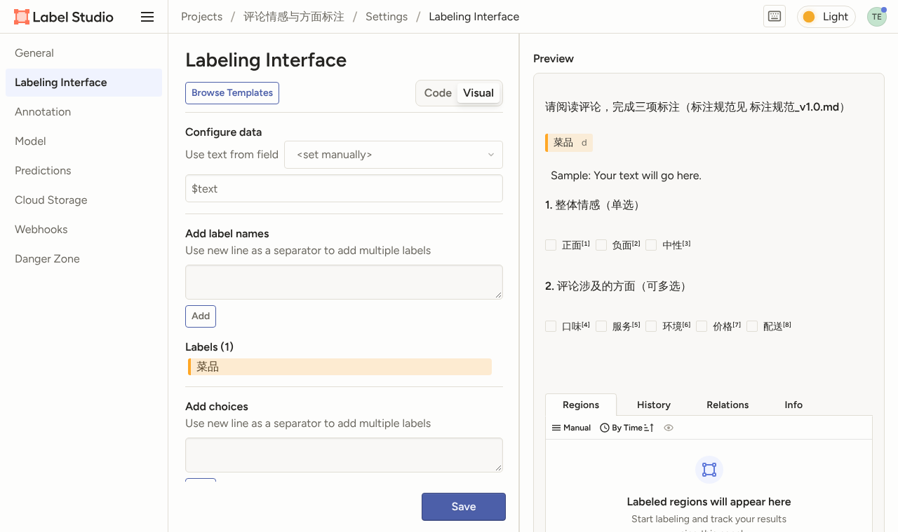
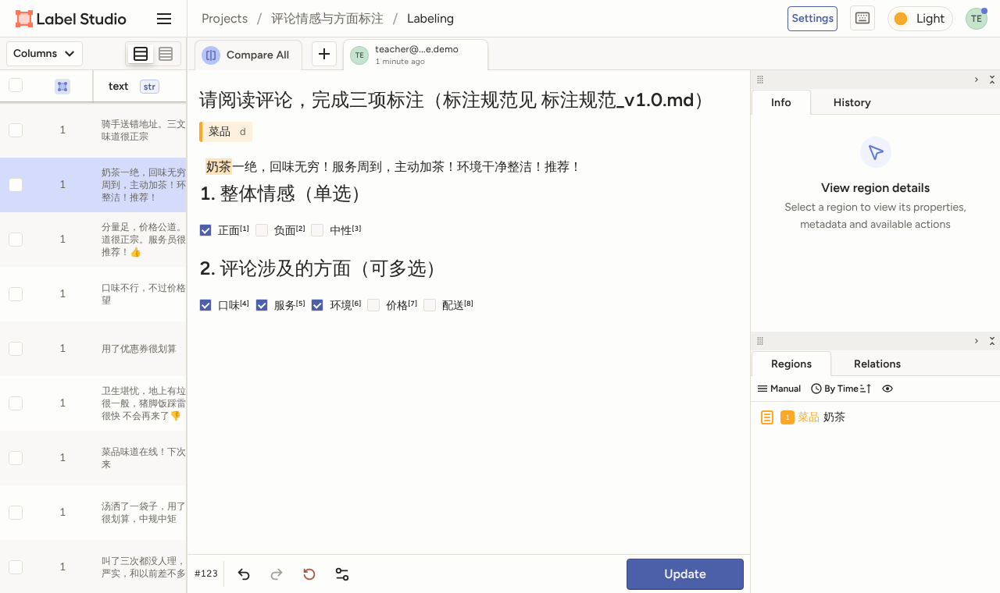
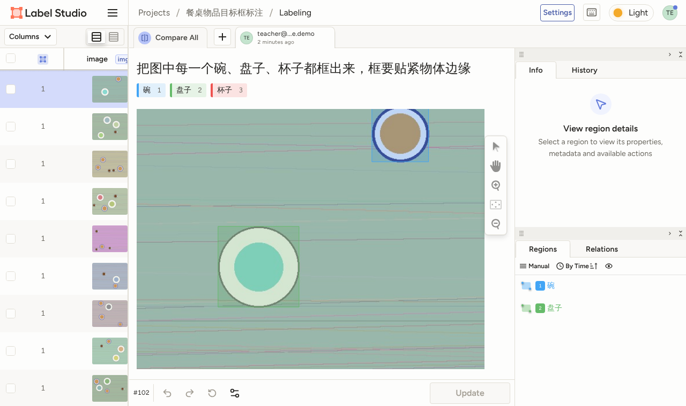
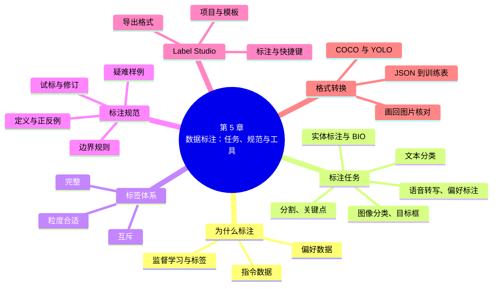

# 第 5 章 数据标注：任务、规范与工具

!!! abstract "本章学时"
    理论 5 学时（其中线下 2 学时）· 实验 2 学时（本章共 3 个实验，教师可任选）

## 学习目标

学完本章，你应该能够：

1. **说出**常见的数据标注任务类型，以及每类任务的标注结果长什么样（记忆）；
2. **解释**标签体系“互斥、完整、粒度合适”的含义，以及 BIO 标注、COCO 和 YOLO 格式的规则（理解）；
3. **编写**一份包含定义、正反例、边界规则和疑难样例的标注规范，并通过试标修订它（应用）；
4. **运行**Label Studio，配置标注模板，完成文本和图像标注，导出结果并用给定代码转成训练表（应用）；
5. **判断**一条评论、一张图片按规范应该怎样标注，说出依据的是规范中的哪一条（评价）。

!!! info "先修要求"
    学习本章前，你需要：

    - 知道什么是训练数据、什么是非结构化数据（[1.1.2](../01-overview/index.md#112)、[1.3.1](../01-overview/index.md#131)）；
    - 会读 JSON、会用 `json_normalize`（[3.2.3](../03-collection/index.md#323-json)）；
    - 知道评论已经清洗过，手机号被替换成了“[手机号]”（[4.6](../04-cleaning/index.md#46)）；
    - 第一次接触“监督学习”也没关系，5.1 节会用一个例子讲清楚，详细内容见“机器学习”课程第 1 章。

??? abstract "本章概念清单（21 个，点击查看定义和例子）"
    1. [监督学习](../../appendix/glossary.md#g-监督学习)
    2. [标签](../../appendix/glossary.md#g-标签)
    3. [数据标注](../../appendix/glossary.md#g-数据标注)
    4. [指令数据](../../appendix/glossary.md#g-指令数据)
    5. [偏好数据](../../appendix/glossary.md#g-偏好数据)
    6. [文本分类](../../appendix/glossary.md#g-文本分类)
    7. [实体标注](../../appendix/glossary.md#g-实体标注)
    8. [BIO 标注](../../appendix/glossary.md#g-BIO-标注)
    9. [目标框标注](../../appendix/glossary.md#g-目标框标注)
    10. [图像分割](../../appendix/glossary.md#g-图像分割)
    11. [关键点标注](../../appendix/glossary.md#g-关键点标注)
    12. [语音转写](../../appendix/glossary.md#g-语音转写)
    13. [偏好标注](../../appendix/glossary.md#g-偏好标注)
    14. [标签体系](../../appendix/glossary.md#g-标签体系)
    15. [标注规范](../../appendix/glossary.md#g-标注规范)
    16. [边界规则](../../appendix/glossary.md#g-边界规则)
    17. [试标](../../appendix/glossary.md#g-试标)
    18. [Label Studio](../../appendix/glossary.md#g-Label-Studio)
    19. [标注模板](../../appendix/glossary.md#g-标注模板)
    20. [COCO 格式](../../appendix/glossary.md#g-COCO-格式)
    21. [YOLO 格式](../../appendix/glossary.md#g-YOLO-格式)

## 情景导入

“食客说”想让程序自动判断每条评论是好评还是差评，这样就能每天自动统计各家商家的口碑，差评多了及时提醒商家。技术部说：“模型可以做，但得先给我 3000 条标好‘正面、负面、中性’的评论，让它学。”

数据组的小周觉得这事简单：“好评差评谁看不出来？找几个实习生，一人标一千条，三天就完事。”结果三天后收上来一看，问题一大堆：同一条“味道不错，就是送得太慢了”，有人标正面，有人标负面，有人标中性；有人把“还行吧”标成正面，有人标成中性；有个实习生为了赶进度，大部分都标成了正面。技术部用这批数据训练出来的模型，准确率还不如随便猜。

问题出在哪？出在没有一份大家都照着做的标注规范。本章就来学习数据标注：标注有哪些类型、规范怎么写、工具怎么用。这是人工智能训练师（四级）考试中比重最大的内容。

## 5.1 为什么人工智能需要标注数据

### 5.1.1 模型从“题目加答案”中学习

教小朋友认水果，我们会拿着苹果说“这是苹果”，拿着香蕉说“这是香蕉”。看得多了，再拿一个没见过的苹果，他也能认出来。很多人工智能模型的学习方式与此相同：给它看大量“题目 + 答案”，让它自己总结规律，以后遇到新题目就能给出答案。这种学习方式叫[**监督学习**](../../appendix/glossary.md#g-监督学习 "让模型从大量“输入 + 正确答案（标签）”的样本中学习规律，再对新输入给出答案的学习方式"){ .term }，“答案”就是[**标签**](../../appendix/glossary.md#g-标签 "监督学习中每条数据对应的“正确答案”，由标注得到"){ .term }。

| 任务 | 题目（输入） | 答案（标签） |
|---|---|---|
| 评论情感分析 | 一条评论 | 正面 / 负面 / 中性 |
| 菜品识别 | 一张菜品照片 | 菜品名称 |
| 餐具检测 | 一张餐桌照片 | 每个碗、盘子、杯子的位置和类别 |
| 语音点餐 | 一段录音 | 录音对应的文字 |

评论、照片、录音这些原始数据，平台每天都在大量产生，但“答案”不会自己出现，需要有人按照统一的规则一条条地给出来。这项工作就是[**数据标注**](../../appendix/glossary.md#g-数据标注 "按照标注规范，对文本、图像、语音等数据进行分类、框选、转写等加工，给数据加上标签的工作"){ .term }：按照标注规范，对文本、图像、语音等数据进行分类、框选、转写等加工，给它们加上标签。做这项工作的人就是第 1 章介绍的**数据标注员**。

模型能学到什么，取决于标注数据教了它什么。标注数据少了，模型学不会；标注得乱七八糟，模型就学成一团糟。所以业内常说，数据标注的质量决定了模型能力的上限。

### 5.1.2 大模型也离不开标注

有人会问：现在的大模型不是在海量网页上自己学的吗？还需要人工标注吗？需要，而且要求更高。大模型的训练大致分两个阶段：先在海量文本上“读书”，学会语言和知识；再由人来“教规矩”，让它学会听懂指令、回答得有用而且安全。第二阶段离不开两类人工标注数据：<sup class="cite">[[1]](#ref5-1)</sup>

- [**指令数据**](../../appendix/glossary.md#g-指令数据 "由人编写的“指令或问题 + 高质量回答”，用来教大模型听懂指令、按要求回答"){ .term }：由标注员写出“问题 + 高质量的回答”，教模型怎样回答问题。比如写出“请用三句话总结这条差评的主要问题”和一个示范回答；
- [**偏好数据**](../../appendix/glossary.md#g-偏好数据 "标注员对同一问题的几个模型回答按好坏排序或打分得到的数据，用来教大模型分辨什么样的回答更好"){ .term }：让模型对同一个问题给出几个回答，由标注员按照规范排出好坏，教模型知道“什么样的回答更好”。

2024 年 12 月，国家发展改革委等部门印发《关于促进数据标注产业高质量发展的实施意见》，提出到 2027 年数据标注产业年均复合增长率超过 20%，并在全国建设数据标注基地。<sup class="cite">[[2]](#ref5-2)</sup> 数据标注已经从过去的“体力活”发展成需要专业知识、懂规范、会用工具的技术工作。

## 5.2 常见的标注任务

### 5.2.1 文本分类

[**文本分类**](../../appendix/glossary.md#g-文本分类 "给一段文字分配一个（单标签）或多个（多标签）类别的任务"){ .term }是给一段文字分配一个或几个类别标签。它是最常见、最容易上手的标注任务。根据一条数据能有几个标签，分为两种：

- **单标签分类**：一条数据只能属于一个类别。比如评论的整体情感，只能是正面、负面、中性中的一个；
- **多标签分类**：一条数据可以同时属于多个类别。比如评论涉及的方面，“味道好、送得快”同时涉及口味和配送。

本章的评论标注就是两者的组合：情感单选，方面多选。

### 5.2.2 实体标注与 BIO

[**实体标注**](../../appendix/glossary.md#g-实体标注 "在文字中找出特定类型的词语，标出起止位置和类型"){ .term }是在文字中找出特定类型的词语（叫“实体”），标出它们的起止位置和类型。常见的实体有人名、地名、机构名、时间，在“食客说”里是菜品和店名。比如：

> 骑手送错地址。**三文鱼刺身**（菜品）味道很正宗

标注员在工具中用鼠标划出“三文鱼刺身”，选择“菜品”标签，工具就会记下：从第 7 个字开始、到第 12 个字之前，类型是菜品（Python 从 0 开始数）。

模型训练时，通常要把这样的标注转换成每个字一个标签的形式，最常用的是 [**BIO 标注**](../../appendix/glossary.md#g-BIO-标注 "把实体标注转换为逐字标签的方法：实体第一个字标 B，其余字标 I，非实体标 O"){ .term }：实体的第一个字标 B（Begin，开始），实体的其余字标 I（Inside，里面），不属于任何实体的字标 O（Outside，外面），B 和 I 后面再接上实体类型。<sup class="cite">[[3]](#ref5-3)</sup>

```text
骑 O    手 O    送 O    错 O    地 O    址 O    。 O
三 B-菜品    文 I-菜品    鱼 I-菜品    刺 I-菜品    身 I-菜品
味 O    道 O    很 O    正 O    宗 O
```

为什么要区分 B 和 I？因为两个实体可能紧挨着，比如“毛肚鸭肠”是两个菜品，标成“B I B I”才能看出是两个，如果都标成“I I I I”，就分不清是一个还是两个了。在下面的动画里可以亲手标一标。

<iframe class="sim-frame" src="../../sims/entity-bio/main.html" height="560" loading="lazy" title="实体标注练习"></iframe>
动画：实体标注练习。先选“菜品”或“店名”，再点实体的第一个字和最后一个字，下方自动生成 BIO 序列；“对答案”后和参考答案逐字比对。[全屏打开](../../sims/entity-bio/main.html){ target=_blank }
{ .sim-caption }

### 5.2.3 图像标注

图像标注按“标得多细”可以分为四种：

| 类型 | 标注结果 | 例子 | 难度 |
|---|---|---|---|
| **图像分类** | 整张图一个类别 | 这张照片是“火锅” | 低 |
| [**目标框标注**](../../appendix/glossary.md#g-目标框标注 "用矩形框标出图像中每个目标物体的位置并标明类别"){ .term } | 每个物体一个矩形框 + 类别 | 框出图中每一个碗、盘子、杯子 | 中 |
| [**图像分割**](../../appendix/glossary.md#g-图像分割 "沿物体轮廓勾画，或为每个像素标注类别的图像标注任务"){ .term } | 每个物体沿轮廓勾出的多边形，或者每个像素的类别 | 沿着盘子边缘描出它的形状 | 高 |
| [**关键点标注**](../../appendix/glossary.md#g-关键点标注 "标出物体上若干个约定特征点位置的图像标注任务"){ .term } | 物体上若干个特定点的位置 | 标出人手的 21 个关节点 | 高 |

**目标框标注**是最常用的，也是四级技能考核的重点。一个框用两个角的坐标表示：左上角 (x_min, y_min) 和右下角 (x_max, y_max)，单位是像素，图片左上角是原点，x 向右增大、y **向下**增大（和数学课上的坐标系不同）。画框要遵守几条基本要求：

1. **贴紧**：框的四条边紧贴物体最外侧的边缘，不留大片空白，也不切掉物体的一部分；
2. **不漏**：图中每一个属于标注类别的物体都要框出来，包括只露出一部分的；
3. **一物一框**：两个碗挨在一起，要分别画两个框，不能用一个大框框住；
4. **类别正确**：碗、盘子、杯子分清楚，拿不准的按规范中的边界规则处理。

怎样衡量一个框“贴得紧不紧”？第 6 章会学习用交并比来打分，在下面的动画里可以先体验一下。

<iframe class="sim-frame" src="../../sims/bbox-iou/main.html" height="720" loading="lazy" title="目标框标注与交并比"></iframe>
动画：目标框标注与交并比。在餐桌照片上拖出一个框，实时显示你的框和参考框重合的程度，以及是否达到 0.7 的验收标准。[全屏打开](../../sims/bbox-iou/main.html){ target=_blank }
{ .sim-caption }

### 5.2.4 语音与大模型标注

[**语音转写**](../../appendix/glossary.md#g-语音转写 "把录音逐字写成文字，通常还要标出时间戳和说话人"){ .term }是把录音逐字写成文字，通常还要标出每句话的起止时间（时间戳）和说话人，用于训练语音识别模型。转写要求“听到什么写什么”，口头语、重复、听不清的地方都要按规范用约定的符号标出。

[**偏好标注**](../../appendix/glossary.md#g-偏好标注 "比较模型对同一问题的几个回答，按规范判断哪个更好或给出评分的标注任务"){ .term }是大模型时代新出现的任务：同一个问题，模型给出两个或几个回答，标注员按照规范比较哪个更好，或者给每个回答打分。比如顾客问“这家店适合带老人去吗”，回答 A 结合了评论中“座位宽敞、上菜快”的信息，回答 B 只说了“适合”，标注员应该判断 A 更好。偏好标注的规范通常从“是否有用、是否真实、是否安全”几个方面来比较，对标注员的阅读理解和判断能力要求较高。

## 5.3 设计标签体系

在动手标注之前，先要确定“有哪些标签”，也就是[**标签体系**](../../appendix/glossary.md#g-标签体系 "一个标注任务中全部标签的集合及其组织方式，应互斥、完整、粒度合适"){ .term }。一个好的标签体系应当做到三点：

1. **互斥**：单选的标签之间不能有重叠，一条数据不能同时符合两个标签的定义。比如把情感分成“正面、负面、中性、满意”就不行，“满意”和“正面”重叠了；
2. **完整**：所有可能的数据都能找到一个标签。如果只有“正面、负面”，好坏各半的评论就没处放，所以要加“中性”；
3. **粒度合适**：分得太粗，模型学到的信息太少；分得太细，标注员分不清，标注一致性就差。比如把情感分成“非常满意、满意、一般、不满意、非常不满意”五级，标注员之间对“满意”和“非常满意”很难达成一致。粒度要根据用途来定：只是统计好评率，三类就够了。

很多标签体系会设一个“其他”类，用来放不属于任何已有类别的数据，保证完整。但要警惕“其他”变成“垃圾桶”：拿不准的都往里扔。所以规范中要写明“其他”的定义，并定期检查“其他”里的数据，如果某一类数据在“其他”里多起来了，说明该增加一个新标签了。

“食客说”评论标注的标签体系如下：

| 标注项 | 类型 | 标签 |
|---|---|---|
| 整体情感 | 单选，必填 | 正面、负面、中性 |
| 涉及的方面 | 多选，可以不选 | 口味、服务、环境、价格、配送 |
| 菜品 | 实体，可以没有 | 菜品 |

!!! cert "证书考点 · 人工智能训练师（四级）· 数据标注"
    “数据标注”是四级考核中比重最大的职业功能，包括数据归类和定义、按规范进行标注两部分。常考：标注任务的类型及其结果形式（分类、目标框、分割、关键点、转写）；标签体系的设计要求；按给定规范完成文本分类、目标框标注。技能考核通常要求在标注平台上限时完成一批标注并导出。容易错在漏标部分遮挡的物体、两个相邻物体共用一个框，以及不看规范凭感觉标。

## 5.4 编写标注规范

### 5.4.1 规范的组成部分

[**标注规范**](../../appendix/glossary.md#g-标注规范 "说明每个标签的含义和各种情况如何标注的文档，包括定义、正反例、边界规则、疑难样例、质量要求、版本记录"){ .term }是告诉标注员“每一个标签是什么意思、遇到各种情况该怎么标”的说明文档，也叫标注指南。它是标注项目中最重要的文件：规范写得清楚，不同的人标出来的结果才会一致；规范写得含糊，标注员只能凭感觉，结果必然五花八门。一份完整的规范通常包括：

| 组成部分 | 写什么 | 为什么需要 |
|---|---|---|
| 任务说明 | 标注目的、数据来源、要标哪几项、用什么工具 | 让标注员知道标注结果用来干什么 |
| 标签定义 | 每个标签的含义 | 统一理解 |
| 正例和反例 | 每个标签“是什么”和“不是什么”的例子 | 定义往往不够直观，例子最有说服力 |
| [**边界规则**](../../appendix/glossary.md#g-边界规则 "标注规范中针对介于两个标签之间、容易产生分歧的情况所规定的统一判法"){ .term } | 介于两个标签之间的情况怎么判 | 分歧几乎都出在边界上 |
| 疑难样例 | 试标中出现分歧的真实例子和最终答案 | 让标注员看到规则怎样落地 |
| 质量要求 | 准确率要求、每日工作量、拿不准时怎么办 | 明确验收标准 |
| 版本记录 | 每次修改的日期、内容、修改人 | 规范会不断修订，要知道谁按哪一版标的 |

### 5.4.2 “食客说”评论标注规范（节选）

下面是“食客说”评论情感与方面标注规范 v1.0 的核心部分，完整规范见 `labs/ch05/标注规范_v1.0.md`。

**整体情感的定义与例子**

| 标签 | 定义 | 正例 | 反例（不属于本类） |
|---|---|---|---|
| 正面 | 评论者对这次消费总体满意，愿意推荐或再来 | 奶茶一绝，回味无穷！服务周到，主动加茶！推荐！ | “还行吧”（是中性） |
| 负面 | 评论者对这次消费总体不满意，表示失望、不会再来或劝别人别来 | 口味不行，不过价格实惠 失望 | “价格偏贵，但味道很好，下次还来”（是正面） |
| 中性 | 没有明显倾向；或者好坏各半、看不出总体倾向 | 中规中矩；骑手送错地址。三文鱼刺身味道很正宗 | “一般般，不会再来了”（是负面） |

**边界规则**

1. **好坏都有时，看结尾和整体态度**：评论末尾有“推荐”“还会再来”“五星好评”等总结性表态的，按表态定；没有总结性表态、好坏各占一半的，标“中性”。
2. **只有一句“失望”“差评”“推荐”等表态**：按表态标正面或负面，方面不选。
3. **表情符号**：😋👍❤️[赞] 视为正面表态，😡👎[怒][失望] 视为负面表态，和文字矛盾时以文字为准。
4. **“上菜很快”**属于服务；“外卖送得很快”属于配送。
5. **“分量”**足或少都归入价格（性价比）。
6. **只有“[手机号]”或无意义内容**的评论：情感标中性，方面不选，并点“跳过”后报告质检员。

**疑难样例**

| 评论 | 情感 | 方面 | 依据 |
|---|---|---|---|
| 骑手送错地址。三文鱼刺身味道很正宗 | 中性 | 配送、口味 | 一好一坏、没有总结表态，规则 1 |
| 口味不行，不过价格实惠 失望 | 负面 | 口味、价格 | 结尾“失望”是总结表态，规则 1 |
| 用了优惠券很划算，猪脚饭做得特别好吃，叫了三次都没人理，五星好评😋 | 正面 | 价格、口味、服务 | 结尾“五星好评”是总结表态，规则 1 |

可以看到，情景导入中让实习生们争论不休的“味道不错，就是送得太慢了”，按规则 1 应该标“中性”。边界规则没有绝对的对错，关键是**大家按同一条规则来**。

### 5.4.3 先试标，再定稿

规范不是一次就能写好的。正确的做法是“写初稿 → [试标](../../appendix/glossary.md#g-试标 "规范定稿前，请几个人独立标注少量数据，用来发现分歧、修订规范"){ .term } → 讨论分歧 → 修订 → 再试标”，直到标注员之间的一致性达到要求再定稿：

1. 写出初稿，包括标签定义和少量例子；
2. 从数据中随机抽 50～100 条，请两三个人**各自独立**标注，互相不商量；
3. 比较结果，把有分歧的数据全部列出来，一起讨论：是有人粗心标错了，还是规范没写清楚？
4. 对于规范没写清楚的，增加或修改边界规则，把这些数据写进疑难样例；
5. 用修订后的规范再试标一批新数据，看一致率是否提高。

实验 5-1 用随书提供的两名标注员试标结果做了一次比较，50 条中有 36 条一致，一致率 72%：

```text
标注员乙  中性  正面  负面  合计
标注员甲
中性     9   4   0  13
正面     0  23   4  27
负面     2   4   4  10
合计    11  31   8  50
```

这张交叉表的行是甲的标签，列是乙的标签，对角线（中性—中性、正面—正面、负面—负面）上是两人一致的，其余格子都是分歧。看 14 条分歧，大致可以分成两类：一类是“鸡腿饭做得特别好吃，下次还会再来❤️”被标成负面这样的明显错误，属于粗心，要提醒标注员认真；另一类是“价格实惠。味道很一般，辣椒炒肉踩雷了”这样好坏都有的评论，两人分别标了中性和正面，这说明规范缺少边界规则，正是修订规范的依据。规范 v1.0 的边界规则 1 就是这样来的。

!!! tip "试标时一致率多少算够？"
    不同任务的要求不同。情感分类这类主观性较强的任务，修订后的规范通常要让两人一致率达到 85%～90% 以上；实体标注、目标框标注这类客观性较强的任务，要求更高。第 6 章会学习比一致率更严格的衡量方法 Kappa 系数。

??? microvideo "思维工具微课｜同一句话，两个人标得不一样　4 分 01 秒"

    <video class="mv-video" controls preload="none" playsinline poster="../../assets/video/a3.jpg">
      <source src="../../assets/video/a3.mp4" type="video/mp4">
    </video>

    **这一集的思维工具：验收标准先行。** 什么时候用：几个人一起做同一件事。怎么用：写定义、列疑难、配例子，先试做。局限：总有没写到的情况。

    **看完选两件做：**

    - 玩一玩：给一个标注任务写半页规范，和同学试标 20 条。
    - 审一审 AI：让它当第二个标注员，看和你差在哪几条。
    - 想一想自己：哪次合作出了岔子，是因为各有各的理解。

    <p class="mv-note">本片配音和部分画面由 AI 生成。</p>

## 5.5 标注工具：Label Studio

### 5.5.1 常见的标注工具

标注需要专门的工具：在界面上显示数据，让标注员点选、划词、画框，并把结果按标准格式保存下来。常见的有：

| 工具 | 类型 | 特点 |
|---|---|---|
| [**Label Studio**](../../appendix/glossary.md#g-Label-Studio "开源的网页版数据标注工具，支持文本、图像、音频、视频等多种标注任务和多种导出格式"){ .term } | 开源，网页版 | 文本、图像、音频、视频都能标，可以自定义模板，支持多人协作和多种导出格式，本书主线工具 |
| labelme | 开源，桌面软件 | 专注图像的多边形、目标框标注，简单轻便 |
| CVAT | 开源，网页版 | 专注图像和视频标注，功能强大 |
| 百度 EasyData、阿里云 PAI 智能标注、华为云 ModelArts 数据标注 | 国内云平台服务 | 和各自的模型训练平台打通，提供智能预标注，适合企业团队使用 |

本书选择 Label Studio，是因为它开源免费、在自己电脑上就能运行、支持的任务类型最全，学会了它，其他工具也很容易上手。<sup class="cite">[[4]](#ref5-4)</sup>

### 5.5.2 安装与启动

Label Studio 是一个 Python 程序，建议单独建一个虚拟环境安装，避免和其他库冲突（编者使用的版本是 1.23.2）：

```bash
uv venv labelstudio-env                 # 新建一个虚拟环境
source labelstudio-env/bin/activate     # Windows 写：labelstudio-env\Scripts\activate
uv pip install label-studio             # 安装，需要几分钟
label-studio start                      # 启动
```

启动后浏览器会自动打开 `http://localhost:8080`，第一次使用要注册一个账号（只保存在你自己的电脑上）。不想安装 Python 的，也可以用 Docker 启动，命令见附录 C。启动的命令行窗口在标注期间不要关闭，关闭了 Label Studio 也就停止了。

### 5.5.3 建项目、配模板、导入数据

在 Label Studio 中，一个标注任务就是一个**项目**（Project）。登录后点“Create Project”，依次完成三步：

1. **Project Name**：填写项目名，如“评论情感与方面标注”；
2. **Data Import**：上传要标注的数据文件。本章用 `labs/data/annotation/to_label_100.csv`，100 条评论，两列：`review_id` 和 `text`；
3. **Labeling Setup**：选择或编写[**标注模板**](../../appendix/glossary.md#g-标注模板 "Label Studio 中用标签语言描述标注界面的配置，规定显示什么数据、有哪些标注项"){ .term }，也就是标注界面长什么样、有哪些标签。

Label Studio 的模板用一种类似网页的标签语言编写，每个部件用尖括号括起来。本章的评论标注模板（`labs/ch05/评论标注模板.xml`）主体如下：

```xml
<View>
  <Labels name="entity" toName="text">
    <Label value="菜品" background="#ffa726" hotkey="d"/>
  </Labels>
  <Text name="text" value="$text"/>
  <Choices name="sentiment" toName="text" choice="single" showInline="true">
    <Choice value="正面" hotkey="1"/>
    <Choice value="负面" hotkey="2"/>
    <Choice value="中性" hotkey="3"/>
  </Choices>
  <Choices name="aspect" toName="text" choice="multiple" showInline="true">
    <Choice value="口味"/> <Choice value="服务"/> <Choice value="环境"/>
    <Choice value="价格"/> <Choice value="配送"/>
  </Choices>
</View>
```

读这段模板，抓住四种部件就行：

- `<Text name="text" value="$text"/>`：显示文字。`$text` 表示取数据文件中名为 `text` 的列，所以 CSV 的列名要和这里对上。**列名建议用英文**，用中文列名时 Label Studio 可能无法识别；
- `<Choices … choice="single">`：单选题，`choice="multiple"` 是多选题，每个 `<Choice>` 是一个选项，`hotkey` 是键盘快捷键；
- `<Labels … toName="text">`：划词标签，`toName` 说明在哪个部件上划；
- 每个部件的 `name` 是它的名字，导出结果中就用这个名字区分不同的标注项（如 `sentiment`、`aspect`、`entity`）。

在设置页面左侧编辑模板，右侧会实时显示标注界面的预览：



### 5.5.4 标注和快捷键

导入数据后，点项目中的任意一条数据，就进入标注界面：



标注一条评论的操作是：先读整条评论；在上方选“菜品”标签（或按快捷键 d），用鼠标在文字上划出菜品名称；按 1、2、3 选择情感；点选涉及的方面；最后点右下角的“Submit”（提交），自动跳到下一条。熟练以后，大部分操作都可以用键盘完成，速度会快很多。

几个实用的功能：

- **Skip（跳过）**：遇到无法判断的数据，不要乱标，点跳过，并按规范报告；
- **撤销、重做**：界面左下角的箭头，或者 Ctrl + Z；
- **Regions（区域）**：右下角列出这条数据中所有划出的实体或框，点击可以选中、删除；
- **多人协作**：在“Settings → Members”中邀请其他账号，管理员可以给不同的人分配不同的数据，也可以设置“每条数据由几个人重复标注”，用于第 6 章的一致性检查。

图像目标框标注的模板把 `<Text>` 换成 `<Image>`，把 `<Labels>` 换成 `<RectangleLabels>`（`labs/ch05/图片标注模板.xml`）。标注时先选类别，再在图上按住鼠标拖出框：



### 5.5.5 导出标注结果

标注完成后，在项目页面点“Export”，选择导出格式。常用的有：

| 格式 | 内容 | 适用 |
|---|---|---|
| JSON | 完整的标注信息，包括谁标的、什么时候标的、每个结果的详细数据 | 各种任务，转换成其他格式的“原料” |
| CSV | 一条数据一行，标注结果放在对应的列中 | 分类任务，直接用 Excel 或 pandas 打开 |
| COCO | 目标检测领域最常用的格式之一，所有图片的框放在一个 JSON 文件中 | 图像目标框、分割 |
| YOLO | 每张图片一个文本文件，每行一个框 | 训练 YOLO 系列目标检测模型 |

## 5.6 把标注结果变成训练数据

### 5.6.1 从 JSON 到训练表

Label Studio 导出的 JSON 是一个列表，每个元素是一条数据（任务），结构大致如下（节选自编者导出的真实文件）：

```json
{"id": 122,
 "data": {"review_id": "R005091", "text": "骑手送错地址。三文鱼刺身味道很正宗"},
 "annotations": [{"completed_by": 1,
   "result": [
     {"from_name": "sentiment", "type": "choices", "value": {"choices": ["中性"]}},
     {"from_name": "aspect", "type": "choices", "value": {"choices": ["配送", "口味"]}},
     {"from_name": "entity", "type": "labels",
      "value": {"start": 7, "end": 12, "text": "三文鱼刺身", "labels": ["菜品"]}}]}]}
```

`data` 是原始数据，`annotations` 是标注结果（同一条数据如果有几个人标，就有几份），每份结果的 `result` 里，每一项用 `from_name` 说明是哪个标注项，`value` 里是具体内容。这种结构用 `json_normalize` 很难一步展平，最清楚的办法是写一个循环，一条一条地取出来（`labs/ch05/lab5_2_convert_export.py`）：

```python
for t in tasks:
    row = {"review_id": t["data"]["review_id"], "text": t["data"]["text"]}
    for r in t["annotations"][0]["result"]:              # 第一份标注结果中的每一项
        if r["from_name"] == "sentiment":
            row["情感"] = r["value"]["choices"][0]       # 单选：取列表中唯一的一个
        elif r["from_name"] == "aspect":
            for a in r["value"]["choices"]:              # 多选：选了哪几个方面，那几列记 1
                row[a] = 1
    rows.append(row)
```

转换后得到一张训练表，多标签的“方面”变成了五个 0/1 列，模型训练时最常用这种形式：

```text
  review_id                            text  情感  口味  服务  环境  价格  配送     菜品
0   R005091               骑手送错地址。三文鱼刺身味道很正宗  中性   1   0   0   0   1  三文鱼刺身
1   R001164  奶茶一绝，回味无穷！服务周到，主动加茶！环境干净整洁！推荐！  正面   1   1   1   0   0     奶茶
2   R000918    分量足，价格公道。披萨味道很正宗。服务员很热情。推荐！👍  正面   1   1   0   1   0     披萨
```

菜品实体则按 5.2.2 节的规则转换成 BIO 序列，每个字一行，句子之间空一行，这是实体识别模型常用的训练文件格式。

### 5.6.2 COCO 和 YOLO：同一个框的两种写法

图像目标框可以导出成 [**COCO 格式**](../../appendix/glossary.md#g-COCO-格式 "目标检测常用的标注格式，所有图片的标注存在一个 JSON 文件中，框写成左上角坐标和宽高（像素）"){ .term }和 [**YOLO 格式**](../../appendix/glossary.md#g-YOLO-格式 "每张图片一个文本文件，每行一个框，写成类别编号和中心点、宽高（相对图片宽高的比例）"){ .term }，写法不同，表示的是同一个框。以 `table_01.jpg`（640 × 480 像素）中的碗为例：

| 格式 | 写法 | 含义 |
|---|---|---|
| 参考答案 | `426, 8, 524, 106` | 左上角 (426, 8)，右下角 (524, 106)，单位像素 |
| COCO | `"bbox": [426, 8, 98, 98]` | 左上角 x、y，宽、高，单位像素 |
| YOLO | `2 0.7421875 0.11875 0.153125 0.2041666` | 类别编号，中心点 x、y，宽、高，都是相对图片宽高的比例 |

YOLO 的数字怎么来的？中心点 x =（426 + 98 ÷ 2）÷ 640 = 0.742，中心点 y =（8 + 98 ÷ 2）÷ 480 = 0.119，宽 = 98 ÷ 640 = 0.153，高 = 98 ÷ 480 = 0.204。开头的 2 是类别编号，要到 `classes.txt` 中查：第 0 行是杯子，第 1 行是盘子，第 2 行是碗。用比例而不是像素，好处是图片放大缩小以后标注不用改。<sup class="cite">[[5]](#ref5-5)</sup><sup class="cite">[[6]](#ref5-6)</sup>

格式转换最容易出错的地方是“左上角”和“中心点”搞混、像素和比例搞混。所以转换以后，一定要用程序把框画回图片上，用眼睛检查一遍，实验 5-3 就是这样做的。

## 5.7 前沿视窗

**大模型预标注。** 让标注员从零开始标，又慢又累。现在越来越多的标注平台先用模型（包括大模型）给出一个“预标注”结果，标注员只需要检查和修改。对于情感分类这样的任务，大模型的预标注准确率往往已经很高，标注员的工作就从“标注”变成了“审核”，效率能提高好几倍。Label Studio 也支持接入模型做预标注。但预标注有一个风险：标注员容易“偷懒”，不仔细看就直接接受模型的结果，把模型的错误也一起保留下来了。第 6 章会讨论怎样通过质检来控制这个风险。

**数据标注产业。** 2024 年起，国家数据局在成都、沈阳、合肥等地布局建设国家数据标注基地，《关于促进数据标注产业高质量发展的实施意见》也提出要推动标注产业向专业化、智能化发展。<sup class="cite">[[2]](#ref5-2)</sup> 医疗影像、自动驾驶、工业质检、大模型对齐等领域的标注，要求标注员具备专业知识，“懂行业 + 会标注”的人才越来越受欢迎。

## 本章实验

!!! abstract "实验总览"
    | 实验 | 类型 | 建议时长 | 内容 |
    |---|---|---|---|
    | 实验 5-1 | ★ 基础 | 60 分钟（建议线下） | 编写评论情感与方面标注规范，两人试标 50 条后修订 |
    | 实验 5-2 | ★ 基础 | 60 分钟 | 用 Label Studio 标注 100 条评论，导出 JSON 并转成训练表 |
    | 实验 5-3 | ☆ 拓展 | 45 分钟 | 标注 20 张图片的目标框，导出 COCO 和 YOLO，把框画回图片核对 |

    代码见配套资源 `labs/ch05/` 目录。

### 实验 5-1 ★ 编写评论情感与方面标注规范

**实验目的**

1. 会设计一个满足“互斥、完整、粒度合适”的标签体系；
2. 会写包含定义、正反例、边界规则、疑难样例和版本记录的标注规范；
3. 会通过试标找出规范的漏洞并修订。

**实验环境**：本机 CPU，Excel 或 WPS 表格。两人一组。

**实验数据**：`labs/data/annotation/to_label_100.csv` 的前 50 条评论；`labs/ch05/试标50条_示例.csv`（随书提供的两名标注员的试标结果，没有同伴时用它代替）。

**实验步骤与代码**

第 1 步，**不看本书 5.4.2 节**，两人一起读 20 条评论，讨论并写出规范初稿 v0.1：情感、方面的标签定义，每个标签至少一个正例和一个反例。

第 2 步，两人**各自独立**用 Excel 标注前 50 条评论的情感，互相不看、不商量。把结果整理成与 `试标50条_示例.csv` 相同的四列：`review_id`、`评论内容`、`标注员甲`、`标注员乙`。

第 3 步，运行比较程序，找出分歧（`labs/ch05/lab5_1_trial_compare.py`）：

```python
df = pd.read_csv("试标50条_示例.csv")                  # 换成你们自己的文件名
same = df["标注员甲"] == df["标注员乙"]
print(f"两人标注一致：{same.sum()} 条，一致率 {same.mean():.0%}")
print(pd.crosstab(df["标注员甲"], df["标注员乙"], margins=True, margins_name="合计"))
diff = df[~same]
diff.to_csv("试标分歧.csv", index=False, encoding="utf-8-sig")
```

第 4 步，逐条讨论 `试标分歧.csv` 中的分歧，在每条后面写上“粗心”或“规范没写清”。对“规范没写清”的，增加边界规则，并把这条评论写进疑难样例。

第 5 步，修订成 v0.2，在版本记录中写清改了什么。再用第 51～100 条评论试标一次，比较一致率是否提高。

**运行结果**（随书示例数据）

```text
两人标注一致：36 条，一致率 72%
标注员乙  中性  正面  负面  合计
……（交叉表见 5.4.3 节）
分歧 14 条：
                             评论内容 标注员甲 标注员乙
         比别家贵一倍 披萨又冷又硬 环境太吵 不会再来了   中性   正面
            环境干净整洁，价格实惠，强烈推荐给大家❤️   正面   负面
               价格实惠。味道很一般，辣椒炒肉踩雷了   中性   正面
……
     环境太吵 收银员爱答不理 麻婆豆腐又冷又硬 失望[失望]   负面   中性
用了优惠券很划算，猪脚饭做得特别好吃，叫了三次都没人理，五星好评😋   正面   负面
          座位宽敞，送到还是热的，强烈推荐给大家[憨笑]   正面   负面
               鸡腿饭做得特别好吃，下次还会再来❤️   负面   正面
```

**实验记录表**

| 项目 | 第一次试标（v0.1） | 第二次试标（v0.2） |
|---|---|---|
| 一致率 | | |
| 分歧条数 | | |
| 其中“粗心” | | |
| 其中“规范没写清” | | |
| 新增的边界规则条数 | | |

**常见问题排查**

| 现象 | 原因 | 解决办法 |
|---|---|---|
| 一致率很高（如 98%），但标注明显有错 | 两人试标时商量了 | 必须各自独立标注 |
| `KeyError: '标注员甲'` | 列名和程序不一致 | 列名改成 `标注员甲`、`标注员乙` |
| 交叉表中出现“正面 ”“ 正面”两种 | 标签前后有空格 | 读入后加 `df["标注员甲"] = df["标注员甲"].str.strip()` |

**思考与练习**

1. 你们的规范和本书的规范 v1.0 有哪些不同？哪些边界规则是你们想到而本书没写的？
2. 有人主张“好坏都有的评论一律标中性”，这样规则更简单，一致率也更高。你同意吗？对模型的用途有什么影响？

**实验报告要求**

提交规范 v0.2（含版本记录）、两次试标的一致率和分歧分析。

### 实验 5-2 ★ 用 Label Studio 标注评论

**实验目的**

1. 会安装、启动 Label Studio，建项目、导入数据；
2. 会读懂和修改标注模板；
3. 会按规范完成文本分类和实体标注，导出 JSON；
4. 会用给定代码把导出结果转换成训练表和 BIO 文件。

**实验环境**：本机 CPU，Label Studio 1.23 或更新版本，浏览器（推荐 Edge、Chrome）。

**实验数据**：`labs/data/annotation/to_label_100.csv`；模板 `labs/ch05/评论标注模板.xml`；规范 `labs/ch05/标注规范_v1.0.md`。

**实验步骤与代码**

第 1 步，按 5.5.2 节安装并启动 Label Studio，注册账号。

第 2 步，新建项目“评论情感与方面标注”，导入 `to_label_100.csv`。在“Labeling Setup”中点“Custom template”，把 `评论标注模板.xml` 的内容粘贴进去，看右侧预览是否和 5.5.3 节的图一致。

第 3 步，按规范 v1.0 标注全部 100 条评论。建议记一下时间：标完 100 条用了多少分钟？

第 4 步，在项目页面点“Export”，选“JSON”，下载导出文件，放到 `labs/ch05` 目录下。

第 5 步，打开 `lab5_2_convert_export.py`，把 `EXPORT` 改成你导出的文件名，运行。没有安装 Label Studio 的同学，可以直接用编者导出的 `示例导出/评论标注_导出.json` 运行。

```python
tags = ["O"] * len(text)                     # 每个字先标 O（不是实体）
for r in result:
    if r["from_name"] == "entity":
        s, e = r["value"]["start"], r["value"]["end"]
        tags[s] = "B-菜品"                   # 实体的第一个字
        for i in range(s + 1, e):
            tags[i] = "I-菜品"               # 实体的其余字
```

这是程序中把实体转换成 BIO 的部分，`range(s + 1, e)` 是从第 s+1 个字到第 e−1 个字。

**运行结果**（编者导出的示例文件）

```text
任务数： 100
  review_id                            text  情感  口味  服务  环境  价格  配送     菜品
0   R005091               骑手送错地址。三文鱼刺身味道很正宗  中性   1   0   0   0   1  三文鱼刺身
1   R001164  奶茶一绝，回味无穷！服务周到，主动加茶！环境干净整洁！推荐！  正面   1   1   1   0   0     奶茶
2   R000918    分量足，价格公道。披萨味道很正宗。服务员很热情。推荐！👍  正面   1   1   0   1   0     披萨
3   R005630                  口味不行，不过价格实惠 失望  负面   1   0   0   1   0
4   R003709                        用了优惠券很划算  正面   0   0   0   1   0
情感分布： {'正面': 48, '中性': 34, '负面': 18}
各方面被提到的次数： {'口味': 68, '服务': 32, '环境': 27, '价格': 32, '配送': 34}
BIO 示例（第 1 条）：
骑 O
……
三 B-菜品
文 I-菜品
鱼 I-菜品
刺 I-菜品
身 I-菜品
味 O
……
```

编者的示例文件是按随书参考答案标注的，你自己标的结果和它不会完全一样，第 6 章会学习怎样衡量这种差别。

**实验记录表**

| 项目 | 你的结果 |
|---|---|
| 标完 100 条用时（分钟） | |
| 你的情感分布（正面 / 负面 / 中性） | |
| 你跳过了几条？为什么？ | |
| 用 `reviews_参考答案.csv` 核对，你的情感标签准确率 | |
| 你觉得最难判断的一条评论 | |

**常见问题排查**

| 现象 | 原因 | 解决办法 |
|---|---|---|
| `label-studio` 不是内部或外部命令 | 没有激活虚拟环境 | 先运行 `activate` 命令 |
| 浏览器打不开 localhost:8080 | Label Studio 没启动完，或端口被占用 | 等命令行出现“Starting development server”；或用 `label-studio start --port 8081` |
| 标注界面显示 `$text` 而不是评论 | CSV 列名和模板中的 `$text` 对不上 | 确认 CSV 的列名是 `text` |
| 导入后有 101 条，第一条是列名 | 导入时选成了“按行导入文本” | 删除项目重新导入，选“Treat CSV/TSV as List of tasks” |
| 程序报 `KeyError: 'text'` | 你的数据列名不是 `text` | 改程序中的 `t["data"]["text"]` |

**思考与练习**

1. 在模板中给情感再加一个选项“无法判断”，应该怎样改？加了以后规范要怎样配套修改？
2. 修改程序，统计每个菜品被提到的次数，哪个菜品被提到最多？

**实验报告要求**

提交标注界面截图、导出文件、转换后的训练表，以及实验记录表。

### 实验 5-3 ☆ 图像目标框标注

**实验目的**

1. 会配置图像目标框标注模板，按“贴紧、不漏、一物一框”的要求画框；
2. 会导出 COCO 和 YOLO 两种格式，说出它们的区别；
3. 会把导出的框画回图片核对。

**实验环境**：本机 CPU，Label Studio。

**实验数据**：`labs/data/images/` 下的 20 张餐桌照片（`table_01.jpg`～`table_20.jpg`），共有 26 个碗、29 个盘子、24 个杯子；模板 `labs/ch05/图片标注模板.xml`；参考答案 `labs/data/images_boxes_参考.csv`。

**实验步骤与代码**

第 1 步，**先自己做**：新建项目“餐桌物品目标框标注”，导入 20 张图片，参照 5.5.4 节自己写出目标框模板（类别：碗、盘子、杯子），写不出来再参考 `图片标注模板.xml`。

第 2 步，标注全部 20 张图片。

第 3 步，分别以 COCO 和 YOLO 格式导出，解压到 `labs/ch05/` 下，对照 5.6.2 节看懂两种格式。

第 4 步，运行 `lab5_3_draw_boxes.py`，把框画回图片，打开 `核对图/` 文件夹检查。程序中把 YOLO 换算回像素的部分：

```python
c, cx, cy, w, h = line.split()                      # 类别 中心x 中心y 宽 高
x = (float(cx) - float(w) / 2) * W                  # 中心点 − 半个宽 = 左边，再乘图片宽度
y = (float(cy) - float(h) / 2) * H
```

**运行结果**（编者导出的示例文件）

```text
类别： {0: '杯子', 1: '盘子', 2: '碗'}  图片： 20  框： 79
图片 table_01.jpg 的标注：
  YOLO: 碗 2 0.7421875 0.11875 0.153125 0.2041666666666667  →  像素框 x=426 y=8 宽=98 高=98
  YOLO: 盘子 1 0.359375 0.6 0.21875 0.2916666666666667  →  像素框 x=160 y=218 宽=140 高=140
  COCO: 碗 bbox=[426, 8, 98, 98]
  COCO: 盘子 bbox=[160, 218, 140, 140]
已把框画回 20 张图片，保存在 核对图/ 文件夹
```

两种格式换算后完全一致。Label Studio 会在上传的图片文件名前加一段随机前缀（如 `a6922596-table_01.jpg`），程序中的 `short` 函数负责把它去掉。

**实验记录表**

| 项目 | 你的结果 |
|---|---|
| 你一共画了多少个框？和参考答案的 79 个差几个？ | |
| 漏标最多的是哪一类？为什么？ | |
| 一张图平均用时（秒） | |
| COCO 中第一个框的 bbox | |
| 同一个框的 YOLO 写法 | |

**常见问题排查**

| 现象 | 原因 | 解决办法 |
|---|---|---|
| 画框时拖不出框，图片跟着移动 | 选成了“移动”工具 | 先在上方点一个类别标签，再画 |
| 导出的 COCO 中 `file_name` 是一长串路径 | Label Studio 记录的是服务器上的存储路径 | 程序只取文件名，不影响 |
| 画回去的框整体偏移了 | YOLO 的中心点当成了左上角 | 按 5.6.2 节的公式换算 |
| `FileNotFoundError: 示例导出/coco/result.json` | 导出的压缩包没解压，或路径不同 | 解压后修改程序开头的路径 |

**思考与练习**

1. 用 `images_boxes_参考.csv` 中的参考框，手算 `table_01.jpg` 中盘子的 YOLO 写法，和导出结果对照。
2. 如果把所有图片缩小成 320 × 240 像素，COCO 和 YOLO 的标注要不要改？怎样改？

**实验报告要求**

提交 3 张核对图截图、实验记录表和两道思考题的计算过程。

## 本章小结

- **监督学习**的模型从“题目 + 答案”中学习，答案就是**标签**；**数据标注**就是按规范给数据加上标签，标注质量决定模型能力的上限。大模型同样需要人工编写的**指令数据**和人工排序的**偏好数据**。
- 常见标注任务：**文本分类**（单标签、多标签）、**实体标注**（常转换成 **BIO 标注**）、图像分类、**目标框标注**、图像分割、关键点标注、**语音转写**、**偏好标注**。目标框要贴紧、不漏、一物一框。
- **标签体系**要互斥、完整、粒度合适，“其他”类要有定义并定期检查。
- **标注规范**包括任务说明、标签定义、正反例、**边界规则**、疑难样例、质量要求和版本记录。规范要通过**试标**发现分歧、反复修订，再定稿。
- **Label Studio** 是开源的网页标注工具：建项目、写**标注模板**（`Text`、`Choices`、`Labels`、`RectangleLabels`）、导入数据、标注、导出 JSON、CSV、COCO、YOLO 等格式。
- 导出的 JSON 用循环转成训练表；**COCO 格式**用左上角和宽高（像素），**YOLO 格式**用中心点和宽高（比例），转换后要画回图片核对。



**下一章预告**

100 条评论、20 张图片，你一个人就能标完。但真实项目往往是几十个标注员、几万条数据，怎么知道大家标得对不对？三个人的标注不一致时听谁的？一批 2000 条的标注交上来，要不要全部检查一遍？下一章学习标注质量的衡量指标、抽检验收和审核流程，以及怎样用模型帮助提高标注的效率和质量。

## 参考文献

正文中的上标编号（如<sup class="cite">[[1]](#ref5-1)</sup>）对应下面的文献。带链接的可以直接打开；书籍可在图书馆或电子书平台查阅。

<div class="refs" markdown>

**论文**

- <span id="ref5-1"></span>[1] OUYANG L, WU J, JIANG X, et al. Training language models to follow instructions with human feedback[C]//Advances in Neural Information Processing Systems 35 (NeurIPS 2022). 2022: 27730-27744.
    <span class="ref-note">InstructGPT 论文，介绍了用人工编写的示范回答和人工排序的偏好数据训练大模型的方法，对应 5.1.2 节。</span>
- <span id="ref5-3"></span>[3] RAMSHAW L A, MARCUS M P. Text chunking using transformation-based learning[C]//Proceedings of the Third Workshop on Very Large Corpora. 1995: 82-94.
    <span class="ref-note">最早提出用 I、O、B 标签表示文本片段的论文之一，BIO 标注方法由此流行，对应 5.2.2 节。</span>
- <span id="ref5-5"></span>[5] LIN T Y, MAIRE M, BELONGIE S, et al. Microsoft COCO: common objects in context[C]//Computer Vision – ECCV 2014. Cham: Springer, 2014: 740-755.
    <span class="ref-note">COCO 数据集的论文，COCO 标注格式由此成为目标检测领域的通用格式，对应 5.6.2 节。</span>

**政策文件**

- <span id="ref5-2"></span>[2] 国家发展改革委, 国家数据局, 财政部, 等. 关于促进数据标注产业高质量发展的实施意见：发改数据〔2024〕1822 号[Z/OL]. (2025-01-13)[2026-10-31]. https://www.ndrc.gov.cn/xxgk/zcfb/tz/202501/t20250113_1395643.html.
    <span class="ref-note">提出到 2027 年数据标注产业年均复合增长率超过 20%、建设数据标注基地等目标，对应 5.1.2、5.7 节。</span>

**在线资源**

- <span id="ref5-4"></span>[4] HumanSignal. Label Studio documentation[EB/OL]. [2026-10-31]. https://labelstud.io/guide/.
    <span class="ref-note">Label Studio 官方文档，包括安装、模板标签（Text、Choices、Labels、RectangleLabels 等）和导出格式的说明，对应 5.5 节。</span>
- <span id="ref5-6"></span>[6] Ultralytics. Object detection datasets overview[EB/OL]. [2026-10-31]. https://docs.ultralytics.com/datasets/detect/.
    <span class="ref-note">YOLO 标注格式的官方说明：每张图一个 txt 文件，每行“类别 中心x 中心y 宽 高”，坐标为相对比例，对应 5.6.2 节。</span>

</div>

## 课后练习

选择题和判断题可以直接点击选项作答，系统会马上告诉你对错，并展开答案与解析；多选题选好后点“提交答案”。简答和实操题请先自己作答，再点开“答案与解析”核对。每道题的解析下方都有“回看”链接，做错了可以直接跳回正文复习。

**一、单项选择题**

<div class="quiz" data-answer="B" markdown>

**1.** 给评论打上“正面、负面、中性”标签，属于哪类标注任务？（　　）

- A. 实体标注
- B. 文本分类
- C. 目标框标注
- D. 语音转写

</div>

??? tip "答案与解析"
    **答案：B**

    给一段文字分配一个类别，是文本分类；情感只能选一个，是单标签分类。

    考查：文本分类 · 认知层次：理解 · [回看 5.2.1](#521)
    { .quiz-meta }

<div class="quiz" data-answer="C" markdown>

**2.** 对“毛肚鸭肠”两个菜品做 BIO 标注，正确的结果是（　　）。

- A. B-菜品 I-菜品 I-菜品 I-菜品
- B. I-菜品 I-菜品 I-菜品 I-菜品
- C. B-菜品 I-菜品 B-菜品 I-菜品
- D. B-菜品 B-菜品 B-菜品 B-菜品

</div>

??? tip "答案与解析"
    **答案：C**

    两个实体各自的第一个字标 B，其余字标 I。A 会被理解成一个四个字的菜品。

    考查：BIO 标注 · 认知层次：应用 · [回看 5.2.2](#522-bio)
    { .quiz-meta }

<div class="quiz" data-answer="A" markdown>

**3.** 下列关于目标框标注的要求，错误的是（　　）。

- A. 两个挨在一起的碗可以用一个大框框住
- B. 框的四条边要紧贴物体最外侧的边缘
- C. 只露出一部分的物体也要框出来
- D. 每个框都要选择正确的类别

</div>

??? tip "答案与解析"
    **答案：A**

    目标框要“一物一框”，挨在一起的物体也要分别画框。

    考查：目标框标注 · 认知层次：理解 · [回看 5.2.3](#523)
    { .quiz-meta }

<div class="quiz" data-answer="D" markdown>

**4.** 把情感标签设计成“正面、负面、中性、满意”，违反了标签体系的哪项要求？（　　）

- A. 完整
- B. 粒度合适
- C. 有“其他”类
- D. 互斥

</div>

??? tip "答案与解析"
    **答案：D**

    “满意”和“正面”含义重叠，一条评论可能同时符合两个标签，违反了互斥。

    考查：标签体系 · 认知层次：分析 · [回看 5.3](#53)
    { .quiz-meta }

<div class="quiz" data-answer="B" markdown>

**5.** 标注规范中，专门规定“介于两个标签之间的情况怎么判”的部分是（　　）。

- A. 任务说明
- B. 边界规则
- C. 版本记录
- D. 质量要求

</div>

??? tip "答案与解析"
    **答案：B**

    分歧几乎都出在边界上，边界规则就是为这些情况制定的统一判法。

    考查：标注规范 · 认知层次：记忆 · [回看 5.4.1](#541)
    { .quiz-meta }

<div class="quiz" data-answer="C" markdown>

**6.** 按本书规范 v1.0，“外卖送了一个多小时，不过烤鱼味道很正宗，下次还会再来”的情感应标为（　　）。

- A. 负面
- B. 中性
- C. 正面
- D. 跳过

</div>

??? tip "答案与解析"
    **答案：C**

    好坏都有，但结尾有“下次还会再来”的总结性表态，按边界规则 1 标正面。方面是配送和口味。

    考查：边界规则 · 认知层次：应用 · [回看 5.4.2](#542)
    { .quiz-meta }

<div class="quiz" data-answer="A" markdown>

**7.** Label Studio 模板中 `<Text name="text" value="$text"/>` 里的 `$text` 表示（　　）。

- A. 取数据文件中名为 text 的列
- B. 显示字符“$text”
- C. 这个部件的名字是 text
- D. 文字的颜色

</div>

??? tip "答案与解析"
    **答案：A**

    `$` 后面是数据中的列名；`name="text"` 才是部件的名字。列名对不上时界面会直接显示“$text”。

    考查：标注模板 · 认知层次：理解 · [回看 5.5.3](#553)
    { .quiz-meta }

<div class="quiz" data-answer="D" markdown>

**8.** 一张 640 × 480 像素的图片中，一个框的 COCO 写法是 `[160, 218, 140, 140]`，它的 YOLO 写法中，中心点 x 约为（　　）。

- A. 0.25
- B. 0.45
- C. 0.22
- D. 0.36

</div>

??? tip "答案与解析"
    **答案：D**

    中心点 x =（160 + 140 ÷ 2）÷ 640 = 230 ÷ 640 ≈ 0.36。C 是宽度的比例 140 ÷ 640。

    考查：YOLO 格式 · 认知层次：应用 · [回看 5.6.2](#562-coco-yolo)
    { .quiz-meta }

<div class="quiz" data-answer="B" markdown>

**9.** 大模型训练中，让标注员比较同一问题的几个回答并排出好坏，得到的是（　　）。

- A. 指令数据
- B. 偏好数据
- C. 实体数据
- D. 预标注数据

</div>

??? tip "答案与解析"
    **答案：B**

    偏好数据告诉模型“什么样的回答更好”；指令数据是人写的“问题 + 示范回答”。

    考查：偏好标注 · 认知层次：记忆 · [回看 5.1.2](#512)
    { .quiz-meta }

**二、多项选择题**

<div class="quiz quiz-multi" data-answer="ABD" markdown>

**10.** 一份完整的标注规范通常包括（　　）。

- A. 标签定义和正反例
- B. 边界规则和疑难样例
- C. 标注员的个人信息
- D. 版本记录

</div>

??? tip "答案与解析"
    **答案：ABD**

    此外还有任务说明和质量要求。标注员的个人信息与规范无关。

    考查：标注规范 · 认知层次：记忆 · [回看 5.4.1](#541)
    { .quiz-meta }

<div class="quiz quiz-multi" data-answer="ACD" markdown>

**11.** 关于试标，下列做法正确的有（　　）。

- A. 试标时每个人独立标注，互相不商量
- B. 试标一致率低，说明标注员不认真，换人即可
- C. 把分歧数据逐条讨论，区分“粗心”和“规范没写清”
- D. 修订规范后再试标一批新数据，看一致率是否提高

</div>

??? tip "答案与解析"
    **答案：ACD**

    一致率低往往是规范没写清楚，应该修订规范，而不是简单换人。

    考查：试标与修订 · 认知层次：理解 · [回看 5.4.3](#543)
    { .quiz-meta }

<div class="quiz quiz-multi" data-answer="BC" markdown>

**12.** 下列属于图像标注任务的有（　　）。

- A. 语音转写
- B. 关键点标注
- C. 图像分割
- D. 偏好标注

</div>

??? tip "答案与解析"
    **答案：BC**

    图像标注包括图像分类、目标框、分割、关键点。语音转写针对录音，偏好标注针对模型的回答。

    考查：标注任务类型 · 认知层次：记忆 · [回看 5.2.3](#523)
    { .quiz-meta }

<div class="quiz quiz-multi" data-answer="ABD" markdown>

**13.** 关于 COCO 和 YOLO 格式，下列说法正确的有（　　）。

- A. COCO 的 bbox 是左上角坐标加宽高，单位像素
- B. YOLO 每张图片一个文本文件，每行一个框
- C. YOLO 的坐标是左上角坐标，单位像素
- D. 两种格式可以互相换算

</div>

??? tip "答案与解析"
    **答案：ABD**

    YOLO 用的是中心点坐标和宽高，并且是相对图片宽高的比例，C 错误。

    考查：COCO 与 YOLO 格式 · 认知层次：理解 · [回看 5.6.2](#562-coco-yolo)
    { .quiz-meta }

**三、判断题**

<div class="quiz quiz-judge" data-answer="×" markdown>

**14.** 有了大模型，人工数据标注就不再需要了。

</div>

??? tip "答案与解析"
    **答案：×**

    大模型训练同样需要人工编写的指令数据和人工排序的偏好数据，而且要求更高；预标注后也需要人工审核。

    考查：数据标注 · 认知层次：理解 · [回看 5.1.2](#512)
    { .quiz-meta }

<div class="quiz quiz-judge" data-answer="√" markdown>

**15.** 标签体系中设置“其他”类时，也要写明它的定义，并定期检查其中的数据。

</div>

??? tip "答案与解析"
    **答案：√**

    否则“其他”容易变成拿不准就往里扔的“垃圾桶”。某类数据在“其他”中多起来时，应考虑增加新标签。

    考查：标签体系 · 认知层次：理解 · [回看 5.3](#53)
    { .quiz-meta }

<div class="quiz quiz-judge" data-answer="×" markdown>

**16.** 标注时遇到拿不准的数据，为了不影响进度，应该凭感觉选一个标签。

</div>

??? tip "答案与解析"
    **答案：×**

    拿不准时不要猜，应按规范跳过并报告，由质检员或规范制定者判断，必要时补充边界规则。

    考查：标注规范 · 认知层次：评价 · [回看 5.5.4](#554)
    { .quiz-meta }

<div class="quiz quiz-judge" data-answer="√" markdown>

**17.** 图像坐标系中，原点在图片左上角，y 轴向下增大。

</div>

??? tip "答案与解析"
    **答案：√**

    这和数学课上 y 轴向上的坐标系不同，是画框和换算时容易出错的地方。

    考查：目标框标注 · 认知层次：记忆 · [回看 5.2.3](#523)
    { .quiz-meta }

<div class="quiz quiz-judge" data-answer="×" markdown>

**18.** 多标签分类中，一条数据只能选择一个标签。

</div>

??? tip "答案与解析"
    **答案：×**

    多标签分类中一条数据可以同时有多个标签，比如评论同时涉及口味和配送；只能选一个的是单标签分类。

    考查：文本分类 · 认知层次：记忆 · [回看 5.2.1](#521)
    { .quiz-meta }

**四、简答题**

**19.** 什么是标签体系的“互斥、完整、粒度合适”？各举一个违反的例子。

??? tip "答案与解析"
    **参考答案**：互斥：单选标签之间不能重叠，例如“正面、负面、中性、满意”中“满意”与“正面”重叠。完整：所有数据都能找到标签，例如只有“正面、负面”时好坏各半的评论无处可放。粒度合适：不能太粗也不能太细，例如把情感分成五级，标注员难以区分“满意”和“非常满意”，一致性差；而只是统计好评率时三类就够了。

    考查：标签体系 · 认知层次：理解 · [回看 5.3](#53)
    { .quiz-meta }

**20.** 为什么标注规范要先试标再定稿？试标后发现分歧应该怎么处理？

??? tip "答案与解析"
    **参考答案**：规范的初稿是编写者凭经验写的，真实数据中会出现很多没想到的情况，只有让几个人独立试标，才能暴露出规范没写清的地方。发现分歧后，逐条讨论：属于粗心的，提醒标注员；属于规范没写清的，增加或修改边界规则，把这条数据写进疑难样例，更新版本记录。修订后再用新数据试标，直到一致率达到要求再定稿。

    考查：试标与修订 · 认知层次：理解 · [回看 5.4.3](#543)
    { .quiz-meta }

**21.** 说明 Label Studio 标注模板中 `Text`、`Choices`、`Labels`、`RectangleLabels` 四种部件的作用。

??? tip "答案与解析"
    **参考答案**：`Text` 显示要标注的文字，`value` 指定取数据中的哪一列；`Choices` 是选择题，`choice="single"` 单选、`"multiple"` 多选，用于分类；`Labels` 是划词标签，在 `toName` 指定的文字上划出实体；`RectangleLabels` 是矩形框标签，在图片上拖框并选择类别，用于目标框标注。

    考查：标注模板 · 认知层次：理解 · [回看 5.5.3](#553)
    { .quiz-meta }

**五、实操题**

**22.** 修改实验 5-2 的转换程序，统计 100 条评论中每个菜品被提到的次数，输出前 5 名。

??? tip "答案与解析"
    **参考答案**：在程序最后加：

    ```python
    dishes = table["菜品"].str.split("|").explode()   # 拆开“|”，每个菜品一行
    dishes = dishes[dishes != ""]                     # 去掉没有菜品的空值
    print(dishes.value_counts().head(5))
    ```

    `explode` 把一个格子里的列表“炸开”成多行。用编者的示例文件，提到最多的是牛肉面（7 次），其次是杨枝甘露、虾饺、黄焖鸡、肠粉（各 4 次），100 条评论共涉及 31 种菜品。

    考查：标注结果转换 · 认知层次：应用 · [回看 5.6.1](#561-json)
    { .quiz-meta }

**23.** 写一个函数 `coco_to_yolo(bbox, W, H)`，输入 COCO 的 bbox 和图片宽高，返回 YOLO 的中心点 x、y 和宽、高（比例）。用 `[426, 8, 98, 98]`、640、480 检验。

??? tip "答案与解析"
    **参考答案**：

    ```python
    def coco_to_yolo(bbox, W, H):
        x, y, w, h = bbox
        return (x + w / 2) / W, (y + h / 2) / H, w / W, h / H

    print(coco_to_yolo([426, 8, 98, 98], 640, 480))
    # (0.7421875, 0.11875, 0.153125, 0.20416666666666666)
    ```

    结果与 Label Studio 导出的 YOLO 文件一致。

    考查：COCO 与 YOLO 格式 · 认知层次：应用 · [回看 5.6.2](#562-coco-yolo)
    { .quiz-meta }
