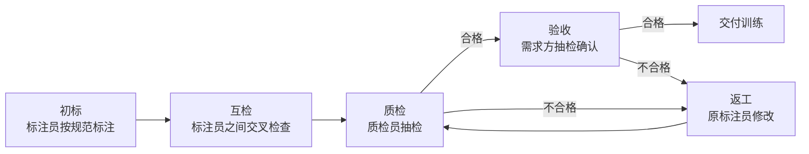
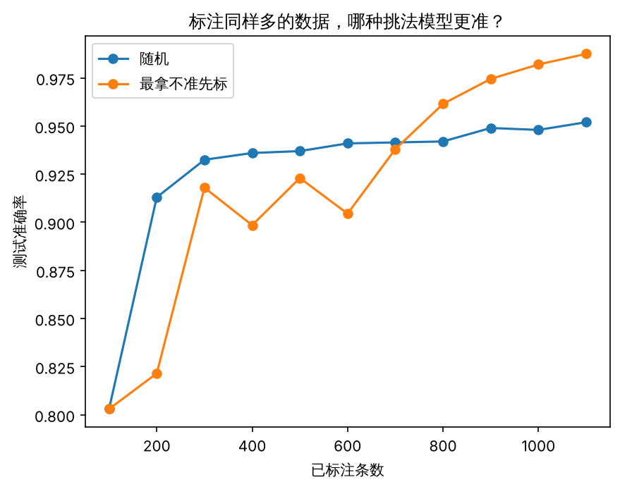
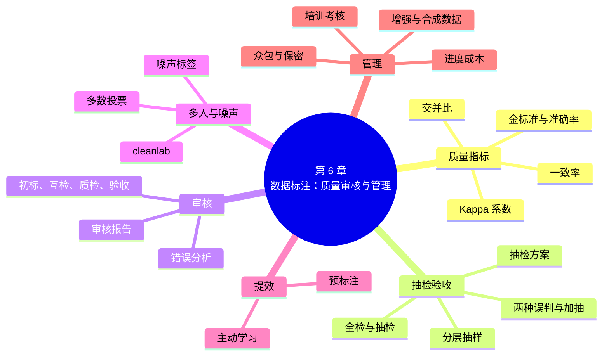

# 第 6 章 数据标注：质量审核与管理

!!! abstract "本章学时"
    理论 4 学时（其中线下 2 学时）· 实验 2 学时（本章共 3 个实验，教师可任选）

## 学习目标

学完本章，你应该能够：

1. **说出**衡量标注质量的四个指标（准确率、一致率、Kappa、交并比）和标注审核的一般流程（记忆）；
2. **解释**Kappa 为什么要扣除“碰巧一致”，以及抽检验收为什么会误判（理解）；
3. **运行并修改**给定代码，计算几名标注员之间的一致率和 Kappa，找出分歧样本（应用）；
4. **运行并修改**给定代码，对一批标注按方案抽检验收，并写出标注审核报告（应用）；
5. **判断**一批标注是否合格、哪些需要返工，说明理由和依据（评价）。

!!! info "先修要求"
    学习本章前，你需要：

    - 知道标注规范的组成，做过或读过试标（[5.4](../05-annotation/index.md#54)）；
    - 知道目标框的坐标表示方法（[5.2.3](../05-annotation/index.md#523)）；
    - 会用 `groupby` 分组统计、用 `crosstab` 做交叉表（[2.4](../02-pandas/index.md#24)）。

??? abstract "本章概念清单（19 个，点击查看定义和例子）"
    1. [金标准](../../appendix/glossary.md#g-金标准)
    2. [标注准确率](../../appendix/glossary.md#g-标注准确率)
    3. [一致率](../../appendix/glossary.md#g-一致率)
    4. [Kappa 系数](../../appendix/glossary.md#g-Kappa-系数)
    5. [Fleiss' Kappa](../../appendix/glossary.md#g-Fleiss'-Kappa)
    6. [交并比](../../appendix/glossary.md#g-交并比)
    7. [验收](../../appendix/glossary.md#g-验收)
    8. [抽检](../../appendix/glossary.md#g-抽检)
    9. [分层抽样](../../appendix/glossary.md#g-分层抽样)
    10. [抽检方案](../../appendix/glossary.md#g-抽检方案)
    11. [错误分析](../../appendix/glossary.md#g-错误分析)
    12. [标注审核报告](../../appendix/glossary.md#g-标注审核报告)
    13. [多数投票](../../appendix/glossary.md#g-多数投票)
    14. [噪声标签](../../appendix/glossary.md#g-噪声标签)
    15. [预标注](../../appendix/glossary.md#g-预标注)
    16. [主动学习](../../appendix/glossary.md#g-主动学习)
    17. [众包](../../appendix/glossary.md#g-众包)
    18. [数据增强](../../appendix/glossary.md#g-数据增强)
    19. [合成数据](../../appendix/glossary.md#g-合成数据)

## 情景导入

“食客说”的评论标注项目扩大了：外包公司派来了 4 名标注员（工号 W01 到 W04），一周交来一批 2000 条情感标注。数据组的小周作为质检员负责验收。他面临三个问题。

第一，2000 条全部检查一遍要两天，没有这个时间。只检查一部分，抽多少条才算数？抽检的结果能代表整批吗？

第二，标注员说“我们标得很准”，怎么用数字来说明“准不准”？如果没有标准答案，又怎么知道谁标得好？

第三，技术部希望下个月标到 2 万条。按现在的速度要 10 个人干一个月，有没有办法少标一些、标得更快，还不降低质量？

本章就来回答这三个问题：怎样衡量标注质量，怎样抽检验收和写审核报告，以及怎样用模型帮助人提高标注的质量和效率。

## 6.1 怎样衡量标注质量

### 6.1.1 准确率：和“标准答案”比

最直接的办法是准备一份[**金标准**](../../appendix/glossary.md#g-金标准 "由专家按规范仔细标注、反复确认，作为“标准答案”的一批数据，用于计算准确率和考核标注员"){ .term }：由经验最丰富的专家，按规范仔细标注、反复讨论确认的一批数据，作为“标准答案”。把标注员的结果和金标准对照，标对的比例就是[**标注准确率**](../../appendix/glossary.md#g-标注准确率 "标注结果与金标准（或质检复核结果）相同的比例"){ .term }：

> 标注准确率 = 标对的条数 ÷ 总条数

实验 6-1 的数据中，三名标注员对同样 300 条评论做了情感标注，并有一份金标准。对照结果：

```text
标注员A 准确率：92.0%
标注员B 准确率：87.3%
标注员C 准确率：82.3%
```

金标准的制作成本很高，所以通常只准备少量（几十到几百条），用于标注员的培训考核，或者混在待标注数据中定期“暗考”：标注员不知道哪些是考题，系统自动用这些数据计算他的准确率。

### 6.1.2 一致率与 Kappa 系数

没有金标准时怎么办？可以让两个人标同一批数据，看他们的结果一致不一致。两人标签相同的比例叫[**一致率**](../../appendix/glossary.md#g-一致率 "两名标注员对同一批数据给出相同标签的比例"){ .term }。如果两个按同一规范独立工作的人总是给出相同的答案，说明规范清楚、两人都理解到位；如果经常不一致，说明至少有一个人有问题，或者规范有漏洞。

但一致率有一个缺陷：它没有考虑“碰巧一致”。设想一个极端的例子：评论中有九成是好评，甲、乙两人偷懒，几乎全部标“正面”。他们的一致率会高达 88%，看起来很好，但这个一致完全是碰巧，两人根本没有认真区分好评和差评。

[**Kappa 系数**](../../appendix/glossary.md#g-Kappa-系数 "扣除碰巧一致后衡量两名标注员一致程度的指标，等于（实际一致率 − 碰巧一致率）÷（1 − 碰巧一致率）"){ .term }（Cohen's Kappa）解决了这个问题。它先算出“如果两人各自按自己的习惯随便标，会碰巧一致多少”，再看实际一致率比碰巧一致率高出多少：<sup class="cite">[[1]](#ref6-1)</sup>

> Kappa =（实际一致率 − 碰巧一致率）÷（1 − 碰巧一致率）

碰巧一致率怎么算？把每个标签“甲标它的比例 × 乙标它的比例”加起来。还是那个偷懒的例子：甲、乙各有 94% 标正面、3% 标负面、3% 标中性，碰巧一致率就是 0.94 × 0.94 + 0.03 × 0.03 + 0.03 × 0.03 ≈ 88.5%，比实际一致率 88% 还高，算出的 Kappa 约为 −0.05，说明这两人的一致还不如随便乱标。

Kappa 的取值一般在 0 到 1 之间：1 表示完全一致，0 表示和碰巧一致差不多，负数表示比碰巧还差。常用的判断参考是：<sup class="cite">[[2]](#ref6-2)</sup>

| Kappa | 一致程度 |
|---|---|
| 0.81～1.00 | 几乎完全一致 |
| 0.61～0.80 | 较强 |
| 0.41～0.60 | 中等 |
| 0.21～0.40 | 一般 |
| 0.00～0.20 | 轻微 |

用 scikit-learn 一行就能算出 Kappa：

```python
from sklearn.metrics import cohen_kappa_score
a, b = df["标注员A"], df["标注员B"]
print(f"一致率 {(a == b).mean():.1%}，Kappa {cohen_kappa_score(a, b):.3f}")   # 一致率 80.7%，Kappa 0.686
```

Cohen's Kappa 用于两个人之间。三个或更多人标同一批数据时，用 [**Fleiss' Kappa**](../../appendix/glossary.md#g-Fleiss'-Kappa "把 Kappa 推广到三名及以上标注员的一致性指标"){ .term }，思路相同，可以用 statsmodels 库计算。<sup class="cite">[[3]](#ref6-3)</sup> 实验 6-1 中三人的 Fleiss' Kappa 是 0.619，属于“较强”的下限，说明规范还有改进空间。在下面的动画里可以亲手改一改混淆表，看 Kappa 怎样变化。

<iframe class="sim-frame" src="../../sims/kappa-calculator/main.html" height="600" loading="lazy" title="Kappa 计算器"></iframe>
动画：Kappa 计算器。修改两名标注员的混淆表，或点现成的例子，看实际一致率、碰巧一致率和 Kappa 怎样变化。[全屏打开](../../sims/kappa-calculator/main.html){ target=_blank }
{ .sim-caption }

### 6.1.3 交并比：目标框画得准不准

目标框标注不能简单地说“对”或“错”，因为框总会有几个像素的偏差。衡量两个框重合程度的指标是[**交并比**](../../appendix/glossary.md#g-交并比 "两个框重叠部分面积与两框合起来覆盖面积之比，用于衡量目标框的准确程度"){ .term }（IoU）：两个框重叠部分的面积，除以两个框合起来覆盖的总面积。

> 交并比 = 交集面积 ÷ 并集面积 = 交集面积 ÷（框 1 面积 + 框 2 面积 − 交集面积）

以 `table_03.jpg` 中左下角的碗为例，参考框是 (59, 255) 到 (151, 347)，92 × 92 = 8464 像素²：

| 标注员画的框 | 情况 | 交集 | 并集 | 交并比 |
|---|---|---|---|---|
| (55, 250) 到 (160, 350) | 画得稍大一圈 | 8464 | 10500 | 0.81 |
| (70, 265) 到 (140, 335) | 画得小了一圈 | 4900 | 8464 | 0.58 |
| (80, 275) 到 (172, 367) | 大小对，但整体偏了 20 多像素 | 5112 | 11816 | 0.43 |

交并比在 0 到 1 之间，越大越好。目标检测领域常把 0.5 作为“检测到了”的门槛，标注验收的要求更高一些，本书的图片标注规范规定：**与参考框的交并比不低于 0.7 算合格**。<sup class="cite">[[4]](#ref6-4)</sup> 可以回到第 5 章的动画“目标框标注与交并比”里试一试。

!!! cert "证书考点 · 人工智能训练师 · 标注质量检查"
    检查标注结果是否符合规范，是训练师在数据标注工作中的重要内容；更高等级的训练师还要负责审核他人的标注、组织抽检、编写审核报告。常考：准确率、一致率的计算；Kappa 的含义（为什么比一致率更可靠）；交并比的计算；抽检的样本量和合格判定。容易错在交并比的并集忘了减去交集，以及把一致率高当成标注质量高。

## 6.2 抽检验收

### 6.2.1 全检还是抽检

标注员交来一批数据，质检员要决定这批数据能不能接收，这叫[**验收**](../../appendix/glossary.md#g-验收 "质检员或需求方检查一批标注数据，决定是否接收的过程"){ .term }。验收有两种方式：

- **全检**：每一条都检查。结果最可靠，但工作量和重新标一遍差不多，只适合数据量小、要求极高的场合（如医疗影像）；
- [**抽检**](../../appendix/glossary.md#g-抽检 "按一定方法随机抽出一部分数据检查，用结果推断整批质量"){ .term }：按一定方法随机抽出一部分来检查，用抽检结果推断整批的质量。这是绝大多数项目的做法。

抽检要做到“随机”，不能挑着检查，比如只看前 100 条、只看短的评论，否则抽检结果不能代表整批。如果一批数据由几个标注员完成，最好[**分层抽样**](../../appendix/glossary.md#g-分层抽样 "先把数据按某个特征分成几层（如按标注员），再在每层中分别随机抽样"){ .term }：每个标注员各抽一定比例，这样既能评价整批，又能评价每个人。

```python
sample = batch.groupby("标注员").sample(frac=0.10, random_state=2026)   # 每个标注员各抽 10%
```

`random_state` 固定了随机数，保证每次运行抽到的是同样的样本，便于复查。

### 6.2.2 抽多少、怎么判

一份[**抽检方案**](../../appendix/glossary.md#g-抽检方案 "事先规定抽多少、合格标准是什么、不合格怎么办的验收规则"){ .term }要事先写清三件事：抽多少、合格标准是什么、不合格怎么办。例如：

1. 每批按标注员分层抽检 10%；
2. 抽检准确率不低于 95% 判为合格；
3. 某个标注员不合格的，从他未被抽中的数据中再加抽 20%，合并计算；仍不合格的，他的这批数据全部返工。

为什么要“加抽”？因为抽检是用一小部分推断整体，必然有误差，抽得越少误差越大。比如一名标注员真实准确率是 96.5%，本来合格，但这次抽了 60 条恰好有 4 条错（93.3%），就会被误判为不合格；反过来，一名真实准确率只有 90% 的标注员，也可能因为运气好而被放过。抽检验收总存在这两种误判：

- **合格的被误退**：冤枉了标注员，浪费返工的人力；
- **不合格的被放过**：错误的标签流进训练数据，影响模型。

抽检条数越多，两种误判越少，但检查的成本越高。实际工作中的折中办法是：先少抽，对结果在合格线附近的再加抽，对新人和历史质量差的人多抽。工业上的抽样检验有专门的国家标准（GB/T 2828.1），用“接收质量限”来规定抽多少、允许几个错，标注验收可以参照它的思路。<sup class="cite">[[5]](#ref6-5)</sup> 下面的动画可以直观地看到抽检条数和误判概率的关系。

<iframe class="sim-frame" src="../../sims/acceptance-sampling/main.html" height="620" loading="lazy" title="抽检验收模拟"></iframe>
动画：抽检验收模拟。拖动抽检条数和真实错误率，看这批标注被判合格的概率，以及合格批被误退、不合格批被放过的可能性。[全屏打开](../../sims/acceptance-sampling/main.html){ target=_blank }
{ .sim-caption }

### 6.2.3 合格、返工与错误分析

实验 6-2 对 2000 条标注按上面的方案验收，第一次抽检 201 条的结果是：

```text
整批抽检准确率：93.0%，不合格
     抽检条数  正确条数    准确率  结论
标注员
W01    62    59  0.952  合格
W02    60    56  0.933  加抽
W03    41    36  0.878  加抽
W04    38    36  0.947  加抽
```

对 W02、W03、W04 加抽后：

```text
     抽检条数    准确率  结论
标注员
W02   167  0.952  合格
W03   115  0.852  返工
W04   107  0.953  合格
```

最终只有 W03 的 409 条需要返工。因为本书的数据有全部参考答案，可以验证这个结论：四人的真实准确率分别是 95.9%、96.5%、84.4%、95.8%，抽检的判断是对的。如果没有加抽这一步，W02 和 W04 就会被冤枉。

验收不只是给出“合格 / 不合格”，还要做[**错误分析**](../../appendix/glossary.md#g-错误分析 "对检查出的错误按类型、原因归类统计，找出改进方向"){ .term }：错在哪类标签上？把抽检中标错的样本做一张交叉表：

```text
情感标签   中性  正面  负面
情感_参考
中性      0   2   1
正面      7   0   3
负面      0   1   0
```

14 处错误中有 7 处是把正面标成了中性，是最多的一类。翻看这些评论，如“环境干净整洁。推荐！”“用了优惠券很划算”“服务周到，主动加茶 下次还会再来”，都是明确的好评，有的还带着“推荐”，却被标成了中性。这类错误不是规范的边界问题，而是标注员对“中性”理解得过宽，以为只夸了一两句就算“一般”。应该在下次培训中重点讲解：只有正面内容、或者有明确正面表态的，就是正面；并在规范的反例中补充这样的例子。

## 6.3 审核流程与审核报告

### 6.3.1 多级审核流程

规模较大的标注项目，通常采用多级审核，层层把关：



- **初标**：标注员按规范完成标注，提交前自查；
- **互检**：标注员之间交叉检查一部分，发现明显错误当场纠正；
- **质检**：质检员按抽检方案检查，不合格的退回返工；
- **验收**：数据需求方（如算法团队）再抽检一次，确认后才交付使用。

每一级发现的问题都要记录下来，既用于计算质量指标，也用于修订规范、培训标注员。

### 6.3.2 标注审核报告

质检和验收的结论要写成[**标注审核报告**](../../appendix/glossary.md#g-标注审核报告 "记录一批标注的基本情况、抽检方案和结果、错误分析、处理意见的文档"){ .term }，交给项目负责人和需求方。一份审核报告通常包括：

| 部分 | 内容 | 实验 6-2 的例子 |
|---|---|---|
| 基本情况 | 批次、数据量、标注员、标注时间、所用规范版本 | 第 1 批，2000 条，W01～W04，规范 v1.0 |
| 抽检方案 | 抽样方法、比例、合格标准、加抽规则 | 分层抽 10%，准确率 ≥ 95% 合格，不合格加抽 20% |
| 抽检结果 | 整批和每人的抽检条数、准确率、结论 | 整批 93.0%；W03 加抽后 85.2%，其余合格 |
| 错误分析 | 错误类型分布、典型错误样例、原因 | 正面误标为中性最多（7 处），标注员对“中性”理解过宽 |
| 处理意见 | 返工范围、规范修订建议、培训建议 | W03 的 409 条返工；培训中强调中性的定义，规范补充相应反例 |
| 附件 | 抽检明细、返工清单 | `返工清单.csv` |

审核报告的模板见附录 E。写报告时，结论要有数字支撑，例如“W03 准确率偏低”不如写成“W03 两次抽检共 115 条，准确率 85.2%，低于 95% 的验收标准”。

## 6.4 多人标注与噪声标签

### 6.4.1 多数投票

对质量要求高的数据，常常让三个（或更多）人各自独立标注同一条数据，再用[**多数投票**](../../appendix/glossary.md#g-多数投票 "几个人独立标注同一条数据，取得票最多的标签作为最终标签"){ .term }决定最终标签：三人中至少两人相同，就取这个标签。实验 6-1 中，三名标注员的准确率分别只有 92.0%、87.3%、82.3%，但多数投票后的准确率达到了 96.7%，比最好的一个人还高。这是因为不同的人一般不会在同一条数据上犯同样的错，投票能把个人的偶然错误抵消掉。

```python
df["多数投票"] = df[people].mode(axis=1)[0]     # 每一行取出现次数最多的标签
```

`mode` 是“众数”，即出现次数最多的值，`axis=1` 表示按行计算。三人给出三个不同标签时（实验中有 8 条），众数无法决定，程序会取其中一个，这类数据应该交给专家复核，而不是让程序随便选。多人标注的代价是成本翻了几倍，所以通常只用于金标准、测试集，或者特别难的数据。

### 6.4.2 噪声标签与 cleanlab

即使经过了质检，训练数据中仍然难免有一些标错的标签，这叫[**噪声标签**](../../appendix/glossary.md#g-噪声标签 "训练数据中标错了的标签"){ .term }。能不能让模型帮忙把它们找出来？思路是：先用这批数据训练一个模型，让模型对每条数据给出“它认为属于每个标签的概率”。如果某条数据被标成“负面”，而模型非常确信它是“正面”，这条数据就很可疑，值得人工复查。

把这个思路做严谨的方法叫“置信学习”，Python 库 cleanlab 实现了它。<sup class="cite">[[6]](#ref6-6)</sup> 实验 6-3 在 2000 条人工标注上运行 cleanlab：

```text
cleanlab 找出可疑标签 116 条，其中真的标错的 111 条（查准 96%）；全部标错的 126 条，找到了 88%
                          评论内容 标注员 情感标签 情感_参考
          一般般，没什么特别的，第一次来，感觉普通 W02   正面    中性
                 还行吧！第一次来，感觉普通 W04   负面    中性
                         中规中矩🤔 W01   正面    中性
         装修很有格调。送到还是热的。强烈推荐给大家 W02   负面    正面
```

cleanlab 列出的 116 条可疑标签中，96% 确实标错了，而且找到了全部错误的 88%。这意味着质检员只需复查这 116 条，就能纠正绝大部分错误，比随机抽检高效得多。当然，模型挑出的只是“可疑”，最终改不改，仍然要由人按规范判断。

## 6.5 提效：预标注与主动学习

### 6.5.1 预标注

[**预标注**](../../appendix/glossary.md#g-预标注 "先用模型给数据标上初步标签，再由标注员检查和修改"){ .term }是先用模型给数据标上一个初步的标签，标注员在此基础上检查、修改，而不是从零开始标。对于模型已经比较准的任务，标注员大部分时候只需要点“确认”，速度能提高几倍。Label Studio 等工具都支持导入模型的预测结果作为预标注，第 9 章会学习用现成的模型做预标注。

预标注的风险是“锚定效应”：标注员看到预标注结果后，容易不加思考地接受，模型的错误就被保留了下来。应对的办法是：在数据中混入少量金标准考题（不给预标注），检查标注员是否在认真看；对“标注员几乎没改动”的批次加大抽检比例。

### 6.5.2 主动学习：先标最拿不准的

标注预算有限时，先标哪些数据最划算？直觉是随机挑。[**主动学习**](../../appendix/glossary.md#g-主动学习 "让模型挑出最拿不准的数据优先交给人标注，以较少的标注量获得较好的模型"){ .term }的思路是：让模型先用少量数据训练，然后对所有待标注的数据做预测，挑出模型**最拿不准**的（预测概率最低的）交给人标，再训练、再挑，如此循环。<sup class="cite">[[7]](#ref6-7)</sup> 道理很简单：模型已经很有把握的数据，标了也学不到多少新东西；拿不准的数据，正是它需要学的。

实验 6-3 比较了两种挑法。从 100 条开始，每轮再标 100 条，记录模型在 2000 条测试数据上的准确率：

```text
          随机  最拿不准先标
已标注条数
100    0.803   0.803
200    0.913   0.822
……
700    0.942   0.938
800    0.942   0.962
900    0.949   0.974
1000   0.948   0.982
1100   0.952   0.988
```



开始阶段，“最拿不准先标”反而不如随机，因为模型太弱时，它“拿不准”的往往是一些特别难、特别怪的数据。标到 800 条以后，主动学习明显胜出：标 1100 条时准确率达到 98.8%，而随机挑选的 95.2%，是在付出同样标注成本的情况下得到的。这提醒我们：主动学习不是在任何阶段都更好，要用实验来判断。

## 6.6 标注团队管理

标注项目的质量，最终取决于人。管理一个标注团队，要关注以下几方面：

**培训与考核。** 新标注员上岗前要学习规范、看疑难样例，然后用金标准考核，准确率达标才能正式上岗。规范修订后要重新培训。平时用混入的金标准考题持续考核，把准确率、工作量与绩效挂钩。

**进度与成本。** 根据每人每天的标注量（如每天 300～500 条评论）、数据总量和交付时间，计算需要多少人；标注成本 = 标注工时 + 质检工时 + 返工工时，返工越多成本越高，所以“一次标对”比“标得快”更重要。每天跟踪完成量和质检合格率，发现落后或质量下降及时调整。

**众包。** 把标注任务拆成小任务发布到网络平台，由大量兼职人员完成，叫[**众包**](../../appendix/glossary.md#g-众包 "把任务拆成小任务发布到网络平台，由大量兼职人员完成"){ .term }。它的优点是快、便宜，缺点是质量参差不齐，必须配合多人标注、多数投票、金标准考题等质量控制手段。涉及敏感信息的数据不适合众包。

**数据保密。** 标注员能接触到大量原始数据，其中可能有用户的个人信息、企业的商业秘密。要与标注员签订保密协议；标注平台设置账号权限，只能看到分配给自己的数据；禁止截屏、下载、拷贝到个人设备；数据在交给标注员之前先做脱敏处理（第 4 章把手机号替换成“[手机号]”就是一例）。这些要求也是《个人信息保护法》《数据安全法》的规定，第 12 章会详细学习。

## 6.7 合成数据与数据增强

标注数据不够时，除了继续人工标注，还有两条路：

[**数据增强**](../../appendix/glossary.md#g-数据增强 "对已有标注数据做不改变标签的变换，生成更多训练数据"){ .term }是对已有的标注数据做一些不改变标签的变换，“变出”更多的训练数据。图像上常用翻转、旋转、裁剪、调亮度：一张标好“碗”的照片左右翻转后还是碗，框的坐标相应翻转即可。文本上可以替换同义词、调换句子顺序，但要小心，文字的变换很容易改变原意，比如把“不太好吃”中的“不”去掉，情感就反了。

[**合成数据**](../../appendix/glossary.md#g-合成数据 "用程序或模型生成、而非真实采集的数据"){ .term }是用程序或模型从头生成的数据。本书的“食客说”数据就是编者用程序按真实业务的分布生成的合成数据。现在用大模型生成训练数据也越来越常见，比如让大模型“写 100 条抱怨配送太慢的差评”。合成数据适合真实数据难以获取（如罕见的故障、涉及隐私的数据）的场合，但它可能和真实数据有差距，比如大模型写的差评往往比真实顾客的差评更“规范”、更少错别字。所以合成数据通常与真实数据混合使用，并且**测试数据必须用真实数据**，才能知道模型在真实场景中的表现。

## 6.8 前沿视窗

**大模型当“标注员”和“质检员”。** 2023 年的一项研究发现，在几类文本标注任务上，ChatGPT 的标注准确率超过了众包平台上的人工标注员，而成本只有后者的约二十分之一。<sup class="cite">[[8]](#ref6-8)</sup> 此后，用大模型做预标注、用大模型检查人工标注中的可疑样本，在业界迅速普及。但大量实践也表明，大模型标注有明显的局限：在需要专业知识（如医疗）、需要结合本地语境（如方言、网络新词）或者规范很细致的任务上，它的表现不稳定；它还会“一本正经地”犯错，而且错误往往是系统性的，同一类数据会一错一大片。所以目前比较稳妥的做法是“大模型预标注 + 人工审核 + 金标准抽检”，人从“标注员”变成了“审核员”和“规范制定者”，对人的要求不是降低了，而是提高了。

## 本章实验

!!! abstract "实验总览"
    | 实验 | 类型 | 建议时长 | 内容 |
    |---|---|---|---|
    | 实验 6-1 | ★ 基础 | 45 分钟 | 三名标注员的 300 条标注：准确率、一致率、Kappa、多数投票，找出分歧样本 |
    | 实验 6-2 | ★ 基础 | 60 分钟（建议线下） | 对 2000 条标注分层抽检、加抽、判定返工，写标注审核报告 |
    | 实验 6-3 | ☆ 拓展 | 45 分钟 | 比较随机挑选和主动学习；用 cleanlab 找出可疑标签 |

    代码见配套资源 `labs/ch06/` 目录。

### 实验 6-1 ★ 一致性分析

**实验目的**

1. 会用金标准计算标注准确率；
2. 会计算两人之间的一致率和 Cohen's Kappa、多人之间的 Fleiss' Kappa；
3. 会用多数投票合并多人标注，找出分歧样本用于修订规范。

**实验环境**：本机 CPU。

**实验数据**：`labs/data/annotation/three_annotators.csv`，300 条评论，三名标注员 A、B、C 的情感标注和金标准。

**实验步骤与代码**

第 1 步，计算每个人的准确率：

```python
people = ["标注员A", "标注员B", "标注员C"]
for p in people:
    print(f"{p} 准确率：{(df[p] == df['金标准']).mean():.1%}")
```

第 2 步，两两计算一致率和 Kappa，见 6.1.2 节。程序用两层 `for` 循环列出所有两人组合。

第 3 步，计算三人的 Fleiss' Kappa：

```python
from statsmodels.stats.inter_rater import aggregate_raters, fleiss_kappa
table, _ = aggregate_raters(df[people].to_numpy())   # 统计每条评论各标签得了几票
print(f"三人 Fleiss' Kappa：{fleiss_kappa(table):.3f}")
```

第 4 步，用交叉表看准确率最低的标注员 C 错在哪里。

第 5 步，多数投票，见 6.4.1 节；第 6 步，列出有分歧的样本并保存。完整代码见 `labs/ch06/lab6_1_agreement.py`。

**运行结果**

```text
样本数： 300
标注员A 准确率：92.0%
标注员B 准确率：87.3%
标注员C 准确率：82.3%
标注员A 与 标注员B：一致率 80.7%，Kappa 0.686
标注员A 与 标注员C：一致率 77.7%，Kappa 0.632
标注员B 与 标注员C：一致率 71.7%，Kappa 0.538
三人 Fleiss' Kappa：0.619
标注员C  中性   正面  负面   合计
金标准
中性    63   14   0   77
正面    14  139  15  168
负面     3    7  45   55
合计    80  160  60  300
多数投票准确率：96.7%；三人各不相同：8 条
有分歧的样本：101 条，例如：
                          评论内容 标注员A 标注员B 标注员C 金标准
      比别家贵一倍 披萨又冷又硬 环境太吵 不会再来了   中性   正面   正面  负面
         环境干净整洁，价格实惠，强烈推荐给大家❤️   正面   正面   负面  正面
            价格实惠。味道很一般，辣椒炒肉踩雷了   中性   中性   正面  中性
                          中规中矩   负面   中性   正面  中性
……
```

准确率最高的 A 与 B 之间 Kappa 也最高（0.686），C 与任何人的 Kappa 都较低。C 的混淆表显示，他的错误分散在各类之间，金标准为中性的 77 条中有 14 条被标成正面，正面中又有 15 条被标成负面，这说明他对规范的整体把握不够，需要重新培训，而不只是某一条规则没理解。第一条分歧“比别家贵一倍 披萨又冷又硬 环境太吵 不会再来了”，三人中两人标了正面，多数投票的结果也是错的，可见多数投票并不能纠正所有错误。

**实验记录表**

| 项目 | 你的结果 |
|---|---|
| 准确率最低的标注员及其准确率 | |
| Kappa 最低的一对标注员 | |
| 三人 Fleiss' Kappa，属于哪个一致程度 | |
| 多数投票的准确率 | |
| 从分歧样本中选 3 条，按规范 v1.0 判断应标什么、依据哪一条 | |

**常见问题排查**

| 现象 | 原因 | 解决办法 |
|---|---|---|
| `ModuleNotFoundError: No module named 'statsmodels'` | 没有安装 statsmodels | `pip install statsmodels` |
| Kappa 是负数 | 两人的一致比碰巧还差，或者把两列的顺序对错了行 | 检查两列是否对应同一批评论 |
| 多数投票后行数变了 | `mode` 返回多列，取了整张表 | 用 `mode(axis=1)[0]` 只取第一列 |

**思考与练习**

1. 如果只用一致率而不用 Kappa，会得出什么不同的结论吗？在什么情况下两者结论差别最大？
2. 去掉准确率最低的 C，只用 A、B 两人，遇到两人不一致时怎么办？

**实验报告要求**

提交运行结果截图、实验记录表，以及根据分歧样本提出的至少两条规范修订建议。

### 实验 6-2 ★ 抽检验收并写审核报告

**实验目的**

1. 会按标注员分层抽样，计算抽检准确率并判定合格与否；
2. 会对结果在合格线附近的标注员加抽，减少误判；
3. 会做错误分析，写出标注审核报告。

**实验环境**：本机 CPU。

**实验数据**：`labs/data/annotation/batch_2000.csv`，一批 2000 条情感标注，由 W01～W04 四名标注员完成。“情感_参考”列模拟质检员复核后的正确标签；真实工作中只有被抽中的样本才有这一列，由质检员逐条复核填写。

**实验步骤与代码**

第 1 步，分层抽检 10%，见 6.2.1 节。

第 2 步，计算整批和每人的抽检准确率，判定“合格”或“加抽”：

```python
sample["是否正确"] = sample["情感标签"] == sample["情感_参考"]
by_worker = sample.groupby("标注员")["是否正确"].agg(抽检条数="count", 正确条数="sum", 准确率="mean")
by_worker["结论"] = by_worker["准确率"].map(lambda x: "合格" if x >= STANDARD else "加抽")
```

第 3 步，错误分析，见 6.2.3 节。

第 4 步，对需要加抽的标注员，从未抽中的数据中再抽 20%，合并后重新判定：

```python
more = batch.drop(sample.index)                                # 去掉已经抽过的
more = more[more["标注员"].isin(fail)].groupby("标注员").sample(frac=0.20, random_state=2030)
```

第 5 步，保存返工清单。完整代码见 `labs/ch06/lab6_2_sampling_check.py`。

第 6 步，按 6.3.2 节的结构（或附录 E 的模板）写一份标注审核报告。

**运行结果**

见 6.2.3 节。程序最后还打印了全量的真实准确率，用来验证抽检的判断：

```text
需返工： ['W03'] 409 条，已保存 返工清单.csv
全量真实准确率： {'W01': 0.959, 'W02': 0.965, 'W03': 0.844, 'W04': 0.958}  整批： 0.937
```

**实验记录表**

| 标注员 | 第一次抽检准确率 | 加抽后准确率 | 结论 | 真实准确率 |
|---|---|---|---|---|
| W01 | | | | |
| W02 | | | | |
| W03 | | | | |
| W04 | | | | |

**常见问题排查**

| 现象 | 原因 | 解决办法 |
|---|---|---|
| 每次运行抽到的样本不同 | 没有设置 `random_state` | 设置一个固定的数 |
| `ValueError: Cannot take a larger sample than population` | `frac` 大于 1，或用 `n=` 抽的条数超过了这组的总数 | 检查参数 |
| 加抽后的条数和预期不同 | 没有去掉第一次已经抽过的数据 | 先 `batch.drop(sample.index)` |

**思考与练习**

1. 把第一次抽检的 `random_state` 改成 1、2、3 各运行一次，结论有变化吗？这说明了什么？
2. 如果把第一次抽检比例从 10% 提高到 30%，还需要加抽吗？成本增加了多少？

**实验报告要求**

提交标注审核报告（不超过两页），附抽检结果截图和返工清单的前 10 行。

### 实验 6-3 ☆ 预标注、主动学习与噪声标签

**实验目的**

1. 会比较随机挑选和主动学习两种方式的标注效率；
2. 会用 cleanlab 找出人工标注中的可疑标签；
3. 能说出这两种方法的适用条件和局限。

**实验环境**：本机 CPU，需要 scikit-learn、cleanlab，运行约 5 秒。

**实验数据**：`labs/data/reviews.csv` 和 `reviews_参考答案.csv`（12000 条评论及参考标签）；`batch_2000.csv`。

**实验步骤与代码**

第 1 步，把评论变成数字。模型不认识文字，要先把每条评论变成一串数字，这里按单字和两字词出现的情况来转换，原理在第 9 章介绍，这里直接运行即可：

```python
vec = TfidfVectorizer(analyzer="char", ngram_range=(1, 2), min_df=2)
X = vec.fit_transform(rv["评论内容"])
```

第 2 步，**先自己写**：参照 6.5.2 节的思路，写出“最拿不准先标”的挑选代码。提示：`model.predict_proba` 给出每条数据属于每个标签的概率，每行的最大值越小，说明越拿不准。参考写法：

```python
prob = model.predict_proba(X[rest]).max(axis=1)   # 每条待标注数据的最大概率
pick = rest[np.argsort(prob)[:step]]              # 从小到大排，取前 100 条
```

第 3 步，运行两种挑法各 10 轮，画出准确率曲线，见 6.5.2 节。

第 4 步，用 cleanlab 在 2000 条人工标注中找可疑标签：

```python
prob = cross_val_predict(LogisticRegression(max_iter=1000), Xb, labels, cv=5, method="predict_proba")
issues = find_label_issues(labels, prob, return_indices_ranked_by="self_confidence")
```

`cross_val_predict` 把数据分成 5 份，每次用 4 份训练、预测剩下 1 份，这样每条数据的预测概率都来自“没见过它”的模型，判断才公正。完整代码见 `labs/ch06/lab6_3_active_cleanlab.py`。

**运行结果**

见 6.4.2 节和 6.5.2 节。

**实验记录表**

| 项目 | 你的结果 |
|---|---|
| 标 500 条时，随机 / 主动学习的准确率 | |
| 标 1100 条时，随机 / 主动学习的准确率 | |
| cleanlab 找出的可疑标签数、其中真错的比例 | |
| cleanlab 漏掉的错误标签有多少条？ | |

**常见问题排查**

| 现象 | 原因 | 解决办法 |
|---|---|---|
| `ModuleNotFoundError: No module named 'cleanlab'` | 没有安装 | `pip install cleanlab` |
| 图中中文显示成方框 | 没有中文字体 | 见附录 C 的字体设置 |
| 你的曲线和书上不完全一样 | 随机数种子或库的版本不同 | 趋势一致即可 |

**思考与练习**

1. 把起始的 100 条改成 300 条，主动学习在一开始还会落后吗？
2. 打开 cleanlab 找出的前 20 条可疑标签，有没有“模型错了、人标得对”的情况？为什么最终要由人来决定？

**实验报告要求**

提交准确率曲线图、cleanlab 结果截图、实验记录表和两道思考题的回答。

## 本章小结

- 衡量标注质量的指标：对照**金标准**的**标注准确率**；两人之间的**一致率**和扣除碰巧一致的**Kappa 系数**（多人用 **Fleiss' Kappa**）；目标框的**交并比**，本书以 0.7 为合格线。
- **验收**多用**抽检**：随机、按标注员**分层抽样**，事先写好**抽检方案**（抽多少、合格标准、不合格怎么办）。抽检存在合格被误退和不合格被放过两种误判，结果在合格线附近时要加抽。
- 审核采用初标、互检、质检、验收的多级流程；结论写成**标注审核报告**，包括基本情况、抽检方案、结果、**错误分析**、处理意见。
- **多数投票**能抵消个人的偶然错误；**噪声标签**可以用 cleanlab 等工具让模型先挑出可疑的，再由人复查。
- **预标注**和**主动学习**能提高标注效率，但要防止标注员盲目接受预标注，主动学习也不是任何阶段都更好。
- 标注团队管理包括培训考核、进度成本、**众包**的质量控制和数据保密。**数据增强**和**合成数据**能补充数据，但测试数据必须是真实数据。



**下一章预告**

标注好的数据交给了模型，干净的订单数据也准备好了。接下来，我们要从数据中找出规律、回答业务问题：雨天送达慢了多少？哪类用户最常下单？新版页面真的让下单的人变多了吗？下一章学习探索性分析和统计推断，你将学会读懂“p 值”和“置信区间”，并识别统计数字中常见的陷阱。

## 参考文献

正文中的上标编号（如<sup class="cite">[[1]](#ref6-1)</sup>）对应下面的文献。带链接的可以直接打开；书籍可在图书馆或电子书平台查阅。

<div class="refs" markdown>

**论文**

- <span id="ref6-1"></span>[1] COHEN J. A coefficient of agreement for nominal scales[J]. Educational and Psychological Measurement, 1960, 20(1): 37-46.
    <span class="ref-note">提出 Cohen's Kappa 的原始论文，对应 6.1.2 节。</span>
- <span id="ref6-2"></span>[2] LANDIS J R, KOCH G G. The measurement of observer agreement for categorical data[J]. Biometrics, 1977, 33(1): 159-174.
    <span class="ref-note">给出了 Kappa 取值与一致程度的常用划分，对应 6.1.2 节的表格。</span>
- <span id="ref6-3"></span>[3] FLEISS J L. Measuring nominal scale agreement among many raters[J]. Psychological Bulletin, 1971, 76(5): 378-382.
    <span class="ref-note">把 Kappa 推广到多名评判者，即 Fleiss' Kappa，对应 6.1.2 节。</span>
- <span id="ref6-4"></span>[4] EVERINGHAM M, VAN GOOL L, WILLIAMS C K I, et al. The PASCAL visual object classes (VOC) challenge[J]. International Journal of Computer Vision, 2010, 88(2): 303-338.
    <span class="ref-note">PASCAL VOC 评测以交并比大于 0.5 作为检测正确的标准，这一做法被广泛沿用，对应 6.1.3 节。</span>
- <span id="ref6-6"></span>[6] NORTHCUTT C, JIANG L, CHUANG I. Confident learning: estimating uncertainty in dataset labels[J]. Journal of Artificial Intelligence Research, 2021, 70: 1373-1411.
    <span class="ref-note">置信学习的论文，cleanlab 库即由作者开发，对应 6.4.2 节。</span>
- <span id="ref6-7"></span>[7] SETTLES B. Active learning literature survey[R]. Madison: University of Wisconsin–Madison, 2009.
    <span class="ref-note">主动学习的经典综述，介绍了“不确定性采样”等挑选策略，对应 6.5.2 节。</span>
- <span id="ref6-8"></span>[8] GILARDI F, ALIZADEH M, KUBLI M. ChatGPT outperforms crowd workers for text-annotation tasks[J]. Proceedings of the National Academy of Sciences, 2023, 120(30): e2305016120.
    <span class="ref-note">比较大模型与众包标注员在文本标注任务上的准确率和成本，对应 6.8 节。</span>

**标准**

- <span id="ref6-5"></span>[5] 国家质量监督检验检疫总局, 中国国家标准化管理委员会. 计数抽样检验程序 第 1 部分：按接收质量限（AQL）检索的逐批检验抽样计划：GB/T 2828.1—2012[S]. 北京: 中国标准出版社, 2012.
    <span class="ref-note">工业产品抽样检验的国家标准，规定了按批量和接收质量限确定样本量和允许不合格数的方法，对应 6.2.2 节。</span>

</div>

## 课后练习

选择题和判断题可以直接点击选项作答，系统会马上告诉你对错，并展开答案与解析；多选题选好后点“提交答案”。简答和实操题请先自己作答，再点开“答案与解析”核对。每道题的解析下方都有“回看”链接，做错了可以直接跳回正文复习。

**一、单项选择题**

<div class="quiz" data-answer="C" markdown>

**1.** 由专家按规范仔细标注、反复确认，作为“标准答案”的数据叫（　　）。

- A. 预标注
- B. 噪声标签
- C. 金标准
- D. 合成数据

</div>

??? tip "答案与解析"
    **答案：C**

    金标准用来计算标注准确率、考核标注员。

    考查：金标准 · 认知层次：记忆 · [回看 6.1.1](#611)
    { .quiz-meta }

<div class="quiz" data-answer="B" markdown>

**2.** 两名标注员的实际一致率为 80%，碰巧一致率为 50%，Kappa 为（　　）。

- A. 0.3
- B. 0.6
- C. 0.8
- D. 1.6

</div>

??? tip "答案与解析"
    **答案：B**

    Kappa =（0.8 − 0.5）÷（1 − 0.5）= 0.3 ÷ 0.5 = 0.6。

    考查：Kappa 系数 · 认知层次：应用 · [回看 6.1.2](#612-kappa)
    { .quiz-meta }

<div class="quiz" data-answer="D" markdown>

**3.** 两名标注员几乎把所有评论都标成“正面”，一致率高达 88%。对此最合理的判断是（　　）。

- A. 两人标注质量很高
- B. 规范写得很清楚
- C. 应该用一致率代替 Kappa
- D. 一致可能主要是碰巧，应计算 Kappa 判断

</div>

??? tip "答案与解析"
    **答案：D**

    两人都几乎只标一个类别时，碰巧一致率本身就很高，Kappa 可能接近 0 甚至为负。

    考查：Kappa 系数 · 认知层次：分析 · [回看 6.1.2](#612-kappa)
    { .quiz-meta }

<div class="quiz" data-answer="A" markdown>

**4.** 三名或更多标注员标注同一批数据时，衡量一致性常用（　　）。

- A. Fleiss' Kappa
- B. Cohen's Kappa
- C. 交并比
- D. 准确率

</div>

??? tip "答案与解析"
    **答案：A**

    Cohen's Kappa 用于两人，Fleiss' Kappa 用于多人。

    考查：Fleiss' Kappa · 认知层次：记忆 · [回看 6.1.2](#612-kappa)
    { .quiz-meta }

<div class="quiz" data-answer="C" markdown>

**5.** 参考框面积 100，标注框面积 80，且标注框完全在参考框内部，交并比为（　　）。

- A. 0.2
- B. 0.6
- C. 0.8
- D. 1.25

</div>

??? tip "答案与解析"
    **答案：C**

    交集 = 80，并集 = 100 + 80 − 80 = 100，交并比 = 80 ÷ 100 = 0.8。

    考查：交并比 · 认知层次：应用 · [回看 6.1.3](#613)
    { .quiz-meta }

<div class="quiz" data-answer="B" markdown>

**6.** 一批数据由 4 名标注员完成，抽检时每人各抽 10%，这种抽样方法叫（　　）。

- A. 全检
- B. 分层抽样
- C. 多数投票
- D. 主动学习

</div>

??? tip "答案与解析"
    **答案：B**

    按标注员分成几层，每层分别抽样，既能评价整批，也能评价每个人。

    考查：分层抽样 · 认知层次：理解 · [回看 6.2.1](#621)
    { .quiz-meta }

<div class="quiz" data-answer="D" markdown>

**7.** 一名标注员的真实准确率为 96.5%，但抽检 60 条恰好错了 4 条（93.3%），被判为不合格。这属于（　　）。

- A. 不合格的被放过
- B. 噪声标签
- C. 锚定效应
- D. 合格的被误退

</div>

??? tip "答案与解析"
    **答案：D**

    本来合格，却因抽检的偶然误差被判不合格。结果在合格线附近时，应加抽后再判定。

    考查：抽检误判 · 认知层次：分析 · [回看 6.2.2](#622)
    { .quiz-meta }

<div class="quiz" data-answer="A" markdown>

**8.** 标注员看到模型的预标注结果后不加思考地接受，导致模型的错误被保留，这种现象叫（　　）。

- A. 锚定效应
- B. 数据增强
- C. 碰巧一致
- D. 众包

</div>

??? tip "答案与解析"
    **答案：A**

    应对办法：混入不带预标注的金标准考题，对改动很少的批次加大抽检比例。

    考查：预标注 · 认知层次：理解 · [回看 6.5.1](#651)
    { .quiz-meta }

<div class="quiz" data-answer="C" markdown>

**9.** 主动学习挑选待标注数据的思路是（　　）。

- A. 随机挑选
- B. 先标最短的评论
- C. 先标模型最拿不准的数据
- D. 先标模型最有把握的数据

</div>

??? tip "答案与解析"
    **答案：C**

    模型最拿不准的数据正是它最需要学的，标注这些数据带来的提升最大。

    考查：主动学习 · 认知层次：理解 · [回看 6.5.2](#652)
    { .quiz-meta }

**二、多项选择题**

<div class="quiz quiz-multi" data-answer="ABD" markdown>

**10.** 一份抽检方案应事先写清（　　）。

- A. 抽样方法和比例
- B. 合格标准
- C. 每名标注员的工资
- D. 不合格时如何处理

</div>

??? tip "答案与解析"
    **答案：ABD**

    抽检方案回答“抽多少、怎么判、不合格怎么办”，与工资无关。

    考查：抽检方案 · 认知层次：记忆 · [回看 6.2.2](#622)
    { .quiz-meta }

<div class="quiz quiz-multi" data-answer="ABC" markdown>

**11.** 标注审核报告通常包括（　　）。

- A. 抽检方案与抽检结果
- B. 错误类型分布和典型错误样例
- C. 返工范围和规范修订建议
- D. 标注员的身份证号

</div>

??? tip "答案与解析"
    **答案：ABC**

    此外还有基本情况和附件。标注员的个人信息不应写进报告。

    考查：标注审核报告 · 认知层次：理解 · [回看 6.3.2](#632)
    { .quiz-meta }

<div class="quiz quiz-multi" data-answer="ACD" markdown>

**12.** 关于多数投票，下列说法正确的有（　　）。

- A. 能抵消个人的偶然错误，结果可能比最好的单人还准
- B. 能纠正所有错误
- C. 三人给出三个不同标签时，应交给专家复核
- D. 成本是单人标注的几倍

</div>

??? tip "答案与解析"
    **答案：ACD**

    多数人都标错时，投票结果也是错的，实验 6-1 中就有这样的例子。

    考查：多数投票 · 认知层次：理解 · [回看 6.4.1](#641)
    { .quiz-meta }

<div class="quiz quiz-multi" data-answer="BCD" markdown>

**13.** 标注过程中的数据保密措施包括（　　）。

- A. 把原始数据发给标注员的个人邮箱，方便在家标注
- B. 与标注员签订保密协议
- C. 平台设置权限，标注员只能看到分配给自己的数据
- D. 交给标注员之前先做脱敏处理

</div>

??? tip "答案与解析"
    **答案：BCD**

    数据不能发到个人邮箱或拷贝到个人设备。

    考查：数据保密 · 认知层次：评价 · [回看 6.6](#66)
    { .quiz-meta }

**三、判断题**

<div class="quiz quiz-judge" data-answer="×" markdown>

**14.** 两名标注员的一致率高，就说明他们的标注质量高。

</div>

??? tip "答案与解析"
    **答案：×**

    一致率包含碰巧一致的部分；两人也可能一致地标错。要结合 Kappa 和金标准准确率来判断。

    考查：一致率 · 认知层次：理解 · [回看 6.1.2](#612-kappa)
    { .quiz-meta }

<div class="quiz quiz-judge" data-answer="√" markdown>

**15.** 抽检条数越多，验收的两种误判越少，但成本也越高。

</div>

??? tip "答案与解析"
    **答案：√**

    可以在交互动画“抽检验收模拟”中观察到这一点。

    考查：抽检误判 · 认知层次：理解 · [回看 6.2.2](#622)
    { .quiz-meta }

<div class="quiz quiz-judge" data-answer="×" markdown>

**16.** cleanlab 找出的可疑标签都是错的，可以直接修改。

</div>

??? tip "答案与解析"
    **答案：×**

    模型挑出的只是“可疑”，实验中约 4% 实际是标对的，最终要由人按规范判断。

    考查：噪声标签 · 认知层次：评价 · [回看 6.4.2](#642-cleanlab)
    { .quiz-meta }

<div class="quiz quiz-judge" data-answer="×" markdown>

**17.** 主动学习在任何阶段都比随机挑选效果好。

</div>

??? tip "答案与解析"
    **答案：×**

    实验 6-3 中，开始阶段主动学习反而不如随机，标到 800 条以后才明显胜出。

    考查：主动学习 · 认知层次：分析 · [回看 6.5.2](#652)
    { .quiz-meta }

<div class="quiz quiz-judge" data-answer="√" markdown>

**18.** 使用合成数据训练模型时，测试数据仍应使用真实数据。

</div>

??? tip "答案与解析"
    **答案：√**

    合成数据和真实数据可能有差距，只有用真实数据测试，才能知道模型在真实场景中的表现。

    考查：合成数据 · 认知层次：理解 · [回看 6.7](#67)
    { .quiz-meta }

**四、简答题**

**19.** 为什么说 Kappa 系数比一致率更能反映标注的一致性？

??? tip "答案与解析"
    **参考答案**：一致率没有考虑碰巧一致。即使两人随便标，也会有一部分碰巧相同，尤其是某个标签占比很大时，碰巧一致率会很高。Kappa 先算出碰巧一致率，再看实际一致率超出它多少，用（实际一致率 − 碰巧一致率）÷（1 − 碰巧一致率）计算，扣除了碰巧的部分，只反映“真正的一致”。例如两人几乎都标正面，一致率 88%，Kappa 却接近 0。

    考查：Kappa 系数 · 认知层次：理解 · [回看 6.1.2](#612-kappa)
    { .quiz-meta }

**20.** 简述标注项目多级审核的流程，以及每一级的作用。

??? tip "答案与解析"
    **参考答案**：初标，标注员按规范标注并自查；互检，标注员之间交叉检查一部分，发现明显错误；质检，质检员按抽检方案抽检，不合格的退回返工；验收，需求方再抽检确认，合格后交付训练。每级发现的问题都要记录，用于计算质量指标、修订规范和培训标注员。

    考查：审核流程 · 认知层次：理解 · [回看 6.3.1](#631)
    { .quiz-meta }

**21.** 预标注能提高效率，但可能带来什么风险？怎样应对？

??? tip "答案与解析"
    **参考答案**：风险是锚定效应：标注员看到预标注后容易不加思考地接受，模型的错误被保留下来，而且模型的错误往往是成批的、系统性的。应对：在数据中混入不带预标注的金标准考题，检查标注员是否认真；统计每人对预标注的修改率，修改极少的批次加大抽检比例；定期分析模型容易出错的数据类型，提醒标注员重点检查。

    考查：预标注 · 认知层次：评价 · [回看 6.5.1](#651)
    { .quiz-meta }

**五、实操题**

**22.** 用 `three_annotators.csv`，计算标注员 A 与金标准之间的 Kappa，以及 C 与金标准之间的 Kappa，比较两人的差距。

??? tip "答案与解析"
    **参考答案**：

    ```python
    from sklearn.metrics import cohen_kappa_score
    df = pd.read_csv("../data/annotation/three_annotators.csv")
    for p in ["标注员A", "标注员C"]:
        print(p, round(cohen_kappa_score(df[p], df["金标准"]), 3))
    ```

    A 与金标准的 Kappa 为 0.867，C 为 0.704。准确率相差约 10 个百分点（92.0% 与 82.3%），Kappa 相差更明显，说明 C 的标注与金标准的一致程度只到“较强”的下限。Kappa 不仅能用于两个标注员之间，也能用于标注员与金标准之间。

    考查：Kappa 系数 · 认知层次：应用 · [回看 6.1.2](#612-kappa)
    { .quiz-meta }

**23.** 写一个函数 `iou(a, b)`，输入两个框（x_min, y_min, x_max, y_max），返回交并比。用 6.1.3 节表格中的三个框检验。

??? tip "答案与解析"
    **参考答案**：

    ```python
    def iou(a, b):
        w = max(0, min(a[2], b[2]) - max(a[0], b[0]))   # 交集的宽，不重叠时为 0
        h = max(0, min(a[3], b[3]) - max(a[1], b[1]))   # 交集的高
        inter = w * h
        union = (a[2] - a[0]) * (a[3] - a[1]) + (b[2] - b[0]) * (b[3] - b[1]) - inter
        return inter / union

    ref = (59, 255, 151, 347)
    for box in [(55, 250, 160, 350), (70, 265, 140, 335), (80, 275, 172, 367)]:
        print(round(iou(ref, box), 2))      # 0.81  0.58  0.43
    ```

    交集的左边取两框左边的较大者，右边取两框右边的较小者，两者之差就是交集的宽；`max(0, …)` 处理两框不重叠的情况。

    考查：交并比 · 认知层次：应用 · [回看 6.1.3](#613)
    { .quiz-meta }
