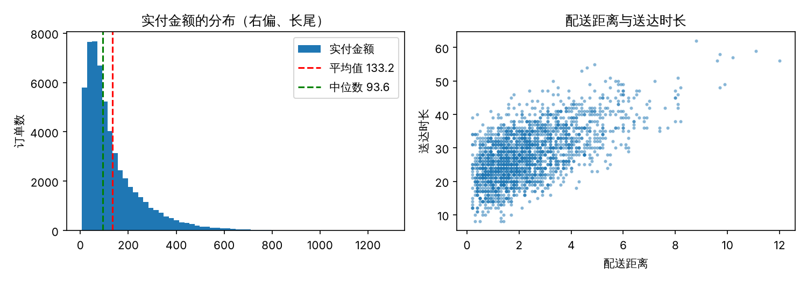
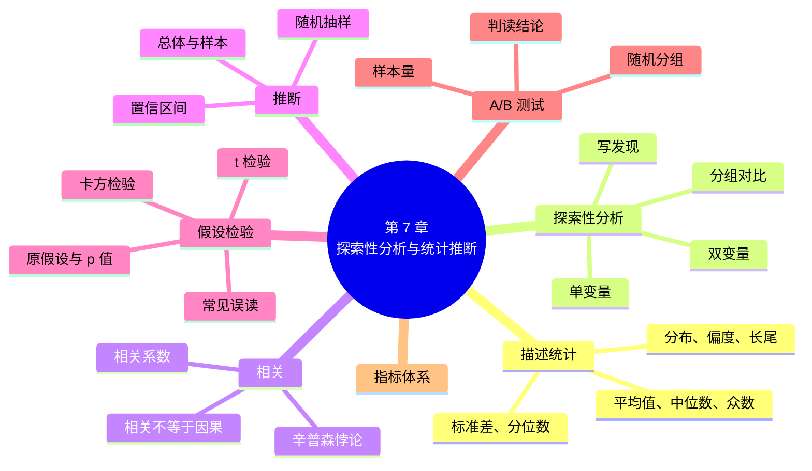

# 第 7 章 探索性分析与统计推断

!!! abstract "本章学时"
    理论 5 学时 · 实验 1 学时（本章共 3 个实验，教师可任选）

## 学习目标

学完本章，你应该能够：

1. **说出**平均值、中位数、标准差、分位数、相关系数、置信区间、p 值的含义（记忆）；
2. **解释**为什么长尾数据要看中位数、为什么相关不等于因果，以及辛普森悖论产生的原因（理解）；
3. **运行并修改**给定代码，对订单数据做描述统计、分组对比和相关分析，写出分析发现（应用）；
4. **运行并修改**给定代码，完成 t 检验、卡方检验和 A/B 测试，并用一句话正确地说出结论（应用）；
5. **判断**一个统计结论是否可靠，指出常见的误读（评价）。

!!! info "先修要求"
    学习本章前，你需要：

    - 会用 `describe`、`groupby`、`pivot_table`、`merge`（[第 2 章](../02-pandas/index.md)）；
    - 知道中位数、3σ 法则、箱线图法（[4.4.1](../04-cleaning/index.md#441)）；
    - 本章只讲统计检验“结论怎么读”，不推导公式。想了解原理的同学可以参考“机器学习”课程的数学基础部分或任何一本统计学入门教材。

??? abstract "本章概念清单（24 个，点击查看定义和例子）"
    1. [描述统计](../../appendix/glossary.md#g-描述统计)
    2. [集中趋势](../../appendix/glossary.md#g-集中趋势)
    3. [众数](../../appendix/glossary.md#g-众数)
    4. [离散程度](../../appendix/glossary.md#g-离散程度)
    5. [标准差](../../appendix/glossary.md#g-标准差)
    6. [分位数](../../appendix/glossary.md#g-分位数)
    7. [分布](../../appendix/glossary.md#g-分布)
    8. [偏度](../../appendix/glossary.md#g-偏度)
    9. [探索性数据分析](../../appendix/glossary.md#g-探索性数据分析)
    10. [相关系数](../../appendix/glossary.md#g-相关系数)
    11. [相关矩阵](../../appendix/glossary.md#g-相关矩阵)
    12. [辛普森悖论](../../appendix/glossary.md#g-辛普森悖论)
    13. [总体](../../appendix/glossary.md#g-总体)
    14. [样本](../../appendix/glossary.md#g-样本)
    15. [随机抽样](../../appendix/glossary.md#g-随机抽样)
    16. [置信区间](../../appendix/glossary.md#g-置信区间)
    17. [假设检验](../../appendix/glossary.md#g-假设检验)
    18. [原假设](../../appendix/glossary.md#g-原假设)
    19. [p 值](../../appendix/glossary.md#g-p-值)
    20. [显著性水平](../../appendix/glossary.md#g-显著性水平)
    21. [t 检验](../../appendix/glossary.md#g-t-检验)
    22. [卡方检验](../../appendix/glossary.md#g-卡方检验)
    23. [A/B 测试](../../appendix/glossary.md#g-A-B-测试)
    24. [指标](../../appendix/glossary.md#g-指标)

## 情景导入

月度经营会上，三位同事各自汇报了一个“发现”。

运营小王说：“我们的平均客单价是 133 元，说明大部分顾客一单花一百多。”财务马上反驳：“不对吧，我看大部分订单都是五六十块钱的。”

配送组小李说：“我查了一下，凡是用了优惠券的订单，好评率是 62.5%，没用的是 63.5%，差了一个百分点。看来优惠券让顾客更挑剔了，建议少发券。”

产品组小陈说：“我们给一部分用户试用了新版商家页面，新版的下单转化率是 6.3%，旧版是 10.5%，新版明显更差，我建议撤回新版。”

老板听完问：“这三个结论，哪个靠得住？”本章学完，你就能回答这个问题。剧透一下：三个结论都有问题，而且是数据分析中最常见的三类问题。

## 7.1 描述统计：用几个数字概括一列数

### 7.1.1 平均值和中位数：一单“一般”花多少钱

描述一列数据“一般是多少”，叫[**集中趋势**](../../appendix/glossary.md#g-集中趋势 "一列数据“一般是多少”，常用平均值、中位数、众数表示"){ .term }，最常用的是平均值和中位数。第 2 章已经算过“食客说”订单实付金额的[描述统计](../../appendix/glossary.md#g-描述统计 "用平均值、中位数、标准差等少数几个数字概括一列数据的特点"){ .term }：

```text
count    56655.0
mean       133.2
std        120.7
min          6.2
25%         51.1
50%         93.6
75%        175.7
max       1288.4
```

平均值 133.2 元，中位数（50%）只有 93.6 元，差了 40 元。这就是运营和财务吵架的原因：平均值被少数几百上千元的大单“拉高”了，并不能代表“大部分顾客”；中位数是排在正中间的那一单，一半订单比它少、一半比它多，更能代表“一般的”订单。

> 平均值和中位数差得多，说明数据里有极端值或者分布不对称，这时应该报告中位数，或者两个都报告。

收入、房价、订单金额、等待时间这类数据，几乎都是这种情况。“人均收入”常被吐槽“被平均”，也是这个道理。第三个衡量集中趋势的指标是[**众数**](../../appendix/glossary.md#g-众数 "一列数据中出现次数最多的值，常用于类别数据"){ .term }，即出现次数最多的值，常用于类别数据，例如“订单最多的菜系是快餐”。

### 7.1.2 标准差和分位数：数据有多分散

只知道“一般是多少”还不够，还要知道数据之间差别有多大，叫[**离散程度**](../../appendix/glossary.md#g-离散程度 "一列数据彼此相差有多大，常用标准差、四分位距表示"){ .term }。最常用的是[**标准差**](../../appendix/glossary.md#g-标准差 "衡量数据偏离平均值远近的指标，越大说明数据越分散"){ .term }（std）：它大致表示每个数据离平均值平均有多远。送达时长的平均值是 28.3 分钟，标准差是 8.3 分钟，说明大部分订单的送达时长在 20 到 37 分钟之间；实付金额的标准差是 120.7 元，几乎和平均值一样大，说明订单金额差别非常大。

[**分位数**](../../appendix/glossary.md#g-分位数 "把数据从小到大排好后，位于某个百分比位置上的值"){ .term }把数据从小到大排好后切成若干份。25% 分位数（下四分位数）表示有四分之一的数据比它小，75% 分位数（上四分位数）表示有四分之三的数据比它小。分位数在业务中很有用：

```python
print(orders["实付金额"].quantile([0.1, 0.25, 0.5, 0.75, 0.9]))
```

```text
0.10     27.2
0.25     51.1
0.50     93.6
0.75    175.7
0.90    294.2
```

可以这样解读：一成订单不到 27 元，一半订单不到 94 元，九成订单不到 294 元。外卖平台常说的“90% 的订单 35 分钟内送达”，用的就是分位数。

### 7.1.3 分布的形状：偏度与长尾

把数据画成直方图，就能看到它的[**分布**](../../appendix/glossary.md#g-分布 "一列数据中各个取值出现的多少，常用直方图展示"){ .term }。实付金额的直方图（左图）是一座左边高、右边拖着长长尾巴的“山”，这叫**右偏**或“长尾”分布；送达时长则接近左右对称的“钟形”。衡量不对称程度的指标叫[**偏度**](../../appendix/glossary.md#g-偏度 "分布不对称的程度；右边拖长尾巴叫右偏，此时平均值大于中位数"){ .term }：0 表示对称，大于 0 表示右偏，越大尾巴越长。实付金额的偏度是 2.00，送达时长只有 0.43。



看清分布的形状很重要：对称的数据，平均值和中位数差不多，用 3σ 法则找异常值也比较合适；长尾的数据，要用中位数、分位数来描述，异常值要用箱线图法，而且大量“异常值”可能是正常的业务现象（第 4 章已经见过）。

## 7.2 探索性分析的套路

拿到一份新数据，在建模、做报告之前，先要“摸清”它，这个过程叫[**探索性数据分析**](../../appendix/glossary.md#g-探索性数据分析 "在建模或下结论之前，用统计量和图表从多个角度摸清数据的过程"){ .term }（EDA）。它是统计学家 Tukey 在 1970 年代倡导的方法：先不急着验证某个想法，而是用描述统计和图表从各个角度看数据，让数据自己“说话”。<sup class="cite">[[1]](#ref7-1)</sup> 初学者可以按下面的套路一步步来：

| 步骤 | 做什么 | 常用方法 |
|---|---|---|
| 1. 单变量 | 每一列分别看：数值列看分布，类别列看频数 | `describe`、`skew`、直方图；`value_counts` |
| 2. 双变量 | 两列放在一起看关系 | 数值与数值：相关系数、散点图；类别与数值：分组统计；类别与类别：交叉表 |
| 3. 分组对比 | 按城区、菜系、时间等拆开，看差异 | `groupby`、`pivot_table` |
| 4. 记录发现 | 每个发现写成一句带数字的话，并标注“待验证”还是“已确认” | 文字 |

例如，对“食客说”订单做完前三步，可以写出这样的发现：

1. 实付金额右偏，平均 133.2 元、中位数 93.6 元，报告客单价时应同时给出两者；
2. 菜系之间客单价差别很大，按中位数看，快餐 40.9 元，日料 245.9 元，相差约 6 倍；
3. 配送距离与送达时长相关系数 0.66，距离越远送得越慢；
4. 雨天平均送达时长比晴天多约 6 分钟，商家自送比平台专送多约 4～5 分钟，两个因素叠加时（雨天商家自送）平均 36.1 分钟；
5. 就餐人数与实付金额相关系数 0.61，多人聚餐是大单的主要来源。

其中第 4 条“商家自送比平台专送慢”，是真的慢，还是碰巧？这就需要 7.5 节的假设检验来验证。

## 7.3 相关分析：两个变量一起变吗

### 7.3.1 相关系数

[**相关系数**](../../appendix/glossary.md#g-相关系数 "衡量两个数值变量直线关系强弱和方向的数，在 −1 到 1 之间"){ .term }（皮尔逊相关系数）衡量两个数值变量之间直线关系的强弱和方向，取值在 −1 到 1 之间：

- 接近 1：正相关，一个大另一个也大，如配送距离与送达时长（0.66）；
- 接近 −1：负相关，一个大另一个反而小，如商品价格与销量常常是负相关；
- 接近 0：没有直线关系，如优惠金额与送达时长（0.00）。

一般认为，相关系数的绝对值在 0.3 以下是弱相关，0.3～0.7 是中等相关，0.7 以上是强相关。用 pandas 一行就能算出多列两两之间的相关系数，叫[**相关矩阵**](../../appendix/glossary.md#g-相关矩阵 "把多列两两之间的相关系数排成的表格"){ .term }：

```python
cols = ["配送距离", "送达时长", "就餐人数", "实付金额", "优惠金额"]
print(df[cols].corr().round(2))
```

```text
      配送距离  送达时长  就餐人数  实付金额  优惠金额
配送距离  1.00  0.66 -0.00 -0.00  0.00
送达时长  0.66  1.00 -0.00 -0.00  0.00
就餐人数 -0.00 -0.00  1.00  0.61  0.04
实付金额 -0.00 -0.00  0.61  1.00 -0.00
优惠金额  0.00  0.00  0.04 -0.00  1.00
```

相关系数只能发现**直线关系**。如果两个变量是“先升后降”的曲线关系，相关系数可能接近 0，所以一定要配合散点图看。

### 7.3.2 相关不等于因果

两个变量相关，不代表一个是另一个的原因。有三种常见的情况会造成“假的因果”：

1. **第三个因素**：夏天冰淇淋销量和溺水人数都上升，两者相关，但原因是天气热，而不是冰淇淋导致溺水。“食客说”里，雨天订单的送达时长更长、评分也偏低，可能不是“下雨让顾客心情差”，而是“下雨让送达变慢、饭菜变凉”；
2. **因果倒置**：用了优惠券的顾客复购率高，可能不是优惠券让顾客回头，而是平台本来就更愿意给老顾客发券；
3. **纯属巧合**：变量多了，总会有一些碰巧相关的，比如某年某城市的奶茶店数量和某种疾病发病率。

要确认因果关系，最可靠的办法是做**随机对照试验**，在互联网行业就是 7.6 节的 A/B 测试。

### 7.3.3 辛普森悖论：合起来看和分开看，结论相反

还有一种更隐蔽的陷阱。实验 7-3 中，产品组做了一次“试验”：新版页面（B 版）主要推送给了新城区的用户，旧版（A 版）主要留给了老城区。合起来看：

```text
     访客数  下单数     转化率
版本
A   6057  635  0.1048
B   5943  372  0.0626
```

B 版转化率 6.3%，A 版 10.5%，B 明显更差。可是按城区拆开看：

```text
新城区：A 版 2.89%，B 版 4.58%，B 更好
老城区：A 版 12.39%，B 版 13.29%，B 也更好
```

两个城区里 B 版都更好，合起来 B 版却更差！这就是[**辛普森悖论**](../../appendix/glossary.md#g-辛普森悖论 "分组看是一个结论、合起来看却相反的现象，原因是各组人数比例不同"){ .term }。原因是：老城区用户本来就爱下单（转化率十几个百分点），新城区用户本来就很少下单（几个百分点）；A 版有 80% 的访客来自老城区，B 版只有 19%。A 版的“好成绩”主要是因为它的访客本来就更爱下单，而不是页面更好。情景导入中产品组小陈的结论，就是掉进了这个陷阱。

避免辛普森悖论的办法是：比较两组时，先检查两组的构成是否相同（如城区、新老用户的比例）；构成不同时，要分层比较；最根本的办法是随机分组，让两组的构成自然相同。

## 7.4 总体、样本与置信区间

### 7.4.1 用样本推断总体

我们关心的全部对象叫[**总体**](../../appendix/glossary.md#g-总体 "想要研究的全部对象"){ .term }，比如“所有可能来下单的顾客”；实际能拿到、拿来分析的一部分叫[**样本**](../../appendix/glossary.md#g-样本 "从总体中抽出来、实际拿来观察的一部分对象"){ .term }。很多时候我们只能用样本去推断总体：做一次满意度调查只能问几百个人；第 6 章的抽检只检查了一成的标注；A/B 测试也只观察了一段时间内的访客。

样本要能代表总体，关键是[**随机抽样**](../../appendix/glossary.md#g-随机抽样 "让总体中每个对象都有同样机会被抽中的抽样方法"){ .term }：每个对象被抽中的机会相同。常见的抽样方法有：

- **简单随机抽样**：从全部对象中随机抽，如 `orders.sample(200)`；
- **分层抽样**：先按某个特征分成几层，每层分别随机抽，保证各层都有代表，如第 6 章按标注员分层抽检；
- **方便抽样**：只调查容易调查到的人，如只问到店的顾客。这种样本往往有偏差，结论不能推广到总体。

### 7.4.2 置信区间

用样本算出的平均值，和总体真正的平均值总会有一点差距。差距可能有多大？[**置信区间**](../../appendix/glossary.md#g-置信区间 "根据样本估计出的、有较大把握包含真实值的范围"){ .term }回答这个问题：它给出一个范围，并说明我们有多大的把握认为真值在这个范围内。实验 7-2 从全部订单中只抽 200 单，估计平均送达时长：

```python
s = orders["送达时长"].sample(200, random_state=7)
low, high = stats.t.interval(0.95, len(s) - 1, loc=s.mean(), scale=stats.sem(s))
```

```text
样本平均 28.0，95% 置信区间 [26.8, 29.3]；全部订单的真实平均 28.3
```

“95% 置信区间是 26.8 到 29.3 分钟”的正确理解是：用这种方法反复抽样、反复计算，大约 95% 的区间会盖住真值。这一次的区间确实盖住了真值 28.3。置信区间的宽度取决于三件事：数据本身越分散，区间越宽；样本越大，区间越窄；要求的把握越大（如 99%），区间越宽。下面的动画可以直观地看到这一点。

<iframe class="sim-frame" src="../../sims/confidence-interval/main.html" height="680" loading="lazy" title="抽样与置信区间"></iframe>
动画：抽样与置信区间。每次从全部订单中随机抽 100 个样本，各画一条置信区间，看有多少条盖住了真实平均值。[全屏打开](../../sims/confidence-interval/main.html){ target=_blank }
{ .sim-caption }

## 7.5 假设检验：差别是真的，还是碰巧

### 7.5.1 检验的思路和 p 值

商家自送平均 31.3 分钟，平台专送 26.9 分钟，差了 4.4 分钟。这个差别是“真的”，还是抽样带来的碰巧？[**假设检验**](../../appendix/glossary.md#g-假设检验 "先假设“没有差别”，再看样本数据和这个假设是否矛盾，以此判断差别是否真实存在"){ .term }就是用来回答这类问题的方法。它的思路有点像法庭上的“无罪推定”：

1. 先假设“没有差别”，这叫[**原假设**](../../appendix/glossary.md#g-原假设 "假设检验中先假定成立的“没有差别、没有关系”的说法"){ .term }（例如：两种配送方式的平均送达时长相同）；
2. 在原假设成立的前提下，计算“碰巧出现现在这么大（或更大）的差别”的概率，这个概率叫 [**p 值**](../../appendix/glossary.md#g-p-值 "假如原假设成立，碰巧得到眼前这么大（或更大）差别的可能性；越小越说明差别不像巧合"){ .term }；
3. 如果 p 值很小，说明“没有差别”的前提下几乎不可能出现这样的数据，于是拒绝原假设，认为差别是真实存在的，叫“差异显著”；如果 p 值不小，就说“没有足够证据表明有差别”。

“多小算小”要事先规定，这个界限叫[**显著性水平**](../../appendix/glossary.md#g-显著性水平 "事先定好的判断标准，p 值小于它就认为差别显著，通常取 0.05"){ .term }，最常用的是 0.05。也就是说：

> p < 0.05：差异显著，差别很可能是真的；p ≥ 0.05：差异不显著，现有数据不足以说明有差别。

我们不需要会手算 p 值，scipy、statsmodels 等库会算好，关键是会选方法、会读结论。

### 7.5.2 t 检验：两组的平均值一样吗

比较两组数据的**平均值**有没有显著差异，用 [**t 检验**](../../appendix/glossary.md#g-t-检验 "判断两组数值的平均值是否真有差别的检验方法"){ .term }：

```python
from scipy import stats
a = orders[orders["配送方式"] == "商家自送"]["送达时长"]
b = orders[orders["配送方式"] == "平台专送"]["送达时长"]
t, p = stats.ttest_ind(a, b, equal_var=False)       # Welch t 检验：不要求两组方差相等
```

```text
商家自送 18270 单，平均 31.3 分钟；平台专送 38385 单，平均 26.9 分钟
t = 60.6，p < 0.001 → 差异显著
```

p 值小于 0.001，远小于 0.05，可以下结论：商家自送的平均送达时长显著长于平台专送。如果只各抽 30 单再检验一次：

```text
每组只抽 30 单：平均 29.0 对 28.5，p = 0.811 → 差异不显著
```

同样的两种配送方式，数据少了，就检验不出差别了。这说明：**“不显著”不等于“没有差别”**，可能只是数据不够。

### 7.5.3 卡方检验：两个类别变量有关联吗

比较的是两个**类别变量**之间有没有关联（比如“是否用了优惠”和“是否好评”），用[**卡方检验**](../../appendix/glossary.md#g-卡方检验 "判断两个类别变量是否有关系的检验方法"){ .term }。它比较的是交叉表中实际的数字，和“如果两者毫无关联”时应有的数字差多少：

```python
table = pd.crosstab(df["用了优惠"], df["好评"])
chi2, p, dof, expected = stats.chi2_contingency(table)
```

```text
好评     False  True
用了优惠
False   2849   4956
True    1574   2621
好评率： {False: 0.635, True: 0.625}
卡方 = 1.17，p = 0.279 → 没有发现关联
```

用了优惠的好评率 62.5%，没用的 63.5%，p = 0.279，大于 0.05，差异不显著。情景导入中小李说“优惠券让顾客更挑剔了”，这一个百分点的差别完全可能是碰巧，不能据此决定少发券。

!!! cert "证书考点 · Python 技术应用工程师（中级）· 数据分析"
    数据分析部分常考 pandas 的描述统计和分组统计，以及 scipy 的基本统计检验。常考：`describe` 输出中各项的含义；平均值和中位数的区别；`corr` 的取值含义；t 检验、卡方检验各适用于什么数据；p 值和 0.05 的比较。容易错在把“p 值大于 0.05”说成“两组相同”，以及把相关系数当成因果关系。

### 7.5.4 读检验结果的常见误读

| 误读 | 正确的说法 |
|---|---|
| “p = 0.03，说明原假设成立的概率是 3%” | p 值是“假如原假设成立，出现这样或更极端数据的概率”，不是原假设成立的概率 |
| “p = 0.28，说明两组没有差别” | 只能说“没有足够证据表明有差别”，可能是差别太小或数据太少 |
| “p < 0.001，说明差别很大” | p 值小只说明差别“很可能是真的”，不说明差别大。数据量很大时，0.1 分钟的差别也会显著 |
| “做了 20 次检验，有一次 p < 0.05，发现了规律！” | 按 0.05 的标准，做 20 次检验，平均就会有一次碰巧显著，这叫多重比较问题 |

美国统计协会 2016 年专门发表声明，提醒研究者不要只凭“p 是否小于 0.05”下结论，而要同时报告效应的大小和置信区间。<sup class="cite">[[2]](#ref7-2)</sup> 在业务分析中，一个好习惯是同时说清三件事：**差多少**（效应大小）、**有多确定**（置信区间或 p 值）、**值不值得**（业务意义）。

## 7.6 A/B 测试

### 7.6.1 怎样设计一次 A/B 测试

要知道新版页面是不是真的更好，最可靠的办法是 [**A/B 测试**](../../appendix/glossary.md#g-A-B-测试 "把用户随机分成两组，分别使用旧方案和新方案，比较指标判断新方案是否更好"){ .term }：把访客**随机**分成两组，一组看旧版（A），一组看新版（B），其他条件完全相同，一段时间后比较两组的下单转化率。<sup class="cite">[[3]](#ref7-3)</sup> 因为是随机分组，两组访客的构成（新老城区、新老用户等）自然相同，转化率的差别就只能归因于页面不同。这正是 7.3.3 节那次“试验”所缺少的。

设计一次 A/B 测试，要事先定好：

1. **目标指标**：用什么来判断好坏，如下单转化率；
2. **分组方法**：随机分组，每个访客始终看同一个版本；
3. **样本量和时长**：要检测出多小的差别，就需要多少访客。想检测的差别越小、转化率越低，需要的访客越多。一般至少要覆盖一个完整的星期，因为工作日和周末的用户行为不同；
4. **判断标准**：显著性水平（如 0.05）和“值得上线”的最小提升。

!!! warning "不要一边测一边看，看到显著就停"
    A/B 测试最常见的错误是每天看一次结果，哪天 p 值碰巧小于 0.05 就宣布胜利、停止测试。这样做大大增加了“假阳性”的概率。正确的做法是事先定好样本量，测完再看。

### 7.6.2 判读 A/B 测试的结果

实验 7-3 的规范 A/B 测试中，两组老城区访客的比例分别是 50.3% 和 50.1%，说明随机分组是成功的。结果如下：

```text
      访客数  下单数     转化率
版本
A   10106  749  0.0741
B    9894  860  0.0869
B − A = +1.28%，95% 置信区间 [+0.53%, +2.04%]，p < 0.001
```

可以这样写结论：**新版页面使下单转化率从 7.41% 提高到 8.69%，提高了 1.28 个百分点（95% 置信区间 0.53～2.04 个百分点），差异显著。** 置信区间整个在 0 以上，说明即使按最保守的估计，新版也能提高 0.53 个百分点。至于值不值得全面上线，还要看开发和维护新版的成本，这是业务判断。

这里的检验用的是“两个比例的 z 检验”，因为比较的是两组的“比例”（转化率），而不是平均值。在下面的动画中，可以调整访客数和转化率，体会样本量对结论的影响。

<iframe class="sim-frame" src="../../sims/ab-test/main.html" height="520" loading="lazy" title="A/B 测试判读"></iframe>
动画：A/B 测试判读。调整每组访客数和两组的转化率，看差值的置信区间和 p 值，以及能不能下结论。[全屏打开](../../sims/ab-test/main.html){ target=_blank }
{ .sim-caption }

??? microvideo "思维工具微课｜促销之后销量涨了两成，是促销的功劳吗？　4 分 30 秒"

    <video class="mv-video" controls preload="none" playsinline poster="../../assets/video/a4.jpg">
      <source src="../../assets/video/a4.mp4" type="video/mp4">
    </video>

    **这一集的思维工具：基线对照。** 什么时候用：“做了某事之后，变好了”。怎么用：没做的那一组，变了多少？。局限：有些事留不出对照组。

    **看完选两件做：**

    - 玩一玩：拿一份销售数据，分出做和没做的两组比一比。
    - 审一审 AI：让它分析“活动效果”，看它找不找对照。
    - 想一想自己：你归功于某件事的变化，不做会怎样。

    <p class="mv-note">本片配音和部分画面由 AI 生成。</p>

## 7.7 指标体系：用哪些数字衡量业务

分析要回答业务问题，首先要有一套大家认可的[**指标**](../../appendix/glossary.md#g-指标 "用一个数字衡量业务某方面表现，并写清计算口径"){ .term }。“食客说”的核心经营指标和 2025 年的数值如下：

| 指标 | 定义 | 2025 年 |
|---|---|---|
| 订单量 | 统计期内的订单数 | 56655 单 |
| 交易额 | 统计期内实付金额之和 | 754.4 万元 |
| 客单价 | 交易额 ÷ 订单量（同时报告中位数） | 平均 133.2 元，中位数 93.6 元 |
| 下单用户数 | 统计期内至少下过一单的用户数 | 4670 人 |
| 复购率 | 下单 2 次及以上的用户 ÷ 下单用户数 | 93.4% |
| 好评率 | 评分 4 星及以上的评论 ÷ 评论数 | 63.1% |
| 平均送达时长 | 送达时长的平均值（同时报告 90% 分位数） | 28.3 分钟 |

建立指标体系要注意：

- **定义要写清楚**：“复购率”是按月算还是按年算？“好评”是 4 星以上还是 5 星？定义不同，数字可能差很多。上表的复购率按全年计算，所以很高；按月计算会低得多。指标定义要写进数据字典，所有报表统一口径；
- **有主有次**：选一个最能反映业务目标的“北极星指标”（如交易额），再配几个解释它的过程指标（订单量、客单价、转化率）；
- **成对出现**：只看一个指标容易被“钻空子”，比如只考核送达时长，骑手可能提前点“已送达”，所以要同时看差评率。

## 7.8 前沿视窗

**对话式数据分析。** 现在很多工具可以“用中文聊天做分析”：把 Excel 或 CSV 上传给大模型，问“各城区雨天的平均送达时长差多少？显著吗？”，它会自己写代码、运行、出图、给结论。这类工具大大降低了数据分析的门槛，但它们也容易犯本章讲过的统计错误：把相关当成因果；数据量很大时报告“显著”，却不说差别其实很小；没有检查两组的构成是否可比，掉进辛普森悖论；把“不显著”说成“没有差别”。所以，用大模型做分析时，要像审核一份同事的报告那样逐条审核它的结论，本章学的这些知识正是审核的依据。

## 本章实验

!!! abstract "实验总览"
    | 实验 | 类型 | 建议时长 | 内容 |
    |---|---|---|---|
    | 实验 7-1 | ★ 基础 | 45 分钟 | 门店经营探索性分析：描述统计、分布、分组对比、相关分析，写出 5 条发现 |
    | 实验 7-2 | ★ 基础 | 40 分钟 | t 检验、卡方检验和置信区间 |
    | 实验 7-3 | ☆ 拓展 | 45 分钟 | A/B 测试判读与辛普森悖论 |

    代码见配套资源 `labs/ch07/` 目录。

### 实验 7-1 ★ 门店经营探索性分析

**实验目的**

1. 会按“单变量 → 双变量 → 分组对比”的套路做探索性分析；
2. 会根据偏度和直方图判断分布形状，选择合适的统计量；
3. 会计算相关矩阵，把发现写成带数字的句子。

**实验环境**：本机 CPU。

**实验数据**：`labs/data/orders.csv`、`shops.csv`。

**实验步骤与代码**

第 1 步，单变量分析：实付金额的描述统计和偏度，菜系的频数：

```python
x = df["实付金额"]
print(x.describe().round(1))
print(f"偏度 {x.skew():.2f}；平均值 {x.mean():.1f} 比中位数 {x.median():.1f} 大，说明右边有长尾")
print(df["菜系"].value_counts(normalize=True).round(3).head(5))
```

`value_counts(normalize=True)` 给出的是比例而不是个数。

第 2 步，画实付金额的直方图和“配送距离—送达时长”散点图，见 7.1.3 节的图。

第 3 步，各菜系客单价的分组对比；第 4 步，相关矩阵，见 7.3.1 节；第 5 步，天气和配送方式两个因素交叉看送达时长。完整代码见 `labs/ch07/lab7_1_eda.py`。

**运行结果**

```text
偏度 2.00；平均值 133.2 比中位数 93.6 大，说明右边有长尾
菜系
快餐      0.186
粤菜      0.166
川菜      0.115
甜品饮品    0.099
火锅      0.098
        订单数    平均值    中位数
菜系
快餐    10518   52.3   40.9
面馆     4571   53.9   41.6
甜品饮品   5627   61.1   48.3
湘菜     4958  130.6  104.6
川菜     6487  149.3  118.5
烧烤     4473  148.8  119.2
粤菜     9403  161.9  129.9
火锅     5526  228.4  185.8
西餐     3627  247.8  195.0
日料     1465  299.4  245.9
……（相关矩阵见 7.3.1 节）
配送方式  商家自送  平台专送
天气
晴     29.9  25.6
雨     36.1  31.4
```

**实验记录表**

| 发现 | 依据的数字 | 待验证 / 已确认 |
|---|---|---|
| 1. | | |
| 2. | | |
| 3. | | |
| 4. | | |
| 5. | | |

**常见问题排查**

| 现象 | 原因 | 解决办法 |
|---|---|---|
| `corr()` 报错 `could not convert string to float` | 选的列里有文字列 | 只选数值列，或 `corr(numeric_only=True)` |
| 直方图挤成一根柱子 | 有极大的值，`bins` 太少 | 增加 `bins`，或先筛掉极端值再画 |
| 图中中文显示成方框 | 没有中文字体 | 见附录 C |

**思考与练习**

1. 把第 3 步的分组列从“菜系”换成“城区”，各城区的客单价差别大吗？
2. 计算商家“人均价格”和订单“实付金额”的相关系数，结果说明了什么？

**实验报告要求**

提交图表、运行结果截图和填好的“5 条发现”记录表。

### 实验 7-2 ★ 假设检验

**实验目的**

1. 会选择合适的检验方法：比较平均值用 t 检验，比较两个类别变量的关联用卡方检验；
2. 会读 p 值，用一句话正确地写出结论；
3. 会计算平均值的置信区间，并理解样本量对检验的影响。

**实验环境**：本机 CPU，需要 scipy。

**实验数据**：`orders.csv`、`reviews.csv`。

**实验步骤与代码**

第 1 步，t 检验：两种配送方式的送达时长，见 7.5.2 节；再每组只抽 30 单检验一次。

第 2 步，卡方检验：是否用了优惠与是否好评，见 7.5.3 节。程序先把评论表和订单表按订单号合并，再新建两列：

```python
df["用了优惠"] = df["优惠金额"] > 0       # True / False
df["好评"] = df["评分"] >= 4
```

第 3 步，抽 200 单估计平均送达时长的置信区间，见 7.4.2 节。完整代码见 `labs/ch07/lab7_2_tests.py`。

**运行结果**

```text
商家自送 18270 单，平均 31.3 分钟；平台专送 38385 单，平均 26.9 分钟
t = 60.6，p < 0.001 → 差异显著
每组只抽 30 单：平均 29.0 对 28.5，p = 0.811 → 差异不显著
好评     False  True
用了优惠
False   2849   4956
True    1574   2621
好评率： {False: 0.635, True: 0.625}
卡方 = 1.17，p = 0.279 → 没有发现关联
样本平均 28.0，95% 置信区间 [26.8, 29.3]；全部订单的真实平均 28.3
```

**实验记录表**

| 检验 | 原假设 | p 值 | 用一句话写出结论 |
|---|---|---|---|
| 配送方式与送达时长 | | | |
| 每组只抽 30 单 | | | |
| 优惠与好评 | | | |

**常见问题排查**

| 现象 | 原因 | 解决办法 |
|---|---|---|
| p 值显示为 0.0 | p 值太小，超出了显示精度 | 写成“p < 0.001” |
| `ttest_ind` 结果是 `nan` | 数据中有空值 | 先 `dropna()` |
| 卡方检验报错 | 交叉表中有的格子是 0 或很小 | 合并类别，或改用其他检验 |

**思考与练习**

1. 用 t 检验比较晴天和雨天的送达时长，写出结论。
2. 把每组的抽样数从 30 改成 100、300，p 值怎样变化？差异从什么时候开始变得显著？

**实验报告要求**

提交运行结果截图和实验记录表，并回答：情景导入中小李的结论错在哪里？

### 实验 7-3 ☆ A/B 测试与辛普森悖论

**实验目的**

1. 会检查 A/B 测试的分组是否均衡；
2. 会计算两组转化率之差的置信区间和 p 值，写出规范的结论；
3. 会通过分层比较识别辛普森悖论。

**实验环境**：本机 CPU，需要 statsmodels。

**实验数据**：`ab_test.csv`（规范的 A/B 测试，20000 名访客随机分组）；`ab_simpson.csv`（不规范的试验，B 版主要投放在新城区，12000 名访客）。

**实验步骤与代码**

第 1 步，**先自己写**：检查两组中老城区访客的比例是否接近。提示：`groupby("版本")` 后对“城区类型”求“等于老城区”的比例。

第 2 步，写一个函数，输入一份试验数据，输出两组的转化率、差值、置信区间和 p 值：

```python
def ab_report(df, title):
    g = df.groupby("版本")["是否下单"].agg(访客数="count", 下单数="sum", 转化率="mean")
    z, p = proportions_ztest(g["下单数"][["B", "A"]], g["访客数"][["B", "A"]])
    low, high = confint_proportions_2indep(g.loc["B", "下单数"], g.loc["B", "访客数"],
                                           g.loc["A", "下单数"], g.loc["A", "访客数"])
    print(g.round(4))
    print(f"B − A，95% 置信区间 [{low:+.2%}, {high:+.2%}]，p = {p:.3f}")
```

第 3 步，对规范的 A/B 测试调用这个函数，写出结论。

第 4 步，对不规范的试验整体调用一次，再按城区类型分开各调用一次，比较结论。完整代码见 `labs/ch07/lab7_3_ab_test.py`。

**运行结果**

```text
两组中老城区访客的比例： {'A': 0.503, 'B': 0.501}
—— 规范的 A/B 测试 ——
B − A = +1.28%，95% 置信区间 [+0.53%, +2.04%]，p < 0.001
两组中老城区访客的比例： {'A': 0.8, 'B': 0.192}
—— 不规范的试验：整体看 ——
B − A = -4.22%，95% 置信区间 [-5.21%, -3.24%]，p < 0.001
—— 不规范的试验：只看新城区 ——
B − A = +1.70%，95% 置信区间 [+0.47%, +2.72%]，p = 0.009
—— 不规范的试验：只看老城区 ——
B − A = +0.90%，95% 置信区间 [-1.18%, +3.18%]，p = 0.409
```

不规范的试验中，整体看 B 版差了 4.22 个百分点，而且“显著”；分开看，新城区 B 版显著更好，老城区 B 版也更好但不显著（老城区的 B 组只有 1144 人，数据不够）。整体结论被两组构成的差异完全扭曲了。

**实验记录表**

| 项目 | 规范的 A/B 测试 | 不规范的试验 |
|---|---|---|
| 两组老城区访客比例 | | |
| 整体：B − A 及置信区间 | | |
| 分城区：B − A | — | |
| 你的结论 | | |

**常见问题排查**

| 现象 | 原因 | 解决办法 |
|---|---|---|
| `ImportError: cannot import name 'confint_proportions_2indep'` | statsmodels 版本太旧 | 升级到 0.12 以上 |
| 差值的正负号和书上相反 | 把 A、B 的顺序写反了 | 统一用 B − A |

**思考与练习**

1. 用一段话向产品经理解释：为什么不能用 `ab_simpson.csv` 的整体结论撤回新版？
2. 规范的 A/B 测试中，如果每组只有 2000 人（`ab.sample(4000)`），结论会怎样？

**实验报告要求**

提交运行结果截图、实验记录表，以及写给产品经理的结论说明（不超过 200 字）。

## 本章小结

- **描述统计**用几个数字概括一列数：**集中趋势**看平均值、**中位数**、**众数**；**离散程度**看**标准差**和**分位数**。**分布**右偏、有长尾时（**偏度**大于 0），中位数比平均值更有代表性。
- **探索性数据分析**按单变量、双变量、分组对比的套路摸清数据，把发现写成带数字的句子。
- **相关系数**衡量直线关系的强弱和方向；相关不等于因果，要警惕第三个因素、因果倒置和巧合；**辛普森悖论**提醒我们：两组构成不同时，要分层比较。
- 用**样本**推断**总体**要**随机抽样**；**置信区间**给出估计的范围和把握程度，样本越大区间越窄。
- **假设检验**先假设“没有差别”（**原假设**），**p 值**小于**显著性水平**（常用 0.05）才说差异显著。比较平均值用 **t 检验**，比较类别变量的关联用**卡方检验**。“不显著”不等于“没差别”，“显著”不等于“差得多”。
- **A/B 测试**通过随机分组确认因果，要事先定好指标、样本量和判断标准，结论要说清差多少、有多确定、值不值得。
- **指标**要定义清楚、有主有次、成对出现。



**下一章预告**

本章的发现都藏在一行行数字里，老板听汇报时很难一下子看明白。下一章学习数据可视化：什么问题该用什么图，怎样画出清楚、不误导人的图表，怎样搭一个能自己点选查看的经营看板，最后把分析发现写成一份让人愿意读、读得懂的数据分析报告。

## 参考文献

正文中的上标编号（如<sup class="cite">[[1]](#ref7-1)</sup>）对应下面的文献。带链接的可以直接打开；书籍可在图书馆或电子书平台查阅。

<div class="refs" markdown>

**教材与专著**

- <span id="ref7-1"></span>[1] TUKEY J W. Exploratory data analysis[M]. Reading: Addison-Wesley, 1977.
    <span class="ref-note">探索性数据分析的奠基之作，倡导先用简单的统计量和图形“看”数据，对应 7.2 节。</span>
- <span id="ref7-3"></span>[3] KOHAVI R, TANG D, XU Y. Trustworthy online controlled experiments: a practical guide to A/B testing[M]. Cambridge: Cambridge University Press, 2020.
    <span class="ref-note">微软、谷歌、领英等公司 A/B 测试负责人合著，系统介绍试验设计、样本量、常见陷阱，对应 7.6 节。</span>
- <span id="ref7-4"></span>[4] 贾俊平, 何晓群, 金勇进. 统计学[M]. 8 版. 北京: 中国人民大学出版社, 2021.
    <span class="ref-note">国内广泛使用的统计学入门教材，描述统计、抽样、参数估计、假设检验各章可作为本章的延伸阅读。</span>

**论文与声明**

- <span id="ref7-2"></span>[2] WASSERSTEIN R L, LAZAR N A. The ASA statement on p-values: context, process, and purpose[J]. The American Statistician, 2016, 70(2): 129-133.
    <span class="ref-note">美国统计协会关于 p 值的声明，列出了 p 值的六条正确理解，对应 7.5.4 节。</span>

**在线资源**

- <span id="ref7-5"></span>[5] SciPy developers. Statistical functions (scipy.stats)[EB/OL]. [2026-10-31]. https://docs.scipy.org/doc/scipy/reference/stats.html.
    <span class="ref-note">scipy 统计模块的官方文档，包括 ttest_ind、chi2_contingency 等函数，对应 7.5 节。</span>

</div>

## 课后练习

选择题和判断题可以直接点击选项作答，系统会马上告诉你对错，并展开答案与解析；多选题选好后点“提交答案”。简答和实操题请先自己作答，再点开“答案与解析”核对。每道题的解析下方都有“回看”链接，做错了可以直接跳回正文复习。

**一、单项选择题**

<div class="quiz" data-answer="B" markdown>

**1.** 订单实付金额平均值 133.2 元，中位数 93.6 元。要说明“一般的订单花多少钱”，更合适的是（　　）。

- A. 平均值
- B. 中位数
- C. 最大值
- D. 标准差

</div>

??? tip "答案与解析"
    **答案：B**

    平均值被少数大单拉高；中位数是排在正中间的订单，更能代表一般情况。

    考查：中位数 · 认知层次：应用 · [回看 7.1.1](#711)
    { .quiz-meta }

<div class="quiz" data-answer="C" markdown>

**2.** “90% 的订单在 41 分钟内送达”中的 41 分钟是送达时长的（　　）。

- A. 平均值
- B. 标准差
- C. 90% 分位数
- D. 众数

</div>

??? tip "答案与解析"
    **答案：C**

    90% 分位数表示有 90% 的数据比它小。

    考查：分位数 · 认知层次：理解 · [回看 7.1.2](#712)
    { .quiz-meta }

<div class="quiz" data-answer="A" markdown>

**3.** 一列数据的偏度为 2.0，直方图左高右低、右边拖着长尾，这种分布叫（　　）。

- A. 右偏分布
- B. 左偏分布
- C. 对称分布
- D. 均匀分布

</div>

??? tip "答案与解析"
    **答案：A**

    偏度大于 0、长尾在右边的是右偏分布，此时平均值大于中位数。

    考查：偏度 · 认知层次：理解 · [回看 7.1.3](#713)
    { .quiz-meta }

<div class="quiz" data-answer="D" markdown>

**4.** 配送距离与送达时长的相关系数为 0.66，下列说法正确的是（　　）。

- A. 两者没有关系
- B. 两者负相关
- C. 配送距离每增加 1 公里，送达时长增加 0.66 分钟
- D. 两者中等程度正相关，距离越远送达时长往往越长

</div>

??? tip "答案与解析"
    **答案：D**

    相关系数衡量直线关系的强弱和方向，不表示“增加多少”。

    考查：相关系数 · 认知层次：理解 · [回看 7.3.1](#731)
    { .quiz-meta }

<div class="quiz" data-answer="B" markdown>

**5.** 两组构成不同时，合起来看和分开看得出相反结论的现象叫（　　）。

- A. 多重比较
- B. 辛普森悖论
- C. 锚定效应
- D. 长尾效应

</div>

??? tip "答案与解析"
    **答案：B**

    实验 7-3 中，B 版在新老城区都更好，合起来却更差，原因是 B 版访客大多来自本来就不爱下单的新城区。

    考查：辛普森悖论 · 认知层次：记忆 · [回看 7.3.3](#733)
    { .quiz-meta }

<div class="quiz" data-answer="C" markdown>

**6.** 平均送达时长的 95% 置信区间为 [26.8, 29.3]，正确的理解是（　　）。

- A. 95% 的订单送达时长在 26.8 到 29.3 分钟之间
- B. 真实平均值一定在这个区间内
- C. 用这种方法反复抽样计算，约 95% 的区间会盖住真实平均值
- D. 样本中 95% 的数据落在这个区间

</div>

??? tip "答案与解析"
    **答案：C**

    置信区间说的是“平均值”的范围和这种方法的可靠程度，不是单个订单的范围。

    考查：置信区间 · 认知层次：理解 · [回看 7.4.2](#742)
    { .quiz-meta }

<div class="quiz" data-answer="A" markdown>

**7.** 比较商家自送和平台专送两组的平均送达时长有无显著差异，应使用（　　）。

- A. t 检验
- B. 卡方检验
- C. 相关分析
- D. Kappa 系数

</div>

??? tip "答案与解析"
    **答案：A**

    比较两组平均值用 t 检验；比较两个类别变量的关联用卡方检验。

    考查：t 检验 · 认知层次：应用 · [回看 7.5.2](#752-t)
    { .quiz-meta }

<div class="quiz" data-answer="D" markdown>

**8.** 卡方检验得到 p = 0.279，显著性水平为 0.05，正确的结论是（　　）。

- A. 两者一定没有关联
- B. 两者有显著关联
- C. 原假设成立的概率是 27.9%
- D. 没有足够证据表明两者有关联

</div>

??? tip "答案与解析"
    **答案：D**

    p ≥ 0.05 只能说“没有足够证据”，不能说“一定没有”；p 值也不是原假设成立的概率。

    考查：p 值 · 认知层次：评价 · [回看 7.5.4](#754)
    { .quiz-meta }

<div class="quiz" data-answer="B" markdown>

**9.** A/B 测试能够确认因果关系，最关键的原因是（　　）。

- A. 样本量大
- B. 访客被随机分组，两组的构成自然相同
- C. 使用了 p 值
- D. 测试时间长

</div>

??? tip "答案与解析"
    **答案：B**

    随机分组使两组除了页面不同外其他条件相同，差别才能归因于页面。

    考查：A/B 测试 · 认知层次：理解 · [回看 7.6.1](#761-ab)
    { .quiz-meta }

**二、多项选择题**

<div class="quiz quiz-multi" data-answer="ABD" markdown>

**10.** 下列可能造成“相关但不是因果”的原因有（　　）。

- A. 存在同时影响两者的第三个因素
- B. 因果方向弄反了
- C. 做了随机对照试验
- D. 纯属巧合

</div>

??? tip "答案与解析"
    **答案：ABD**

    随机对照试验恰恰是确认因果的方法。

    考查：相关不等于因果 · 认知层次：理解 · [回看 7.3.2](#732)
    { .quiz-meta }

<div class="quiz quiz-multi" data-answer="AC" markdown>

**11.** 关于置信区间的宽度，下列说法正确的有（　　）。

- A. 样本越大，区间越窄
- B. 置信水平从 95% 提高到 99%，区间变窄
- C. 数据越分散，区间越宽
- D. 区间宽度与样本量无关

</div>

??? tip "答案与解析"
    **答案：AC**

    要求的把握越大，区间越宽，B 错误。

    考查：置信区间 · 认知层次：理解 · [回看 7.4.2](#742)
    { .quiz-meta }

<div class="quiz quiz-multi" data-answer="ABC" markdown>

**12.** 设计 A/B 测试时应事先确定（　　）。

- A. 目标指标
- B. 样本量和测试时长
- C. 显著性水平和值得上线的最小提升
- D. 每天看一次结果，显著了就停

</div>

??? tip "答案与解析"
    **答案：ABC**

    一边测一边看、显著就停会大大增加假阳性，D 是错误做法。

    考查：A/B 测试 · 认知层次：理解 · [回看 7.6.1](#761-ab)
    { .quiz-meta }

<div class="quiz quiz-multi" data-answer="ACD" markdown>

**13.** 建立业务指标体系时，下列做法正确的有（　　）。

- A. 每个指标的定义写进数据字典，统一口径
- B. 指标越多越好，不分主次
- C. 选一个北极星指标，再配几个过程指标
- D. 容易被“钻空子”的指标要和其他指标成对考核

</div>

??? tip "答案与解析"
    **答案：ACD**

    指标要有主有次，太多反而分散注意力。

    考查：指标体系 · 认知层次：理解 · [回看 7.7](#77)
    { .quiz-meta }

**三、判断题**

<div class="quiz quiz-judge" data-answer="×" markdown>

**14.** p 值小于 0.001，说明两组的差别很大。

</div>

??? tip "答案与解析"
    **答案：×**

    p 值小只说明差别很可能是真的，不说明差别大。数据量很大时，很小的差别也会显著。

    考查：p 值 · 认知层次：评价 · [回看 7.5.4](#754)
    { .quiz-meta }

<div class="quiz quiz-judge" data-answer="√" markdown>

**15.** 相关系数接近 0，只能说明两个变量没有直线关系，可能存在曲线关系。

</div>

??? tip "答案与解析"
    **答案：√**

    所以相关分析要配合散点图。

    考查：相关系数 · 认知层次：理解 · [回看 7.3.1](#731)
    { .quiz-meta }

<div class="quiz quiz-judge" data-answer="×" markdown>

**16.** 只调查到店的顾客，就能准确推断全部顾客的满意度。

</div>

??? tip "答案与解析"
    **答案：×**

    这是方便抽样，到店顾客与外卖顾客可能不同，样本有偏差。

    考查：随机抽样 · 认知层次：评价 · [回看 7.4.1](#741)
    { .quiz-meta }

<div class="quiz quiz-judge" data-answer="√" markdown>

**17.** 同样两种配送方式，每组只抽 30 单时差异不显著，用全部数据时差异显著，说明“不显著”可能只是因为数据不够。

</div>

??? tip "答案与解析"
    **答案：√**

    实验 7-2 正是这个例子。

    考查：假设检验 · 认知层次：理解 · [回看 7.5.2](#752-t)
    { .quiz-meta }

<div class="quiz quiz-judge" data-answer="×" markdown>

**18.** 做 20 次检验，只要有一次 p < 0.05，就说明发现了真实的规律。

</div>

??? tip "答案与解析"
    **答案：×**

    按 0.05 的标准，做 20 次检验平均就会有一次碰巧显著，这是多重比较问题。

    考查：假设检验的误读 · 认知层次：评价 · [回看 7.5.4](#754)
    { .quiz-meta }

**四、简答题**

**19.** 情景导入中三位同事的结论分别错在哪里？

??? tip "答案与解析"
    **参考答案**：小王用平均值 133 元代表“大部分顾客”，但订单金额右偏，平均值被大单拉高，中位数只有 93.6 元，应报告中位数或两者都报告。小李看到好评率差 1 个百分点就下结论，但卡方检验 p = 0.279，差异不显著，可能是碰巧；即使显著，也是相关而不一定是因果。小陈的“试验”不是随机分组，B 版主要投放在本来就不爱下单的新城区，分城区看 B 版都更好，整体结论被辛普森悖论扭曲。

    考查：综合 · 认知层次：评价 · [回看 7.1.1](#711)
    { .quiz-meta }

**20.** 简述假设检验的思路，并说明 p 值的含义。

??? tip "答案与解析"
    **参考答案**：先假设“没有差别”（原假设）；在原假设成立的前提下，计算出现现有数据这样或更极端情况的概率，即 p 值；p 值小于事先规定的显著性水平（常用 0.05），说明原假设下这样的数据很难出现，就拒绝原假设，认为差异显著；否则说没有足够证据表明有差别。p 值不是原假设成立的概率，也不表示差别的大小。

    考查：假设检验 · 认知层次：理解 · [回看 7.5.1](#751-p)
    { .quiz-meta }

**21.** 写出实验 7-3 规范 A/B 测试的结论，要求说清“差多少、有多确定、值不值得”。

??? tip "答案与解析"
    **参考答案**：新版页面使下单转化率从 7.41% 提高到 8.69%，提高 1.28 个百分点（95% 置信区间 0.53～2.04 个百分点，p < 0.001），差异显著。按每天 1 万访客计算，相当于每天多约 128 单（保守估计也有 50 多单）。是否全面上线，还要结合新版的开发、维护成本和其他指标（如客单价、退款率）是否变差来决定。

    考查：A/B 测试 · 认知层次：应用 · [回看 7.6.2](#762-ab)
    { .quiz-meta }

**五、实操题**

**22.** 用 t 检验比较晴天和雨天的送达时长，写出结论。

??? tip "答案与解析"
    **参考答案**：

    ```python
    sunny = orders[orders["天气"] == "晴"]["送达时长"]
    rainy = orders[orders["天气"] == "雨"]["送达时长"]
    t, p = stats.ttest_ind(rainy, sunny, equal_var=False)
    print(round(sunny.mean(), 1), round(rainy.mean(), 1), p)
    ```

    晴天平均约 27.0 分钟，雨天约 32.9 分钟，p < 0.001。结论：雨天的平均送达时长比晴天长约 6 分钟，差异显著。

    考查：t 检验 · 认知层次：应用 · [回看 7.5.2](#752-t)
    { .quiz-meta }

**23.** 计算“食客说”2025 年每个月的复购率（当月下单 2 次及以上的用户 ÷ 当月下单用户数），哪个月最高？和全年复购率 93.4% 相比如何？

??? tip "答案与解析"
    **参考答案**：

    ```python
    orders["月份"] = pd.to_datetime(orders["下单时间"]).dt.month
    per = orders.groupby(["月份", "user_id"]).size()          # 每个用户每月下了几单
    rate = (per >= 2).groupby("月份").mean().round(3)
    print(rate)
    ```

    运行结果：各月复购率在 34.0%（2 月，春节前后）到 53.1%（12 月）之间，12 月最高，下半年整体高于上半年。按月计算的复购率远低于全年的 93.4%，因为统计的时间窗口短，用户在一个月内下两单的机会少。这说明指标定义（统计周期）不同，数字差别很大，报表中必须写清口径。

    考查：指标体系 · 认知层次：应用 · [回看 7.7](#77)
    { .quiz-meta }
