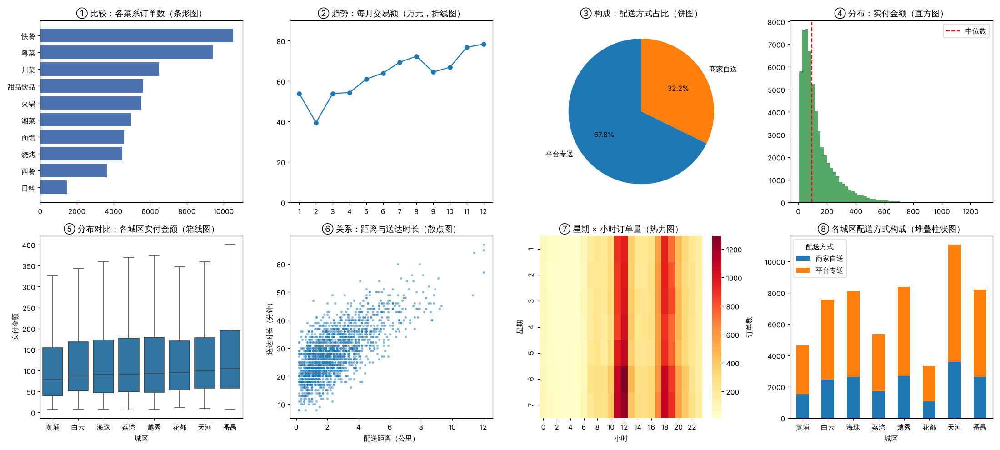
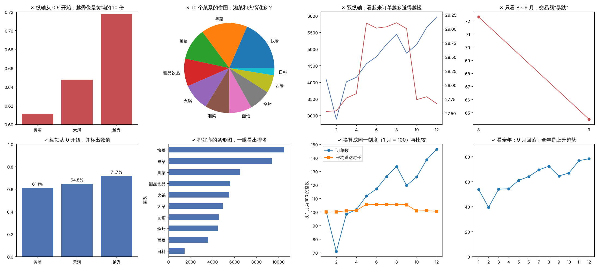
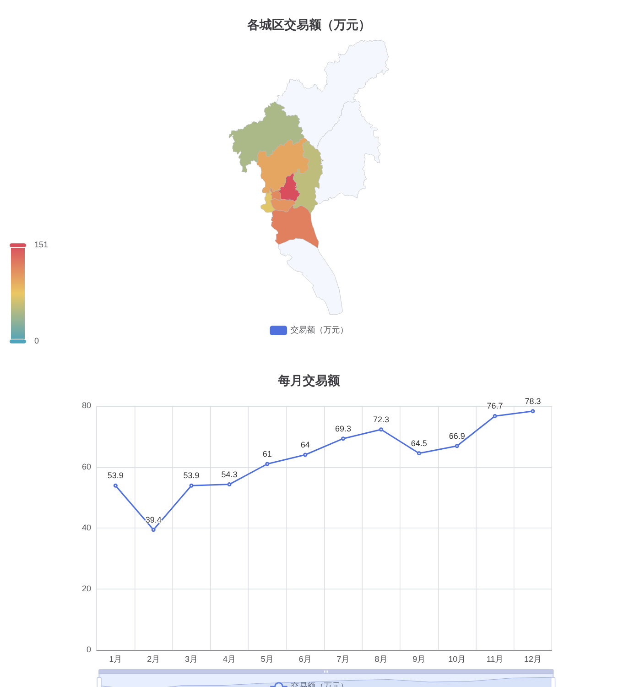
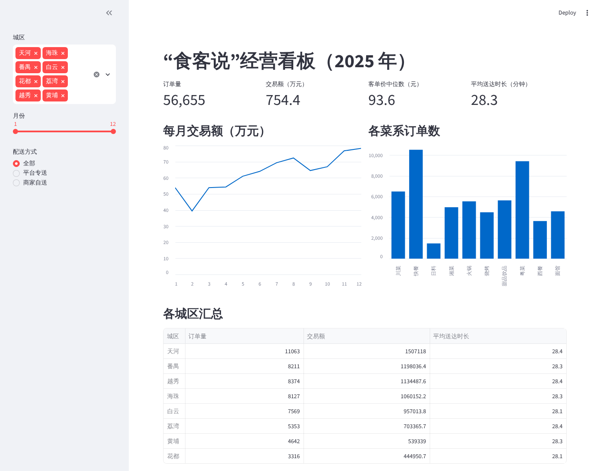
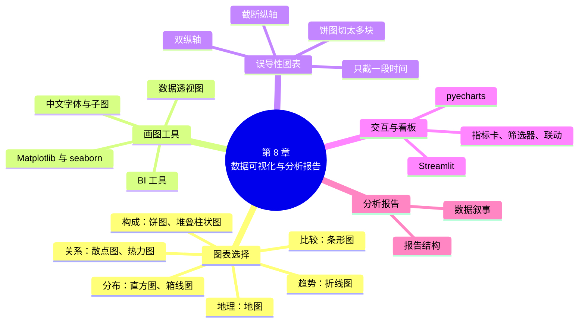

# 第 8 章 数据可视化与分析报告

!!! abstract "本章学时"
    理论 5 学时 · 实验 2 学时（本章共 3 个实验，教师可任选）

## 学习目标

学完本章，你应该能够：

1. **说出**比较、趋势、构成、分布、关系、地理六类问题分别适合用什么图表（记忆）；
2. **解释**截断纵轴、饼图切太多块、双纵轴、只截一段时间这四种图表为什么会误导人（理解）；
3. **运行并修改**给定代码，用 Matplotlib 和 seaborn 画出 8 种常用图表，并改正误导性图表（应用）；
4. **运行并修改**给定代码，用 pyecharts 做交互图表和网页看板，或用 WPS / Excel 做数据透视图（应用）；
5. **写出**一份结构完整、结论有数据支撑的数据分析报告，并评价别人的报告（评价）。

!!! info "先修要求"
    学习本章前，你需要：

    - 会用 `groupby`、`pivot_table`、`value_counts` 汇总数据（[2.4](../02-pandas/index.md#24)）；
    - 知道平均值、中位数、分布、相关系数的含义（[7.1](../07-statistics/index.md#71)、[7.3](../07-statistics/index.md#73)）；
    - 用过 Excel 或 WPS 表格插入图表（没用过也没关系，8.3 节从头讲）。

??? abstract "本章概念清单（24 个，点击查看定义和例子）"
    1. [数据可视化](../../appendix/glossary.md#g-数据可视化)
    2. [条形图](../../appendix/glossary.md#g-条形图)
    3. [折线图](../../appendix/glossary.md#g-折线图)
    4. [饼图](../../appendix/glossary.md#g-饼图)
    5. [直方图](../../appendix/glossary.md#g-直方图)
    6. [箱线图](../../appendix/glossary.md#g-箱线图)
    7. [散点图](../../appendix/glossary.md#g-散点图)
    8. [热力图](../../appendix/glossary.md#g-热力图)
    9. [堆叠柱状图](../../appendix/glossary.md#g-堆叠柱状图)
    10. [Matplotlib](../../appendix/glossary.md#g-Matplotlib)
    11. [seaborn](../../appendix/glossary.md#g-seaborn)
    12. [子图](../../appendix/glossary.md#g-子图)
    13. [数据透视图](../../appendix/glossary.md#g-数据透视图)
    14. [商业智能](../../appendix/glossary.md#g-商业智能)
    15. [误导性图表](../../appendix/glossary.md#g-误导性图表)
    16. [截断纵轴](../../appendix/glossary.md#g-截断纵轴)
    17. [双纵轴](../../appendix/glossary.md#g-双纵轴)
    18. [交互图表](../../appendix/glossary.md#g-交互图表)
    19. [pyecharts](../../appendix/glossary.md#g-pyecharts)
    20. [数据看板](../../appendix/glossary.md#g-数据看板)
    21. [指标卡](../../appendix/glossary.md#g-指标卡)
    22. [Streamlit](../../appendix/glossary.md#g-Streamlit)
    23. [数据分析报告](../../appendix/glossary.md#g-数据分析报告)
    24. [数据叙事](../../appendix/glossary.md#g-数据叙事)

## 情景导入

上一章，小林用描述统计和假设检验找到了好几条有价值的发现。他把这些发现写成一份 6 页的 Word 文档，满满都是数字和表格，交给了老板。

第二天老板把他叫过去：“你写得很认真，但我翻了两页就看不下去了。我只想知道三件事：生意是变好了还是变差了？哪里有问题？我们该做什么？你能不能做成几张图，让我一眼就能看明白？”

小林有点委屈，于是参考网上的经营报告，画了一张三维立体饼图，把 10 个菜系的订单占比都放了进去，又画了一张柱状图，纵轴从 60% 开始，显得越秀区的好评率比别的城区高出一大截。同事看了直摇头：“这饼图谁也看不出火锅和湘菜哪个多；柱状图虽然好看，但会误导人，老板看了以为黄埔区的服务糟透了。”

画图并不难，难的是画对、画清楚、画得诚实。本章就来解决这三个问题，最后把小林的“6 页数字”改写成一份老板愿意读、读得懂的数据分析报告。

## 8.1 图表选择：先问“想回答什么问题”

### 8.1.1 六类问题，六类图表

[**数据可视化**](../../appendix/glossary.md#g-数据可视化 "把数据画成图表，让人通过眼睛快速看出数量的大小、变化和关系"){ .term }就是把数据画成图，让人通过眼睛快速看出数量的大小、变化和关系。选图表的第一步不是打开软件挑一个好看的样式，而是先问自己：**这张图要回答什么问题？**<sup class="cite">[[1]](#ref8-1)</sup> 数据分析中常见的问题可以归成六类：

| 问题类型 | 典型问题（“食客说”） | 首选图表 | 也可以用 |
|---|---|---|---|
| 比较 | 哪个菜系订单最多？ | [**条形图**](../../appendix/glossary.md#g-条形图 "用矩形的长度表示数值大小的图表，竖着放的也叫柱状图，最适合比较各类别的大小"){ .term }（柱状图） | 点图 |
| 趋势 | 交易额每个月怎么变？ | [**折线图**](../../appendix/glossary.md#g-折线图 "把各时间点的数值用线连起来，表示随时间变化的趋势"){ .term } | 面积图、柱状图（时间点少时） |
| 构成 | 两种配送方式各占多少？ | [**饼图**](../../appendix/glossary.md#g-饼图 "用扇形的大小表示各部分占整体的比例，只适合 2～5 类"){ .term }、环形图（只限 2～5 类） | [**堆叠柱状图**](../../appendix/glossary.md#g-堆叠柱状图 "把一根柱子按组成部分分段堆起来，同时看总量和构成"){ .term }、百分比条形图 |
| 分布 | 订单金额一般在什么范围？ | [**直方图**](../../appendix/glossary.md#g-直方图 "把数值分成若干区间，用柱子高度表示每个区间里有多少个数据，用来看分布"){ .term } | [**箱线图**](../../appendix/glossary.md#g-箱线图 "用箱子和须线画出一组数据的中位数、四分位数和异常值，适合比较几组数据的分布"){ .term }（多组比较时） |
| 关系 | 送得越远，越慢吗？ | [**散点图**](../../appendix/glossary.md#g-散点图 "以两个数值变量为横、纵坐标，每个数据画一个点，用来看两者的关系"){ .term } | [**热力图**](../../appendix/glossary.md#g-热力图 "用颜色深浅表示表格中每个格子数值大小的图"){ .term }（多列两两关系、两个类别交叉） |
| 地理 | 哪个城区交易额最高？ | 填色地图 | 排好序的条形图 |

几条通用的经验：

- **比较大小用长度**。人眼比较长度最准，比较角度和面积就差很多，比较颜色深浅更差。所以条形图是最“万能”的图，拿不准时就用它；
- **时间放横轴，从左到右**。表示趋势时，时间必须按顺序排列，间隔要均匀；
- **一张图只说一件事**。想说两件事，就画两张图。

在下面的动画里，点一个问题，看推荐的图表和理由。

<iframe class="sim-frame" src="../../sims/chart-chooser/main.html" height="720" loading="lazy" title="图表选择与纠错"></iframe>
动画：图表选择与纠错。上半部分选问题、看推荐的图表；下半部分选一张误导性图表，逐项勾选改正方法（8.4 节会用到）。[全屏打开](../../sims/chart-chooser/main.html){ target=_blank }
{ .sim-caption }

### 8.1.2 一张好图的五个要素

不管用什么软件画图，一张合格的图都要有：

1. **标题**：直接写出图要说明的问题或结论，如“天河区交易额最高，占全市 20%”比“各城区交易额”更好；
2. **坐标轴名称和单位**：“交易额（万元）”“送达时长（分钟）”，不写单位，读者不知道 80 是 80 元还是 80 万元；
3. **图例**：图中有两种以上颜色或线条时，要说明各代表什么；
4. **数据来源**：图下方注明“数据来源：食客说 2025 年订单表”；
5. **必要的数值标注**：重点数字直接标在图上，读者不用去对坐标。

另外，颜色要有含义、不要花哨：同一类数据用同一种颜色，需要强调的那一项（如“本店”“最差的城区”）用醒目的颜色，其余用灰色。

## 8.2 用 Matplotlib 和 seaborn 画常用图表

### 8.2.1 画图的基本步骤

[**Matplotlib**](../../appendix/glossary.md#g-Matplotlib "Python 中最基础、最常用的画图库"){ .term } 是 Python 中最基础、最常用的画图库，[**seaborn**](../../appendix/glossary.md#g-seaborn "基于 Matplotlib 的统计图表库，几行代码就能画出箱线图、热力图等"){ .term } 是在它基础上封装的统计图表库，几行代码就能画出好看的箱线图、热力图。画图的基本步骤只有四步：

```python
import matplotlib.pyplot as plt
plt.rcParams["font.sans-serif"] = ["SimHei", "Microsoft YaHei", "PingFang SC",
                                   "WenQuanYi Zen Hei", "Noto Sans CJK SC"]  # 中文字体
plt.rcParams["axes.unicode_minus"] = False      # 让负号正常显示

fig, ax = plt.subplots(figsize=(8, 4))          # 第 1 步：建一块 8×4 英寸的画布
cnt = df["菜系"].value_counts().sort_values()   # 第 2 步：准备数据（先排好序）
ax.barh(cnt.index, cnt.values)                  # 第 3 步：画图（barh 是横向条形图）
ax.set_title("各菜系订单数")                    # 第 4 步：加标题、坐标轴名称
ax.set_xlabel("订单数")
plt.savefig("菜系订单数.png", dpi=150)           # 保存成图片；在 Jupyter 里会直接显示
```

前三行是**中文字体配置**，每个程序开头都要写。Matplotlib 默认的字体没有汉字，不设置的话，图里的中文会显示成一个个小方框。代码列出了 Windows（SimHei、Microsoft YaHei）、macOS（PingFang SC）和 Linux（WenQuanYi、Noto）常见的中文字体，程序会按顺序找，找到哪个用哪个。

!!! tip "图里的中文还是方框？"
    说明你的电脑上这几个字体都没有。Windows 一般都有 SimHei（黑体）；Linux 可以安装文泉驿字体；实在不行，见附录 C“中文字体设置”。运行时出现的 `findfont` 警告可以忽略，只要图里的中文正常显示就行。

### 8.2.2 常用图表的画法

画不同的图，换的只是第 3 步那一行：

| 图表 | Matplotlib 写法 | seaborn 写法 | Excel / WPS 里 |
|---|---|---|---|
| 条形图 | `ax.barh(类别, 数值)`，竖的用 `ax.bar` | `sns.barplot` | 插入 → 条形图 / 柱形图 |
| 折线图 | `ax.plot(x, y, marker="o")` | `sns.lineplot` | 插入 → 折线图 |
| 饼图 | `ax.pie(数值, labels=类别, autopct="%.1f%%")` | 无 | 插入 → 饼图 |
| 直方图 | `ax.hist(一列数, bins=60)` | `sns.histplot` | 插入 → 直方图（Excel 2016 以上） |
| 箱线图 | `ax.boxplot` | `sns.boxplot(data=df, x=分组列, y=数值列)` | 插入 → 箱形图（Excel 2016 以上） |
| 散点图 | `ax.scatter(x, y, s=6, alpha=0.4)` | `sns.scatterplot` | 插入 → 散点图 |
| 热力图 | `ax.imshow` | `sns.heatmap(透视表)` | 条件格式 → 色阶 |
| 堆叠柱状图 | `交叉表.plot(kind="bar", stacked=True)` | 无 | 插入 → 堆积柱形图 |

一张图里放几张小图，叫[**子图**](../../appendix/glossary.md#g-子图 "在一块画布上排列的多张小图"){ .term }。`fig, axes = plt.subplots(2, 4)` 建一块 2 行 4 列的画布，`axes[0, 1]` 就是第 1 行第 2 列的那张小图。实验 8-1 就用这种方法，把“食客说”的 8 张常用图表画在一起：



**图 8-1 “食客说”2025 年经营数据的 8 种常用图表**（数据来源：实验 8-1 运行结果）

从图 8-1 可以读出很多信息：快餐、粤菜订单最多（①）；交易额 2 月春节低谷、9 月回落，全年总体上升（②）；平台专送占三分之二以上（③）；订单金额右偏，中位数 93.6 元（④）；番禺区的订单金额整体偏高（⑤）；距离越远送得越慢（⑥）；每天 12 点和 18 点前后是两个高峰，周六、周日更忙（⑦）；各城区两种配送方式的比例差不多（⑧）。

!!! note "图 ⑦ 热力图是怎么来的"
    热力图的数据是一张透视表：行是星期，列是小时，格子里是订单数，颜色越深订单越多。代码只有两行：
    `heat = df.pivot_table(index="星期", columns="小时", values="order_id", aggfunc="count")`，
    `sns.heatmap(heat, cmap="YlOrRd")`。第 2 章学过的透视表，在这里直接变成了一张图。

## 8.3 不写代码也能画：数据透视图与 BI 工具

### 8.3.1 WPS / Excel 数据透视图

如果只是每月出几张固定的图，用 WPS 表格或 Excel 的[**数据透视图**](../../appendix/glossary.md#g-数据透视图 "WPS / Excel 中由数据透视表直接生成、能随字段拖放变化的图表"){ .term }就够了，不用写一行代码。以“各城区交易额”为例：

1. 用 WPS 或 Excel 打开第 4 章清洗好的订单表（已经合并了商家的城区）。没有合并的，可以先在 pandas 里 `merge` 后 `to_excel` 导出；
2. 点任意一个单元格，选“插入 → 数据透视图”（WPS 在“插入 → 数据透视表”里勾选“数据透视图”）；
3. 在右边的字段列表里，把“城区”拖到“轴（类别）”，把“实付金额”拖到“值”，汇总方式选“求和”；
4. 在图上右击 → “排序”，按交易额从大到小排；双击纵坐标轴，确认最小值是 0；
5. 把“月份”拖到“筛选器”，就能在图上方选择只看某几个月。

数据透视图和第 2 章的透视表是一回事：先按类别汇总，再画成图。它的好处是改一下拖放的字段就能换一个角度看数据，适合边看边想；缺点是每个月数据更新后要手动刷新，步骤多了容易出错。

### 8.3.2 商业智能工具

企业里做固定报表和看板，更常用[**商业智能**](../../appendix/glossary.md#g-商业智能 "连接数据、拖拽做图、组合看板并分享给他人的一类软件和方法"){ .term }（Business Intelligence，BI）工具。国内常见的有帆软 FineBI、阿里云 Quick BI、腾讯云 BI 等，国外有 Power BI、Tableau。它们的用法都类似：

1. **连接数据**：连接数据库或上传 Excel，以后数据更新，图表自动更新；
2. **拖拽做图**：和数据透视图一样，把字段拖到行、列、颜色上；
3. **组合成看板**：把多张图和指标卡排在一个页面上，设置筛选和联动（8.5 节）；
4. **分享**：发一个网址给老板，老板在手机上就能看。

FineBI 有免费的个人版，学有余力的同学可以下载试用，把实验 8-2 的看板用拖拽的方式再做一遍，体会和写代码的差别。

!!! tip "什么时候写代码，什么时候用工具？"
    一次性的探索分析、需要复杂计算的分析，用 pandas + Matplotlib 更灵活，代码还能保存下来重复运行；固定格式、要给很多人看、要每天更新的报表和看板，用 BI 工具更省事。两者并不冲突：很多公司用 Python 清洗和计算，把结果写进数据库，再由 BI 工具展示。

## 8.4 误导性图表：图会“说谎”

同样的数据，换一种画法，就能让人得出完全不同的结论。这类图叫[**误导性图表**](../../appendix/glossary.md#g-误导性图表 "由于画法不当，使读者对数据得出错误印象的图表"){ .term }。有的是作者故意为之，更多的是作者自己没意识到。<sup class="cite">[[2]](#ref8-2)</sup><sup class="cite">[[3]](#ref8-3)</sup> 实验 8-1 用“食客说”的真实数据复现了四种最常见的误导手法，上排是误导的画法，下排是改正后的画法：



**图 8-2 四种误导性图表（上排）和改正后的图表（下排）**（数据来源：实验 8-1 运行结果）

### 8.4.1 截断纵轴

[**截断纵轴**](../../appendix/glossary.md#g-截断纵轴 "柱状图的数值轴不从 0 开始，从而放大差别"){ .term }是指柱状图的纵轴不从 0 开始。图 8-2 第 1 列，黄埔、天河、越秀三个城区的好评率分别是 61.1%、64.8%、71.7%。纵轴从 60% 开始时，越秀的柱子高度大约是黄埔的 10 倍，看起来黄埔的服务糟透了；纵轴从 0 开始，三根柱子差别不大，越秀只比黄埔高 10.6 个百分点。

**改正方法**：柱状图、条形图的数值轴必须从 0 开始，因为读者是用柱子的**长度**来比较大小的。折线图看的是变化趋势，纵轴可以不从 0 开始，但要在坐标轴上标清楚起点。

### 8.4.2 饼图切太多块

图 8-2 第 2 列，10 个菜系的饼图中，甜品饮品、火锅、湘菜的扇形大小非常接近，谁多谁少根本分不出来。三维立体饼图更糟：由于透视效果，离读者近的扇形看起来更大。

**改正方法**：饼图只用于 2～5 类、各部分加起来等于 100% 的情况；类别多了，改用从大到小排序的条形图。任何图表都尽量不要用三维效果。

### 8.4.3 双纵轴

[**双纵轴**](../../appendix/glossary.md#g-双纵轴 "一张图左右各有一个纵轴，分别表示两个量；刻度可随意设定，容易制造假象"){ .term }是指一张图左右各有一个纵轴，分别表示两个不同的量。图 8-2 第 3 列的上图，左轴是订单数，右轴是平均送达时长，看起来两条线一起涨落，好像“订单越多，送得越慢”。但右轴的范围被设成了 27.3～29.3 分钟，不到 2 分钟的变化被放大成了整张图的高度。实际上，两者的相关系数只有 0.3；5～9 月送达时长偏长，主要是因为这几个月是雨季，雨天订单占 35%，其他月份只占 11%～12%。

**改正方法**：去掉右轴，把两个量都换算成“以 1 月为 100”的指数，画在同一个刻度上（下图）：12 月的订单数是 1 月的 146%，而平均送达时长最多只比 1 月高 6%。或者干脆画成上下两张图，共用一个横轴。

### 8.4.4 只截一段时间

图 8-2 第 4 列的上图只画了 8 月和 9 月，纵轴范围又只覆盖 64～73 万元，交易额看起来“暴跌”；看全年就会发现，9 月虽然比 8 月回落了 10.8%，10～12 月又创了新高，全年是上升趋势。

**改正方法**：展示足够长的时间范围，至少包含一个完整的周期（如一整年）；如果只关心某一段，也要说明前后的情况。

!!! warning "看到一张图，先问四个问题"
    1. 纵轴从哪里开始？ 2. 有几个纵轴？ 3. 时间范围是不是被挑过？ 4. 用的是长度、角度还是面积在比较？
    这四个问题既能帮你识破别人的图，也能检查自己的图。回到 8.1 节的动画，在下半部分逐项勾选改正方法，看看图是怎样“变诚实”的。

??? microvideo "思维工具微课｜这张图涨得吓人，先看哪里？　4 分 11 秒"

    <video class="mv-video" controls preload="none" playsinline poster="../../assets/video/a5.jpg">
      <source src="../../assets/video/a5.mp4" type="video/mp4">
    </video>

    **这一集的思维工具：三问来源。** 什么时候用：一张图让你吃了一惊。怎么用：谁的数据？怎么画的？没画什么？。局限：很多图不写来源。

    **看完选两件做：**

    - 玩一玩：同一组数据画两张图：纵轴从 0 起和不从 0 起。
    - 审一审 AI：让它画柱状图，检查纵轴的起点。
    - 想一想自己：你转发过的哪张图，没看过纵轴。

    <p class="mv-note">本片配音和部分画面由 AI 生成。</p>

## 8.5 交互图表与数据看板

### 8.5.1 用 pyecharts 做交互图表

Matplotlib 画出的是一张静态图片。如果希望读者能把鼠标放在图上看具体数值、拖动时间范围、点击图例隐藏某条线，就需要[**交互图表**](../../appendix/glossary.md#g-交互图表 "可以用鼠标悬停看数值、缩放、点击图例的网页图表"){ .term }。[**pyecharts**](../../appendix/glossary.md#g-pyecharts "把百度开源的 ECharts 包装成 Python 写法的交互图表库，自带中国地图"){ .term } 是一个国产的 Python 库，它把百度开源的 ECharts 图表库包装成 Python 写法，生成的是一个网页文件，用浏览器打开就能交互。它还自带全国各省市的地图，画中国地图非常方便。

pyecharts 的写法是“链式调用”：先建一个图表对象，再一步一步地 `.add_xaxis()`、`.add_yaxis()`、`.set_global_opts()`，每一步返回的还是这个图表对象：

```python
from pyecharts import options as opts
from pyecharts.charts import Line

mon = df.groupby("月份")["实付金额"].sum() / 10000          # 每月交易额（万元）
line = (
    Line()                                                  # 建一张折线图
    .add_xaxis([f"{m}月" for m in mon.index])               # 横轴：1月、2月……
    .add_yaxis("交易额（万元）", mon.round(1).tolist())     # 纵轴：一组数据
    .set_global_opts(title_opts=opts.TitleOpts(title="每月交易额"),
                     datazoom_opts=opts.DataZoomOpts())     # 下方加一个可拖动的范围条
)
line.render("每月交易额.html")                               # 生成网页，用浏览器打开
```

注意两点：一是 pyecharts 要的是 Python 列表，所以要用 `.tolist()` 把 pandas 的数据转换一下；二是生成的网页需要联网加载 ECharts 的脚本，断网时打开是空白的。

画地图的写法类似。“食客说”的商家分布在广州 8 个城区，地图上的区名带“区”字，所以要把“天河”改成“天河区”：

```python
from pyecharts.charts import Map

area = (df.groupby("城区")["实付金额"].sum() / 10000).round(1)
pairs = [(name + "区", value) for name, value in area.items()]   # [("天河区", 150.7), ……]
m = (
    Map()
    .add("交易额（万元）", pairs, maptype="广州")                  # 用广州市的区县地图
    .set_global_opts(visualmap_opts=opts.VisualMapOpts(max_=float(area.max())))
)
```

`visualmap_opts` 设置颜色和数值的对应关系，数值越大颜色越深。地图上南沙、从化、增城三个区是空白的，因为随书数据没有这三个区的商家。

### 8.5.2 数据看板

把几张关键的图和几个核心数字放在一个页面上，让人一眼看清业务全貌，这个页面叫[**数据看板**](../../appendix/glossary.md#g-数据看板 "把核心指标和关键图表放在一个页面上、可以筛选查看的展示页面"){ .term }（Dashboard，也叫仪表板、驾驶舱）。一个好的看板通常由三部分组成：

1. [**指标卡**](../../appendix/glossary.md#g-指标卡 "看板上用大号字显示单个核心指标及其涨跌的区块"){ .term }：页面最上方用大号字显示几个最核心的数字，如订单量、交易额、客单价、平均送达时长，最好附上和上月相比的涨跌；
2. **图表区**：几张回答关键问题的图，一般 4～6 张，按“总体 → 细分”的顺序排列；
3. **筛选器**：让看的人自己选择时间、城区、配送方式等条件，所有图表跟着变。

更进一步，还可以设置**联动**：点击地图上的天河区，旁边的趋势图、菜系图都自动变成只显示天河区的数据。

实验 8-2 用 pyecharts 的 `Page` 把地图、折线图、条形图、环形图拼成一个网页看板：



**图 8-3 用 pyecharts 生成的网页看板（截取上半部分）**（数据来源：实验 8-2 运行结果）

pyecharts 的看板可以交互，但不能筛选。要做带筛选器的看板，可以用 BI 工具，或者用 Python 的 [**Streamlit**](../../appendix/glossary.md#g-Streamlit "用很少的 Python 代码把数据分析程序变成网页应用的库"){ .term } 库（实验 8-3，拓展）。Streamlit 能用很少的代码把一个 Python 程序变成网页应用：`st.sidebar.multiselect` 生成多选框，`st.metric` 生成指标卡，`st.line_chart` 画折线图。选择条件一变，程序就自动重新运行一遍，所有数字和图表都随之更新。



**图 8-4 用 Streamlit 搭建的“食客说”经营看板**：左边是筛选器，上方是指标卡（数据来源：实验 8-3 运行结果）

!!! cert "证书考点 · 人工智能数据处理工程师 · 数据可视化"
    考查用 Matplotlib 等库绘制常用图表，以及根据分析目的选择图表。常考：各类图表的用途（比较、趋势、构成、分布、关系）；Matplotlib 画图的基本步骤和中文显示的设置；子图 `subplots` 的用法。容易错在用饼图表示太多类别、用折线图连接没有先后顺序的类别，以及忘记设置中文字体。

## 8.6 数据分析报告：用数据讲故事

### 8.6.1 报告的结构

图画得再好，也要组织成一份报告，才能推动决策。[**数据分析报告**](../../appendix/glossary.md#g-数据分析报告 "把分析的目的、数据、方法、发现和建议写给决策者看的文档"){ .term }是把分析的目的、过程、发现和建议写给决策者看的文档。一份规范的报告一般包括：<sup class="cite">[[4]](#ref8-4)</sup>

| 部分 | 写什么 | 篇幅 |
|---|---|---|
| 标题和摘要 | 用 3～5 句话写出最重要的发现和建议。老板可能只读这一段 | 半页以内 |
| 背景与问题 | 为什么做这次分析，要回答哪几个问题 | 一段 |
| 数据与方法 | 用了哪些数据（来源、时间范围、条数）、做了哪些清洗、用了什么方法 | 一段，细节放附录 |
| 分析发现 | 每条发现：一句结论 + 一张图 + 支撑的数字 | 报告的主体 |
| 建议 | 针对发现提出可执行的建议，说明谁来做、预期效果 | 一段或一张表 |
| 局限与下一步 | 数据和方法有哪些不足，还需要验证什么 | 几句话 |

附录 E 有完整的报告模板。

### 8.6.2 用数据讲故事

[**数据叙事**](../../appendix/glossary.md#g-数据叙事 "把数据、图表和文字组织成有逻辑的线索，引导读者得出结论"){ .term }（用数据讲故事）是指把数据、图表和文字组织成一条有逻辑的线索，让读者跟着你的思路得出结论。几条实用的技巧：<sup class="cite">[[4]](#ref8-4)</sup>

1. **结论先行**。每一节的标题就是结论，如“雨季送达时长变长，拖累好评率”，而不是“送达时长分析”。读者只读标题也能知道你发现了什么；
2. **一条发现配一张图**。图的标题写结论，正文写数字，三者说的是同一件事；
3. **有对比才有意义**。“好评率 63.1%”没有意义，“比上季度下降 2 个百分点”“比行业平均低 5 个百分点”才有意义。常用的对比有：和过去比、和目标比、和别人比、不同组之间比；
4. **区分事实和推测**。“雨天平均送达时长比晴天长 6 分钟”是事实；“好评率下降可能和送达变慢有关”是推测，要用“可能”“需要进一步验证”来表述，不能把相关说成因果（7.3.2 节）；
5. **建议要能执行**。“提高服务质量”不是建议；“5～9 月雨季在午、晚高峰各增加 10% 的骑手，预计可把雨天平均送达时长缩短 2 分钟”才是建议。

### 8.6.3 报告示例

下面是根据第 7、8 章的分析，为“食客说”写的一份报告摘要和主要发现（完整版见实验 8-3）：

!!! example "“食客说”2025 年经营分析报告（摘要）"
    **摘要**：2025 年平台交易额 754.4 万元，12 月比 1 月增长 45%，全年保持上升。主要问题有两个：一是送达超过 40 分钟的订单好评率只有 55.0%，比其他订单低 8.9 个百分点，而 5～9 月雨季的送达时长明显变长；二是西餐的好评率只有 54.4%，在 10 个菜系中最低。建议雨季在午、晚高峰增加运力，并对西餐商家开展一次服务质量排查。

    **发现 1：交易额稳步增长，2 月和 9 月有回落。** 月交易额从 1 月的 53.9 万元增长到 12 月的 78.3 万元；2 月受春节影响降到 39.4 万元，9 月比 8 月回落 10.8%（图 8-1 ②）。

    **发现 2：天河区贡献了五分之一的交易额。** 天河区交易额 150.7 万元，占全市 20.0%；花都区 44.5 万元，最低（图 8-3）。

    **发现 3：午餐和晚餐两个高峰集中，周末更忙。** 11～12 点和 18～19 点四个小时的订单占全天的 47%；周末日均订单是工作日的 1.2 倍（图 8-1 ⑦）。

    **发现 4：送得慢的订单，好评率明显更低。** 送达超过 40 分钟的订单占 7.7%，它们的好评率是 55.0%，其余订单是 63.9%，差异显著（卡方检验 p < 0.001）。雨天平均送达 33.0 分钟，比晴天长 6 分钟；5～9 月雨天订单占 35%（7.5 节、图 8-2 第 3 列）。注意：这是相关关系，送得慢可能还伴随着餐品变凉等其他原因。

    **发现 5：西餐、烧烤好评率偏低。** 西餐好评率 54.4%、烧烤 57.7%，火锅最高为 71.5%（图 8-3）。

注意报告中的每一个数字都能在前面的实验结果中找到出处，每一条推测都标明了“可能”。

## 8.7 前沿视窗

**国产 BI 与对话式 BI。** 近几年，国产 BI 工具发展很快，帆软 FineBI、阿里云 Quick BI、网易有数、腾讯云 BI 等在政府、金融、制造、零售企业中广泛使用。随着大模型的普及，这些工具纷纷加入了“对话式 BI”（也叫智能问数）功能：用户在输入框里用中文提问“上个月哪个城区的交易额增长最快？”，系统自动理解问题、生成查询、画出图表并写出一段解读。这大大降低了看数据的门槛，让不懂技术的业务人员也能自己查数。但它也带来新的问题：大模型可能误解指标口径（比如把“交易额”理解成订单金额而不是实付金额），也可能选错图表、写出把相关说成因果的解读。所以，企业在上线对话式 BI 之前，都要先把指标的定义整理清楚（7.7 节），并对它的回答抽样核对。本章学的图表选择和误导性图表知识，正是判断这些自动生成的图表是否靠谱的依据。

## 本章实验

!!! abstract "实验总览"
    | 实验 | 类型 | 建议时长 | 内容 |
    |---|---|---|---|
    | 实验 8-1 | ★ 基础 | 50 分钟 | 用 Matplotlib 和 seaborn 画 8 种常用图表；复现并改正 4 张误导性图表 |
    | 实验 8-2 | ★ 基础 | 40 分钟 | 用 pyecharts 做交互地图和趋势图，拼成网页看板；用 WPS / Excel 做数据透视图 |
    | 实验 8-3 | ☆ 拓展 | 90 分钟 | 用 Streamlit 搭一个带筛选器的看板；写一份数据分析报告并交叉评审 |

    代码见配套资源 `labs/ch08/` 目录。

### 实验 8-1 ★ 常用图表与误导性图表纠错

**实验目的**

1. 会用 Matplotlib 和 seaborn 画条形图、折线图、饼图、直方图、箱线图、散点图、热力图、堆叠柱状图；
2. 会设置中文字体，会用子图把多张图排在一起；
3. 会识别并改正四种常见的误导性图表。

**实验环境**：本机 CPU，需要 matplotlib、seaborn。

**实验数据**：`labs/data/orders.csv`、`shops.csv`、`reviews.csv`。

**实验步骤与代码**

第 1 步，运行 `labs/ch08/lab8_1_charts.py`，得到图 8-1。程序先把订单表和商家表合并，再从下单时间里取出月份、星期、小时：

```python
df = orders.merge(shops, on="shop_id")              # 订单表加上商家的城区、菜系
df["月份"] = df["下单时间"].dt.month
df["星期"] = df["下单时间"].dt.day_of_week + 1      # 1 = 星期一 …… 7 = 星期日
df["小时"] = df["下单时间"].dt.hour
fig, axes = plt.subplots(2, 4, figsize=(20, 9))     # 2 行 4 列，共 8 个子图
ax = axes.flatten()                                 # 变成一维，方便用 ax[0]～ax[7]
```

后面 8 段代码分别画 8 张图，每段前面的注释写明了这张图回答什么问题、为什么选这种图。

第 2 步，修改代码：把图 ① 改成“各城区订单数”；把图 ② 改成“每月平均送达时长”，想一想纵轴还需要从 0 开始吗？

第 3 步，运行 `labs/ch08/lab8_1_misleading.py`，得到图 8-2。对照 8.4 节，逐一说出上排每张图的问题和下排的改正方法。下面是“截断纵轴”的两种画法，区别只在 `set_ylim` 一行：

```python
ax[0, 0].bar(rate.index, rate.values, color="#C44E52")
ax[0, 0].set_ylim(0.6, 0.72)                        # 误导：纵轴从 0.6 开始
ax[1, 0].bar(rate.index, rate.values, color="#4C72B0")
ax[1, 0].set_ylim(0, 1)                             # 改正：纵轴从 0 开始
for i, v in enumerate(rate.values):                 # 在柱子上方标出数值
    ax[1, 0].text(i, v + 0.02, f"{v:.1%}", ha="center")
```

**运行结果**

```text
已保存 lab8_1_charts.png
每月交易额（万元）： {1: 53.9, 2: 39.4, 3: 53.9, 4: 54.3, 5: 61.0, 6: 64.0, 7: 69.3, 8: 72.3, 9: 64.5, 10: 66.9, 11: 76.7, 12: 78.3}
订单最多的时段： {12: 7606, 18: 6865, 11: 6695}
周末日均订单 / 工作日日均订单 = 1.2
三个城区好评率： {'黄埔': 0.611, '天河': 0.648, '越秀': 0.717}
订单数与平均送达时长的相关系数： 0.3
8 月 → 9 月交易额： 72.3 → 64.5 万元， 下降 10.8%
```

图表见图 8-1 和图 8-2。

**实验记录表**

| 图表 | 回答的问题 | 从图中读到的一条结论（带数字） |
|---|---|---|
| ① 条形图 | | |
| ② 折线图 | | |
| ④ 直方图 | | |
| ⑦ 热力图 | | |
| 误导图 1～4 | 问题是什么 | 改正方法 |

**常见问题排查**

| 现象 | 原因 | 解决办法 |
|---|---|---|
| 图中中文显示成方框 | 没有找到中文字体 | 检查程序开头的字体设置；见附录 C |
| 负号显示成方框 | 没有设置 `axes.unicode_minus` | 加上 `plt.rcParams["axes.unicode_minus"] = False` |
| 运行后没有出现图 | 在命令行运行时，`savefig` 只保存不显示 | 到程序所在文件夹找 png 文件；或在最后加 `plt.show()` |
| 子图的标题和坐标轴重叠 | 子图之间太挤 | `savefig` 前加 `plt.tight_layout()` |
| `AttributeError: ... has no attribute 'day_of_week'` | pandas 版本太旧 | 改成 `.dt.dayofweek`，或升级 pandas |

**思考与练习**

1. 图 ⑤ 的箱线图中，`showfliers=False` 去掉了什么？改成 `True` 再画一次，图有什么变化？
2. 把图 ③ 的饼图改成“各菜系订单占比”，你觉得合适吗？应该换成什么图？

**实验报告要求**

提交图 8-1、图 8-2 和你修改后的图，以及填好的记录表。

### 实验 8-2 ★ 交互图表与经营看板

**实验目的**

1. 会用 pyecharts 画交互折线图、条形图、环形图和城市地图；
2. 会用 `Page` 把多张图拼成一个网页看板；
3. 会用 WPS 或 Excel 做数据透视图，体会零代码做图的方法。

**实验环境**：本机 CPU，需要 pyecharts（`pip install pyecharts`）；打开生成的网页需要联网。

**实验数据**：`orders.csv`、`shops.csv`、`reviews.csv`。

**实验步骤与代码**

第 1 步，运行 `labs/ch08/lab8_2_pyecharts.py`，程序在同一个文件夹里生成 `lab8_2_dashboard.html`。用浏览器打开，试一试：鼠标停在地图的某个区上，看交易额；拖动折线图下方的范围条，只看下半年；点击环形图下方的图例，隐藏一种配送方式。

第 2 步，读懂把四张图拼成看板的代码：

```python
from pyecharts.charts import Page

page = Page(page_title="食客说经营看板", layout=Page.SimplePageLayout)
page.add(m, line, bar, pie)                         # 地图、折线图、条形图、环形图
page.render("lab8_2_dashboard.html")
```

第 3 步，修改代码：把地图的数值从“交易额”改成“订单数”；给折线图再加一条“订单数（百单）”的线（再写一个 `.add_yaxis`）。

第 4 步，零代码做法：用 WPS 或 Excel 打开 `orders.csv`，按 8.3.1 节的步骤做一张“各配送方式每月订单数”的数据透视图，把“配送方式”拖到“图例（系列）”，“月份”拖到“轴”。

**运行结果**

```text
已生成 lab8_2_dashboard.html
各城区交易额（万元）： {'天河': 150.7, '番禺': 119.8, '越秀': 113.4, '海珠': 106.0, '白云': 95.7, '荔湾': 70.3, '黄埔': 53.9, '花都': 44.5}
好评率最高和最低的菜系： 火锅 71.5 / 西餐 54.4
```

网页看板见图 8-3。

**实验记录表**

| 项目 | 结果 |
|---|---|
| 交易额最高 / 最低的城区及金额 | |
| 拖动范围条只看 7～12 月，交易额最低的月份 | |
| 好评率最高 / 最低的菜系 | |
| 数据透视图截图 | |
| 用代码和用 WPS / Excel 做图，各有什么优缺点 | |

**常见问题排查**

| 现象 | 原因 | 解决办法 |
|---|---|---|
| 打开网页是一片空白 | 网页需要联网加载 ECharts 脚本 | 联网后刷新；或在 Jupyter 中用 `chart.render_notebook()` |
| 地图上所有区都没有颜色 | 区名对不上，如数据是“天河”，地图是“天河区” | 检查 `pairs` 中的名字是否带“区” |
| `TypeError: Object of type int64 is not JSON serializable` | 直接传入了 pandas 或 NumPy 的数字 | 用 `.tolist()` 或 `float()` 转成 Python 的数字 |
| WPS / Excel 打开 CSV 中文乱码 | 编码问题 | 见 3.2 节，用“数据 → 从文本导入”并选择 UTF-8 |

**思考与练习**

1. 地图和排好序的条形图都能表示各城区的交易额，各有什么优缺点？
2. 如果老板只能看一张图，你会选看板中的哪一张？为什么？

**实验报告要求**

提交看板网页截图、修改后的代码、数据透视图截图和记录表。

### 实验 8-3 ☆ Streamlit 看板与数据分析报告

**实验目的**

1. 会用 Streamlit 搭一个带筛选器和指标卡的看板；
2. 会按规范的结构写一份数据分析报告；
3. 会按评分表评审别人的报告。

**实验环境**：本机 CPU，需要 streamlit（`pip install streamlit`）。

**实验数据**：`orders.csv`、`shops.csv`、`reviews.csv`，以及第 7、8 章的实验结果。

**实验步骤与代码**

第 1 步，在命令行（不是 Python 里）进入教材代码所在的文件夹，运行：

```bash
streamlit run labs/ch08/lab8_3_streamlit_app.py
```

浏览器会自动打开 `http://localhost:8501`，显示图 8-4 的看板。在左边取消几个城区、拖动月份滑块、切换配送方式，看指标卡和图表的变化。按 ++ctrl+c++ 停止运行。

第 2 步，读懂筛选的代码。用户的每一次选择都存进一个变量，再用第 2 章学过的条件筛选得到 `sel`，后面所有的数字和图都用 `sel` 来算：

```python
areas = st.sidebar.multiselect("城区", 城区列表, default=城区列表)   # 多选框
start, end = st.sidebar.slider("月份", 1, 12, (1, 12))              # 范围滑块
sel = df[df["城区"].isin(areas) & df["月份"].between(start, end)]
c1, c2, c3, c4 = st.columns(4)                                       # 一行分成 4 栏
c1.metric("订单量", f"{len(sel):,}")                                 # 指标卡
```

第 3 步，**先自己写**：在看板上再加一个指标卡“好评率”。提示：需要读入评论表，按订单号和 `sel` 合并。

第 4 步，以 8.6.3 节的报告为参考，用附录 E 的模板写一份“食客说”经营分析报告，至少包含 4 条发现，每条配一张图。也可以换一个角度，如“雨天经营分析”“西餐商家诊断”。

第 5 步，同学之间交换报告，按下面的评分表互评。

**运行结果**

看板见图 8-4。全部城区、全年、全部配送方式时，指标卡显示：订单量 56,655，交易额 754.4 万元，客单价中位数 93.6 元，平均送达时长 28.3 分钟。

**实验记录表（报告评分表）**

| 评分项 | 满分 | 得分 | 评语 |
|---|---|---|---|
| 摘要：3～5 句话说清主要发现和建议 | 20 | | |
| 每条发现都有结论、图和数字 | 25 | | |
| 图表选择恰当，没有误导 | 20 | | |
| 区分事实和推测，没有把相关说成因果 | 15 | | |
| 建议具体、可执行 | 20 | | |

**常见问题排查**

| 现象 | 原因 | 解决办法 |
|---|---|---|
| `streamlit: command not found` | 没有安装，或没有激活虚拟环境 | 激活虚拟环境后 `pip install streamlit` |
| 用 `python lab8_3_streamlit_app.py` 运行没有网页 | Streamlit 程序要用 `streamlit run` 启动 | 改用 `streamlit run` |
| 浏览器没有自动打开 | 系统设置原因 | 手动打开 `http://localhost:8501` |
| 取消所有城区后报错 | 筛选后没有数据，中位数是空值 | 加一句 `if sel.empty: st.warning("没有数据"); st.stop()` |

**思考与练习**

1. 指标卡只显示数字，老板不知道是好是坏。怎样让指标卡显示“比上月增长多少”？提示：`st.metric` 有一个 `delta` 参数。
2. 你的报告中哪一条结论是推测？你打算怎样验证它？

**实验报告要求**

提交看板截图（含你加的“好评率”指标卡）、数据分析报告和你对一份同学报告的评分表。

## 本章小结

- **数据可视化**的第一步是想清楚问题：比较用**条形图**，趋势用**折线图**，构成用**饼图**（2～5 类）或**堆叠柱状图**，分布用**直方图**和**箱线图**，关系用**散点图**和**热力图**，地理位置用地图。拿不准时，排好序的条形图最稳妥。
- 一张好图要有结论式标题、坐标轴名称和单位、图例、数据来源和必要的数值标注。
- 用 **Matplotlib** 画图分四步：建画布、准备数据、画图、加标题和标签；每个程序开头都要设置中文字体。**seaborn** 能更方便地画箱线图、热力图。
- 不写代码，也可以用 WPS / Excel 的**数据透视图**或**商业智能**（BI）工具做图和看板。
- **误导性图表**常见四种：**截断纵轴**、饼图切太多块、**双纵轴**、只截一段时间。看图先问纵轴起点、纵轴个数、时间范围和比较方式。
- **pyecharts** 生成可以交互的网页图表，还能画城市地图；**数据看板**由**指标卡**、图表区和筛选器组成，**Streamlit** 能快速搭出带筛选的看板。
- **数据分析报告**包括摘要、背景与问题、数据与方法、发现、建议、局限；**数据叙事**要结论先行、一条发现配一张图、有对比、区分事实和推测、建议可执行。



**下一章预告**

到目前为止，我们一直在“看”数据：描述它、检验它、画出它。下一章开始让数据“做事”：用 scikit-learn 训练模型，预测一单外卖要送多久；用第 5、6 章标注好的评论训练一个情感分类模型，自动判断新评论是好评还是差评；用 RFM 模型把用户分成几群，给运营提出建议；最后试一试用现成的预训练模型和大模型帮我们做预标注。

## 参考文献

正文中的上标编号（如<sup class="cite">[[1]](#ref8-1)</sup>）对应下面的文献。带链接的可以直接打开；书籍可在图书馆或电子书平台查阅。

<div class="refs" markdown>

**教材与专著**

- <span id="ref8-1"></span>[1] TUFTE E R. The visual display of quantitative information[M]. 2nd ed. Cheshire: Graphics Press, 2001.
    <span class="ref-note">数据可视化的经典著作，提出“数据墨水比”等原则，主张图表要清楚、准确、不加多余装饰，对应 8.1 节。</span>
- <span id="ref8-2"></span>[2] HUFF D. How to lie with statistics[M]. New York: W. W. Norton, 1954.
    <span class="ref-note">通俗讲解统计数字和图表怎样误导人，截断坐标轴等手法在书中都有举例，中文版名为《统计数字会撒谎》，对应 8.4 节。</span>
- <span id="ref8-3"></span>[3] CAIRO A. How charts lie: getting smarter about visual information[M]. New York: W. W. Norton, 2019.
    <span class="ref-note">用新闻和社交媒体中的真实图表，讲解怎样识别误导性图表，中文版名为《图表会说谎》，对应 8.4 节。</span>
- <span id="ref8-4"></span>[4] KNAFLIC C N. Storytelling with data: a data visualization guide for business professionals[M]. Hoboken: Wiley, 2015.
    <span class="ref-note">面向职场人士的数据可视化和数据叙事指南，中文版名为《用数据讲故事》，对应 8.6 节。</span>

**在线资源**

- <span id="ref8-5"></span>[5] Matplotlib development team. Matplotlib: visualization with Python[EB/OL]. [2026-10-31]. https://matplotlib.org/stable/.
    <span class="ref-note">Matplotlib 官方文档，其中的图表示例库（Examples）按图表类型列出了大量示例代码，对应 8.2 节。</span>
- <span id="ref8-6"></span>[6] pyecharts 开发团队. pyecharts 文档[EB/OL]. [2026-10-31]. https://pyecharts.org/.
    <span class="ref-note">pyecharts 中文官方文档，包括各种图表和地图的参数说明，对应 8.5.1 节。</span>
- <span id="ref8-7"></span>[7] Streamlit. Streamlit documentation[EB/OL]. [2026-10-31]. https://docs.streamlit.io/.
    <span class="ref-note">Streamlit 官方文档，从安装到部署的入门教程和组件说明，对应 8.5.2 节和实验 8-3。</span>

</div>

## 课后练习

选择题和判断题可以直接点击选项作答，系统会马上告诉你对错，并展开答案与解析；多选题选好后点“提交答案”。简答和实操题请先自己作答，再点开“答案与解析”核对。每道题的解析下方都有“回看”链接，做错了可以直接跳回正文复习。

**一、单项选择题**

<div class="quiz" data-answer="C" markdown>

**1.** 想展示“食客说”2025 年每个月交易额的变化，最合适的图表是（　　）。

- A. 饼图
- B. 散点图
- C. 折线图
- D. 箱线图

</div>

??? tip "答案与解析"
    **答案：C**

    随时间的变化（趋势）用折线图，横轴是按顺序排列的月份。

    考查：图表选择 · 认知层次：应用 · [回看 8.1.1](#811)
    { .quiz-meta }

<div class="quiz" data-answer="B" markdown>

**2.** 想看“配送距离”和“送达时长”两个数值变量之间有没有关系，应该用（　　）。

- A. 饼图
- B. 散点图
- C. 堆叠柱状图
- D. 直方图

</div>

??? tip "答案与解析"
    **答案：B**

    两个数值变量的关系用散点图，每个点是一笔订单。

    考查：散点图 · 认知层次：应用 · [回看 8.1.1](#811)
    { .quiz-meta }

<div class="quiz" data-answer="D" markdown>

**3.** 下列情况中，最适合用饼图的是（　　）。

- A. 10 个菜系的订单占比
- B. 12 个月的交易额
- C. 8 个城区的好评率
- D. 平台专送和商家自送的订单占比

</div>

??? tip "答案与解析"
    **答案：D**

    饼图只适合 2～5 类、加起来等于 100% 的构成。10 个菜系太多；交易额是趋势；好评率各城区之间是比较，加起来也不等于 100%。

    考查：饼图 · 认知层次：应用 · [回看 8.4.2](#842)
    { .quiz-meta }

<div class="quiz" data-answer="A" markdown>

**4.** 用 Matplotlib 画图时，中文显示成小方框，应该（　　）。

- A. 设置 `plt.rcParams["font.sans-serif"]` 为系统中有的中文字体
- B. 把数据中的中文改成拼音
- C. 增大图片的分辨率 dpi
- D. 把 `figsize` 调大

</div>

??? tip "答案与解析"
    **答案：A**

    Matplotlib 默认字体没有汉字，要指定中文字体。

    考查：Matplotlib · 认知层次：应用 · [回看 8.2.1](#821)
    { .quiz-meta }

<div class="quiz" data-answer="C" markdown>

**5.** `fig, axes = plt.subplots(2, 3)` 之后，第 2 行第 1 列的子图是（　　）。

- A. `axes[2, 1]`
- B. `axes[1, 2]`
- C. `axes[1, 0]`
- D. `axes[0, 1]`

</div>

??? tip "答案与解析"
    **答案：C**

    Python 从 0 开始编号，第 2 行是 1，第 1 列是 0。

    考查：子图 · 认知层次：应用 · [回看 8.2.2](#822)
    { .quiz-meta }

<div class="quiz" data-answer="B" markdown>

**6.** 三个城区的好评率分别是 61.1%、64.8%、71.7%，画成柱状图时纵轴从 60% 开始，这属于（　　）。

- A. 双纵轴
- B. 截断纵轴
- C. 只截一段时间
- D. 饼图切太多块

</div>

??? tip "答案与解析"
    **答案：B**

    柱状图的纵轴不从 0 开始，会把差别放大，越秀的柱子看起来是黄埔的 10 倍。

    考查：截断纵轴 · 认知层次：理解 · [回看 8.4.1](#841)
    { .quiz-meta }

<div class="quiz" data-answer="A" markdown>

**7.** 用 pyecharts 画图，最后得到的是（　　）。

- A. 一个可以用浏览器打开、能交互的网页文件
- B. 一张 png 图片
- C. 一个 Excel 文件
- D. 一个 Word 文档

</div>

??? tip "答案与解析"
    **答案：A**

    pyecharts 的 `render()` 生成 HTML 网页，用浏览器打开可以悬停、缩放、点击图例。

    考查：pyecharts · 认知层次：记忆 · [回看 8.5.1](#851-pyecharts)
    { .quiz-meta }

<div class="quiz" data-answer="D" markdown>

**8.** 数据看板最上方用大号字显示订单量、交易额等核心数字的部分叫（　　）。

- A. 图例
- B. 筛选器
- C. 坐标轴
- D. 指标卡

</div>

??? tip "答案与解析"
    **答案：D**

    指标卡显示最核心的几个数字，最好附上与上期相比的涨跌。

    考查：指标卡 · 认知层次：记忆 · [回看 8.5.2](#852)
    { .quiz-meta }

<div class="quiz" data-answer="B" markdown>

**9.** 下列数据分析报告中的小节标题，最好的是（　　）。

- A. 送达时长分析
- B. 送达超过 40 分钟的订单，好评率低 8.9 个百分点
- C. 关于送达时长的若干问题
- D. 图 3

</div>

??? tip "答案与解析"
    **答案：B**

    结论先行：读者只读标题就知道发现了什么，而且有具体数字。

    考查：数据叙事 · 认知层次：评价 · [回看 8.6.2](#862)
    { .quiz-meta }

**二、多项选择题**

<div class="quiz quiz-multi" data-answer="ABD" markdown>

**10.** 一张合格的图表应该包含（　　）。

- A. 坐标轴名称和单位
- B. 数据来源
- C. 三维立体效果
- D. 能说明问题的标题

</div>

??? tip "答案与解析"
    **答案：ABD**

    三维效果会扭曲大小，应该避免。

    考查：图表要素 · 认知层次：记忆 · [回看 8.1.2](#812)
    { .quiz-meta }

<div class="quiz quiz-multi" data-answer="ABC" markdown>

**11.** 下列可以用来表示数据分布的图表有（　　）。

- A. 直方图
- B. 箱线图
- C. 小提琴图（seaborn 的 `violinplot`）
- D. 饼图

</div>

??? tip "答案与解析"
    **答案：ABC**

    小提琴图是箱线图的变体，同时显示分布的形状。饼图表示构成，不表示分布。

    考查：直方图、箱线图 · 认知层次：理解 · [回看 8.2.2](#822)
    { .quiz-meta }

<div class="quiz quiz-multi" data-answer="ACD" markdown>

**12.** 关于双纵轴图，下列说法正确的有（　　）。

- A. 左右两个纵轴的范围可以随意设定，两条线的走势看起来就会随之改变
- B. 两条线一起涨落，就说明两者有因果关系
- C. 可以把两个量换算成同一基期的指数，画在同一刻度上
- D. 可以画成上下两张图，共用横轴

</div>

??? tip "答案与解析"
    **答案：ACD**

    双纵轴容易制造“一起涨落”的假象；即使真的一起变化，也只是相关，不等于因果。

    考查：双纵轴 · 认知层次：评价 · [回看 8.4.3](#843)
    { .quiz-meta }

<div class="quiz quiz-multi" data-answer="ABCD" markdown>

**13.** 一份规范的数据分析报告通常包括（　　）。

- A. 摘要
- B. 数据与方法
- C. 分析发现
- D. 建议与局限

</div>

??? tip "答案与解析"
    **答案：ABCD**

    此外还有标题、背景与问题。

    考查：数据分析报告 · 认知层次：记忆 · [回看 8.6.1](#861)
    { .quiz-meta }

**三、判断题**

<div class="quiz quiz-judge" data-answer="√" markdown>

**14.** 条形图和柱状图的数值轴必须从 0 开始。

</div>

??? tip "答案与解析"
    **答案：√**

    读者用长度比较大小，不从 0 开始就会放大差别。

    考查：截断纵轴 · 认知层次：理解 · [回看 8.4.1](#841)
    { .quiz-meta }

<div class="quiz quiz-judge" data-answer="×" markdown>

**15.** 三维立体饼图比平面饼图更直观，适合在报告中使用。

</div>

??? tip "答案与解析"
    **答案：×**

    三维透视会让近处的扇形看起来更大，扭曲比例。

    考查：饼图 · 认知层次：评价 · [回看 8.4.2](#842)
    { .quiz-meta }

<div class="quiz quiz-judge" data-answer="√" markdown>

**16.** WPS 或 Excel 的数据透视图，本质上就是先做透视表汇总，再把汇总结果画成图。

</div>

??? tip "答案与解析"
    **答案：√**

    数据透视图和透视表是一回事，改变拖放的字段就能换角度看数据。

    考查：数据透视图 · 认知层次：理解 · [回看 8.3.1](#831-wps-excel)
    { .quiz-meta }

<div class="quiz quiz-judge" data-answer="×" markdown>

**17.** Streamlit 程序和普通 Python 程序一样，用 `python 文件名.py` 运行就能打开网页。

</div>

??? tip "答案与解析"
    **答案：×**

    要在命令行用 `streamlit run 文件名.py` 启动。

    考查：Streamlit · 认知层次：记忆 · [回看 实验 8-3](#8-3-streamlit)
    { .quiz-meta }

<div class="quiz quiz-judge" data-answer="×" markdown>

**18.** 报告中写“送得慢导致了好评率下降”是没有问题的，因为两者的差异是显著的。

</div>

??? tip "答案与解析"
    **答案：×**

    显著只说明差异不太可能是巧合，不能说明因果。应写“送得慢的订单好评率更低，可能与……有关”。

    考查：数据叙事 · 认知层次：评价 · [回看 8.6.2](#862)
    { .quiz-meta }

**四、简答题**

**19.** 情景导入中，小林的三维饼图和柱状图各有什么问题？应该怎样改？

??? tip "答案与解析"
    **参考答案**：三维饼图放了 10 个菜系，扇形大小相近，人眼很难比较角度和面积，三维透视又会让近处的扇形显得更大；应改成从大到小排序的平面条形图。柱状图纵轴从 60% 开始，把城区之间几个百分点的差别放大成好几倍，误导老板认为黄埔区的服务很差；应让纵轴从 0 开始，并在柱子上标出数值。

    考查：误导性图表 · 认知层次：评价 · [回看 8.4](#84)
    { .quiz-meta }

**20.** 一个数据看板由哪几部分组成？各起什么作用？

??? tip "答案与解析"
    **参考答案**：① 指标卡：用大号字显示几个最核心的数字和涨跌，让人一眼看出整体情况；② 图表区：4～6 张回答关键问题的图，按“总体 → 细分”排列；③ 筛选器：让看的人自己选择时间、地区等条件，所有图表随之更新。更进一步还可以设置联动，点击一张图中的某一项，其他图自动筛选。

    考查：数据看板 · 认知层次：理解 · [回看 8.5.2](#852)
    { .quiz-meta }

**21.** 把下面这条建议改写成可执行的建议：“我们要提高配送效率，改善顾客体验。”

??? tip "答案与解析"
    **参考答案**（言之有理即可）：“5～9 月雨季，在 11～13 点和 17～20 点两个高峰各增加 10% 的骑手，并对商家自送订单设置 40 分钟超时提醒；预计可把雨天平均送达时长从 33 分钟缩短到 31 分钟以内，由配送组负责，9 月底复盘。”要点：说清做什么、什么时候、谁来做、预期效果和怎样检验。

    考查：数据分析报告 · 认知层次：应用 · [回看 8.6.2](#862)
    { .quiz-meta }

**五、实操题**

**22.** 画一张“各城区平均送达时长”的条形图，要求从大到小排序、纵轴从 0 开始、标出数值，并说明各城区之间差别大不大。

??? tip "答案与解析"
    **参考答案**：

    ```python
    t = df.groupby("城区")["送达时长"].mean().sort_values()
    fig, ax = plt.subplots(figsize=(7, 4))
    ax.barh(t.index, t.values)
    for i, v in enumerate(t.values):
        ax.text(v + 0.3, i, f"{v:.1f}", va="center")
    ax.set_xlim(0, 35)
    ax.set_xlabel("平均送达时长（分钟）")
    ax.set_title("各城区平均送达时长相差不到 0.5 分钟")
    plt.savefig("城区送达时长.png", dpi=150)
    ```

    运行结果：各城区平均送达时长在 28.1～28.4 分钟之间，差别很小。如果把横轴设成从 28 开始，看起来会差好几倍，这正是截断坐标轴的误导。

    考查：条形图、截断纵轴 · 认知层次：应用 · [回看 8.4.1](#841)
    { .quiz-meta }

**23.** 用 pyecharts 画一张“各菜系订单数”的柱状图，生成网页并截图。

??? tip "答案与解析"
    **参考答案**：

    ```python
    from pyecharts import options as opts
    from pyecharts.charts import Bar

    cnt = df["菜系"].value_counts()
    bar = (
        Bar()
        .add_xaxis(cnt.index.tolist())
        .add_yaxis("订单数", cnt.tolist())
        .set_global_opts(title_opts=opts.TitleOpts(title="各菜系订单数"))
    )
    bar.render("菜系订单数.html")
    ```

    快餐 10518 单最多，日料 1465 单最少。注意要用 `.tolist()` 转换数据，打开网页需要联网。

    考查：pyecharts · 认知层次：应用 · [回看 8.5.1](#851-pyecharts)
    { .quiz-meta }
