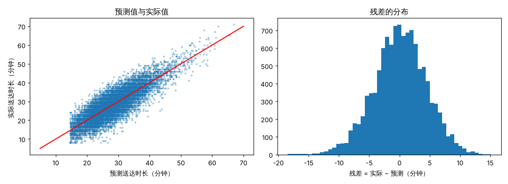
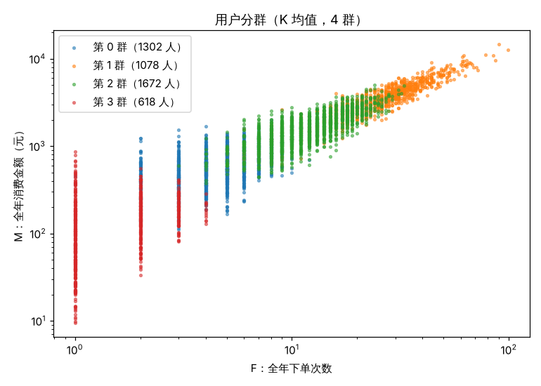
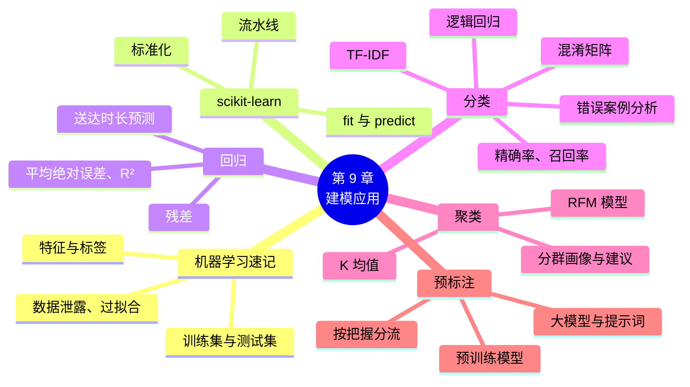

# 第 9 章 建模应用：从 scikit-learn 到预训练模型

!!! abstract "本章学时"
    理论 5 学时 · 实验 1 学时（本章共 3 个实验，教师可任选）

## 学习目标

学完本章，你应该能够：

1. **说出**特征、标签、训练集、测试集、数据泄露的含义，以及回归、分类、聚类分别解决什么问题（记忆）；
2. **解释**为什么要留出测试集、为什么要和基准比较，以及准确率高不等于模型好用的原因（理解）；
3. **运行并修改**给定代码，用 scikit-learn 流水线完成送达时长预测和评论情感分类，写出测试报告和错误案例分析（应用）；
4. **运行并修改**给定代码，计算 RFM、给用户分群，并为每一群提出运营建议（应用）；
5. **判断**什么时候可以用模型或大模型做预标注，说出成本和风险（评价）。

!!! info "先修要求"
    学习本章前，你需要：

    - 知道监督学习、标签、预标注的含义（[5.1](../05-annotation/index.md#51)、[6.4](../06-annotation-qa/index.md#64)）；
    - 会用 pandas 新增列、分组汇总、合并表（[第 2 章](../02-pandas/index.md)）；
    - 本章只讲“怎么用、结果怎么读”，算法原理请参考“机器学习”课程：线性回归（第 3 章）、逻辑回归与分类评估（第 4 章）、聚类（第 8 章）、神经网络（第 10、11 章）。

??? abstract "本章概念清单（25 个，点击查看定义和例子）"
    1. [机器学习](../../appendix/glossary.md#g-机器学习)
    2. [特征](../../appendix/glossary.md#g-特征)
    3. [模型](../../appendix/glossary.md#g-模型)
    4. [回归](../../appendix/glossary.md#g-回归)
    5. [分类](../../appendix/glossary.md#g-分类)
    6. [聚类](../../appendix/glossary.md#g-聚类)
    7. [训练集](../../appendix/glossary.md#g-训练集)
    8. [测试集](../../appendix/glossary.md#g-测试集)
    9. [数据泄露](../../appendix/glossary.md#g-数据泄露)
    10. [过拟合](../../appendix/glossary.md#g-过拟合)
    11. [scikit-learn](../../appendix/glossary.md#g-scikit-learn)
    12. [流水线](../../appendix/glossary.md#g-流水线)
    13. [标准化](../../appendix/glossary.md#g-标准化)
    14. [平均绝对误差](../../appendix/glossary.md#g-平均绝对误差)
    15. [决定系数](../../appendix/glossary.md#g-决定系数)
    16. [残差](../../appendix/glossary.md#g-残差)
    17. [TF-IDF](../../appendix/glossary.md#g-TF-IDF)
    18. [逻辑回归](../../appendix/glossary.md#g-逻辑回归)
    19. [混淆矩阵](../../appendix/glossary.md#g-混淆矩阵)
    20. [精确率](../../appendix/glossary.md#g-精确率)
    21. [召回率](../../appendix/glossary.md#g-召回率)
    22. [RFM 模型](../../appendix/glossary.md#g-RFM-模型)
    23. [K 均值](../../appendix/glossary.md#g-K-均值)
    24. [预训练模型](../../appendix/glossary.md#g-预训练模型)
    25. [提示词](../../appendix/glossary.md#g-提示词)

## 情景导入

“食客说”的运营经理给数据组提了三个需求：

第一，顾客下单时，App 上要显示“预计 xx 分钟送达”。现在是所有订单都写“30 分钟”，近的订单早早就到了，远的订单、雨天的订单经常超时，顾客投诉“说好的 30 分钟呢”。

第二，每天有几百条新评论，客服只能挑着看。能不能让电脑自动判断每条评论是好评、中评还是差评，把差评第一时间推给客服？

第三，下个月有一笔营销预算，想给不同的用户发不同的优惠券。但 4670 个用户，总不能一个一个看吧？

这三个需求，分别对应机器学习中的三类问题：**预测一个数**（回归）、**判断属于哪一类**（分类）、**把相似的对象分成几群**（聚类）。本章不推导算法，而是像使用一件工具那样，学会用 [scikit-learn](../../appendix/glossary.md#g-scikit-learn "Python 中最常用的机器学习库，各种算法都用 fit、predict 两步调用"){ .term } 把这三件事做出来，并且学会判断做得好不好。

## 9.1 机器学习速记

### 9.1.1 从数据中学规律

[**机器学习**](../../appendix/glossary.md#g-机器学习 "让计算机从数据中自动找出规律，再用规律对新数据做预测或判断的方法"){ .term }是让计算机从数据中自动找出规律，再用这个规律对新数据做预测或判断的方法。以“预计送达时长”为例：

- 我们手上有 56655 笔历史订单，每笔订单都知道配送距离、天气、配送方式、下单时间，也知道**实际**送了多少分钟；
- 用来做预测的信息（距离、天气……）叫[**特征**](../../appendix/glossary.md#g-特征 "用来做预测的输入信息，通常是表格中的一列"){ .term }，要预测的结果（送达时长）就是第 5 章讲过的标签；
- 把特征和标签交给算法，算法从中找出“距离每远 1 公里，大约多送几分钟”这样的规律，这个规律就是[**模型**](../../appendix/glossary.md#g-模型 "算法从训练数据中学到的规律，可以对新数据做预测"){ .term }；
- 新订单来了，只知道特征，把特征交给模型，模型就给出预测的送达时长。

按要预测的东西不同，常见的任务有三类：

| 任务 | 预测什么 | “食客说”的例子 | 本章小节 |
|---|---|---|---|
| [**回归**](../../appendix/glossary.md#g-回归 "预测一个数值的机器学习任务"){ .term } | 一个数 | 送达时长、下个月的交易额 | 9.3 |
| [**分类**](../../appendix/glossary.md#g-分类 "预测属于哪一个类别的机器学习任务"){ .term } | 属于哪一类 | 评论是正面、中性还是负面 | 9.4 |
| [**聚类**](../../appendix/glossary.md#g-聚类 "没有标签，把相似的对象自动分成几群的任务"){ .term } | 没有标签，把相似的对象分成几群 | 用户分群 | 9.5 |

回归和分类都需要标签，属于监督学习；聚类不需要标签，属于无监督学习。

### 9.1.2 训练集、测试集和数据泄露

模型在“见过的”数据上表现好不算本事，在“没见过的”新数据上表现好才算。所以建模前要先把数据分成两份：

- [**训练集**](../../appendix/glossary.md#g-训练集 "交给算法学习规律的那部分数据"){ .term }：一般占 70%～80%，交给算法学规律；
- [**测试集**](../../appendix/glossary.md#g-测试集 "训练时不让模型看到、用来检验模型真实水平的数据"){ .term }：一般占 20%～30%，训练时**完全不让模型看到**，训练好以后用来检验模型的真实水平。

这就像考试：平时做的练习题是训练集，期末考试的题目是测试集。如果期末考试的原题平时都做过，考满分也不能说明真学会了。

如果测试集的信息在训练时“漏”给了模型，测试成绩就会虚高，上线后效果却很差，这叫[**数据泄露**](../../appendix/glossary.md#g-数据泄露 "测试集或预测时拿不到的信息在训练时被模型用到，使测试成绩虚高"){ .term }。常见的泄露有：

1. 同一条数据既在训练集又在测试集（比如重复的评论没有去重，第 4 章）；
2. 用了预测时还拿不到的信息当特征。比如用“评论的评分”去预测“评论的情感”，但新评论还没打分时就要预测；用“实际送达时间”去算送达时长的特征；
3. 先用全部数据做了标准化、填充缺失值，再划分训练集和测试集，测试集的信息就混进了训练过程。用 9.2 节的流水线可以避免这个问题。

与数据泄露相反的一个问题叫[**过拟合**](../../appendix/glossary.md#g-过拟合 "模型把训练集中的偶然细节也学了下来，在训练集上好、在新数据上差"){ .term }：模型把训练集里的偶然细节也当成规律死记硬背下来，在训练集上表现很好，在测试集上表现差很多。判断方法很简单：比较训练集和测试集上的成绩，差得多就是过拟合了。<sup class="cite">[[1]](#ref9-1)</sup>

## 9.2 scikit-learn 的基本用法

[scikit-learn](https://scikit-learn.org/stable/)（简称 sklearn）是 Python 中最常用的机器学习库，几乎所有算法的用法都一样，只有三步：<sup class="cite">[[2]](#ref9-2)</sup>

```python
from sklearn.linear_model import LinearRegression

model = LinearRegression()          # 第 1 步：选一个算法，建一个模型对象
model.fit(X_train, y_train)         # 第 2 步：用训练集的特征和标签训练（fit 就是“拟合”“学习”）
pred = model.predict(X_test)        # 第 3 步：对测试集的特征做预测
```

换一个算法，只需要换第 1 行，比如把 `LinearRegression()` 换成 `RandomForestRegressor()`，后两行一个字都不用改。

划分训练集和测试集也只要一行：

```python
from sklearn.model_selection import train_test_split

X_train, X_test, y_train, y_test = train_test_split(X, y, test_size=0.2, random_state=2026)
```

`test_size=0.2` 表示 20% 作为测试集；`random_state` 固定随机种子，保证每次划分的结果一样，和第 6 章抽检时的用法相同。

实际建模时，数据在交给算法之前往往还要经过几步处理，比如[**标准化**](../../appendix/glossary.md#g-标准化 "把一列数据减去平均值再除以标准差，使各列数值范围相近"){ .term }（把各列数据换算到相近的范围，避免数值大的列“说了算”）、把文字变成数字。scikit-learn 的[**流水线**](../../appendix/glossary.md#g-流水线 "把预处理步骤和模型串成一个整体，一次训练、一次预测"){ .term }（Pipeline）可以把这些步骤和模型串成一个整体：

```python
from sklearn.pipeline import Pipeline
from sklearn.preprocessing import StandardScaler

lin = Pipeline([
    ("scale", StandardScaler()),        # 第一步：标准化，起个名字叫 scale
    ("model", LinearRegression()),      # 第二步：线性回归，起个名字叫 model
])
lin.fit(X_train, y_train)               # 一次 fit，依次完成标准化和训练
pred = lin.predict(X_test)              # 一次 predict，依次完成标准化和预测
```

流水线有两个好处：一是代码短，训练和预测时不会漏掉某一步；二是标准化用的平均值、标准差只从训练集里算，自动避免了 9.1.2 节说的第 3 种数据泄露。训练好的流水线还可以用 `joblib.dump` 保存成一个文件，上线时直接读取使用（第 11 章）。

## 9.3 回归：预测送达时长

### 9.3.1 准备特征

模型只认数字，所以第一步是把订单表里的信息整理成数字特征。实验 9-1 选了 5 个特征：

```python
df["小时"] = df["下单时间"].dt.hour
df["高峰"] = df["小时"].isin([11, 12, 17, 18, 19]).astype(int)   # 午、晚高峰记 1，其余记 0
df["雨天"] = (df["天气"] == "雨").astype(int)                    # 文字变成 0 / 1
df["商家自送"] = (df["配送方式"] == "商家自送").astype(int)
X = df[["配送距离", "雨天", "商家自送", "高峰", "就餐人数"]]
y = df["送达时长"]
```

“天气”“配送方式”是文字，用“是不是雨天”“是不是商家自送”变成 0 和 1；“高峰”是从下单时间中提取出来的新特征，这一步叫特征构造。选哪些特征，要靠第 7 章探索性分析的发现：雨天、商家自送、距离远都会送得慢。

### 9.3.2 看误差：和基准比

训练好线性回归模型后，用测试集评估。回归模型最常用的评估指标是[**平均绝对误差**](../../appendix/glossary.md#g-平均绝对误差 "每个预测值与实际值之差的绝对值的平均数，单位和标签相同"){ .term }（MAE）：每一单“预测值与实际值相差几分钟”的平均数。它的单位和标签相同，最容易理解。

但“平均差 3.45 分钟”到底好不好？要有一个**基准**来比较。最简单的基准是“不管什么订单都猜平均值 28.3 分钟”，这正是 App 现在的做法。实验 9-1 的结果：

```text
训练集 45324 单；测试集 11331 单
基准（都猜平均值 28.3 分钟）：平均绝对误差 6.53 分钟
线性回归：平均绝对误差 3.45 分钟，R² = 0.721
每个特征增加 1 个单位，送达时长约增加（分钟）： {'配送距离': 3.4, '雨天': 6.0, '商家自送': 4.51, '高峰': 6.04, '就餐人数': -0.02}
随机森林：平均绝对误差 3.49 分钟，R² = 0.714
```

线性回归把误差从 6.53 分钟降到 3.45 分钟，几乎减半。另一个指标[**决定系数**](../../appendix/glossary.md#g-决定系数 "衡量回归模型解释了标签多大比例变化的指标，越接近 1 越好"){ .term }（R²）在 0 到 1 之间，越接近 1 越好，0.721 表示模型解释了送达时长约 72% 的变化。

线性回归的好处是结果容易解释：距离每远 1 公里，约多 3.4 分钟；雨天约多 6.0 分钟；商家自送约多 4.5 分钟；高峰时段约多 6.0 分钟；就餐人数几乎没有影响。这些数字和第 7 章的分析一致，可以直接讲给运营经理听。

实验中还试了一个更复杂的算法——随机森林，误差反而略大（3.49 分钟）。这说明**复杂的模型不一定更好**，数据中的规律本来就接近直线关系时，简单的模型就够了。

### 9.3.3 看残差：模型在哪里错得多

每一单的“实际值 − 预测值”叫[**残差**](../../appendix/glossary.md#g-残差 "实际值减去预测值"){ .term }。残差为正，说明实际比预测慢，顾客会等得着急。



**图 9-1 送达时长预测的预测值与实际值（左）和残差分布（右）**（数据来源：实验 9-1 运行结果）

左图的点大致沿着红色对角线分布，说明预测大体准确；右图的残差集中在 0 附近，左右大致对称。误差超过 10 分钟的订单占 2.3%。把残差最大的几单找出来看，它们的距离、天气、时段都很普通，说明还有模型没掌握的因素，比如商家出餐慢、骑手同时送好几单。想进一步改进，就要采集这些新特征，这是写给算法工程师的一条“优化需求”（第 11 章）。

!!! tip "上线时怎么用这个模型？"
    App 显示的预计时长，最好比模型的预测多留一点余量（比如加 5 分钟），因为顾客对“晚到”的不满远大于对“早到”的惊喜。这是业务决策，不是模型能决定的。

## 9.4 分类：评论情感分类

### 9.4.1 把文字变成数字：TF-IDF

第 5、6 章标注并审核了 2000 条评论的情感，现在用它们训练一个情感分类模型。难点在于：模型只认数字，评论却是文字。

最常用的简单方法叫 [**TF-IDF**](../../appendix/glossary.md#g-TF-IDF "把文本变成数字的方法：字词在本文中出现越多、在所有文本中越少见，权重越高"){ .term }。它的思路是：把评论切成一个个小片段（这里按单个字和相邻两个字切，如“好吃”切成“好”“吃”“好吃”），统计每个片段在这条评论中出现了几次（TF，词频），再乘以一个权重：在所有评论中都常见的片段（如“的”“了”）权重低，只在少数评论中出现的片段（如“踩雷”“怪味”）权重高（IDF，逆文档频率）。这样每条评论都变成了一长串数字，每个数字代表一个片段的重要程度。<sup class="cite">[[3]](#ref9-3)</sup>

有了数字，就可以用[**逻辑回归**](../../appendix/glossary.md#g-逻辑回归 "输出属于各类别概率的常用分类算法"){ .term }来分类。逻辑回归虽然名字里有“回归”，但它是一个分类算法：它给每个片段学一个“正面还是负面”的分数，把一条评论里所有片段的分数加起来，再换算成属于每一类的概率。把这两步串成流水线：

```python
from sklearn.feature_extraction.text import TfidfVectorizer
from sklearn.linear_model import LogisticRegression

clf = Pipeline([
    ("tfidf", TfidfVectorizer(analyzer="char", ngram_range=(1, 2))),  # 按单字和相邻两字切分
    ("model", LogisticRegression(max_iter=1000, class_weight="balanced")),
])
clf.fit(train["评论内容"], train["情感标签"])   # 训练集：第 6 章的 2000 条标注
pred = clf.predict(test["评论内容"])              # 测试集：另外随机抽的 2000 条评论
```

`class_weight="balanced"` 让模型更重视数量少的类别（负面评论只占两成），否则模型会偏向于猜数量多的“正面”。

### 9.4.2 测试报告：准确率、混淆矩阵、精确率和召回率

在测试集上，模型的准确率是 96.3%。但只看准确率是不够的，还要看模型在每一类上的表现。[**混淆矩阵**](../../appendix/glossary.md#g-混淆矩阵 "把真实类别和预测类别交叉统计的表格，对角线是判对的"){ .term }把“真实是什么”和“预测成什么”交叉起来，和第 6 章比较两名标注员的交叉表是一回事：

```text
      预测正面  预测中性  预测负面
真实正面  1070    19    11
真实中性     1   512    36
真实负面     0     7   344
```

对角线上的数字是判对的，其余是判错的。最大的错误是 36 条中性评论被判成了负面。再看每一类的[**精确率**](../../appendix/glossary.md#g-精确率 "模型判为某一类的样本中，真正属于这一类的比例"){ .term }和[**召回率**](../../appendix/glossary.md#g-召回率 "真正属于某一类的样本中，被模型找出来的比例"){ .term }：

```text
              precision    recall  f1-score   support
          正面      0.999     0.973     0.986      1100
          中性      0.952     0.933     0.942       549
          负面      0.880     0.980     0.927       351
```

- **精确率**（precision）：模型判为“负面”的评论中，真的是负面的占多少。负面的精确率是 88.0%，即模型推给客服的“差评”里，每 100 条约有 12 条其实不是差评；
- **召回率**（recall）：真正的负面评论中，被模型找出来的占多少。负面的召回率是 98.0%，即真正的差评几乎都能被找出来。
- F1 值是精确率和召回率的综合，两者都高时 F1 才高。

哪个指标更重要，要看业务：客服最怕漏掉差评，所以负面的召回率更重要；多推几条误报，客服多看几眼就行。这样的模型可以先上线试用。

### 9.4.3 错误案例分析

测试报告的最后一部分，是把判错的评论拿出来逐条看，找出模型错在哪里、为什么错，这叫错误案例分析，和第 6 章分析标注员的错误是同样的方法。实验 9-1 中模型判错了 74 条，前几条是：

```text
                           评论内容 情感_参考 预测
            性价比很高！汤洒了一袋子！下次还会再来    正面 负面
            肥牛鲜嫩入味。上菜太慢了，等了四十分钟    中性 负面
            适合朋友聚会，收银员爱答不理，五星好评    正面 负面
                         虾滑又冷又硬    负面 中性
```

逐条看下来，大约三分之二的错误是“好坏都有”的评论，正是第 5 章标注规范中的边界规则 1 管的那类评论：要看结尾的总结性表态。TF-IDF 只统计片段出现了没有，不管片段的位置和先后，所以学不会“看结尾”这条规则。另有一些错误是“虾滑又冷又硬”这样很短、又出现了训练集里少见的菜名的评论。

根据错误分析，可以提出改进办法：一是多标注一些“好坏都有”的评论加入训练集；二是换用能理解语序的预训练模型（9.6 节）。

!!! cert "证书考点 · Python 技术应用工程师 · 机器学习建模"
    考查用 scikit-learn 完成数据划分、训练、预测和评估的完整流程。常考：`train_test_split` 的参数；`fit`、`predict` 的用法；回归的评估指标（平均绝对误差、R²）；分类的评估指标（准确率、精确率、召回率、F1、混淆矩阵）的计算和含义；`Pipeline` 的作用。容易错在用训练集评估模型、混淆精确率和召回率，以及在划分数据之前做标准化导致数据泄露。

## 9.5 聚类：RFM 与用户分群

### 9.5.1 RFM 模型

给用户分群，营销上最常用的方法是 [**RFM 模型**](../../appendix/glossary.md#g-RFM-模型 "用最近一次消费（R）、消费频率（F）、消费金额（M）衡量用户价值并分群的方法"){ .term }。它用三个指标描述一个用户的价值：<sup class="cite">[[4]](#ref9-4)</sup>

| 指标 | 含义 | 计算方法（“食客说”） | 怎样算好 |
|---|---|---|---|
| R（Recency，最近一次消费） | 最近一次下单距今多少天 | 2026-01-01 减去最后一次下单日期 | 越小越好 |
| F（Frequency，消费频率） | 统计期内下了几单 | 2025 年的订单数 | 越大越好 |
| M（Monetary，消费金额） | 统计期内一共花了多少钱 | 2025 年的实付金额之和 | 越大越好 |

用 pandas 计算 RFM 只要一次分组汇总：

```python
today = pd.Timestamp("2026-01-01")                 # 以这一天作为“今天”
rfm = orders.groupby("user_id").agg(
    最近下单=("下单时间", "max"),
    F=("order_id", "count"),                        # 下了几单
    M=("实付金额", "sum"),                          # 一共花了多少
)
rfm["R"] = (today - rfm["最近下单"]).dt.days       # 距今几天
```

最简单的分群方法是按规则：R、F、M 各和自己的中位数比较，分成“好 / 差”两档，组合起来得到 8 群，每一群都有一个约定俗成的名字。比如三项都好的是“重要价值客户”；F、M 好但 R 差（以前常来、花得多，但最近没来）的是“重要唤回客户”。“食客说”的结果是：重要价值客户 1532 人，占用户的 32.8%，贡献了 62.6% 的消费；重要唤回客户 520 人，占 11.1%，贡献了 14.9% 的消费，是最值得发券召回的人群。

在下面的动画中，拖动三条分档线，看用户落到哪一群：

<iframe class="sim-frame" src="../../sims/rfm-segments/main.html" height="640" loading="lazy" title="RFM 分群"></iframe>
动画：RFM 分群。拖动 R、F、M 的分档线，看 400 名用户在 8 个分群中的分布和各群的消费占比；鼠标停在表格行上可以看运营建议。[全屏打开](../../sims/rfm-segments/main.html){ target=_blank }
{ .sim-caption }

### 9.5.2 K 均值聚类

按规则分群，分档线是人定的。另一种方法是让算法自己找出“自然形成”的群，这就是**聚类**。最常用的聚类算法是 [**K 均值**](../../appendix/glossary.md#g-K-均值 "先指定群数 K，反复调整使群内对象尽量相似的聚类算法"){ .term }：先指定要分成 K 群，算法会反复调整，让每一群内部的用户尽量相似、不同群之间尽量不同。<sup class="cite">[[1]](#ref9-1)</sup>

```python
import numpy as np
from sklearn.preprocessing import StandardScaler
from sklearn.cluster import KMeans

X = StandardScaler().fit_transform(np.log1p(rfm[["R", "F", "M"]]))  # 先取对数，再标准化
km = KMeans(n_clusters=4, n_init=10, random_state=2026).fit(X)       # 分成 4 群
rfm["聚类"] = km.labels_                                             # 每个用户属于第几群
```

聚类前要做两件事：一是取对数（`np.log1p`），因为 M 是右偏分布（第 7 章），少数大户的金额会主导距离的计算；二是标准化，因为 R 以天计、M 以元计，数值范围差得很远。

分成几群合适？可以多试几个 K，看“惯性”（每个点到所在群中心的距离之和）的下降情况，再结合业务上好不好解释来定。实验 9-2 选了 4 群，每一群的画像如下：

```text
      人数   R中位数  F中位数    M中位数  交易额占比
聚类
1   1078    3.0  25.0  3255.0  0.508
2   1672   18.0  11.0  1543.0  0.369
0   1302   46.0   5.0   590.0  0.110
3    618  133.0   2.0   137.0  0.013
```



**图 9-2 K 均值聚类的 4 个用户群**（横、纵轴都是对数坐标，刻度 10⁰、10¹、10² 即 1、10、100；数据来源：实验 9-2 运行结果）

### 9.5.3 给分群起名、提建议

算法只会给出“第 0 群、第 1 群”这样的编号，**给分群起名和提建议是分析人员的工作**，这一步最能体现业务理解：

| 群 | 画像 | 起个名字 | 运营建议 |
|---|---|---|---|
| 1 | 3 天内来过，全年 25 单，花 3255 元；1078 人贡献 50.8% 的交易额 | 忠实老顾客 | 会员专属权益、新店优先体验，重在维护，不必大额发券 |
| 2 | 18 天前来过，全年 11 单，花 1543 元 | 稳定常客 | 满减券提高频率，推荐套餐提高客单价 |
| 0 | 46 天前来过，全年 5 单，花 590 元 | 偶尔光顾 | 节假日、雨天定向推送优惠，唤起需求 |
| 3 | 133 天前来过，全年 2 单，花 137 元 | 流失或沉睡 | 低成本短信召回一次；没有反应就不再投入 |

!!! warning "分群不是“标准答案”"
    分档线和 K 换一换，分群结果就会变。判断分群好不好，标准是业务上能不能解释、能不能用：每一群的画像是否清晰、群与群之间是否有明显差别、能否为每一群设计不同的运营动作。

## 9.6 用预训练模型和大模型做预标注

### 9.6.1 用自己训练的模型预标注

第 6 章讲过预标注：先用模型给数据打上初步标签，标注员只需检查和修改。实验 9-1 训练的情感模型就可以用来预标注。关键是利用模型的“把握”：`predict_proba` 给出评论属于每一类的概率，最大的那个概率就是模型的把握。把握大的直接采用，把握小的交给人工：

```python
proba = clf.predict_proba(todo["text"])              # 每条评论属于三类的概率
todo["预标注"] = clf.classes_[proba.argmax(axis=1)]  # 概率最大的类别
todo["把握"] = proba.max(axis=1)                     # 最大的概率
sure = todo[todo["把握"] >= 0.6]                      # 把握大的，直接采用
unsure = todo[todo["把握"] < 0.6]                     # 把握小的，交给人工
```

对第 5 章待标注的 100 条评论，把握 ≥ 0.6 的有 80 条，准确率 100%；把握 < 0.6 的 20 条交给人工。按人工从头标一条 15 秒、检查一条预标注 5 秒估算，工作量从 25 分钟降到 12 分钟，节省 53%。

### 9.6.2 预训练模型

自己训练模型需要先有一批标注数据。如果一条标注都没有，可以直接用别人训练好的模型。[**预训练模型**](../../appendix/glossary.md#g-预训练模型 "已在海量数据上训练好、可以直接使用或稍加训练后使用的模型"){ .term }是在海量数据上预先训练好、可以直接使用或稍加训练后使用的模型。它们大多是深度神经网络（原理见“机器学习”课程第 10、11 章），能理解语序和上下文，比 TF-IDF 更聪明。

模型分享平台（如国外的 Hugging Face、国内的魔搭 ModelScope）上有大量现成的模型，比如用大众点评评论训练的中文情感分类模型、能识别图片中上千种物体的图像分类模型。用 `transformers` 库调用只要几行代码（实验 9-3 的 `lab9_3_pretrained.py`）：

```python
from transformers import pipeline

clf = pipeline("text-classification", model="uer/roberta-base-finetuned-dianping-chinese")
print(clf("送到都凉了，不会再来了"))   # 输出类似 [{'label': 'negative ...', 'score': 0.99}]
```

用现成模型要注意：模型的类别不一定和我们的标签体系相同（这个模型只分正面、负面两类，没有中性）；模型训练用的数据和我们的数据可能不同（点评网站的长评论 vs 外卖平台的短评论），效果要先抽样检验。第一次运行要下载几百 MB 的模型文件，需要能访问模型网站。

### 9.6.3 大模型辅助标注

大模型（如 DeepSeek、通义千问、文心一言、GPT）能直接读懂中文指令。把标注规范写进[**提示词**](../../appendix/glossary.md#g-提示词 "发给大模型的指令文字，说明要做什么、按什么规则、输出什么格式"){ .term }，让大模型按规范给评论标注，它不需要任何训练数据就能完成分类、抽取菜名等任务：

```text
你是外卖平台的评论标注员。请按下面的规范标注这条评论，只输出 JSON，不要输出别的内容。
规范：
1. 情感：正面 / 中性 / 负面。好坏都有时看结尾的总结性表态（如“推荐”“五星好评”“不会再来”）；
   没有总结表态、好坏各半的标中性。
2. 方面：从 口味、服务、环境、价格、配送 中选出评论提到的（可多选，可以不选）。
3. 菜品：评论中出现的具体菜名，没有就输出空列表。
输出格式：{"情感": "正面", "方面": ["口味"], "菜品": ["白切鸡"]}
评论：骑手送错地址。三文鱼刺身味道很正宗
```

注意提示词其实就是第 5 章的标注规范，写得越清楚，大模型标得越准。实验 9-3 的 `lab9_3_llm_prelabel.py` 通过 API 批量调用大模型，并和参考答案比较准确率。

用大模型做标注，要考虑成本和风险：

| 方面 | 要注意的问题 | 应对办法 |
|---|---|---|
| 准确率 | 对边界情况的理解可能和规范不一致；偶尔“胡说” | 先用 100 条有参考答案的数据测一测；抽检比例不低于人工标注 |
| 稳定性 | 同一条评论问两次，答案可能不同；输出格式偶尔出错 | 把温度参数设为 0；程序检查格式，出错的转人工 |
| 费用 | 按字数（token）收费，数据量大时费用可观 | 先算一笔账：条数 × 每条字数 × 单价 |
| 隐私与合规 | 评论中可能有手机号、地址等个人信息，发给外部 API 有泄露风险 | 先脱敏（第 4、12 章）；敏感数据用本地部署的模型 |

!!! note "本节实验待实测"
    实验 9-3 的第 2、3 部分需要大模型 API 密钥或能访问模型下载站，编者的环境无法连通，代码已检查语法和流程，但结果请在你的环境中实测后填入实验记录表。

## 9.7 前沿视窗

**AutoML 与数据分析智能体。** 本章的建模流程中，选特征、选算法、调参数都要靠人来做。自动机器学习（AutoML）工具可以把这些步骤自动化：给它一张表和要预测的列，它会自动尝试几十种特征处理方法和算法组合，挑出效果最好的模型。各大云平台（如阿里云 PAI、百度 BML）都提供了 AutoML 服务。更进一步，基于大模型的“数据分析智能体”能听懂“帮我预测下个月各城区的订单量”这样的中文指令，自己读数据、写代码、训练模型、画图、写报告。这些工具让建模的门槛越来越低，但本章学的东西反而更重要了：要判断智能体有没有划分测试集、有没有发生数据泄露、有没有和基准比较、错误案例能不能接受。工具可以替你写代码，但不能替你对结果负责。

## 本章实验

!!! abstract "实验总览"
    | 实验 | 类型 | 建议时长 | 内容 |
    |---|---|---|---|
    | 实验 9-1 | ★ 基础 | 50 分钟 | 用流水线预测送达时长、训练评论情感分类模型，写测试报告和错误案例分析 |
    | 实验 9-2 | ★ 基础 | 40 分钟 | 计算 RFM，按规则和 K 均值给用户分群，画分群画像，提运营建议 |
    | 实验 9-3 | ☆ 拓展 | 60 分钟 | 用自己训练的模型、预训练模型和大模型做预标注，与人工标注比较（第 2、3 部分待实测） |

    代码见配套资源 `labs/ch09/` 目录。

### 实验 9-1 ★ 流水线建模与测试报告

**实验目的**

1. 会用 `train_test_split` 划分数据，用 `Pipeline` 串起预处理和模型；
2. 会用平均绝对误差、R² 评估回归模型，并和基准比较；
3. 会用准确率、混淆矩阵、精确率和召回率评估分类模型，做错误案例分析。

**实验环境**：本机 CPU，需要 scikit-learn。

**实验数据**：`labs/data/orders.csv`；`labs/data/annotation/batch_2000.csv`（训练）、`reviews.csv` 和 `reviews_参考答案.csv`（测试）。

**实验步骤与代码**

第 1 步，运行 `labs/ch09/lab9_1_regression.py`，读懂 9.3 节的代码和结果，填写记录表的回归部分。

第 2 步，修改代码：去掉“高峰”这个特征，平均绝对误差变成多少？说明这个特征有没有用。

第 3 步，运行 `labs/ch09/lab9_1_sentiment.py`。程序先训练情感分类模型，再在测试集上输出测试报告，最后把判错的评论保存为 `错误案例.csv`，把模型保存为 `sentiment_model.joblib`。测试集是从**没有参加标注**的评论中抽取的，保证模型没见过：

```python
rest = reviews[~reviews["review_id"].isin(train["review_id"])]   # 去掉训练集里的评论
test = rest.sample(2000, random_state=2026)
```

第 4 步，打开 `错误案例.csv`，看前 20 条，按“好坏都有”“评论太短”“其他”三类统计，写出错误案例分析。

**运行结果**

回归部分见 9.3.2 节和图 9-1。分类部分：

```text
训练集 2000 条： {'正面': 1038, '中性': 569, '负面': 393}
测试集准确率：0.963
……（各类别的精确率、召回率和混淆矩阵见 9.4.2 节）
判错 74 条，举例：
                           评论内容 情感_参考 预测
            性价比很高！汤洒了一袋子！下次还会再来    正面 负面
            肥牛鲜嫩入味。上菜太慢了，等了四十分钟    中性 负面
            适合朋友聚会，收银员爱答不理，五星好评    正面 负面
模型已保存为 sentiment_model.joblib
```

**实验记录表（测试报告）**

| 项目 | 送达时长预测 | 评论情感分类 |
|---|---|---|
| 训练集 / 测试集大小 | | |
| 基准的成绩 | | 都猜“正面”的准确率：＿＿ |
| 模型的成绩 | MAE＿＿，R²＿＿ | 准确率＿＿，负面召回率＿＿ |
| 主要错误类型 | | |
| 改进建议 | | |

**常见问题排查**

| 现象 | 原因 | 解决办法 |
|---|---|---|
| `ValueError: could not convert string to float: '雨'` | 特征中有文字列 | 先把文字变成 0 / 1，见 9.3.1 节 |
| `ConvergenceWarning` | 逻辑回归迭代次数不够 | 增大 `max_iter`；这只是警告，结果仍可用 |
| 每次运行结果都不一样 | 没有固定随机种子 | 加上 `random_state=2026` |
| `FileNotFoundError: sentiment_model.joblib`（实验 9-3） | 还没运行本实验第 3 步 | 先运行 `lab9_1_sentiment.py` |

**思考与练习**

1. 测试集中正面评论占 55%，“都猜正面”的准确率是多少？和模型的 96.3% 比，说明了什么？
2. 把训练集换成 `reviews_参考答案.csv` 中的标签（即没有标错的标签），准确率会提高多少？这说明了标注质量的什么作用？

**实验报告要求**

提交运行结果截图、填好的测试报告和错误案例分析（不少于 200 字）。

### 实验 9-2 ★ RFM 用户分群

**实验目的**

1. 会用 pandas 计算每个用户的 R、F、M；
2. 会按规则分群，也会用 K 均值聚类；
3. 会给分群起名、写画像、提出运营建议。

**实验环境**：本机 CPU，需要 scikit-learn、matplotlib。

**实验数据**：`labs/data/orders.csv`。

**实验步骤与代码**

第 1 步，运行 `labs/ch09/lab9_2_rfm.py`，程序依次输出 RFM 的描述统计、规则分群的人数、不同 K 的惯性、4 个聚类的画像，并保存图 9-2 和 `用户分群结果.csv`。

第 2 步，读懂规则分群的代码。`zip` 把三列“好 / 差”一一配对，再到字典中查出名字：

```python
r_good = rfm["R"] <= rfm["R"].median()          # R 小 = 最近来过 = 好
f_high = rfm["F"] > rfm["F"].median()
m_high = rfm["M"] > rfm["M"].median()
rfm["规则分群"] = [names[k] for k in zip(r_good, f_high, m_high)]
```

第 3 步，**先自己写**：计算每个规则分群的消费占比。提示：`groupby("规则分群")["M"].sum() / rfm["M"].sum()`。

第 4 步，把 `n_clusters` 改成 3 和 5，各运行一次，比较画像，选出你认为最好解释的 K，为每一群起名并提出运营建议。

**运行结果**

```text
            R       F        M
count  4670.0  4670.0   4670.0
mean     45.4    12.1   1615.5
50%      21.0     9.0   1172.4
……
规则分群
一般挽留客户    1574
重要价值客户    1532
一般发展客户     605
重要唤回客户     520
……
2 群，惯性 6478
3 群，惯性 4501
4 群，惯性 3660
5 群，惯性 2919
6 群，惯性 2544
```

4 个聚类的画像见 9.5.2 节，散点图见图 9-2。

**实验记录表**

| 群 | 人数 | R / F / M 中位数 | 交易额占比 | 名字 | 运营建议 |
|---|---|---|---|---|---|
| | | | | | |
| | | | | | |
| | | | | | |
| | | | | | |

**常见问题排查**

| 现象 | 原因 | 解决办法 |
|---|---|---|
| R 全是负数 | “今天”设得比最后一笔订单还早 | 把 `today` 设为数据最后一天之后 |
| 聚类结果几乎只按 M 分 | 没有标准化，M 的数值远大于 R、F | 先 `StandardScaler` |
| 群的编号每次运行都变 | K 均值的编号本身没有含义 | 固定 `random_state`；按画像起名，不要用编号 |

**思考与练习**

1. 规则分群中“重要价值客户”占 32.8% 的用户，却贡献了 62.6% 的消费。这对营销预算的分配有什么启示？
2. 只用 F 和 M、不用 R，分群结果会有什么不足？

**实验报告要求**

提交图 9-2、记录表和一份不超过 300 字的分群运营建议。

### 实验 9-3 ☆ 用模型和大模型做预标注

**实验目的**

1. 会用模型的把握（预测概率）决定哪些预标注直接采用、哪些交给人工；
2. 会调用预训练模型和大模型 API 做预标注；
3. 会比较不同预标注方式的准确率、耗时和费用。

**实验环境**：第 1 部分本机 CPU；第 2 部分需要大模型 API 密钥；第 3 部分需要安装 transformers、torch，并能访问模型下载站（或云 Notebook）。

**实验数据**：`labs/data/annotation/to_label_100.csv`（第 5 章待标注的 100 条）和 `reviews_参考答案.csv`。

**实验步骤与代码**

第 1 步，运行 `labs/ch09/lab9_3_prelabel.py`（要先完成实验 9-1），读懂 9.6.1 节的代码。把 `THRESHOLD` 分别改成 0.5、0.7、0.8，记录直接采用的条数和准确率。

第 2 步（待实测），按 `lab9_3_llm_prelabel.py` 开头的说明设置 API 密钥。先不加参数运行，只打印提示词；确认无误后加 `--run` 调用大模型，记录准确率、用时和费用。

第 3 步（待实测），运行 `lab9_3_pretrained.py`，记录两类准确率。

**运行结果**

第 1 部分：

```text
预标注整体准确率：98%
把握 ≥ 0.6：80 条，准确率 100.0%
把握 < 0.6：20 条，准确率 90.0%，交给人工
                     text 预标注   把握 情感_参考
        服务员很热情 卫生堪忧，地上有垃圾  中性 0.39    中性
         分量足，价格公道，服务员态度很差  中性 0.42    中性
……
全部人工：25 分钟；预标注 + 人工：12 分钟，节省 53%
```

把握小的大多是“好坏都有”的评论，和实验 9-1 的错误案例分析一致。第 2、3 部分的结果请自己实测后填写。

**实验记录表**

| 预标注方式 | 准确率 | 100 条耗时 | 费用 | 需要什么条件 |
|---|---|---|---|---|
| 自己训练的模型（把握 ≥ 0.6 直接采用） | | | 0 | 先有一批标注数据 |
| 预训练模型（两类） | 待实测 | 待实测 | 0 | 能下载模型 |
| 大模型 API | 待实测 | 待实测 | 待实测 | API 密钥 |
| 全部人工 | 以参考答案为准 | 约 25 分钟 | 人工成本 | 标注员 |

**常见问题排查**

| 现象 | 原因 | 解决办法 |
|---|---|---|
| `KeyError: 'LLM_API_KEY'` | 没有设置环境变量 | 按程序开头的说明设置，设置后重新打开命令行窗口 |
| 返回 401 | 密钥错误或已过期 | 到平台重新获取密钥 |
| 返回 429 | 调用太快，被限流 | 增大 `time.sleep` 的秒数（3.4.4 节） |
| `json.decoder.JSONDecodeError` | 大模型输出的不是纯 JSON | 程序已把这类情况记为“出错”，转人工处理；也可以在提示词中强调“只输出 JSON” |
| 下载模型超时 | 无法访问 Hugging Face | 设置镜像 `HF_ENDPOINT`，或改用魔搭 ModelScope |

**思考与练习**

1. 阈值设得越高，直接采用的预标注越准，但交给人工的越多。你会怎样选阈值？
2. 公司要用大模型标注 10 万条带手机号的客服对话，你会提出哪些要求？

**实验报告要求**

提交运行结果截图、实验记录表，以及一段关于“三种预标注方式各适合什么情况”的分析。

## 本章小结

- **机器学习**从数据中学规律：用**特征**预测标签，学到的规律就是**模型**。预测一个数是**回归**，判断类别是**分类**，没有标签、把相似对象分群是**聚类**。
- 数据要分成**训练集**和**测试集**，用测试集检验真实水平；警惕**数据泄露**和**过拟合**。
- scikit-learn 的用法是“建模型、`fit`、`predict`”三步；**流水线**把**标准化**等预处理和模型串在一起，代码更短，还能避免数据泄露。
- 回归用**平均绝对误差**和**决定系数**评估，一定要和基准比较；看**残差**找出模型错得多的情况。送达时长预测把误差从 6.53 分钟降到 3.45 分钟。
- 文本分类先用 **TF-IDF** 把文字变成数字，再用**逻辑回归**分类。评估要看**混淆矩阵**、**精确率**和**召回率**，并做错误案例分析。情感模型准确率 96.3%，错误主要是“好坏都有”的评论。
- **RFM 模型**用最近一次消费、消费频率、消费金额描述用户价值；可以按规则分群，也可以用 **K 均值**聚类。给分群起名、提建议是分析人员的工作。
- 预标注可以用自己训练的模型（按把握分流）、**预训练模型**或大模型（把标注规范写成**提示词**），要权衡准确率、稳定性、费用和隐私风险。



**下一章预告**

用户分好群以后，运营经理又提出了新问题：能不能更进一步，给每个用户推荐他可能喜欢的餐厅？下一章学习推荐系统：从最简单的热门推荐，到按餐厅标签找相似餐厅，再到“喜欢这家店的人也喜欢……”的协同过滤，以及怎样评估推荐得好不好。

## 参考文献

正文中的上标编号（如<sup class="cite">[[1]](#ref9-1)</sup>）对应下面的文献。带链接的可以直接打开；书籍可在图书馆或电子书平台查阅。

<div class="refs" markdown>

**教材与专著**

- <span id="ref9-1"></span>[1] 周志华. 机器学习[M]. 北京: 清华大学出版社, 2016.
    <span class="ref-note">国内经典的机器学习教材，第 2 章讲模型评估与选择（训练集、测试集、过拟合、精确率与召回率），第 9 章讲聚类，对应 9.1、9.4、9.5 节。</span>
- <span id="ref9-3"></span>[3] MANNING C D, RAGHAVAN P, SCHÜTZE H. Introduction to information retrieval[M]. Cambridge: Cambridge University Press, 2008.
    <span class="ref-note">信息检索的经典教材，第 6 章介绍 TF-IDF 的思想和计算方法，网上有免费的电子版，对应 9.4.1 节。</span>
- <span id="ref9-4"></span>[4] HUGHES A M. Strategic database marketing[M]. 4th ed. New York: McGraw-Hill, 2012.
    <span class="ref-note">数据库营销的经典读物，系统介绍了 RFM 分析方法及其在客户细分中的应用，对应 9.5.1 节。</span>

**在线资源**

- <span id="ref9-2"></span>[2] scikit-learn developers. scikit-learn user guide[EB/OL]. [2026-10-31]. https://scikit-learn.org/stable/user_guide.html.
    <span class="ref-note">scikit-learn 官方用户指南，包括流水线、模型评估、聚类等各部分的说明和示例，对应 9.2～9.5 节。</span>

</div>

## 课后练习

选择题和判断题可以直接点击选项作答，系统会马上告诉你对错，并展开答案与解析；多选题选好后点“提交答案”。简答和实操题请先自己作答，再点开“答案与解析”核对。每道题的解析下方都有“回看”链接，做错了可以直接跳回正文复习。

**一、单项选择题**

<div class="quiz" data-answer="B" markdown>

**1.** 根据配送距离、天气等信息预测一单外卖要送多少分钟，属于（　　）。

- A. 分类
- B. 回归
- C. 聚类
- D. 标注

</div>

??? tip "答案与解析"
    **答案：B**

    预测的是一个数值，属于回归。

    考查：回归 · 认知层次：理解 · [回看 9.1.1](#911)
    { .quiz-meta }

<div class="quiz" data-answer="C" markdown>

**2.** 把数据划分为训练集和测试集，测试集的作用是（　　）。

- A. 增加训练数据的数量
- B. 调整模型的参数
- C. 检验模型在没见过的数据上的真实表现
- D. 去除数据中的异常值

</div>

??? tip "答案与解析"
    **答案：C**

    测试集在训练时不让模型看到，用来检验模型的真实水平。

    考查：测试集 · 认知层次：理解 · [回看 9.1.2](#912)
    { .quiz-meta }

<div class="quiz" data-answer="A" markdown>

**3.** 用“评论的评分”作为特征来预测“评论的情感”，但新评论在预测时还没有评分，这属于（　　）。

- A. 数据泄露
- B. 过拟合
- C. 标准化
- D. 聚类

</div>

??? tip "答案与解析"
    **答案：A**

    用了预测时拿不到的信息，测试成绩会虚高，上线后效果差。

    考查：数据泄露 · 认知层次：应用 · [回看 9.1.2](#912)
    { .quiz-meta }

<div class="quiz" data-answer="D" markdown>

**4.** scikit-learn 中，用训练集训练模型的方法是（　　）。

- A. `predict`
- B. `transform`
- C. `score`
- D. `fit`

</div>

??? tip "答案与解析"
    **答案：D**

    `fit` 训练，`predict` 预测。

    考查：scikit-learn · 认知层次：记忆 · [回看 9.2](#92-scikit-learn)
    { .quiz-meta }

<div class="quiz" data-answer="B" markdown>

**5.** 送达时长预测模型的平均绝对误差是 3.45 分钟，它的含义是（　　）。

- A. 有 3.45% 的订单预测错了
- B. 平均每一单的预测值与实际值相差约 3.45 分钟
- C. 模型解释了 3.45% 的变化
- D. 所有订单的误差都不超过 3.45 分钟

</div>

??? tip "答案与解析"
    **答案：B**

    平均绝对误差是每一单误差绝对值的平均数，单位和标签相同。

    考查：平均绝对误差 · 认知层次：理解 · [回看 9.3.2](#932)
    { .quiz-meta }

<div class="quiz" data-answer="C" markdown>

**6.** 情感分类模型中，“负面”的召回率是 98.0%，含义是（　　）。

- A. 模型判为负面的评论中，98.0% 真的是负面
- B. 所有评论中 98.0% 判对了
- C. 真正的负面评论中，98.0% 被模型找出来了
- D. 负面评论占 98.0%

</div>

??? tip "答案与解析"
    **答案：C**

    召回率看的是“真正的负面有多少被找到”；A 说的是精确率。

    考查：召回率 · 认知层次：理解 · [回看 9.4.2](#942)
    { .quiz-meta }

<div class="quiz" data-answer="A" markdown>

**7.** TF-IDF 中，在所有评论中都很常见的字词（如“的”“了”）的权重（　　）。

- A. 低
- B. 高
- C. 等于 1
- D. 和出现次数成正比

</div>

??? tip "答案与解析"
    **答案：A**

    IDF 让到处都出现的字词权重低，只在少数评论中出现的字词权重高。

    考查：TF-IDF · 认知层次：理解 · [回看 9.4.1](#941-tf-idf)
    { .quiz-meta }

<div class="quiz" data-answer="D" markdown>

**8.** RFM 模型中的 R 指的是（　　）。

- A. 用户一共花了多少钱
- B. 用户下了几单
- C. 用户的注册天数
- D. 最近一次消费距今多少天

</div>

??? tip "答案与解析"
    **答案：D**

    R 是 Recency，最近一次消费距今的天数，越小越好。

    考查：RFM 模型 · 认知层次：记忆 · [回看 9.5.1](#951-rfm)
    { .quiz-meta }

<div class="quiz" data-answer="B" markdown>

**9.** 用 K 均值给用户分群前，要先对 R、F、M 做标准化，原因是（　　）。

- A. K 均值只能处理 0 和 1
- B. 三个指标的单位和数值范围相差很大，不标准化时数值大的指标会主导分群
- C. 标准化能增加用户的数量
- D. 标准化后就不需要指定 K 了

</div>

??? tip "答案与解析"
    **答案：B**

    R 以天计、M 以元计，不标准化时距离几乎由 M 决定。

    考查：K 均值、标准化 · 认知层次：理解 · [回看 9.5.2](#952-k)
    { .quiz-meta }

**二、多项选择题**

<div class="quiz quiz-multi" data-answer="ABD" markdown>

**10.** 关于 scikit-learn 的流水线（Pipeline），下列说法正确的有（　　）。

- A. 可以把标准化和模型串成一个整体
- B. 一次 `fit` 就能依次完成预处理和训练
- C. 用了流水线就不需要划分测试集
- D. 能避免预处理时用到测试集信息造成的数据泄露

</div>

??? tip "答案与解析"
    **答案：ABD**

    流水线仍然要用测试集来评估。

    考查：流水线 · 认知层次：理解 · [回看 9.2](#92-scikit-learn)
    { .quiz-meta }

<div class="quiz quiz-multi" data-answer="ACD" markdown>

**11.** 一份分类模型的测试报告，应该包括（　　）。

- A. 测试集上的准确率
- B. 训练集上的准确率代替测试集
- C. 混淆矩阵和各类别的精确率、召回率
- D. 错误案例分析和改进建议

</div>

??? tip "答案与解析"
    **答案：ACD**

    评估必须用测试集，训练集的成绩只用来判断是否过拟合。

    考查：混淆矩阵、测试报告 · 认知层次：应用 · [回看 9.4.2](#942)
    { .quiz-meta }

<div class="quiz quiz-multi" data-answer="ABC" markdown>

**12.** 用大模型 API 做标注时，需要考虑的风险有（　　）。

- A. 对边界情况的理解和规范不一致
- B. 按字数收费，数据量大时费用高
- C. 评论中的个人信息发给外部接口可能泄露
- D. 大模型必须先用 2000 条标注数据训练才能使用

</div>

??? tip "答案与解析"
    **答案：ABC**

    大模型可以不经训练、直接按提示词完成标注。

    考查：大模型辅助标注 · 认知层次：评价 · [回看 9.6.3](#963)
    { .quiz-meta }

<div class="quiz quiz-multi" data-answer="BD" markdown>

**13.** 情感分类模型判错的评论中，大多数是“好坏都有”的评论。下列改进办法合理的有（　　）。

- A. 把测试集中的这类评论删掉，准确率就提高了
- B. 多标注一些“好坏都有”的评论加入训练集
- C. 把测试集也加入训练集
- D. 换用能理解语序的预训练模型

</div>

??? tip "答案与解析"
    **答案：BD**

    删掉难的测试数据、把测试集加入训练，都会让测试成绩失去意义。

    考查：错误案例分析 · 认知层次：评价 · [回看 9.4.3](#943)
    { .quiz-meta }

**三、判断题**

<div class="quiz quiz-judge" data-answer="×" markdown>

**14.** 模型越复杂，预测效果一定越好。

</div>

??? tip "答案与解析"
    **答案：×**

    送达时长预测中，随机森林的误差反而比线性回归略大。

    考查：模型选择 · 认知层次：理解 · [回看 9.3.2](#932)
    { .quiz-meta }

<div class="quiz quiz-judge" data-answer="√" markdown>

**15.** 模型在训练集上表现很好、在测试集上表现差很多，说明可能发生了过拟合。

</div>

??? tip "答案与解析"
    **答案：√**

    过拟合是把训练集的偶然细节也死记了下来。

    考查：过拟合 · 认知层次：理解 · [回看 9.1.2](#912)
    { .quiz-meta }

<div class="quiz quiz-judge" data-answer="√" markdown>

**16.** 逻辑回归虽然名字里有“回归”，但它是一种分类算法。

</div>

??? tip "答案与解析"
    **答案：√**

    逻辑回归输出属于每一类的概率，用于分类。

    考查：逻辑回归 · 认知层次：记忆 · [回看 9.4.1](#941-tf-idf)
    { .quiz-meta }

<div class="quiz quiz-judge" data-answer="×" markdown>

**17.** K 均值聚类会自动给每一群起好名字，如“忠实老顾客”。

</div>

??? tip "答案与解析"
    **答案：×**

    算法只给出编号，起名和提建议是分析人员的工作。

    考查：K 均值 · 认知层次：理解 · [回看 9.5.3](#953)
    { .quiz-meta }

<div class="quiz quiz-judge" data-answer="√" markdown>

**18.** 用模型做预标注时，可以让把握大的预标注直接采用，把握小的交给人工检查。

</div>

??? tip "答案与解析"
    **答案：√**

    实验 9-3 中把握 ≥ 0.6 的 80 条全部正确，工作量节省约一半。

    考查：预标注 · 认知层次：应用 · [回看 9.6.1](#961)
    { .quiz-meta }

**四、简答题**

**19.** 回答情景导入中的三个需求分别属于哪类机器学习任务，各需要什么数据。

??? tip "答案与解析"
    **参考答案**：① 预计送达时长是回归，需要历史订单的特征（距离、天气、配送方式、时段）和实际送达时长；② 评论好评差评判断是分类，需要一批标注好情感标签的评论（第 5、6 章）；③ 用户分群是聚类，不需要标签，需要每个用户的消费记录，计算 RFM。

    考查：机器学习任务 · 认知层次：应用 · [回看 9.1.1](#911)
    { .quiz-meta }

**20.** 为什么评估回归模型时要和“都猜平均值”的基准比较？

??? tip "答案与解析"
    **参考答案**：单看平均绝对误差 3.45 分钟，不知道是好是坏。“都猜平均值”是不用任何模型就能做到的成绩（6.53 分钟），模型必须明显好于它才有价值。基准也是业务现状（App 都写 30 分钟），和它比能说明模型带来了多少改进。

    考查：平均绝对误差 · 认知层次：理解 · [回看 9.3.2](#932)
    { .quiz-meta }

**21.** 给“偶尔光顾”（R 中位数 46 天、F 5 单、M 590 元）的用户群写一条具体的运营建议。

??? tip "答案与解析"
    **参考答案**（言之有理即可）：在雨天或节假日前一天，给这群用户推送一张“满 60 减 10”的优惠券，有效期 3 天，推荐他们以前点过的菜系中评分高的餐厅；一个月后比较领券用户和未领券用户的下单率，评估效果。要点：时机、优惠力度、推荐内容、如何检验效果。

    考查：RFM 分群 · 认知层次：应用 · [回看 9.5.3](#953)
    { .quiz-meta }

**五、实操题**

**22.** 在实验 9-1 的送达时长预测中，再加入一个特征“深夜”（22 点到次日 5 点下单记 1），比较平均绝对误差的变化。

??? tip "答案与解析"
    **参考答案**：

    ```python
    df["深夜"] = (df["小时"] >= 22) | (df["小时"] <= 5)
    df["深夜"] = df["深夜"].astype(int)
    features = ["配送距离", "雨天", "商家自送", "高峰", "就餐人数", "深夜"]
    ```

    然后重新划分数据、训练和评估。运行结果：平均绝对误差仍是 3.45 分钟，没有变化，说明深夜下单对送达时长没有额外影响，这个特征可以不要。作为对比，去掉“高峰”特征后误差升到 4.34 分钟，说明“高峰”很有用。新特征有没有用，要用测试集上的成绩说话。

    考查：特征 · 认知层次：应用 · [回看 9.3.1](#931)
    { .quiz-meta }

**23.** 用实验 9-1 保存的情感模型，预测下面三条评论的情感和把握：“送到都凉了 不会再来了😡”“中规中矩”“环境很好，就是有点贵，推荐”。

??? tip "答案与解析"
    **参考答案**：

    ```python
    import joblib
    clf = joblib.load("labs/ch09/sentiment_model.joblib")
    texts = ["送到都凉了 不会再来了😡", "中规中矩", "环境很好，就是有点贵，推荐"]
    for t, p in zip(texts, clf.predict_proba(texts)):
        print(t, clf.classes_[p.argmax()], round(p.max(), 2))
    ```

    运行结果：第一条负面，把握 0.96；第二条中性，把握 0.94；第三条正面，把握只有 0.61。第三条好坏都有、结尾“推荐”，按规范应为正面，模型判对了但把握小，正是需要人工重点检查的那类评论。

    考查：预标注 · 认知层次：应用 · [回看 9.6.1](#961)
    { .quiz-meta }
