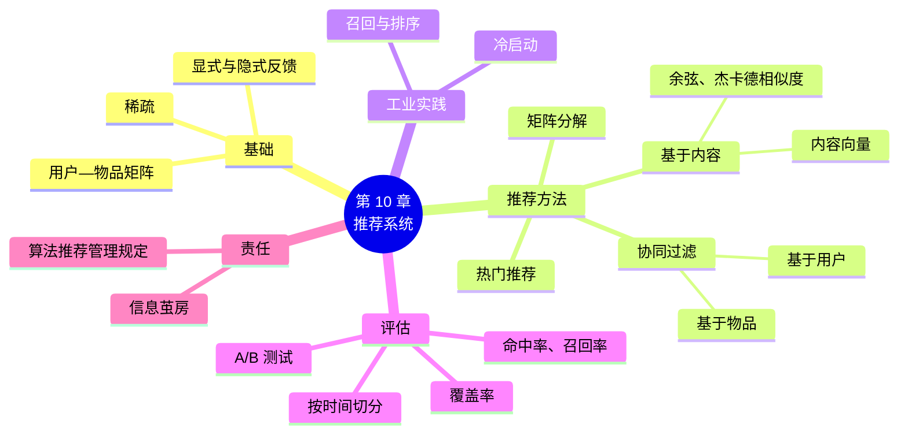

# 第 10 章 推荐系统

!!! abstract "本章学时"
    理论 4 学时 · 实验 1 学时（本章共 3 个实验，教师可任选）

## 学习目标

学完本章，你应该能够：

1. **说出**用户—物品矩阵、显式反馈与隐式反馈、召回与排序、冷启动的含义（记忆）；
2. **解释**热门推荐、基于内容的推荐、协同过滤、矩阵分解各自的思路和优缺点（理解）；
3. **运行并修改**给定代码，计算余弦相似度，完成基于内容的推荐和基于物品的协同过滤（应用）；
4. **运行并修改**给定代码，按时间切分数据，用命中率、召回率、覆盖率比较几种推荐方法（应用）；
5. **判断**一个推荐方案是否合理，说出信息茧房和算法推荐的合规要求（评价）。

!!! info "先修要求"
    学习本章前，你需要：

    - 会用 `crosstab` 做交叉表、用 `groupby` 汇总（[2.4](../02-pandas/index.md#24)）；
    - 知道训练集、测试集、精确率和召回率的含义（[9.1.2](../09-modeling/index.md#912)、[9.4.2](../09-modeling/index.md#942)）；
    - 知道 A/B 测试的思路（[7.6](../07-statistics/index.md#76-ab)）。

??? abstract "本章概念清单（20 个，点击查看定义和例子）"
    1. [推荐系统](../../appendix/glossary.md#g-推荐系统)
    2. [用户—物品矩阵](../../appendix/glossary.md#g-用户—物品矩阵)
    3. [稀疏](../../appendix/glossary.md#g-稀疏)
    4. [显式反馈](../../appendix/glossary.md#g-显式反馈)
    5. [隐式反馈](../../appendix/glossary.md#g-隐式反馈)
    6. [热门推荐](../../appendix/glossary.md#g-热门推荐)
    7. [基于内容的推荐](../../appendix/glossary.md#g-基于内容的推荐)
    8. [余弦相似度](../../appendix/glossary.md#g-余弦相似度)
    9. [杰卡德相似度](../../appendix/glossary.md#g-杰卡德相似度)
    10. [协同过滤](../../appendix/glossary.md#g-协同过滤)
    11. [基于用户的协同过滤](../../appendix/glossary.md#g-基于用户的协同过滤)
    12. [基于物品的协同过滤](../../appendix/glossary.md#g-基于物品的协同过滤)
    13. [矩阵分解](../../appendix/glossary.md#g-矩阵分解)
    14. [召回](../../appendix/glossary.md#g-召回)
    15. [排序](../../appendix/glossary.md#g-排序)
    16. [冷启动](../../appendix/glossary.md#g-冷启动)
    17. [离线评估](../../appendix/glossary.md#g-离线评估)
    18. [命中率](../../appendix/glossary.md#g-命中率)
    19. [覆盖率](../../appendix/glossary.md#g-覆盖率)
    20. [信息茧房](../../appendix/glossary.md#g-信息茧房)

## 情景导入

“食客说”App 首页有一块“猜你喜欢”，目前放的是全平台订单最多的 10 家餐厅，每个用户看到的都一样。运营经理发现了两个问题。

一是住在花都的用户抱怨：“推荐的都是天河、越秀的店，离我二三十公里，根本送不到。”二是新开的店没有订单，就永远上不了推荐，商家抱怨“平台只捧大店”。

经理问数据组：“能不能做到千人千面，给每个人推荐他真正可能想去的店？还有，改了以后怎么知道是变好了还是变差了？”

这就是推荐系统要解决的问题。本章用“食客说”2025 年的订单数据，从最简单的热门推荐做起，一步一步做出能“千人千面”的推荐，并学会用数据判断哪种方法更好。

## 10.1 推荐系统在做什么

### 10.1.1 用户—物品矩阵

[**推荐系统**](../../appendix/glossary.md#g-推荐系统 "根据用户的历史行为和物品信息，从大量物品中挑出用户可能感兴趣的一小部分主动展示的系统"){ .term }是根据用户的历史行为和物品的信息，从大量物品中挑出用户可能感兴趣的一小部分，主动展示给用户的系统。“物品”是个统称：电商里是商品，视频网站里是视频，“食客说”里是餐厅。

推荐系统的原材料是一张[**用户—物品矩阵**](../../appendix/glossary.md#g-用户—物品矩阵 "行是用户、列是物品、格子记录用户对物品行为的表格"){ .term }：行是用户，列是物品，格子里记录用户对物品的行为。“食客说”1～10 月的订单整理成矩阵后是 4600 行 × 300 列，用第 2 章学过的交叉表一行代码就能得到：

```python
ui = (pd.crosstab(train["user_id"], train["shop_id"]) > 0).astype(int)   # 去过记 1，没去过记 0
```

这张矩阵中，填了 1 的格子只占 2.8%，其余 97% 以上都是 0，这种情况叫[**稀疏**](../../appendix/glossary.md#g-稀疏 "矩阵中绝大多数格子为 0 或空的情况"){ .term }。每个用户只去过很少几家店，推荐系统要做的，就是猜出那些 0 里面，哪些格子“将来可能变成 1”。

### 10.1.2 显式反馈和隐式反馈

用户的行为分两种：

- [**显式反馈**](../../appendix/glossary.md#g-显式反馈 "用户明确表达喜好的行为"){ .term }：用户明确表达喜好，如打 1～5 星、点“喜欢 / 不喜欢”。信息清楚，但数量少，大多数人不打分；
- [**隐式反馈**](../../appendix/glossary.md#g-隐式反馈 "从用户行为中推测出的喜好"){ .term }：从行为中推测喜好，如下单、浏览、收藏、停留时长。数量多，但含义不确定：点开了不一定喜欢，没点也不一定不喜欢。

“食客说”的 56655 笔订单是隐式反馈，12000 条评分是显式反馈。实际的推荐系统以隐式反馈为主，本章也只用订单数据。

## 10.2 热门推荐与基于内容的推荐

### 10.2.1 热门推荐

最简单的推荐是[**热门推荐**](../../appendix/glossary.md#g-热门推荐 "把最受欢迎的物品推荐给所有人"){ .term }：把订单最多的店推荐给所有人。实验 10-1 的结果，热门前 3 名是阿坊粤菜（天河店）664 单、鲜城火锅（越秀店）626 单、福轩火锅（番禺店）607 单。

热门推荐不需要任何用户信息，实现简单，适合新用户和首页的“排行榜”。缺点也很明显：所有人看到的都一样，冷门的好店永远没有机会，这正是情景导入中两个抱怨的来源。热门推荐通常作为**基准**，其他方法要比它好才有意义（和第 9 章“都猜平均值”的基准是同一个道理）。

### 10.2.2 基于内容的推荐

[**基于内容的推荐**](../../appendix/glossary.md#g-基于内容的推荐 "根据物品自身的信息，推荐和用户喜欢过的物品相似的物品"){ .term }的思路是：用户喜欢过什么样的东西，就推荐和它相似的东西。“相似”要靠物品自身的信息（内容）来算。“食客说”的每家店有菜系、标签、城区三种信息，把它们变成一串 0 和 1，叫这家店的内容向量：

```python
feat = pd.concat([
    pd.get_dummies(shops["菜系"]),             # 10 个菜系，每家只有一个是 1
    shops["标签"].str.get_dummies("|"),       # 10 个标签（深夜营业、适合约会……），可以有好几个 1
    pd.get_dummies(shops["城区"]),             # 8 个城区
], axis=1).astype(int)                         # 一共 28 列
```

`get_dummies` 把一列类别变成好几列 0 和 1，这叫独热编码（One-Hot）。比如“好味粤菜（番禺店）”的向量中，只有“粤菜”“深夜营业”“网红店”“番禺”四个位置是 1。

### 10.2.3 余弦相似度和杰卡德相似度

两个向量有多相似，最常用的是[**余弦相似度**](../../appendix/glossary.md#g-余弦相似度 "用两个向量夹角的余弦衡量相似程度；对 0/1 向量等于共同的 1 的个数 ÷ √(两者 1 的个数之积)"){ .term }：把两个向量看成两个箭头，夹角越小越相似。取值在 0～1 之间（对 0、1 向量而言），1 表示完全相同。对只有 0 和 1 的向量，它有一个简单的算法：

> 余弦相似度 = 两者共同的 1 的个数 ÷ √（甲的 1 的个数 × 乙的 1 的个数）

例如“好味粤菜（番禺店）”有 4 个 1（粤菜、深夜营业、网红店、番禺），“金姐粤菜（番禺店）”有 4 个 1（粤菜、适合聚餐、深夜营业、番禺），共同的有 3 个，相似度 = 3 ÷ √(4 × 4) = 0.75。scikit-learn 一行就能算出所有店两两之间的相似度：

```python
from sklearn.metrics.pairwise import cosine_similarity
sim = pd.DataFrame(cosine_similarity(feat), index=feat.index, columns=feat.index)
```

另一个常用的是[**杰卡德相似度**](../../appendix/glossary.md#g-杰卡德相似度 "两个集合的交集大小 ÷ 并集大小"){ .term }：共同的 1 的个数 ÷ 两者合起来不同的 1 的个数，即“交集 ÷ 并集”。上例中两家店合起来有 5 个不同的 1，杰卡德相似度 = 3 ÷ 5 = 0.6。它和第 5 章目标框的交并比是同一个思想。

有了店与店的相似度，给用户推荐的方法是：把他去过的店的内容向量加起来（去得多的店加得多），当作他的“口味画像”，再找出和画像最相似、他还没去过的店。实验 10-1 给住在天河的用户 U00002 推荐的 10 家店，全部在天河区，多数带有他常去的店里出现过的“深夜营业”“适合约会”标签。

基于内容的推荐的优点是：新开的店只要填好菜系和标签，马上就能被推荐；推荐理由也好解释（“因为你喜欢深夜营业的湘菜”）。缺点是：效果完全取决于内容信息选得对不对，而且只会推荐“差不多的”，很难给用户惊喜。

## 10.3 协同过滤

### 10.3.1 “去过这家店的人，也常去……”

[**协同过滤**](../../appendix/glossary.md#g-协同过滤 "不看物品内容，只根据用户的行为找出相似的用户或物品来推荐"){ .term }不看物品的内容，只看用户的行为：和你行为相似的人喜欢什么，就给你推荐什么。它有两种做法：

- [**基于用户的协同过滤**](../../appendix/glossary.md#g-基于用户的协同过滤 "先找和目标用户行为相似的用户，再推荐他们喜欢的物品"){ .term }：先找出和你去过的店最重合的一批“相似用户”，再把他们去过、你还没去过的店推荐给你；
- [**基于物品的协同过滤**](../../appendix/glossary.md#g-基于物品的协同过滤 "根据“顾客名单”的重合程度算物品相似度，推荐和用户喜欢过的物品相似的物品"){ .term }：先算出店与店的相似度——两家店的“顾客名单”越重合，就越相似；再把和你去过的店最相似的店推荐给你。

电商里常见的“买了这件商品的人还买了……”，就是基于物品的协同过滤。<sup class="cite">[[1]](#ref10-1)</sup> 由于用户数量远多于物品、而且用户的兴趣变化快，工业界更常用基于物品的做法。

计算方法和 10.2.3 节完全一样，只是向量换了：内容推荐中，一家店的向量是它的菜系和标签；协同过滤中，一家店的向量是用户—物品矩阵中它那一列，即“哪些用户去过它”。在下面的动画中，可以修改 6 个用户去过哪些店，看相似度和推荐结果怎样变化：

<iframe class="sim-frame" src="../../sims/item-cf/main.html" height="700" loading="lazy" title="协同过滤计算器"></iframe>
动画：协同过滤计算器。点格子修改用户去过哪些餐厅，看餐厅之间的余弦相似度和给选中用户的推荐列表。[全屏打开](../../sims/item-cf/main.html){ target=_blank }
{ .sim-caption }

### 10.3.2 在“食客说”上实现

实验 10-2 用 1～10 月的订单算出 300 家店两两之间的相似度：

```python
item_sim = cosine_similarity(ui.T)              # ui.T 把矩阵转过来，每行变成一家店
np.fill_diagonal(item_sim, 0)                   # 自己和自己的相似度不算
item_sim = pd.DataFrame(item_sim, index=ui.columns, columns=ui.columns)

def rec_itemcf(uid):
    """把用户去过的每家店的“相似店”得分加起来，去掉去过的，取前 10 家"""
    score = item_sim.loc[list(seen[uid])].sum().drop(list(seen[uid]))
    return list(score.nlargest(10).index)
```

和阿坊粤菜（天河店）顾客最重合的三家店是大味湘菜（天河店）、阿姐火锅（天河店）、大轩川菜（天河店），菜系各不相同，却都在天河区。算法并不知道每家店在哪个区，它是从“谁和谁一起去过”中自己发现的：同一个区的人常去同一批店。

## 10.4 矩阵分解：找出“隐含口味”

用户—物品矩阵又大又稀疏。[**矩阵分解**](../../appendix/glossary.md#g-矩阵分解 "把用户—物品矩阵分解成用户和物品在少数几个隐含因素上的取值，用来估计未知的格子"){ .term }的想法是：也许用户选店背后只有少数几个“隐含口味”在起作用，比如“离家近不近”“爱不爱吃辣”“预算高不高”。如果能找出这几个隐含口味，每个用户就可以用几个数描述（他在每个口味上的偏好有多强），每家店也用几个数描述（它在每个口味上的特点有多明显），两组数一乘，就能估计出任意一个用户对任意一家店的喜好，包括矩阵中那些 0 的格子。

这几个隐含口味不需要人来定义，而是算法从矩阵中自动“分解”出来的，它们往往没有现成的名字，需要分析人员去解读。实验 10-3 用 scikit-learn 的 `TruncatedSVD` 把 4600 × 300 的矩阵压缩成 10 个隐含口味：

```python
from sklearn.decomposition import TruncatedSVD

svd = TruncatedSVD(n_components=10, random_state=2026)   # 10 个隐含口味
user_f = svd.fit_transform(ui)                           # 每个用户 10 个数
pred = user_f @ svd.components_                          # 还原出每个用户对每家店的估计得分
```

`@` 是矩阵乘法：4600 × 10 的用户矩阵乘以 10 × 300 的店铺矩阵，得到 4600 × 300 的估计得分矩阵。原理请参考“机器学习”课程第 8 章的降维部分，这里只需要理解“用少数几个隐含因素解释大量行为”这个思想。<sup class="cite">[[2]](#ref10-2)</sup>

## 10.5 工业推荐：召回、排序与冷启动

### 10.5.1 召回与排序两个阶段

真实平台上有几十万家店、几亿个商品，不可能对每个用户把每件物品都算一遍。工业推荐系统一般分两个阶段：<sup class="cite">[[3]](#ref10-3)</sup>

1. [**召回**](../../appendix/glossary.md#g-召回 "推荐的第一阶段，用简单快速的方法从海量物品中挑出几百个候选"){ .term }：用几种简单、快速的方法，从海量物品中各挑出几百个候选，合在一起。比如热门召回、本区召回、协同过滤召回、“你常吃的菜系”召回；
2. [**排序**](../../appendix/glossary.md#g-排序 "推荐的第二阶段，用更准的模型给候选打分并排出最终展示顺序"){ .term }：对这几百个候选，用一个更复杂、更准的模型（通常是第 9 章那样的分类模型，预测“用户会不会点”的概率）逐个打分，按分数排出最终展示的十几个。

排序之后往往还有一步“重排”：按业务规则调整，比如同一个菜系不连续出现太多、给新店留几个位置、过滤掉已打烊的店。

### 10.5.2 冷启动

协同过滤依赖用户的历史行为。一个刚注册、一单都没下过的新用户，在矩阵中的那一行全是 0，协同过滤就无能为力了，这叫[**冷启动**](../../appendix/glossary.md#g-冷启动 "新用户或新物品没有行为数据，难以推荐的问题"){ .term }问题。新上线的店没有任何顾客，同样面临冷启动。

常用的冷启动办法有：

- 新用户：推荐热门；利用注册时填的信息（城区、年龄段）推荐同类人群中热门的店；让用户在注册时选几个感兴趣的菜系；
- 新物品：用基于内容的推荐，根据菜系、标签把新店推荐给喜欢同类店的用户；在推荐列表中给新店留出一定的曝光位置。

实验 10-3 把 11～12 月的用户当作“新用户”，比较了三种冷启动办法：

```text
           方法   命中率   召回率   覆盖率
         全站热门 0.233 0.088 0.033
本区热门（注册时填的城区） 0.625 0.345 0.267
       同年龄段热门 0.228 0.086 0.073
```

按注册时填的城区推荐本区热门，命中率从 23.3% 提高到 62.5%；按年龄段推荐则几乎没有改进。这说明，选冷启动用的信息，要选真正影响用户选择的信息。

## 10.6 推荐效果的评估

### 10.6.1 离线评估

推荐做得好不好，先用历史数据做[**离线评估**](../../appendix/glossary.md#g-离线评估 "用历史数据检验推荐方法能否猜中之后发生的行为"){ .term }：用过去的数据训练，看能不能“猜中”之后发生的行为。和第 9 章随机划分不同，推荐系统一定要**按时间切分**：用 1～10 月训练、11～12 月测试，因为上线后永远是用过去预测将来，随机划分会让模型“偷看”到将来的数据，属于数据泄露。

实验 10-2 只考察用户 11～12 月**第一次**去的新店（老店用户本来就会再去，不需要推荐），每人推荐 10 家，用四个指标评估：

| 指标 | 含义 | 计算方法 |
|---|---|---|
| [**命中率**](../../appendix/glossary.md#g-命中率 "推荐列表中至少猜中一个的用户所占的比例"){ .term } | 有多少用户的推荐列表里至少猜中了一家 | 猜中至少一家的用户数 ÷ 参与评估的用户数 |
| 召回率 | 用户实际去的新店，有多少在推荐列表里 | 每人“猜中的店数 ÷ 实际去的新店数”的平均 |
| 精确率 | 推荐的 10 家中，有几家用户真的去了 | 每人“猜中的店数 ÷ 10”的平均 |
| [**覆盖率**](../../appendix/glossary.md#g-覆盖率 "所有推荐列表合起来用到的物品占全部物品的比例"){ .term } | 所有推荐列表合起来，用到了多少家店 | 被推荐过的店数 ÷ 全部店数 |

召回率和精确率与第 9 章的含义相同。覆盖率衡量推荐是不是只集中在少数几家大店上，覆盖率越高，长尾的好店越有机会被看到。

### 10.6.2 几种方法的比较

把实验 10-2 和 10-3 的结果汇总在一起：

| 方法 | 命中率 | 召回率 | 覆盖率 | 说明 |
|---|---|---|---|---|
| 热门推荐 | 18.0% | 8.2% | 6.7% | 基准，人人一样，只用到 20 家店 |
| 基于内容（菜系 + 标签） | 8.9% | 3.7% | 100% | 比热门还差 |
| 基于内容（菜系 + 标签 + 城区） | 39.0% | 19.8% | 100% | 加上城区后大幅提高 |
| 矩阵分解（10 个隐含口味） | 56.2% | 32.6% | 79.3% | |
| 基于物品的协同过滤 | **57.3%** | **33.5%** | 87.0% | 最好 |

这张表很有意思。只用菜系和标签的内容推荐，效果比热门推荐还差，加上城区后才大幅提高。这说明在“食客说”的数据中，用户选店主要看**离得近不近**，而不是菜系和标签。这也符合外卖的常识：送不到的店再合口味也没用。协同过滤和矩阵分解不需要知道城区，却从行为数据中自动学到了这个规律，所以效果最好。

!!! tip "从评估结果中学业务"
    离线评估不只是给算法打分，还能帮我们理解用户。“内容推荐加上城区后命中率从 8.9% 升到 39.0%”这个发现本身就有业务价值：首页推荐应优先考虑距离，商家的配送范围是推荐的硬约束。

### 10.6.3 线上 A/B 测试与信息茧房

离线评估只能说明“能不能猜中用户本来就会去的店”，不能说明推荐有没有让用户多下单。新的推荐方法上线前，最终要用第 7 章的 A/B 测试：一半用户看旧推荐，一半看新推荐，比较点击率、下单转化率、人均订单数等指标。

推荐系统还有一个副作用：它不断推荐用户已经喜欢的东西，用户看到的内容越来越窄，就像被一层茧包了起来，这叫[**信息茧房**](../../appendix/glossary.md#g-信息茧房 "推荐总是迎合已有偏好，使用户接触的信息越来越窄的现象"){ .term }。在新闻、短视频领域，信息茧房可能让人只看到自己认同的观点。所以好的推荐系统除了准确，还要考虑多样性（推荐列表里的菜系不能全是一样的）和新颖性（偶尔推荐一些用户没想到但可能喜欢的店）。

!!! cert "证书考点 · 人工智能数据处理工程师 · 智能推荐"
    智能推荐是数据处理工程师高级的考核内容，中级要打好基础。常考：用户—物品矩阵和稀疏性；基于内容的推荐与协同过滤的区别；余弦相似度、杰卡德相似度的计算；基于用户与基于物品的协同过滤；冷启动问题及解决办法；召回与排序；推荐的评估指标。容易错在把协同过滤说成“根据物品内容推荐”，以及推荐评估时随机划分数据而不是按时间切分。

??? microvideo "思维工具微课｜推荐得越准，用户就越高兴吗？　4 分 05 秒"

    <video class="mv-video" controls preload="none" playsinline poster="../../assets/video/a6.jpg">
      <source src="../../assets/video/a6.mp4" type="video/mp4">
    </video>

    **这一集的思维工具：授权与知情。** 什么时候用：想多用一种关于人的数据。怎么用：知道吗？同意吗？非用不可吗？。局限：点了同意，不等于看懂了。

    **看完选两件做：**

    - 玩一玩：找出三个常用软件里“个性化推荐”的开关。
    - 审一审 AI：让它设计推荐特征，看它会不会主动避开敏感信息。
    - 想一想自己：哪次推荐让你觉得“被盯上了”。

    <p class="mv-note">本片配音和部分画面由 AI 生成。</p>

## 10.7 前沿视窗

**大模型推荐与算法推荐的监管。** 大模型正在改变推荐系统：一方面，大模型能读懂商品描述、用户评论，把“适合约会、环境安静的川菜”这样的文字变成更准确的内容向量，缓解冷启动；另一方面，出现了“生成式推荐”和“对话式推荐”，用户直接说“周五晚上和同事聚餐，五六个人，人均一百左右，别太远”，系统就能理解需求、给出推荐并说明理由。与此同时，国家对算法推荐的管理也越来越规范。2022 年 3 月 1 日起施行的《互联网信息服务算法推荐管理规定》要求：算法推荐服务提供者应当向用户提供不针对其个人特征的选项，或者向用户提供便捷的关闭算法推荐服务的选项；不得根据消费者的偏好、交易习惯等特征，利用算法在交易价格等交易条件上实行不合理的差别待遇（即所谓“大数据杀熟”）；还要定期审核、评估算法机制和模型。<sup class="cite">[[4]](#ref10-4)</sup> 所以，你在很多 App 的设置里都能找到“个性化推荐”开关。做推荐的数据人员，既要让推荐更准，也要守住这些底线（第 12 章）。

## 本章实验

!!! abstract "实验总览"
    | 实验 | 类型 | 建议时长 | 内容 |
    |---|---|---|---|
    | 实验 10-1 | ★ 基础 | 40 分钟 | 热门推荐；用菜系、标签、城区做内容向量，计算余弦相似度，给用户推荐 10 家餐厅 |
    | 实验 10-2 | ★ 基础 | 45 分钟 | 基于物品的协同过滤；按时间切分，用命中率、召回率、精确率、覆盖率与热门推荐比较 |
    | 实验 10-3 | ☆ 拓展 | 45 分钟 | 矩阵分解；评估基于内容的推荐；比较三种冷启动策略 |

    代码见配套资源 `labs/ch10/` 目录。

### 实验 10-1 ★ 热门推荐与基于内容的推荐

**实验目的**

1. 会用 `value_counts` 做热门推荐；
2. 会用 `get_dummies` 把菜系、标签、城区变成内容向量，用余弦相似度找相似的店；
3. 会根据用户的历史订单做基于内容的推荐，并解释推荐理由。

**实验环境**：本机 CPU，需要 scikit-learn。

**实验数据**：`labs/data/orders.csv`、`shops.csv`。

**实验步骤与代码**

第 1 步，运行 `labs/ch10/lab10_1_content.py`，看热门推荐的前 10 家店。

第 2 步，看内容向量和相似店。`str.get_dummies("|")` 把“出餐快|网红店”这样用竖线分隔的标签拆成多列：

```python
shops["标签"].str.get_dummies("|")     # 每个标签一列，有就是 1
```

第 3 步，看给用户 U00002 的推荐。读懂“口味画像”的代码：

```python
history = orders[orders["user_id"] == uid]["shop_id"].value_counts()   # 去过哪些店、各几次
profile = feat.loc[history.index].mul(history.values, axis=0).sum()    # 去得多的店权重大
score = pd.Series(cosine_similarity([profile], feat)[0], index=feat.index)
rec = score.drop(history.index).sort_values(ascending=False).head(10)   # 去掉已经去过的
```

第 4 步，修改代码：把 `uid` 换成 `U00001`（住在天河）和一个住在花都的用户（在 `users.csv` 中找一个），比较推荐结果；再把 `feat` 中的城区去掉，看推荐结果有什么变化。

**运行结果**

```text
热门 10 家：
                店名    菜系             标签  订单数
shop_id
S0283    阿坊粤菜（天河店）    粤菜       适合约会|环境好  664
S0294    鲜城火锅（越秀店）    火锅  出餐快|适合约会|性价比高  626
S0158    福轩火锅（番禺店）    火锅       适合聚餐|有包间  607
……
内容向量的列数： 28
和 好味粤菜（番禺店） 最相似的 5 家：
                店名            标签   相似度
shop_id
S0245    金姐粤菜（番禺店）     适合聚餐|深夜营业  0.75
S0231    金姐粤菜（番禺店）      可停车|深夜营业  0.75
S0024    小哥粤菜（白云店）  深夜营业|可停车|网红店  0.67
……
用户 U00002 去过 23 家店，共 28 单：
……
基于内容推荐的 10 家：
                店名             标签    得分
shop_id
S0043    金味湘菜（天河店）   网红店|可停车|深夜营业  0.71
S0236    老记川菜（天河店）       环境好|适合约会  0.69
S0135    好坊湘菜（天河店）      深夜营业|适合约会  0.69
……
```

**实验记录表**

| 项目 | 结果 |
|---|---|
| 热门第 1 名及订单数 | |
| S0001 与 S0245 的余弦相似度（手算过程） | |
| U00002 的推荐中，在天河区的有几家 | |
| 去掉城区后，推荐结果的变化 | |

**常见问题排查**

| 现象 | 原因 | 解决办法 |
|---|---|---|
| `cosine_similarity` 报错 `could not convert string to float` | 向量里混进了文字列 | 只保留 `get_dummies` 生成的列，并 `.astype(int)` |
| 推荐结果里有用户去过的店 | 忘了 `drop` 去过的店 | 检查 `score.drop(history.index)` |
| `KeyError: 'U0002'` | 用户编号写错 | 用户编号是 U 加 5 位数字，如 `U00002` |

**思考与练习**

1. 内容推荐给出的推荐理由可以怎样写？以 S0043 为例写一句。
2. 如果一家新店刚开业，没有任何订单，热门推荐和基于内容的推荐，哪个能推荐它？

**实验报告要求**

提交运行结果截图、记录表和两个用户推荐结果的对比分析。

### 实验 10-2 ★ 基于物品的协同过滤与离线评估

**实验目的**

1. 会构建用户—物品矩阵，计算物品之间的余弦相似度；
2. 会实现基于物品的协同过滤；
3. 会按时间切分数据，计算命中率、召回率、精确率、覆盖率，比较不同推荐方法。

**实验环境**：本机 CPU，需要 scikit-learn。运行约 10 秒。

**实验数据**：`labs/data/orders.csv`、`shops.csv`。

**实验步骤与代码**

第 1 步，运行 `labs/ch10/lab10_2_itemcf_eval.py`。

第 2 步，读懂按时间切分和“测试期第一次去的新店”的代码：

```python
train = orders[orders["下单时间"] < "2025-11-01"]
test = orders[orders["下单时间"] >= "2025-11-01"]
seen = train.groupby("user_id")["shop_id"].apply(set).to_dict()   # 每人训练期去过的店
for uid, s in test.groupby("user_id")["shop_id"]:
    new = set(s) - seen.get(uid, set())                            # 集合相减：测试期的新店
```

`set` 是 Python 的集合，两个集合相减得到“在前一个里、不在后一个里”的元素。

第 3 步，读懂 `evaluate` 函数中四个指标的计算，对照 10.6.1 节的表。

第 4 步，修改代码：把每人推荐的店数 `K` 从 10 改成 5 和 20，记录命中率、精确率的变化。

**运行结果**

```text
训练 45041 单，测试 11614 单；参与评估的用户 3397 人
用户—物品矩阵的大小： (4600, 300) ，填了 1 的格子只占 2.8%
和 S0283 阿坊粤菜（天河店）顾客最重合的店： {'大味湘菜（天河店）': 0.343, '阿姐火锅（天河店）': 0.311, '大轩川菜（天河店）': 0.284}
    方法   命中率   召回率   精确率   覆盖率
  热门推荐 0.180 0.082 0.020 0.067
物品协同过滤 0.573 0.335 0.083 0.870
```

**实验记录表**

| K | 方法 | 命中率 | 召回率 | 精确率 | 覆盖率 |
|---|---|---|---|---|---|
| 5 | 热门 / 协同过滤 | | | | |
| 10 | 热门 / 协同过滤 | | | | |
| 20 | 热门 / 协同过滤 | | | | |

**常见问题排查**

| 现象 | 原因 | 解决办法 |
|---|---|---|
| `ValueError: assignment destination is read-only` | 对 DataFrame 的 `.values` 直接修改 | 先算成 NumPy 数组，`fill_diagonal` 之后再转成 DataFrame |
| 运行很慢 | 用户多时循环慢 | 正常，约 10 秒；可以先 `list(truth.items())[:500]` 只评估 500 人 |
| 精确率很低（只有 8%）就以为模型很差 | 每人 11～12 月平均只去 2.5 家新店，推荐 10 家最多猜中两三家 | 和基准比较才有意义 |

**思考与练习**

1. 为什么热门推荐的覆盖率只有 6.7%？覆盖率低对商家有什么影响？
2. 如果随机划分训练集和测试集，而不是按时间切分，会有什么问题？

**实验报告要求**

提交运行结果截图、记录表，并用一段话向运营经理说明协同过滤比热门推荐好在哪里。

### 实验 10-3 ☆ 矩阵分解与冷启动

**实验目的**

1. 会用 `TruncatedSVD` 做矩阵分解推荐；
2. 会对基于内容的推荐做离线评估，分析哪些内容信息有用；
3. 会比较不同的冷启动策略。

**实验环境**：本机 CPU，需要 scikit-learn。运行约 35 秒。

**实验数据**：`labs/data/orders.csv`、`shops.csv`、`users.csv`。

**实验步骤与代码**

第 1 步，运行 `labs/ch10/lab10_3_svd_coldstart.py`。

第 2 步，**先自己写**：把 `n_components` 分别改成 5 和 20，记录命中率。隐含口味是不是越多越好？

第 3 步，读懂冷启动部分的代码。“本区热门”先按城区把热门店分好：

```python
hot_area = {a: [s for s in hot if shop_area[s] == a] for a in shop_area.unique()}
rec = lambda u: hot_area[users.loc[u, "常住城区"]][:K]    # 新用户按注册城区推荐
```

第 4 步，**先自己写**：再加一种冷启动策略“本区 + 同年龄段热门”，和表中三种比较。

**运行结果**

```text
            方法   命中率   召回率   覆盖率
     内容（菜系+标签） 0.089 0.037 1.000
  内容（菜系+标签+城区） 0.390 0.198 1.000
矩阵分解（10 个隐含口味） 0.562 0.326 0.793
—— 新用户冷启动 ——
           方法   命中率   召回率   覆盖率
         全站热门 0.233 0.088 0.033
本区热门（注册时填的城区） 0.625 0.345 0.267
       同年龄段热门 0.228 0.086 0.073
```

**实验记录表**

| 项目 | 结果 |
|---|---|
| 隐含口味 5 / 10 / 20 个时的命中率 | |
| 内容推荐加上城区前后的命中率 | |
| 你设计的冷启动策略及命中率 | |
| 结论：用户选店最看重什么？依据是什么？ | |

**常见问题排查**

| 现象 | 原因 | 解决办法 |
|---|---|---|
| 运行时间较长 | 内容推荐要对每个用户算一次相似度 | 正常，约 35 秒 |
| 冷启动的命中率比实验 10-2 还高 | 冷启动评估的是测试期去过的所有店（包括老店），口径不同 | 只在同一张表内部比较 |

**思考与练习**

1. 年龄段为什么几乎没有帮助？如果真实数据中年轻人更爱去甜品店、网红店，结果会怎样？
2. 结合实验结果，为“食客说”首页设计一个“召回 + 排序”的方案。

**实验报告要求**

提交运行结果截图、记录表和推荐方案设计（不超过 300 字）。

## 本章小结

- **推荐系统**从大量物品中为每个用户挑出可能感兴趣的一小部分。原材料是**用户—物品矩阵**，通常非常**稀疏**；用户行为分**显式反馈**和**隐式反馈**。
- **热门推荐**简单、人人一样，常作为基准。**基于内容的推荐**用物品的内容向量和**余弦相似度**（或**杰卡德相似度**）找相似物品，能推荐新物品，但效果取决于内容信息选得对不对。
- **协同过滤**只看行为：**基于用户的协同过滤**找相似的人，**基于物品的协同过滤**找顾客名单相似的物品。**矩阵分解**用少数几个“隐含口味”解释大量行为。
- 工业推荐分**召回**和**排序**两个阶段。新用户、新物品没有行为数据，是**冷启动**问题，可以用热门、注册信息和内容推荐来解决。
- 推荐要按时间切分做**离线评估**，常用**命中率**、召回率、精确率、**覆盖率**；上线前用 A/B 测试。“食客说”的数据中，基于物品的协同过滤命中率 57.3%，是热门推荐的 3 倍多；用户选店主要看距离。
- 好的推荐要兼顾准确、多样和新颖，警惕**信息茧房**，遵守算法推荐的管理规定。



**下一章预告**

第 9 章训练的评论情感模型已经上线运行了两个月，每天处理上千条新评论。最近客服反映：“有些差评没被推送过来”，技术组也发现服务的响应越来越慢。下一章学习智能系统的运维：怎样从运行日志中统计调用量、延迟和错误率，怎样发现数据漂移，怎样收集和分析坏案例，最后写出一份运维报告和给算法工程师的优化需求。

## 参考文献

正文中的上标编号（如<sup class="cite">[[1]](#ref10-1)</sup>）对应下面的文献。带链接的可以直接打开；书籍可在图书馆或电子书平台查阅。

<div class="refs" markdown>

**教材与专著**

- <span id="ref10-2"></span>[2] 项亮. 推荐系统实践[M]. 北京: 人民邮电出版社, 2012.
    <span class="ref-note">国内推荐系统的经典入门书，系统讲解了基于内容的推荐、协同过滤、隐语义模型（矩阵分解）、冷启动和评估指标，对应 10.2～10.6 节。</span>
- <span id="ref10-3"></span>[3] 王喆. 深度学习推荐系统[M]. 北京: 电子工业出版社, 2020.
    <span class="ref-note">介绍工业界推荐系统的架构，包括召回、排序、线上 A/B 测试，对应 10.5 节。</span>

**论文**

- <span id="ref10-1"></span>[1] LINDEN G, SMITH B, YORK J. Amazon.com recommendations: item-to-item collaborative filtering[J]. IEEE Internet Computing, 2003, 7(1): 76-80.
    <span class="ref-note">亚马逊介绍其基于物品的协同过滤（“买了这件商品的人还买了……”）的经典论文，对应 10.3 节。</span>

**法规**

- <span id="ref10-4"></span>[4] 国家互联网信息办公室, 工业和信息化部, 公安部, 国家市场监督管理总局. 互联网信息服务算法推荐管理规定[Z]. 2021-12-31.
    <span class="ref-note">对算法推荐服务提出了信息服务规范和用户权益保护要求，包括提供关闭个性化推荐的选项、不得实施不合理的差别待遇等，对应 10.7 节。</span>

</div>

## 课后练习

选择题和判断题可以直接点击选项作答，系统会马上告诉你对错，并展开答案与解析；多选题选好后点“提交答案”。简答和实操题请先自己作答，再点开“答案与解析”核对。每道题的解析下方都有“回看”链接，做错了可以直接跳回正文复习。

**一、单项选择题**

<div class="quiz" data-answer="C" markdown>

**1.** 用户—物品矩阵中，填了 1 的格子只占 2.8%，这种情况叫（　　）。

- A. 过拟合
- B. 冷启动
- C. 稀疏
- D. 信息茧房

</div>

??? tip "答案与解析"
    **答案：C**

    每个用户只和很少的物品有过行为，矩阵中绝大多数格子是 0。

    考查：稀疏 · 认知层次：记忆 · [回看 10.1.1](#1011)
    { .quiz-meta }

<div class="quiz" data-answer="A" markdown>

**2.** 下列属于隐式反馈的是（　　）。

- A. 用户下单
- B. 用户打了 5 星
- C. 用户点了“不喜欢”
- D. 用户写了一条差评

</div>

??? tip "答案与解析"
    **答案：A**

    下单是从行为中推测喜好；打分、点不喜欢、写评论是明确表达。

    考查：隐式反馈 · 认知层次：理解 · [回看 10.1.2](#1012)
    { .quiz-meta }

<div class="quiz" data-answer="B" markdown>

**3.** 甲店的向量是（粤菜、深夜营业、网红店、番禺），乙店是（粤菜、适合聚餐、深夜营业、番禺），它们的余弦相似度是（　　）。

- A. 0.6
- B. 0.75
- C. 0.5
- D. 1

</div>

??? tip "答案与解析"
    **答案：B**

    共同的 1 有 3 个，3 ÷ √(4 × 4) = 0.75。

    考查：余弦相似度 · 认知层次：应用 · [回看 10.2.3](#1023)
    { .quiz-meta }

<div class="quiz" data-answer="A" markdown>

**4.** 上题两家店的杰卡德相似度是（　　）。

- A. 0.6
- B. 0.75
- C. 0.5
- D. 1

</div>

??? tip "答案与解析"
    **答案：A**

    交集 3 个，并集 5 个，3 ÷ 5 = 0.6。

    考查：杰卡德相似度 · 认知层次：应用 · [回看 10.2.3](#1023)
    { .quiz-meta }

<div class="quiz" data-answer="D" markdown>

**5.** “买了这件商品的人还买了……”属于（　　）。

- A. 热门推荐
- B. 基于内容的推荐
- C. 基于用户的协同过滤
- D. 基于物品的协同过滤

</div>

??? tip "答案与解析"
    **答案：D**

    根据“共同购买”算出物品之间的相似度，推荐和你买过的东西相似的物品。

    考查：基于物品的协同过滤 · 认知层次：理解 · [回看 10.3.1](#1031)
    { .quiz-meta }

<div class="quiz" data-answer="C" markdown>

**6.** 一个刚注册、没有任何订单的新用户，最不适合用（　　）给他推荐。

- A. 热门推荐
- B. 按注册城区的本区热门
- C. 基于物品的协同过滤
- D. 让他先选几个喜欢的菜系

</div>

??? tip "答案与解析"
    **答案：C**

    协同过滤依赖历史行为，新用户没有行为，这就是冷启动问题。

    考查：冷启动 · 认知层次：应用 · [回看 10.5.2](#1052)
    { .quiz-meta }

<div class="quiz" data-answer="B" markdown>

**7.** 工业推荐系统中，从几十万家店中快速挑出几百个候选的阶段叫（　　）。

- A. 排序
- B. 召回
- C. 重排
- D. 评估

</div>

??? tip "答案与解析"
    **答案：B**

    召回追求快和全，排序追求准。

    考查：召回 · 认知层次：记忆 · [回看 10.5.1](#1051)
    { .quiz-meta }

<div class="quiz" data-answer="A" markdown>

**8.** 离线评估推荐系统时，应该（　　）划分训练集和测试集。

- A. 按时间先后
- B. 完全随机
- C. 按用户的城区
- D. 按餐厅的菜系

</div>

??? tip "答案与解析"
    **答案：A**

    上线后总是用过去预测将来，随机划分会让模型“偷看”将来的数据。

    考查：离线评估 · 认知层次：理解 · [回看 10.6.1](#1061)
    { .quiz-meta }

<div class="quiz" data-answer="D" markdown>

**9.** 热门推荐的覆盖率只有 6.7%，说明（　　）。

- A. 热门推荐猜中的用户很少
- B. 热门推荐的精确率很低
- C. 热门推荐运行很慢
- D. 所有用户的推荐列表加起来只用到很少几家店

</div>

??? tip "答案与解析"
    **答案：D**

    覆盖率 = 被推荐过的店数 ÷ 全部店数。

    考查：覆盖率 · 认知层次：理解 · [回看 10.6.1](#1061)
    { .quiz-meta }

**二、多项选择题**

<div class="quiz quiz-multi" data-answer="ABD" markdown>

**10.** 关于基于内容的推荐，下列说法正确的有（　　）。

- A. 新开的店填好菜系和标签就能被推荐
- B. 推荐理由容易解释
- C. 一定比协同过滤效果好
- D. 效果取决于选用的内容信息是否真正影响用户的选择

</div>

??? tip "答案与解析"
    **答案：ABD**

    实验中只用菜系和标签的内容推荐，命中率比热门推荐还低。

    考查：基于内容的推荐 · 认知层次：理解 · [回看 10.2.3](#1023)
    { .quiz-meta }

<div class="quiz quiz-multi" data-answer="ABC" markdown>

**11.** 解决新用户冷启动的办法有（　　）。

- A. 推荐热门
- B. 按注册时填写的信息推荐同类人群的热门
- C. 注册时让用户选择感兴趣的类别
- D. 用基于用户的协同过滤

</div>

??? tip "答案与解析"
    **答案：ABC**

    新用户没有行为数据，协同过滤用不上。

    考查：冷启动 · 认知层次：应用 · [回看 10.5.2](#1052)
    { .quiz-meta }

<div class="quiz quiz-multi" data-answer="ACD" markdown>

**12.** 下列指标中，可以用于推荐系统离线评估的有（　　）。

- A. 命中率
- B. 线上下单转化率
- C. 召回率
- D. 覆盖率

</div>

??? tip "答案与解析"
    **答案：ACD**

    下单转化率要上线后通过 A/B 测试得到。

    考查：离线评估 · 认知层次：记忆 · [回看 10.6](#106)
    { .quiz-meta }

<div class="quiz quiz-multi" data-answer="ABD" markdown>

**13.** 根据《互联网信息服务算法推荐管理规定》，算法推荐服务提供者应当（　　）。

- A. 提供不针对个人特征的选项或便捷关闭算法推荐的选项
- B. 不得利用算法对消费者实行不合理的差别待遇
- C. 只向用户推荐热门内容
- D. 定期审核、评估算法机制

</div>

??? tip "答案与解析"
    **答案：ABD**

    规定并不禁止个性化推荐，而是要求给用户选择权并防止滥用。

    考查：算法推荐管理 · 认知层次：记忆 · [回看 10.7](#107)
    { .quiz-meta }

**三、判断题**

<div class="quiz quiz-judge" data-answer="√" markdown>

**14.** 协同过滤不需要知道物品的菜系、标签等内容信息。

</div>

??? tip "答案与解析"
    **答案：√**

    协同过滤只看“谁和谁一起去过”。

    考查：协同过滤 · 认知层次：理解 · [回看 10.3.1](#1031)
    { .quiz-meta }

<div class="quiz quiz-judge" data-answer="×" markdown>

**15.** 矩阵分解中的“隐含口味”需要由分析人员事先定义好，如“爱吃辣”“预算高”。

</div>

??? tip "答案与解析"
    **答案：×**

    隐含口味是算法从矩阵中自动分解出来的，往往没有现成的名字。

    考查：矩阵分解 · 认知层次：理解 · [回看 10.4](#104)
    { .quiz-meta }

<div class="quiz quiz-judge" data-answer="×" markdown>

**16.** 推荐系统离线评估的命中率高，上线后用户的下单量就一定会增加。

</div>

??? tip "答案与解析"
    **答案：×**

    离线评估只说明能否猜中用户本来就会做的事，效果要用线上 A/B 测试确认。

    考查：A/B 测试 · 认知层次：评价 · [回看 10.6.3](#1063-ab)
    { .quiz-meta }

<div class="quiz quiz-judge" data-answer="√" markdown>

**17.** 推荐系统总是推荐用户已经喜欢的同类内容，可能导致信息茧房。

</div>

??? tip "答案与解析"
    **答案：√**

    所以推荐还要兼顾多样性和新颖性。

    考查：信息茧房 · 认知层次：理解 · [回看 10.6.3](#1063-ab)
    { .quiz-meta }

<div class="quiz quiz-judge" data-answer="√" markdown>

**18.** 在“食客说”的数据中，内容推荐加上城区信息后，命中率从 8.9% 提高到 39.0%，说明用户选店主要看距离。

</div>

??? tip "答案与解析"
    **答案：√**

    评估结果本身也能帮助理解业务。

    考查：离线评估 · 认知层次：分析 · [回看 10.6.2](#1062)
    { .quiz-meta }

**四、简答题**

**19.** 比较基于内容的推荐和基于物品的协同过滤：它们计算“物品相似度”时用的向量分别是什么？各有什么优缺点？

??? tip "答案与解析"
    **参考答案**：基于内容的推荐用物品自身的信息（菜系、标签、城区）组成向量；基于物品的协同过滤用“哪些用户和它有过行为”组成向量（用户—物品矩阵的一列）。内容推荐能推荐新物品、理由好解释，但依赖内容信息是否选对，容易推荐“差不多的”；协同过滤能从行为中自动发现规律、效果通常更好，但新物品、新用户没有行为数据，存在冷启动问题。

    考查：基于内容的推荐、协同过滤 · 认知层次：分析 · [回看 10.3.1](#1031)
    { .quiz-meta }

**20.** 情景导入中，花都用户抱怨推荐的都是远处的店、新店上不了推荐。结合本章内容，提出改进方案。

??? tip "答案与解析"
    **参考答案**：① 把热门推荐改为本区热门，或在召回阶段加入“本区召回”，并把商家的配送范围作为硬约束过滤掉送不到的店；② 用基于物品的协同过滤给有历史的用户做个性化推荐（实验命中率 57.3%，是热门的 3 倍多）；③ 新店用基于内容的推荐，并在推荐列表中给新店留出固定的曝光位置；④ 新方案上线前做 A/B 测试，比较下单转化率和覆盖率。

    考查：推荐系统 · 认知层次：应用 · [回看 10.5](#105)
    { .quiz-meta }

**21.** 为什么推荐系统的离线评估要按时间切分？只评估“测试期第一次去的新店”又是为什么？

??? tip "答案与解析"
    **参考答案**：上线后总是用过去的数据预测将来，按时间切分才能模拟真实情况；随机划分会让训练集中混入测试期之后的行为，造成数据泄露，评估结果虚高。用户本来就会再去的老店不需要推荐，推荐的价值在于帮用户发现新店，所以只评估新店更能反映推荐的作用。

    考查：离线评估 · 认知层次：理解 · [回看 10.6.1](#1061)
    { .quiz-meta }

**五、实操题**

**22.** 用实验 10-2 的 `item_sim`，找出和“鲜城火锅（越秀店）”（S0294）最相似的 5 家店，看它们在哪些城区。

??? tip "答案与解析"
    **参考答案**：

    ```python
    top = item_sim["S0294"].nlargest(5)
    print(shops.loc[top.index, ["店名", "城区", "菜系"]].assign(相似度=top.round(3).values))
    ```

    运行结果：最相似的 5 家是小味湘菜、旺阁湘菜、老家快餐、旺阁面馆、好城粤菜，全部在越秀区，相似度都在 0.28～0.29，菜系各不相同。这说明顾客名单相似的店主要是同一个区的店。

    考查：基于物品的协同过滤 · 认知层次：应用 · [回看 10.3.2](#1032)
    { .quiz-meta }

**23.** 给实验 10-2 增加一种推荐方法“本区热门”（按用户的常住城区推荐本区订单最多、他没去过的店），并和协同过滤比较命中率。

??? tip "答案与解析"
    **参考答案**：

    ```python
    users = pd.read_csv(DATA / "users.csv").set_index("user_id")
    area = shops["城区"]
    def rec_area(uid):
        home = users.loc[uid, "常住城区"]
        return [s for s in hot if area[s] == home and s not in seen[uid]][:K]
    print(evaluate(rec_area, "本区热门"))
    ```

    运行结果：本区热门的命中率 60.0%、召回率 35.9%、覆盖率 78.7%，和协同过滤（57.3%、33.5%、87.0%）不相上下，命中率还略高。因为在这份数据中，距离是影响选店的最主要因素。这提醒我们：先用业务常识做一个强基准，再判断复杂的方法值不值得。不过本区热门的覆盖率较低，同一个区的用户看到的推荐都一样，个性化不如协同过滤。

    考查：离线评估 · 认知层次：评价 · [回看 10.6.2](#1062)
    { .quiz-meta }
