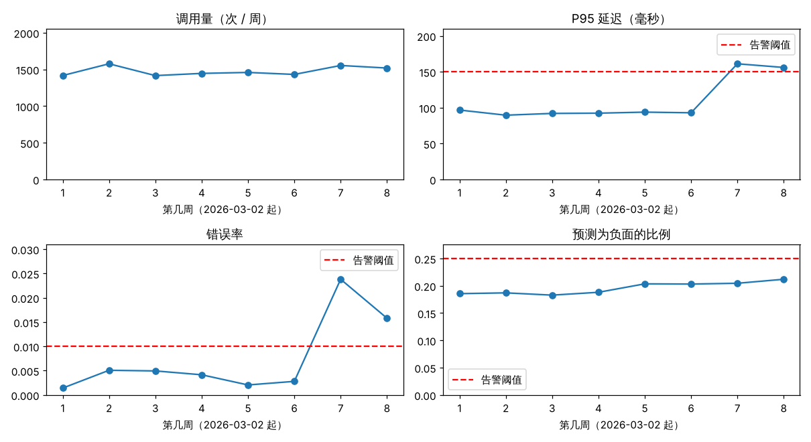
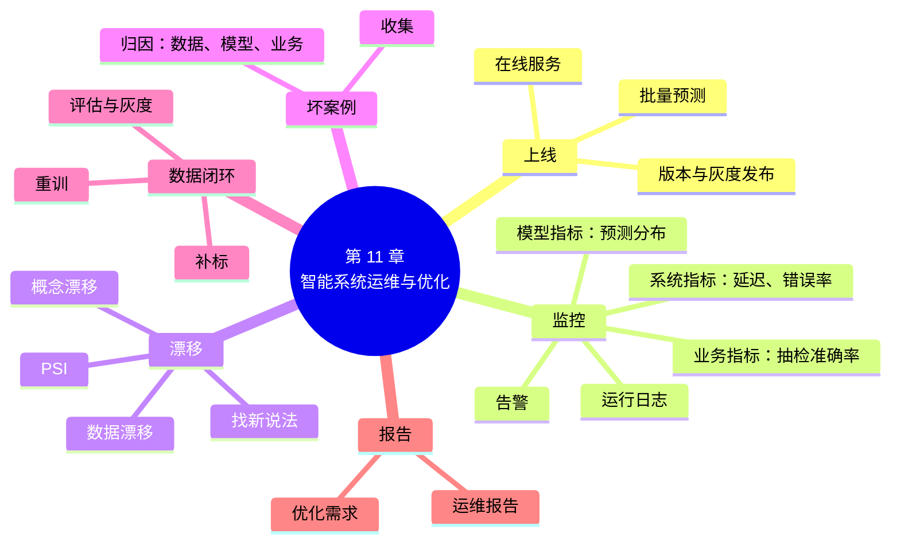

# 第 11 章 智能系统运维与优化

!!! abstract "本章学时"
    理论 4 学时 · 实验 1 学时（本章共 3 个实验，教师可任选）

## 学习目标

学完本章，你应该能够：

1. **说出**批量预测与在线服务、业务 / 模型 / 系统三类监控指标、数据漂移与概念漂移、数据闭环的含义（记忆）；
2. **解释**模型上线后为什么会“变差”，PSI 是怎样衡量分布变化的（理解）；
3. **运行并修改**给定代码，从运行日志中统计调用量、延迟、错误率和预测分布，设置告警规则（应用）；
4. **运行并修改**给定代码，计算 PSI、找出新出现的说法，收集坏案例并归因（应用）；
5. **写出**一份运维报告和一份能被执行的优化需求（评价）。

!!! info "先修要求"
    学习本章前，你需要：

    - 运行过实验 9-1，知道情感分类模型的准确率和错误类型（[9.4](../09-modeling/index.md#94)）；
    - 知道分位数、分布的含义（[7.1.2](../07-statistics/index.md#712)）；
    - 读过标注规范，知道标注审核的流程（[5.4](../05-annotation/index.md#54)、[6.2](../06-annotation-qa/index.md#62)）；
    - 知道 JSON 格式（[3.2.3](../03-collection/index.md#323-json)）。

??? abstract "本章概念清单（18 个，点击查看定义和例子）"
    1. [智能系统运维](../../appendix/glossary.md#g-智能系统运维)
    2. [批量预测](../../appendix/glossary.md#g-批量预测)
    3. [在线服务](../../appendix/glossary.md#g-在线服务)
    4. [灰度发布](../../appendix/glossary.md#g-灰度发布)
    5. [运行日志](../../appendix/glossary.md#g-运行日志)
    6. [监控指标](../../appendix/glossary.md#g-监控指标)
    7. [延迟](../../appendix/glossary.md#g-延迟)
    8. [P95 延迟](../../appendix/glossary.md#g-P95-延迟)
    9. [错误率](../../appendix/glossary.md#g-错误率)
    10. [告警](../../appendix/glossary.md#g-告警)
    11. [数据漂移](../../appendix/glossary.md#g-数据漂移)
    12. [概念漂移](../../appendix/glossary.md#g-概念漂移)
    13. [群体稳定性指标](../../appendix/glossary.md#g-群体稳定性指标)
    14. [坏案例](../../appendix/glossary.md#g-坏案例)
    15. [归因](../../appendix/glossary.md#g-归因)
    16. [数据闭环](../../appendix/glossary.md#g-数据闭环)
    17. [运维报告](../../appendix/glossary.md#g-运维报告)
    18. [优化需求](../../appendix/glossary.md#g-优化需求)

## 情景导入

2026 年 3 月初，第 9 章训练的评论情感模型正式上线：每来一条新评论，系统就调用模型判断情感，判为负面的自动推送给客服。头一个月一切顺利，客服说“省了一大半的工夫”。

到了 4 月中旬，问题接二连三地来了。客服反映：“有些评论明明是夸我们的，系统却判成了中评；还有几条差评没推过来。”技术组也发来消息：“最近两周情感服务的响应变慢了，偶尔还会超时报错。”运营经理问数据组：“模型是不是坏了？要不要重新训练？”

小林打开代码，发现模型文件一个字节都没变。模型没变，为什么效果变了？是模型的问题，还是数据的问题，还是系统的问题？该怎么查、怎么修、修完怎么证明修好了？

这就是[**智能系统运维**](../../appendix/glossary.md#g-智能系统运维 "维护智能系统日常运行，收集分析运行数据，发现和解决问题，提出优化需求的工作"){ .term }要做的事。人工智能训练师四级的“智能系统运维”模块要求：能维护智能系统的日常运行，能收集和分析运行数据，能撰写分析报告和优化需求。本章就带你走一遍这个过程。

## 11.1 智能系统怎样上线

### 11.1.1 批量预测与在线服务

训练好的模型要用起来，常见的有两种方式：

| 方式 | 怎样运行 | 适合的场景 | “食客说”的例子 |
|---|---|---|---|
| [**批量预测**](../../appendix/glossary.md#g-批量预测 "定时把一批数据全部预测一遍、结果存起来的上线方式"){ .term } | 定时（如每天凌晨）把一批数据全部预测一遍，结果存进数据库 | 不急着要结果、数据量大 | 每周一给所有用户重新计算 RFM 分群（第 9 章） |
| [**在线服务**](../../appendix/glossary.md#g-在线服务 "模型一直运行、来一个请求马上返回结果的上线方式"){ .term } | 模型一直运行着，来一个请求就马上返回结果，通常以 API 的形式提供 | 要求实时响应 | 新评论一提交就判断情感；下单时显示预计送达时长 |

在线服务就是第 3 章讲过的应用程序接口：评论系统把评论内容发给情感服务，情感服务返回“负面，把握 0.96”。具体怎样把模型做成接口、部署到服务器，是“人工智能开发框架技术”课程的内容；作为数据人员，我们更关心的是：服务上线以后，怎样知道它运行得好不好。

### 11.1.2 版本和灰度发布

模型会不断更新，每一个上线的模型都要有版本号（如 `sentiment-v1.0`），并记录它用什么数据、什么时间训练的，测试准确率是多少。出了问题，可以快速回退到上一个版本。

新版本上线时，一般不会一下子替换旧版本，而是[**灰度发布**](../../appendix/glossary.md#g-灰度发布 "新版本先让一小部分请求使用，观察正常后再逐步扩大的上线方式"){ .term }：先让 5%～10% 的请求使用新模型，其余仍用旧模型，观察几天，指标正常再逐步扩大比例，直到全部切换。这和第 7 章的 A/B 测试是同一个思路，只是更强调“出问题时影响面小、能随时回退”。

## 11.2 日常维护：运行日志与监控指标

### 11.2.1 运行日志

在线服务每处理一个请求，都会记下一条[**运行日志**](../../appendix/glossary.md#g-运行日志 "系统处理每个请求时自动记下的记录"){ .term }。“食客说”情感服务的日志是 JSON Lines 格式：每一行是一条 JSON 记录。

```json
{"time": "2026-03-02T00:00:36", "request_id": "req001394", "review_id": "R010419", "text": "价格实惠，送到还是热的，推荐！", "latency_ms": 32.8, "status": 200}
```

各字段的含义：`time` 请求时间；`request_id` 请求编号；`review_id` 评论编号；`text` 评论内容；`latency_ms` 从收到请求到返回结果用了多少毫秒；`status` 状态码，200 表示成功，500 表示服务内部出错，504 表示超时（第 3 章）。

pandas 读 JSON Lines 只要一行：`pd.read_json("service_log.jsonl", lines=True)`。随书的 `labs/data/service_log.jsonl` 记录了服务上线后 8 周（2026 年 3 月 2 日至 4 月 26 日）的 11820 次调用。

!!! warning "日志里也有个人信息"
    这份日志直接记下了评论原文。如果评论中有手机号、地址，日志就成了个人信息的“副本”，访问日志的人都能看到。实际工作中，日志要先脱敏再存储，并限制查看权限、规定保存期限（第 12 章）。

### 11.2.2 三类监控指标

只看日志的一行行记录是看不出问题的，要把它汇总成[**监控指标**](../../appendix/glossary.md#g-监控指标 "从日志等数据汇总出的、用来衡量系统运行状况的数字，分系统、模型、业务三类"){ .term }，按天或按周看变化。智能系统的监控指标分三类：<sup class="cite">[[1]](#ref11-1)</sup>

| 类别 | 回答什么问题 | 常用指标（“食客说”情感服务） |
|---|---|---|
| 系统指标 | 服务跑得稳不稳、快不快 | 调用量、平均[**延迟**](../../appendix/glossary.md#g-延迟 "从收到请求到返回结果所用的时间"){ .term }、[**P95 延迟**](../../appendix/glossary.md#g-P95-延迟 "所有请求的延迟从小到大排列后第 95% 位置的值，即 95% 的请求都比它快"){ .term }、[**错误率**](../../appendix/glossary.md#g-错误率 "处理失败（状态码不是 200）的请求所占的比例"){ .term } |
| 模型指标 | 模型的输入、输出有没有异常 | 预测为各类的比例、低把握预测的比例、输入数据的分布（11.3 节） |
| 业务指标 | 模型对业务有没有帮助 | 抽检准确率、客服处理差评的平均时长、漏推差评的投诉数 |

几个指标的含义：

- **延迟**：处理一个请求用了多长时间。平均延迟容易被大量很快的请求“拉低”，所以更常看 **P95 延迟**：把所有请求的延迟从小到大排好，第 95% 位置上的值，即“95% 的请求都比它快”。它就是第 7 章讲的 95% 分位数；
- **错误率**：状态码不是 200 的请求所占的比例；
- **预测分布**：模型每周预测为正面、中性、负面的比例。如果某一周负面突然从 19% 跳到 40%，要么是真的出了大量差评（业务问题），要么是模型或数据出了问题，都要马上查。

模型指标中最重要的“准确率”，上线后是算不出来的，因为新评论没有标签。所以要定期**抽检**：每周随机抽一些评论，由质检员按标注规范人工判断，算出抽检准确率（第 6 章的方法）。

### 11.2.3 告警

不可能每天盯着看板。给关键指标设定阈值，超过阈值就自动发消息通知负责人，这叫[**告警**](../../appendix/glossary.md#g-告警 "指标超过事先设定的阈值时自动通知负责人"){ .term }。实验 11-1 设了三条告警规则：P95 延迟超过 150 毫秒、错误率超过 1%、预测为负面的比例超过 25%。按周统计的结果：

```text
    调用量    平均延迟    P95延迟    错误率   负面占比  低把握占比
周
1  1417  48.530   96.720  0.001  0.186  0.173
2  1577  47.123   89.540  0.005  0.187  0.185
3  1416  48.225   92.000  0.005  0.183  0.191
4  1446  48.026   92.350  0.004  0.188  0.175
5  1459  47.474   93.810  0.002  0.204  0.193
6  1432  47.587   92.900  0.003  0.203  0.194
7  1554  80.930  161.145  0.024  0.205  0.201
8  1519  79.464  156.030  0.016  0.212  0.207
【告警】第 7 周 P95延迟 = 161.145，超过阈值 150
【告警】第 8 周 P95延迟 = 156.030，超过阈值 150
【告警】第 7 周 错误率 = 0.024，超过阈值 0.01
【告警】第 8 周 错误率 = 0.016，超过阈值 0.01
```



**图 11-1 情感服务 8 周的监控看板**：红色虚线是告警阈值（数据来源：实验 11-1 运行结果）

从看板上可以读出两件事：

1. **系统问题**：第 7 周起，调用量并没有明显增加，P95 延迟却从 93 毫秒左右跳到 161 毫秒，错误率从 0.3% 升到 2.4%，出错的大多是 504 超时。调用量没变、延迟突增，问题多半出在服务器本身（比如服务器配置被调低、和别的服务挤在一台机器上），而不是访问量太大。这要交给技术组排查；
2. **模型的苗头**：从第 5 周起，预测为负面的比例从 18%～19% 升到 20%～21%，低把握预测的比例也慢慢上升。没有超过告警阈值，但趋势值得注意，需要进一步检查输入数据有没有变化，这就是下一节的内容。

!!! tip "阈值怎么定？"
    阈值一般参考上线初期一段时间的正常水平：比如正常时 P95 延迟在 90～97 毫秒之间，定 150 毫秒既不会天天误报，又能及时发现问题。阈值定得太松发现不了问题，定得太紧会天天报警，大家就不看了。

## 11.3 数据漂移与概念漂移

### 11.3.1 模型没变，为什么效果会变

模型是用过去的数据训练的，它默认将来的数据和过去差不多。上线后，如果输入数据的分布发生了变化，模型的效果就可能下降，这叫[**数据漂移**](../../appendix/glossary.md#g-数据漂移 "上线后输入数据的分布和训练时不同"){ .term }。例如：

- 网络上出现了新的流行语，评论里多了“绝绝子”“yyds”“拔草了”“是预制菜吧”这样的说法，模型训练时从没见过；
- 平台开展了“写长评返券”活动，评论突然普遍变长；
- 平台新接入了一批西餐、日料商家，评论中的菜名大变样。

还有一种变化更隐蔽：输入的说法没变，但它的“含义”变了，即输入和标签之间的关系变了，这叫[**概念漂移**](../../appendix/glossary.md#g-概念漂移 "输入和标签之间的关系发生变化，同样的输入应该得到不同的标签"){ .term }。比如“分量刚刚好”，以前大家觉得是中性，后来平台发起“光盘行动”，这句话越来越多地被当作夸奖。再比如“预制菜”，几年前只是一个中性的词，现在很多顾客说“是预制菜吧”时是在表达不满。概念漂移往往要修改标注规范、重新标注才能解决。

### 11.3.2 用 PSI 衡量分布变化

怎样判断数据的分布有没有变、变了多少？常用的指标是[**群体稳定性指标**](../../appendix/glossary.md#g-群体稳定性指标 "按基准期分箱，比较两个时期各箱占比差异的指标；小于 0.1 稳定，大于 0.25 变化显著"){ .term }（PSI）。它的计算思路是：<sup class="cite">[[2]](#ref11-2)</sup>

1. 用上线前（基准期）的数据，把某一列按十分位切成 10 个箱，每箱正好占 10%；
2. 用同样的箱子去装上线后的数据，算出每箱占多少；
3. 对每个箱计算“（上线后占比 − 基准占比）× ln（上线后占比 ÷ 基准占比）”，10 个箱加起来就是 PSI。

两个分布完全相同时 PSI 为 0，差别越大 PSI 越大。经验标准是：**小于 0.1 稳定；0.1～0.25 有变化，需要关注；大于 0.25 变化显著，需要排查。**

随书的 `monitor_tools.py` 提供了 `psi(基准数据, 当前数据)` 函数，直接调用即可。实验 11-2 以前 4 周为基准，计算了每周三个量的 PSI：

```text
   评论长度 PSI  模型把握 PSI  负面概率 PSI
周
1     0.007     0.005     0.004
2     0.005     0.002     0.003
3     0.006     0.003     0.004
4     0.007     0.002     0.003
5     0.113     0.025     0.026
6     0.115     0.029     0.028
7     0.071     0.023     0.025
8     0.098     0.025     0.023
评论平均长度：前 4 周 19.2 ，后 4 周 21.4
```

第 5、6 周评论长度的 PSI 超过 0.1，进入“需要关注”区间；评论平均长度从 19.2 字增加到 21.4 字。模型把握和负面概率的 PSI 在 0.03 以下，说明模型输出的分布变化不大。在下面的动画中，可以模拟不同的数据变化，看 PSI 怎样变：

<iframe class="sim-frame" src="../../sims/drift-psi/main.html" height="560" loading="lazy" title="数据漂移与 PSI"></iframe>
动画：数据漂移与 PSI。拖动滑块改变上线后评论长度的分布，看各箱占比、PSI 和告警等级。[全屏打开](../../sims/drift-psi/main.html){ target=_blank }
{ .sim-caption }

### 11.3.3 找出新说法

PSI 只告诉我们“变了”，没告诉我们“哪里变了”。评论变长了，多出来的是什么字？实验 11-2 统计了每个“相邻两字”在多少条评论中出现，找出后 4 周出现 30 次以上、前 4 周一次都没出现过的组合：

```text
新出现的说法（出现条数）： {'yy': 380, 'ds': 380, 'yd': 380, '绝子': 351, '绝绝': 351, '预制': 347, '菜吧': 347, '制菜': 347, '是预': 347, '纯纯': 346, '纯冤': 346, '冤种': 346, '拔草': 333, '草了': 333}
```

拼起来就是五种新说法：“yyds”“绝绝子”“是预制菜吧”“纯纯冤种”“拔草了”。它们从第 5 周开始出现，大约 30% 的评论里有。

找到新说法后，还要看模型在这些评论上准不准。质检员对上线后的 6000 条评论做了抽检复核，结果是：

```text
         条数    准确率
新说法
False  4226  0.964
True   1774  0.935
```

不含新说法的评论，准确率 96.4%，和上线前（实验 9-1 的 96.3%）一样；含新说法的评论，准确率降到 93.5%。数据漂移确实影响了模型的效果，但影响不算大。这也解释了客服的感受：“有些评论明明是夸我们的，系统却判成了中评”——判错的含新说法评论中，有 60 条是正面被判成了中性，例如“牛腩面是预制菜吧，环境干净整洁👍”。

不过，这条评论到底算不算正面？“是预制菜吧”在今天通常带有不满的意思，第 5 章的标注规范里没有相关规定，质检员按“结尾有👍”标了正面。这其实是一个概念漂移的信号：标注规范需要更新。

## 11.4 坏案例：收集、归类、归因

### 11.4.1 坏案例从哪里来

[**坏案例**](../../appendix/glossary.md#g-坏案例 "系统处理错了或用户不满意的具体案例"){ .term }是指智能系统处理错了、或者用户不满意的具体案例。它们是改进系统最直接的依据。坏案例的来源有：

1. **用户和一线人员的反馈**：客服说“这条差评没推过来”，顾客投诉“我的评论被误判”；
2. **定期抽检**：质检员抽检发现的错误；
3. **监控发现的异常**：低把握的预测、和用户评分明显矛盾的预测（如 1 星评论被判为正面）。

收集来的坏案例要统一登记在一张表里，包括：编号、发现时间、来源、原始数据、系统的输出、正确的结果、归因、处理状态。实验 11-3 生成的 `坏案例归因表.csv` 就是这样一张表。

### 11.4.2 归因：数据问题、模型问题，还是业务变化

对每一个坏案例，都要找出它为什么错，这叫[**归因**](../../appendix/glossary.md#g-归因 "找出坏案例出错的原因，一般分为数据问题、模型问题、业务变化"){ .term }。原因一般分三大类：

| 归因 | 典型表现 | 怎么改进 |
|---|---|---|
| 数据问题 | 输入数据本身有问题：乱码、被截断、含广告；训练数据标错了 | 修复数据管道；清洗规则（第 4 章）；返工错误的标注（第 6 章） |
| 模型问题 | 数据没问题，模型能力不够：好坏都有的评论只会数正负面的字，不会“看结尾” | 补充这类数据重新训练；换用更强的模型（第 9 章） |
| 业务变化 | 出现了训练时没有的新情况：新说法、新菜系、新业务 | 补标新数据重新训练；更新标注规范和标签体系 |

实验 11-3 从上线后判错的 267 条评论中随机抽了 100 条，先用规则“预归因”，再由人逐条确认：

```text
上线后 6000 条中判错 267 条，错误率 4.5%
预归因
模型问题：好坏都有，没看结尾表态    53
业务变化：出现新说法          39
模型问题：评论太短            8
```

规则只能做粗分，比如一条既含新说法、又好坏都有的评论，规则会把它归到“业务变化”。所以预归因之后，一定要人工逐条确认，在表中填写“人工确认归因”和“备注”。

!!! cert "证书考点 · 人工智能训练师 · 智能系统运维"
    智能系统运维在四级理论考试中占 20%、技能考试中占 20%。常考：智能系统的部署方式；运行日志的内容和作用；系统、模型、业务三类监控指标；告警的设置；数据漂移的表现和发现方法；坏案例的收集和归因；运维报告和优化需求的写法。容易错在把“模型准确率下降”一律归因为模型问题，而忽视了数据变化和业务变化。

## 11.5 人工反馈与数据闭环

### 11.5.1 补标、重训、灰度上线

发现了问题，怎样修复？对于数据漂移和模型问题，最常用的办法是：把新数据标注好，加入训练集，重新训练模型。这个过程形成一个循环，叫[**数据闭环**](../../appendix/glossary.md#g-数据闭环 "监控 → 收集坏案例 → 补标 → 重训 → 评估 → 灰度上线，不断循环改进系统的过程"){ .term }：


实验 11-3 模拟了一轮数据闭环：从上线后的评论中随机抽 1000 条补标，加入原来的 2000 条训练集重新训练，再在其余 5000 条上比较新旧模型：

```text
       整体准确率   含新说法  不含新说法
模型
旧模型    0.955  0.933  0.964
补标重训后  0.974  0.970  0.975
```

补标重训后，整体准确率从 95.5% 提高到 97.4%，含新说法的评论从 93.3% 提高到 97.0%。注意比较时，新旧模型用的是**同一批**、**都没参与训练**的 5000 条数据，否则比较就不公平（第 9 章的测试集原则）。

离线评估通过后，新模型还要经过灰度发布（11.1.2 节）：先让 10% 的评论走新模型，观察一周的监控指标和抽检准确率，没有问题再全部切换。

### 11.5.2 人在闭环中的作用

数据闭环中，最费人力的是补标。第 6 章讲的预标注和主动学习在这里都能用上：先用当前模型预标注，标注员只改错的；或者优先补标模型把握最小的评论，用更少的标注换来更大的提升。

数据闭环能不能转起来，关键不在算法，而在流程：谁负责收集坏案例、多久归因一次、补标多少条、谁来审核、什么条件下重新训练、谁批准上线。这些都要写成制度，否则闭环就会断在某一环。

## 11.6 运维报告与优化需求

### 11.6.1 运维报告

运维工作要定期形成[**运维报告**](../../appendix/glossary.md#g-运维报告 "定期汇报系统运行指标、异常处理、坏案例分析和下一步计划的文档"){ .term }，向主管和相关团队汇报系统的运行情况。一份运维报告通常包括：

1. **基本情况**：统计周期、系统和模型版本、调用量；
2. **运行指标**：系统、模型、业务三类指标的数值和变化趋势，配监控看板图；
3. **异常与处理**：本期出现了哪些告警和问题，原因是什么，怎样处理的，处理结果如何；
4. **坏案例分析**：数量、分类统计、典型案例；
5. **下一步计划和优化需求**。

附录 E 有运维报告模板。

### 11.6.2 写给算法工程师的优化需求

运维中发现的问题，很多需要算法工程师或开发人员来解决。数据人员要把问题写成[**优化需求**](../../appendix/glossary.md#g-优化需求 "把运维中发现的问题写给算法或开发人员的需求文档，包括现象、影响、原因、需求和验收标准"){ .term }。一份好的优化需求，要让对方读完就知道要做什么、为什么做、做到什么程度算完成。对比下面两种写法：

!!! failure "写得不好的优化需求"
    最近模型效果变差了，客服反映有误判，请优化模型，提高准确率。

!!! success "写得好的优化需求"
    **标题**：情感模型对新流行语的识别准确率偏低，需补充训练数据

    **现象**：2026 年 3 月 30 日起（上线第 5 周），约 30% 的评论含“yyds”“绝绝子”“是预制菜吧”“纯纯冤种”“拔草了”等新说法。抽检 6000 条，含新说法的评论准确率 93.5%，不含的 96.4%；判错的 115 条含新说法评论中，有 60 条是正面被误判为中性。

    **影响**：客服收到的“中评”中混有好评，处理效率下降；第 5 周起评论长度 PSI 为 0.11，处于“需要关注”区间，新说法的比例可能继续上升。

    **原因分析**：训练数据中没有这些说法（数据漂移）；“是预制菜吧”的情感倾向在标注规范中没有规定（概念漂移）。

    **需求**：① 标注组更新标注规范 v1.1，明确五种新说法的处理规则，4 月 30 日前完成；② 按新规范补标上线后的评论 1000 条；③ 算法组用补标数据重新训练，验收标准为：在留出的 5000 条评论上，整体准确率不低于 97%，含新说法的评论准确率不低于 96%；④ 通过后按 10% → 50% → 100% 灰度发布。

    **附件**：坏案例归因表（100 条）、实验 11-2 的漂移分析结果。

写好优化需求的要点是：**有数据**（现象和影响都有数字）、**有证据**（附坏案例）、**有原因分析**、**有验收标准**（做到什么程度算完成）、**有时间和分工**。

## 11.7 前沿视窗

**大模型应用的运维。** 越来越多的企业把大模型接入客服、营销、办公等场景，大模型应用的运维也成了新的工作内容。和本章的情感模型相比，它有几个新特点：一是要管理“提示词版本”，提示词改一个字，回答就可能完全不同，所以提示词也要像模型一样有版本号、改动要测试、上线要灰度；二是回答质量没法用一个准确率衡量，要定期抽样，由人或另一个大模型按“是否准确、是否有用、是否安全”等维度打分；三是要设置“安全护栏”，在输入端拦截恶意指令和敏感信息，在输出端过滤违法、有害或泄露隐私的内容；四是费用按调用量计算，要监控每天的 token 用量和费用。人工智能训练师更高等级的考核中，已经出现了对大模型应用进行测试、评估和优化的内容，本章学到的监控、抽检、坏案例归因和数据闭环的方法，同样适用于大模型应用。

## 本章实验

!!! abstract "实验总览"
    | 实验 | 类型 | 建议时长 | 内容 |
    |---|---|---|---|
    | 实验 11-1 | ★ 基础 | 40 分钟 | 分析情感服务 8 周的运行日志：调用量、延迟、错误率、预测分布，做监控看板和告警 |
    | 实验 11-2 | ★ 基础 | 40 分钟 | 用 PSI 检测数据漂移，找出新出现的说法，比较模型在新说法上的准确率 |
    | 实验 11-3 | ☆ 拓展 | 90 分钟 | 坏案例归因；补标重训并比较；写运维报告和优化需求 |

    代码见配套资源 `labs/ch11/` 目录。`monitor_tools.py` 是随书工具函数，实验直接调用。

### 实验 11-1 ★ 分析模型服务日志

**实验目的**

1. 会用 pandas 读取 JSON Lines 格式的运行日志；
2. 会按周统计调用量、平均延迟、P95 延迟、错误率和预测分布；
3. 会设置告警规则，做监控看板，并判断异常的原因。

**实验环境**：本机 CPU，需要 scikit-learn、matplotlib。最好先完成实验 9-1；如果没有第 9 章保存的模型，工具函数会自动训练一个。

**实验数据**：`labs/data/service_log.jsonl`。

**实验步骤与代码**

第 1 步，运行 `labs/ch11/lab11_1_log_monitor.py`，先看日志的一条记录长什么样，对照 11.2.1 节理解每个字段。

第 2 步，读懂按周统计的代码。`agg` 里每一项的格式是“新列名=(原来的列, 怎样计算)”，计算方法可以是现成的名字，也可以是一个 `lambda` 小函数：

```python
week = log.groupby("周").agg(
    调用量=("request_id", "count"),
    平均延迟=("latency_ms", "mean"),
    P95延迟=("latency_ms", lambda s: s.quantile(0.95)),   # 95% 的请求比它快
    错误率=("status", lambda s: (s != 200).mean()),        # 状态码不是 200 的比例
)
```

第 3 步，读懂告警规则的代码，把错误率的阈值改成 0.005，看看会多出哪些告警，这个阈值合适吗？

第 4 步，**先自己写**：按天（而不是按周）统计 P95 延迟，找出延迟是从哪一天开始升高的。提示：`log["time"].dt.date`。

**运行结果**

按周统计和告警见 11.2.3 节，监控看板见图 11-1。出错请求的统计：

```text
出错请求按状态码： {504: 55, 500: 36}
status  500  504
周
1         2    0
2         3    5
3         2    5
4         2    4
5         2    1
6         4    0
7        15   22
8         7   17
```

**实验记录表**

| 指标 | 第 1～6 周的正常范围 | 第 7～8 周 | 是否告警 | 可能的原因 |
|---|---|---|---|---|
| P95 延迟 | | | | |
| 错误率 | | | | |
| 负面占比 | | | | |
| 延迟开始升高的日期（第 4 步） | — | | — | |

**常见问题排查**

| 现象 | 原因 | 解决办法 |
|---|---|---|
| `ValueError: Expected object or value` | 读 JSON Lines 时没加 `lines=True` | `pd.read_json(路径, lines=True)` |
| `ModuleNotFoundError: No module named 'monitor_tools'` | 没有在 `labs/ch11` 目录下运行，找不到工具文件 | 用 `python labs/ch11/lab11_1_log_monitor.py` 运行，或先 `cd labs/ch11` |
| 时间列不能做减法 | 时间被读成了文字 | 用 `pd.to_datetime` 转换（工具函数已处理） |

**思考与练习**

1. 为什么监控延迟时要看 P95，而不只看平均值？
2. 第 7 周调用量 1554 次，和第 2 周差不多，延迟却高了很多。这说明问题更可能出在哪里？

**实验报告要求**

提交监控看板图、记录表和一段异常分析（不超过 200 字）。

### 实验 11-2 ★ 检测数据漂移

**实验目的**

1. 会调用 `psi` 函数比较两段时期的分布，按经验标准判断漂移程度；
2. 会用“相邻两字”统计找出新出现的说法；
3. 会通过抽检比较模型在不同数据上的准确率，判断漂移对模型的影响。

**实验环境**：本机 CPU。

**实验数据**：`labs/data/service_log.jsonl`、`reviews_online.csv`（上线后 6000 条评论及抽检得到的参考答案）。

**实验步骤与代码**

第 1 步，运行 `labs/ch11/lab11_2_drift.py`，读懂 11.3.2 节的 PSI 结果。

第 2 步，读懂找新说法的代码。`{... for i in range(...)}` 生成一条评论中所有相邻两字的集合（同一条评论中重复出现的只算一次）：

```python
before, after = two_chars(base["text"]), two_chars(log[log["周"] >= 5]["text"])
new = {w: n for w, n in after.items() if n >= 30 and before[w] == 0}   # 后来常见、以前没有
```

第 3 步，修改代码：把基准期改成只用第 1 周，重新计算 PSI，结果有什么变化？

第 4 步，从 `reviews_online.csv` 中找 10 条含“是预制菜吧”的评论，按你的理解标注情感，和参考答案比较，讨论标注规范应该怎样规定。

**运行结果**

PSI、新说法和抽检准确率见 11.3 节。判错的含新说法评论：

```text
预测     中性  正面  负面
情感_参考
中性      0   4  22
正面     60   0  17
负面     12   0   0
                              评论内容 情感_参考 预测
                  牛腩面是预制菜吧，环境干净整洁👍    正面 中性
     烤鸡翅拔草了，烤鸡翅鲜嫩入味，骑手很准时，用了优惠券很划算    正面 中性
      小炒黄牛肉是预制菜吧，适合朋友聚会。小炒黄牛肉味道很正宗    正面 中性
……
```

**实验记录表**

| 项目 | 结果 |
|---|---|
| 评论长度 PSI 超过 0.1 的周 | |
| 发现的新说法 | |
| 含 / 不含新说法的抽检准确率 | |
| 判错中最多的错误类型 | |
| 你对“是预制菜吧”的标注建议 | |

**常见问题排查**

| 现象 | 原因 | 解决办法 |
|---|---|---|
| PSI 出现 `inf` 或特别大 | 某个箱的占比是 0，ln 无法计算 | 随书 `psi` 函数已把 0 替换成 0.0001 |
| 新说法里出现很多菜名 | 上线后新增了菜品 | 正常，可以提高出现次数的门槛，或结合业务判断 |
| 中文正则 `[^一-龥]` 看不懂 | `一-龥` 是常用汉字的编码范围 | 见 4.6 节正则表达式 |

**思考与练习**

1. PSI 只说明分布变了，为什么还要抽检准确率？
2. 如果某周评论长度 PSI 高达 0.6，平均长度从 19 字变成 3 字，你首先会怀疑什么？

**实验报告要求**

提交运行结果截图、记录表和一段漂移分析（不超过 200 字）。

### 实验 11-3 ☆ 坏案例归因与优化需求

**实验目的**

1. 会建立坏案例登记表，对坏案例逐条归因并统计；
2. 会模拟一轮“补标—重训—评估”的数据闭环，公平地比较新旧模型；
3. 会写运维报告和优化需求。

**实验环境**：本机 CPU。

**实验数据**：`labs/data/reviews_online.csv`、`annotation/batch_2000.csv`。

**实验步骤与代码**

第 1 步，运行 `labs/ch11/lab11_3_badcase_retrain.py`，程序生成 `坏案例归因表.csv`（100 条），并输出新旧模型的比较。

第 2 步，用 WPS 或 Excel 打开 `坏案例归因表.csv`，逐条阅读，在“人工确认归因”列填写“数据问题 / 模型问题 / 业务变化”，在“备注”列写具体原因。用数据透视表统计各类的条数。

第 3 步，读懂新旧模型比较的代码，说明为什么要用 `hold`（没参与训练的 5000 条）来比较：

```python
add = online.sample(1000, random_state=2026)      # 补标的 1000 条
hold = online.drop(add.index)                     # 其余 5000 条留作验证，不参与训练
```

第 4 步，把补标的条数改成 300 和 2000，记录准确率，画出“补标条数—准确率”的关系。

第 5 步，参照 11.6 节和附录 E 的模板，写一份第 1～8 周的运维报告和一份优化需求。

**运行结果**

```text
上线后 6000 条中判错 267 条，错误率 4.5%
预归因
模型问题：好坏都有，没看结尾表态    53
业务变化：出现新说法          39
模型问题：评论太短            8
       整体准确率   含新说法  不含新说法
模型
旧模型    0.955  0.933  0.964
补标重训后  0.974  0.970  0.975
```

**实验记录表**

| 补标条数 | 整体准确率 | 含新说法准确率 |
|---|---|---|
| 0（旧模型） | 0.955 | 0.933 |
| 300 | | |
| 1000 | 0.974 | 0.970 |
| 2000 | | |

**常见问题排查**

| 现象 | 原因 | 解决办法 |
|---|---|---|
| 用 Excel 打开 CSV 中文乱码 | 编码问题 | 程序已用 `utf-8-sig` 保存，一般不会乱码；仍乱码时用“数据 → 从文本导入” |
| 新模型的准确率比旧模型还低 | 补标数据太少或标错了 | 检查补标数据的质量（第 6 章） |

**思考与练习**

1. 补标越多越好吗？补标的成本和准确率的提高之间怎样权衡？
2. 你写的优化需求中，验收标准是什么？为什么这样定？

**实验报告要求**

提交填好的坏案例归因表（含统计）、补标条数与准确率的记录表、运维报告和优化需求。

## 本章小结

- 模型上线有**批量预测**和**在线服务**两种方式；新版本通过**灰度发布**逐步上线，出问题可以回退。
- **智能系统运维**从**运行日志**开始，汇总成系统、模型、业务三类**监控指标**：调用量、**延迟**和 **P95 延迟**、**错误率**、预测分布、抽检准确率等，超过阈值就**告警**。
- 输入数据的分布变了叫**数据漂移**，输入和标签的关系变了叫**概念漂移**。用**群体稳定性指标**（PSI）衡量分布变化：小于 0.1 稳定，0.1～0.25 需关注，大于 0.25 需排查。PSI 只说明“变了”，还要找出哪里变了、抽检模型受了多大影响。
- **坏案例**来自反馈、抽检和监控，要登记并**归因**为数据问题、模型问题或业务变化，分别采取不同的改进办法。
- “监控 → 坏案例 → 归因 → 补标 → 重训 → 评估 → 灰度上线”形成**数据闭环**。“食客说”补标 1000 条重训后，准确率从 95.5% 提高到 97.4%。
- 定期写**运维报告**；发现的问题写成**优化需求**，要有数据、有证据、有原因分析、有验收标准、有时间和分工。



**下一章预告**

本章的日志里记下了评论原文，第 3 章采集的用户表里有姓名、手机号和收货地址，第 9 章还想把评论发给外部的大模型……这些做法合规吗？最后一章学习数据伦理和隐私合规：个人信息保护的法律要求、数据分类分级、常用的脱敏方法、怎样从数据中发现偏见；然后把全书学过的内容串起来，完成一个从采集到合规检查的综合项目。

## 参考文献

正文中的上标编号（如<sup class="cite">[[1]](#ref11-1)</sup>）对应下面的文献。带链接的可以直接打开；书籍可在图书馆或电子书平台查阅。

<div class="refs" markdown>

**教材与专著**

- <span id="ref11-1"></span>[1] HUYEN C. Designing machine learning systems[M]. Sebastopol: O'Reilly Media, 2022.
    <span class="ref-note">系统讲解机器学习系统的设计、部署和运维，第 8 章专门讨论数据分布变化（数据漂移、概念漂移）及监控方法，中文版名为《设计机器学习系统》，对应 11.2、11.3 节。</span>
- <span id="ref11-2"></span>[2] SIDDIQI N. Credit risk scorecards: developing and implementing intelligent credit scoring[M]. Hoboken: Wiley, 2006.
    <span class="ref-note">信用评分卡领域的经典著作，介绍了用群体稳定性指标（PSI）监控评分模型的方法和 0.1、0.25 的经验阈值，对应 11.3.2 节。</span>

**标准**

- <span id="ref11-3"></span>[3] 人力资源和社会保障部, 工业和信息化部. 人工智能训练师国家职业技能标准（2021 年版）[S]. 2021.
    <span class="ref-note">规定了人工智能训练师各等级“智能系统运维”职业功能的工作内容和技能要求，对应本章全部内容。</span>

</div>

## 课后练习

选择题和判断题可以直接点击选项作答，系统会马上告诉你对错，并展开答案与解析；多选题选好后点“提交答案”。简答和实操题请先自己作答，再点开“答案与解析”核对。每道题的解析下方都有“回看”链接，做错了可以直接跳回正文复习。

**一、单项选择题**

<div class="quiz" data-answer="B" markdown>

**1.** 新评论一提交就要马上判断情感并推送给客服，适合的上线方式是（　　）。

- A. 批量预测
- B. 在线服务
- C. 离线评估
- D. 灰度发布

</div>

??? tip "答案与解析"
    **答案：B**

    要求实时响应的场景用在线服务。

    考查：在线服务 · 认知层次：应用 · [回看 11.1.1](#1111)
    { .quiz-meta }

<div class="quiz" data-answer="C" markdown>

**2.** 新模型先让 10% 的请求使用，观察正常后再逐步扩大比例，这叫（　　）。

- A. 批量预测
- B. 数据闭环
- C. 灰度发布
- D. 抽检

</div>

??? tip "答案与解析"
    **答案：C**

    灰度发布让出问题时影响面小、能随时回退。

    考查：灰度发布 · 认知层次：记忆 · [回看 11.1.2](#1112)
    { .quiz-meta }

<div class="quiz" data-answer="A" markdown>

**3.** P95 延迟为 160 毫秒，含义是（　　）。

- A. 95% 的请求处理时间不超过 160 毫秒
- B. 平均每个请求用 160 毫秒
- C. 有 95 个请求超过了 160 毫秒
- D. 最慢的请求用了 160 毫秒

</div>

??? tip "答案与解析"
    **答案：A**

    P95 是 95% 分位数。

    考查：P95 延迟 · 认知层次：理解 · [回看 11.2.2](#1122)
    { .quiz-meta }

<div class="quiz" data-answer="D" markdown>

**4.** 下列属于业务指标的是（　　）。

- A. 错误率
- B. P95 延迟
- C. 预测为负面的比例
- D. 客服处理差评的平均时长

</div>

??? tip "答案与解析"
    **答案：D**

    A、B 是系统指标，C 是模型指标。

    考查：监控指标 · 认知层次：理解 · [回看 11.2.2](#1122)
    { .quiz-meta }

<div class="quiz" data-answer="B" markdown>

**5.** 评论中出现了大量训练时没见过的新流行语，这属于（　　）。

- A. 概念漂移
- B. 数据漂移
- C. 过拟合
- D. 冷启动

</div>

??? tip "答案与解析"
    **答案：B**

    输入数据的分布变了是数据漂移；输入和标签的关系变了才是概念漂移。

    考查：数据漂移 · 认知层次：理解 · [回看 11.3.1](#1131)
    { .quiz-meta }

<div class="quiz" data-answer="C" markdown>

**6.** 某周评论长度的 PSI 为 0.18，按经验标准应判断为（　　）。

- A. 稳定，不需要处理
- B. 变化显著，必须立即重新训练
- C. 有变化，需要关注
- D. PSI 不能用于评论长度

</div>

??? tip "答案与解析"
    **答案：C**

    0.1～0.25 为有变化、需要关注。

    考查：PSI · 认知层次：应用 · [回看 11.3.2](#1132-psi)
    { .quiz-meta }

<div class="quiz" data-answer="A" markdown>

**7.** 一条评论被截断成了半句话，模型因此判错，这个坏案例应归因为（　　）。

- A. 数据问题
- B. 模型问题
- C. 业务变化
- D. 概念漂移

</div>

??? tip "答案与解析"
    **答案：A**

    输入数据本身有问题，要修复数据管道。

    考查：归因 · 认知层次：应用 · [回看 11.4.2](#1142)
    { .quiz-meta }

<div class="quiz" data-answer="D" markdown>

**8.** 比较补标重训后的新模型和旧模型，正确的做法是（　　）。

- A. 新模型用补标数据评估，旧模型用原来的测试集评估
- B. 都用补标的 1000 条数据评估
- C. 看哪个模型的训练集准确率高
- D. 用同一批、都没有参与训练的数据评估

</div>

??? tip "答案与解析"
    **答案：D**

    评估数据要相同，且不能参与过训练，比较才公平。

    考查：数据闭环 · 认知层次：评价 · [回看 11.5.1](#1151)
    { .quiz-meta }

<div class="quiz" data-answer="B" markdown>

**9.** 下列优化需求中，最好的是（　　）。

- A. 模型效果变差了，请优化
- B. 含新说法评论的抽检准确率 93.5%，请补标 1000 条重训，验收标准为该类准确率不低于 96%
- C. 请换一个更先进的模型
- D. 客服反映有误判，请尽快处理

</div>

??? tip "答案与解析"
    **答案：B**

    有数据、有具体措施、有验收标准。

    考查：优化需求 · 认知层次：评价 · [回看 11.6.2](#1162)
    { .quiz-meta }

**二、多项选择题**

<div class="quiz quiz-multi" data-answer="ABCD" markdown>

**10.** 情感服务的运行日志中通常会记录（　　）。

- A. 请求时间
- B. 请求编号
- C. 处理用时（延迟）
- D. 状态码

</div>

??? tip "答案与解析"
    **答案：ABCD**

    还可以记录输入摘要和模型输出，但要注意个人信息的脱敏。

    考查：运行日志 · 认知层次：记忆 · [回看 11.2.1](#1121)
    { .quiz-meta }

<div class="quiz quiz-multi" data-answer="ACD" markdown>

**11.** 坏案例的来源包括（　　）。

- A. 客服和用户的反馈
- B. 训练集中判对的样本
- C. 质检员的定期抽检
- D. 监控发现的低把握或矛盾预测

</div>

??? tip "答案与解析"
    **答案：ACD**

    坏案例是处理错了或用户不满意的案例。

    考查：坏案例 · 认知层次：记忆 · [回看 11.4.1](#1141)
    { .quiz-meta }

<div class="quiz quiz-multi" data-answer="ABD" markdown>

**12.** 下列属于数据闭环环节的有（　　）。

- A. 收集坏案例
- B. 补标新数据
- C. 删除所有历史日志
- D. 重新训练并灰度上线

</div>

??? tip "答案与解析"
    **答案：ABD**

    日志是发现问题的依据，应按规定期限保存。

    考查：数据闭环 · 认知层次：理解 · [回看 11.5.1](#1151)
    { .quiz-meta }

<div class="quiz quiz-multi" data-answer="BCD" markdown>

**13.** 一份规范的运维报告应包括（　　）。

- A. 模型算法的数学推导
- B. 运行指标及趋势
- C. 异常情况及处理结果
- D. 坏案例分析和下一步计划

</div>

??? tip "答案与解析"
    **答案：BCD**

    运维报告面向主管和相关团队，重在运行情况和问题处理。

    考查：运维报告 · 认知层次：记忆 · [回看 11.6.1](#1161)
    { .quiz-meta }

**三、判断题**

<div class="quiz quiz-judge" data-answer="×" markdown>

**14.** 模型文件没有改动，模型上线后的效果就不会变化。

</div>

??? tip "答案与解析"
    **答案：×**

    输入数据或业务变了，模型效果就可能下降。

    考查：数据漂移 · 认知层次：理解 · [回看 11.3.1](#1131)
    { .quiz-meta }

<div class="quiz quiz-judge" data-answer="√" markdown>

**15.** 告警阈值定得太紧，会频繁误报，反而让人忽视告警。

</div>

??? tip "答案与解析"
    **答案：√**

    阈值要参考正常时期的水平来定。

    考查：告警 · 认知层次：理解 · [回看 11.2.3](#1123)
    { .quiz-meta }

<div class="quiz quiz-judge" data-answer="×" markdown>

**16.** PSI 超过 0.25，就说明模型的准确率一定大幅下降了。

</div>

??? tip "答案与解析"
    **答案：×**

    PSI 只说明分布变了，模型受多大影响要通过抽检判断；也可能是数据管道出了问题。

    考查：PSI · 认知层次：评价 · [回看 11.3.3](#1133)
    { .quiz-meta }

<div class="quiz quiz-judge" data-answer="√" markdown>

**17.** 上线后的新评论没有标签，所以要通过定期人工抽检来估计模型的准确率。

</div>

??? tip "答案与解析"
    **答案：√**

    抽检方法见第 6 章。

    考查：监控指标 · 认知层次：理解 · [回看 11.2.2](#1122)
    { .quiz-meta }

<div class="quiz quiz-judge" data-answer="√" markdown>

**18.** “是预制菜吧”的情感倾向在标注规范中没有规定，这时应该更新标注规范，而不只是补标数据。

</div>

??? tip "答案与解析"
    **答案：√**

    这是概念漂移的信号，规范不更新，补标的结果也会不一致。

    考查：概念漂移 · 认知层次：评价 · [回看 11.3.3](#1133)
    { .quiz-meta }

**四、简答题**

**19.** 回答情景导入中运营经理的问题：模型是不是坏了？要不要重新训练？请用本章的数据说明。

??? tip "答案与解析"
    **参考答案**：模型本身没坏，问题有两个来源。一是系统问题：第 7 周起 P95 延迟从约 93 毫秒升到 161 毫秒，错误率从 0.3% 升到 2.4%，调用量没有明显增加，应由技术组排查服务器，这和模型无关，重新训练也解决不了。二是数据漂移：第 5 周起约 30% 的评论出现新说法，评论长度 PSI 超过 0.1，含新说法的评论抽检准确率 93.5%，比其他评论低约 3 个百分点。这部分需要更新标注规范、补标数据重新训练，补标 1000 条后准确率可从 95.5% 提高到 97.4%，再经灰度发布上线。

    考查：综合 · 认知层次：评价 · [回看 11.2.3](#1123)
    { .quiz-meta }

**20.** 什么是数据闭环？画出（或用文字写出）它的主要环节。

??? tip "答案与解析"
    **参考答案**：数据闭环是让系统在运行中不断改进的循环：上线运行 → 监控与抽检 → 收集坏案例 → 归因 → 补标新数据（必要时更新标注规范）→ 重新训练 → 离线评估 → 灰度发布 → 回到上线运行。关键在于每个环节都有人负责、有制度保障。

    考查：数据闭环 · 认知层次：理解 · [回看 11.5.1](#1151)
    { .quiz-meta }

**21.** 数据漂移和概念漂移有什么区别？各举一个“食客说”的例子。

??? tip "答案与解析"
    **参考答案**：数据漂移是输入数据的分布变了，如评论中出现“绝绝子”“yyds”等新流行语、评论普遍变长；概念漂移是输入和标签之间的关系变了，同样的说法含义变了，如“是预制菜吧”从中性描述变成了表达不满。数据漂移通常补充新数据重训即可；概念漂移还要修改标注规范、重新标注。

    考查：数据漂移、概念漂移 · 认知层次：理解 · [回看 11.3.1](#1131)
    { .quiz-meta }

**五、实操题**

**22.** 用实验 11-1 的日志，按星期几（星期一到星期日）统计平均延迟，看看周末的延迟和工作日有没有差别。

??? tip "答案与解析"
    **参考答案**：

    ```python
    log["星期"] = log["time"].dt.day_of_week + 1
    print(log.groupby("星期")["latency_ms"].agg(["count", "mean"]).round(1))
    ```

    运行结果：星期一到星期日的调用量都在 1640～1740 次之间，平均延迟都在 55.6～57.0 毫秒之间，周末和工作日没有差别。延迟的变化发生在第 7、8 周，和星期几无关。

    考查：运行日志 · 认知层次：应用 · [回看 11.2.2](#1122)
    { .quiz-meta }

**23.** 用 `psi` 函数比较第 1 周和第 8 周的延迟分布，判断属于哪个等级。

??? tip "答案与解析"
    **参考答案**：

    ```python
    from monitor_tools import load_log, psi
    log = load_log()
    w1 = log[log["周"] == 1]["latency_ms"]
    w8 = log[log["周"] == 8]["latency_ms"]
    print(round(psi(w1, w8), 3))
    ```

    运行结果：PSI = 0.807，远大于 0.25，属于“变化显著，需要排查”，和监控看板上第 7 周起延迟突增的现象一致。PSI 不只能用于模型的输入，也能用于任何需要监控分布变化的指标。

    考查：PSI · 认知层次：应用 · [回看 11.3.2](#1132-psi)
    { .quiz-meta }
