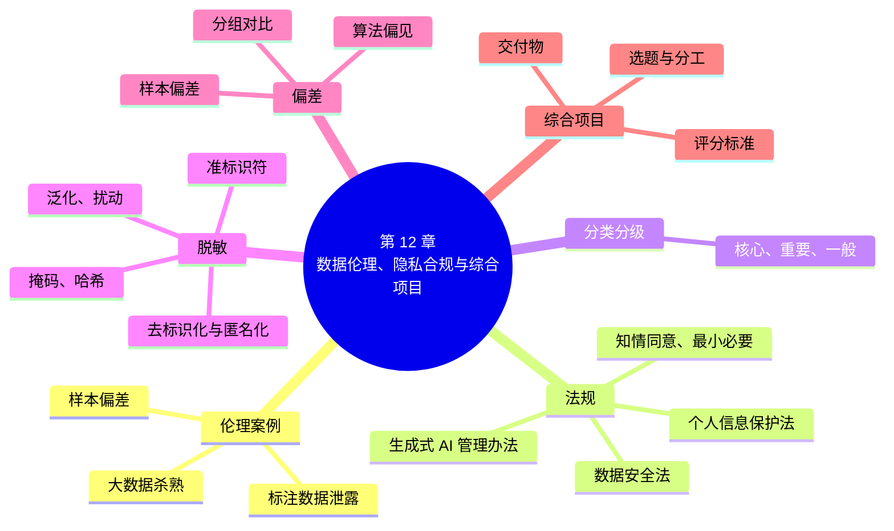

# 第 12 章 数据伦理、隐私合规与综合项目

!!! abstract "本章学时"
    理论 4 学时 · 实验 1 学时（本章共 3 个实验，前两个课内完成，综合项目课后完成）

## 学习目标

学完本章，你应该能够：

1. **说出**个人信息、敏感个人信息、知情同意、最小必要、去标识化与匿名化的含义，以及相关法律法规的名称（记忆）；
2. **解释**数据分类分级的思路，以及样本偏差为什么会导致算法对一部分人不公平（理解）；
3. **运行并修改**给定代码，识别数据中的个人信息，按场景选择掩码、哈希、泛化、扰动等脱敏方法（应用）；
4. **运行并修改**给定代码，对数据处理流程做合规检查，提出整改措施（应用）；
5. **完成**一个从采集、清洗、标注、分析到合规检查的综合项目，并提交项目报告（创造）。

!!! info "先修要求"
    学习本章前，你需要：

    - 会用正则表达式找出手机号（[4.6.2](../04-cleaning/index.md#462)）；
    - 读过本书第 1 章的“职业守则”（[1.5](../01-overview/index.md#15)）；
    - 人工智能伦理的总体框架（公平、透明、责任、隐私）见“人工智能导论”课程，本章只讲数据处理工作中的具体问题。

??? abstract "本章概念清单（15 个，点击查看定义和例子）"
    1. [个人信息](../../appendix/glossary.md#g-个人信息)
    2. [敏感个人信息](../../appendix/glossary.md#g-敏感个人信息)
    3. [知情同意](../../appendix/glossary.md#g-知情同意)
    4. [最小必要](../../appendix/glossary.md#g-最小必要)
    5. [数据分类分级](../../appendix/glossary.md#g-数据分类分级)
    6. [掩码](../../appendix/glossary.md#g-掩码)
    7. [哈希](../../appendix/glossary.md#g-哈希)
    8. [泛化](../../appendix/glossary.md#g-泛化)
    9. [扰动](../../appendix/glossary.md#g-扰动)
    10. [准标识符](../../appendix/glossary.md#g-准标识符)
    11. [去标识化](../../appendix/glossary.md#g-去标识化)
    12. [匿名化](../../appendix/glossary.md#g-匿名化)
    13. [样本偏差](../../appendix/glossary.md#g-样本偏差)
    14. [算法偏见](../../appendix/glossary.md#g-算法偏见)
    15. [隐私计算](../../appendix/glossary.md#g-隐私计算)

## 情景导入

“食客说”准备和一家连锁餐饮集团合作，集团的数据部门发来一封邮件：“为了做联合营销，请把你们平台上在我们门店消费过的用户名单发给我们，包括姓名、手机号和近一年的消费金额，Excel 格式就行。”

运营经理觉得这是好事，让小林“今天下班前导出来发过去”。小林正要动手，想起了上周数据安全培训讲的内容：用户在注册时同意的是“用于本平台提供服务”，没有同意把信息提供给别的公司；手机号是个人信息，消费记录还可能暴露一个人的生活习惯……

另一边，标注组的同事最近把 2000 条带用户手机号的评论发给了外包公司标注，技术组则在讨论要不要把客服对话发给外部的大模型做分类。

这些事能不能做？怎么做才合规？本章先回答这些问题，再把全书学过的内容串起来，完成一个综合项目。

## 12.1 数据工作中的伦理问题

数据处理是人工智能的“上游”，很多伦理问题都是在数据环节埋下的。下面三个案例都和本书讲过的工作直接相关。

**案例一：大数据杀熟。** 同一个外卖、同一家店、同一时间，老用户看到的价格或配送费比新用户高；同一张机票，用苹果手机查看的价格比安卓手机高。平台利用算法掌握的用户偏好、消费能力、对价格的敏感程度，对不同用户“看人下菜碟”。第 9 章的 RFM 分群本身没有问题，但如果把“重要价值客户”的分群结果用来提高他们的价格，就越过了底线。《个人信息保护法》明确规定，利用个人信息进行自动化决策，不得对个人在交易价格等交易条件上实行不合理的差别待遇。

**案例二：标注数据泄露。** 训练数据要交给标注员看，标注员往往是外包公司或众包平台上的兼职人员。如果评论、对话、图片中含有手机号、地址、人脸、病历，没有脱敏就交出去，等于把个人信息交给了一群陌生人。第 4 章清洗评论时把手机号换成“[手机号]”，第 5 章的标注规范要求遇到个人信息时“跳过并报告”，都是在防范这种风险。

**案例三：样本偏差导致不公平。** 某招聘平台用过去十年的录用数据训练简历筛选模型，由于过去录用的技术岗位大多是男性，模型学会了给含有“女子学院”等字样的简历打低分。模型并没有“歧视”的意图，它只是忠实地学会了数据中的偏差。12.5 节会用“食客说”的数据演示，样本偏差是怎样让模型对一部分用户“不公平”的。

这三个案例说明：数据人员不只是“处理数据的人”，也是保护用户权益的第一道关口。第 1 章的**职业守则**中“遵纪守法、保守秘密”的要求，在本章都会具体化。

## 12.2 法规要点：个人信息保护

### 12.2.1 相关法律法规

我国数据和个人信息保护的法律框架主要包括：

| 法律法规 | 施行时间 | 和数据工作关系最密切的内容 |
|---|---|---|
| 《中华人民共和国网络安全法》 | 2017 年 6 月 1 日 | 网络运营者收集、使用个人信息的基本规则 |
| 《中华人民共和国数据安全法》 | 2021 年 9 月 1 日 | 数据分类分级保护制度；数据处理活动的安全义务 |
| 《中华人民共和国个人信息保护法》 | 2021 年 11 月 1 日 | 个人信息处理的原则、告知同意、敏感个人信息、个人的权利 |
| 《生成式人工智能服务管理暂行办法》 | 2023 年 8 月 15 日 | 训练数据要来源合法；涉及个人信息要取得同意；数据标注要有清晰的规则、做质量评估、培训标注人员 |
| 《网络数据安全管理条例》 | 2025 年 1 月 1 日 | 细化网络数据处理者的个人信息保护、重要数据安全等义务 |

其中，《生成式人工智能服务管理暂行办法》第八条专门对数据标注提出要求：提供者应当制定符合要求的清晰、具体、可操作的标注规则；开展数据标注质量评估，抽样核验标注内容的准确性；对标注人员进行必要培训。<sup class="cite">[[3]](#ref12-3)</sup> 这正是本书第 5、6 章所做的事：写标注规范、试标、抽检验收、培训标注员。

### 12.2.2 个人信息与敏感个人信息

《个人信息保护法》规定，[**个人信息**](../../appendix/glossary.md#g-个人信息 "以电子或者其他方式记录的、与已识别或者可识别的自然人有关的各种信息，匿名化处理后的信息除外"){ .term }是以电子或者其他方式记录的与已识别或者可识别的自然人有关的各种信息，不包括匿名化处理后的信息。<sup class="cite">[[1]](#ref12-1)</sup> 理解这个定义的关键是“可识别”：

- 姓名、手机号、身份证号、详细地址，单独一项就能认出是谁，当然是个人信息；
- 性别、年龄段、常住城区，单独一项认不出是谁，但和其他信息组合起来就可能认出来（12.4.3 节），同样属于个人信息；
- 用户的订单记录、评论、浏览记录，和用户编号连在一起，能反映一个具体的人，也是个人信息。

一旦泄露或者被非法使用，容易导致人格尊严受到侵害或者人身、财产安全受到危害的个人信息，叫[**敏感个人信息**](../../appendix/glossary.md#g-敏感个人信息 "一旦泄露或被非法使用，容易导致人格尊严受到侵害或者人身、财产安全受到危害的个人信息"){ .term }，包括生物识别（人脸、指纹、声纹）、宗教信仰、特定身份、医疗健康、金融账户、行踪轨迹等信息，以及不满十四周岁未成年人的个人信息。处理敏感个人信息要有特定的目的和充分的必要性，取得个人的单独同意，并采取严格的保护措施。外卖平台的收货地址和下单时间连起来，能反映一个人每天在哪里、什么时候在家，就带有行踪轨迹的性质，要格外小心。

### 12.2.3 处理个人信息的基本原则

对数据人员来说，最需要记住的是以下几条：

1. [**知情同意**](../../appendix/glossary.md#g-知情同意 "处理个人信息前，向个人清楚告知处理目的、方式和范围，并取得其同意"){ .term }：处理个人信息前，要以显著方式、清晰易懂的语言告知个人处理的目的、方式、种类和保存期限，并取得个人同意。目的、方式变了，要重新取得同意。情景导入中把用户名单提供给另一家公司，就需要告知用户对方的名称、用途，并取得用户的单独同意；
2. [**最小必要**](../../appendix/glossary.md#g-最小必要 "只收集、使用实现目的所必需的最少个人信息，不多拿、不多用、不多存"){ .term }：收集个人信息要限于实现处理目的的最小范围，不得过度收集；处理时采取对个人权益影响最小的方式。做“按城区统计用户数”，只需要城区，就不应该拿到姓名和手机号；
3. **公开透明**：公开个人信息处理规则（隐私政策），明示处理的目的、方式和范围；
4. **保证安全**：采取加密、去标识化、权限控制等措施，防止泄露、篡改、丢失；
5. **保存期限**：保存期限应当为实现处理目的所必要的最短时间，到期删除。第 11 章的运行日志也要规定保存期限。

!!! cert "证书考点 · 人工智能训练师 · 职业道德与法律法规"
    人工智能训练师各等级的理论考试都包括职业道德和相关法律法规知识。常考：《网络安全法》《数据安全法》《个人信息保护法》的施行时间和基本要求；个人信息与敏感个人信息的区别；告知同意、最小必要原则；数据标注工作中的保密要求；常用的脱敏方法。容易错在认为“只要不含姓名就不是个人信息”，以及把去标识化等同于匿名化。

## 12.3 数据分类分级

一家公司有成百上千张数据表，不可能都按最高标准保护，也不能都不管。《数据安全法》规定国家建立[**数据分类分级**](../../appendix/glossary.md#g-数据分类分级 "按数据的内容和一旦泄露造成的危害程度，把数据分成不同类别和级别，分别采取保护措施"){ .term }保护制度：先按数据的内容和用途“分类”，再按数据一旦泄露、篡改或被非法使用造成的危害程度“分级”，不同级别采取不同的保护措施。<sup class="cite">[[2]](#ref12-2)</sup>

国家标准《数据安全技术 数据分类分级规则》（GB/T 43697—2024）把数据从高到低分为核心数据、重要数据、一般数据三个级别：核心数据和重要数据关系国家安全、经济运行、社会稳定，由国家和行业主管部门确定目录；企业日常处理的绝大多数业务数据属于一般数据，可以再按影响程度细分。<sup class="cite">[[4]](#ref12-4)</sup> 下面是为“食客说”的数据做的一个简化的分类分级示例：

| 数据 | 类别 | 级别（企业内部） | 保护措施 |
|---|---|---|---|
| 商家名录、菜系、人均价格 | 公开业务数据 | 低 | 可以公开 |
| 订单汇总统计（各城区交易额） | 经营数据 | 中 | 内部使用，对外发布需审批 |
| 评论内容 | 用户内容 | 中 | 脱敏后再标注、分析 |
| 用户编号与订单明细 | 个人信息 | 高 | 去标识化存储，按需授权访问 |
| 姓名、手机号、收货地址 | 个人信息（可直接识别） | 很高 | 加密存储，严格限制访问，访问留痕 |

分类分级的结果要写进数据字典（第 1 章），每一列数据都标明它的级别，处理时按级别执行相应的措施。

## 12.4 脱敏方法

### 12.4.1 四种常用方法

**脱敏**是在保留数据分析价值的前提下，对个人信息进行变换，降低识别出具体个人的可能性。第 4 章已经用正则表达式把评论里的手机号换成了“[手机号]”。常用的脱敏方法有四种：

| 方法 | 做法 | 例子 | 适合的场景 |
|---|---|---|---|
| [**掩码**](../../appendix/glossary.md#g-掩码 "用 * 等符号遮住数据的一部分，只保留部分字符的脱敏方法"){ .term } | 用 * 等符号遮住一部分 | 13051490103 → 130****0103 | 页面展示、客服核对身份 |
| [**哈希**](../../appendix/glossary.md#g-哈希 "用哈希函数把原值变成一串固定长度、无法反推的字符，相同的原值得到相同的结果"){ .term } | 加“盐”后用哈希函数换成一串固定长度的乱码 | U00002 → f95cb3a3486d | 需要关联多张表、但不需要知道是谁 |
| [**泛化**](../../appendix/glossary.md#g-泛化 "把精确的值换成更粗的范围或类别，降低识别个人的可能"){ .term } | 降低精度 | 详细地址 → 广州市天河区；23 岁 → 18-24 | 统计分析 |
| [**扰动**](../../appendix/glossary.md#g-扰动 "给数值加上小的随机噪声，单条记录不再精确，整体统计结果基本不变"){ .term } | 加入随机误差 | 1543.0 元 → 1597.3 元（±5%） | 只关心总体统计、不关心个人的精确值 |

此外，最彻底的办法是**删除**：用不着的字段直接不要。

哈希函数的特点是：同一个输入永远得到同一个输出，所以哈希后的用户编号仍然能把订单表和评论表关联起来；但从输出推不回输入。不过，手机号只有 11 位，攻击者可以把所有可能的手机号都算一遍哈希来“撞库”，所以哈希前要加一段只有自己知道的字符串，叫“盐”：

```python
import hashlib
SALT = "shike-2026"                      # “盐”：要像密码一样保管，不能和数据放在一起

def hash_id(x):
    return hashlib.sha256((SALT + x).encode("utf-8")).hexdigest()[:12]   # 取前 12 位

def mask_phone(p):
    return p[:3] + "****" + p[-4:]       # 保留前 3 位和后 4 位
```

在下面的动画中，可以为同一条记录的每个字段选择脱敏方法，看不同场景下的可用性和泄露风险：

<iframe class="sim-frame" src="../../sims/data-masking/main.html" height="560" loading="lazy" title="数据脱敏演示"></iframe>
动画：数据脱敏演示。选择使用场景，为每个字段选择保留、掩码、哈希、泛化、扰动或删除，看分析可用性和泄露风险。[全屏打开](../../sims/data-masking/main.html){ target=_blank }
{ .sim-caption }

### 12.4.2 脱敏前后的分析结果

脱敏是为了保护个人，但不能让数据失去分析价值。实验 12-1 比较了脱敏前后的分析结果：

```text
实付金额平均值：原始 133.17，扰动后 133.14
单笔订单平均改变了 5.30 元
按城区统计用户数，脱敏前后完全一致： True
```

给每笔订单的金额加上约 ±5% 的随机误差后，单笔订单平均改变了 5.30 元，但全部订单的平均值只差 0.03 元；地址泛化到区以后，按城区统计的用户数和原来完全一样。这说明：**选对了方法，脱敏后的数据照样能做分析。**

### 12.4.3 去标识化不等于匿名化

把姓名、手机号去掉，就安全了吗？不一定。实验 12-1 检查了去掉直接标识以后，剩下的几列组合起来能不能“认出”一个人：

```text
性别+年龄段+常住城区：同组少于 5 人的用户 0.0%，独一无二的用户 0.0%
性别+年龄段+常住城区+注册日期：同组少于 5 人的用户 100.0%，独一无二的用户 94.3%
```

只用性别、年龄段、常住城区三列，每种组合都至少有 10 个人，很难认出具体是谁；再加上注册日期，94.3% 的用户在数据中是“独一无二”的。如果有人知道某个熟人大概哪天注册的，就能在数据中找到他的全部消费记录。这类单独看认不出、组合起来能认出的字段，叫[**准标识符**](../../appendix/glossary.md#g-准标识符 "单独不能识别个人、但几项组合起来可能识别出个人的字段"){ .term }。

《个人信息保护法》区分了两个概念：

- [**去标识化**](../../appendix/glossary.md#g-去标识化 "处理个人信息后，使其在不借助额外信息的情况下无法识别特定个人"){ .term }：经过处理，在**不借助额外信息**的情况下无法识别特定个人。比如用哈希编号代替用户编号，掌握“盐”和原始表的人仍然可以还原。去标识化后的数据仍然是个人信息，仍受法律保护；
- [**匿名化**](../../appendix/glossary.md#g-匿名化 "处理个人信息后，使其无法识别特定个人且不能复原；匿名化后的信息不再属于个人信息"){ .term }：经过处理**无法识别**特定个人**且不能复原**。匿名化后的信息不再属于个人信息。

真正做到匿名化非常难，所以实际工作中，应当把去标识化后的数据仍然当作个人信息来保护：限制访问、不随意对外提供。

## 12.5 算法偏见与样本偏差

### 12.5.1 偏差从数据中来

[**样本偏差**](../../appendix/glossary.md#g-样本偏差 "训练或分析用的数据不能代表真实总体，导致结论或模型对某些群体不准"){ .term }是指用来训练或分析的数据，不能代表模型将要服务的全部人群。模型从有偏差的数据中学习，就会对数据中“少见”的人群表现更差，这就是很多[**算法偏见**](../../appendix/glossary.md#g-算法偏见 "模型对不同群体的结果系统性地不公平，常来自有偏的数据或有偏的标注"){ .term }的来源。

“食客说”的数据可以演示这个过程。假设数据部门早期只采集了平台专送的订单，用它训练送达时长预测模型（特征中没有“配送方式”），然后用在所有订单上：

```text
商家自送：18270 单，平均绝对误差 5.25 分钟，平均少估了 4.49 分钟，实际比预测晚 10 分钟以上的占 9.8%
平台专送：7677 单，平均绝对误差 3.49 分钟，平均少估了 0.08 分钟，实际比预测晚 10 分钟以上的占 0.9%
```

模型对平台专送的订单预测得很准；对商家自送的订单，平均少估了 4.5 分钟，近一成订单比预测晚到 10 分钟以上。结果是：选了商家自送的店的顾客，总是被“说好的时间”放鸽子，这些商家的差评也会更多（第 8 章发现送得慢的订单好评率低 8.9 个百分点）。模型本身没有“偏心”，偏差完全来自训练数据。

### 12.5.2 怎样从数据上发现偏差

发现偏差的基本方法，就是第 7 章学过的**分组对比**：

1. **检查数据的代表性**：训练数据中各类人群（城区、年龄段、配送方式、设备类型等）的比例，和实际服务的人群是否一致？
2. **分组评估模型**：不只看总体准确率，还要分组计算每一类人群的准确率或误差，看有没有哪一组明显更差；
3. **检查标注的偏差**：标注员是否对某些说法（如方言、网络用语）理解有偏差？第 6 章的错误分析可以发现这类问题；
4. **检查结果的影响**：模型的输出会不会让某些人群总是得到更差的服务、更高的价格？

发现偏差后，可以补充少数人群的数据、在模型中加入相关特征（如“配送方式”）、分组设置阈值，或者在业务规则上做出补偿。

## 12.6 综合项目指南

### 12.6.1 选题

综合项目要求以小组（3～4 人）为单位，把全书的内容串起来，走完一个完整的数据处理与分析流程。从下面三个题目中任选一个：

| 选题 | 内容 | 主要用到的章节 |
|---|---|---|
| 一、“食客说”评论分析 | 采集评论，清洗脱敏，标注 200 条并审核，训练或调用模型做情感分析，按菜系、城区、商家分析差评原因，提出改进建议 | 3、4、5、6、9 |
| 二、门店经营分析 | 从订单、商家、用户数据出发，做探索性分析和统计检验，用户分群，搭建经营看板，写经营分析报告，给出推荐或营销方案 | 2、7、8、9、10 |
| 三、自选业务数据 | 用自己单位或生活中的真实数据（如客服工单、门店销售、班级成绩），自己设计采集、标注和分析方案。**必须先脱敏，并经教师同意** | 全书 |

`labs/ch12/lab12_3_project_starter.py` 是选题一的起步程序，它把第 3、4、9、8 章的步骤串成了一条能跑通的流水线，你可以在它的基础上逐步改进。

### 12.6.2 分工与时间安排

| 阶段 | 时间 | 任务 | 产出 |
|---|---|---|---|
| 1. 立项 | 第 1 周 | 选题，明确业务问题，分工 | 项目计划（1 页） |
| 2. 数据 | 第 2 周 | 采集、质量评估、清洗、脱敏 | 数据质量评估报告、清洗规范 |
| 3. 标注 | 第 3 周 | 写标注规范，试标，标注，审核 | 标注规范、审核报告 |
| 4. 分析建模 | 第 4 周 | 探索性分析、统计检验、建模或推荐 | 代码、测试报告 |
| 5. 成果 | 第 5 周 | 看板、分析报告、合规检查、答辩 | 项目报告、看板截图、合规检查表、答辩 PPT |

建议的分工：数据负责人（采集、清洗）、标注负责人（规范、审核）、分析负责人（分析、建模、看板）、组长（进度、报告、合规检查）。每个人都要参与标注和报告的撰写。

### 12.6.3 交付物与评分标准

项目报告的结构参照第 8 章的数据分析报告，并增加“数据处理过程”和“合规检查”两部分。附录 E 有各类报告和规范的模板。

| 评分项 | 分值 | 要求 |
|---|---|---|
| 数据处理 | 20 | 有数据质量评估和清洗规范，清洗前后数据量和问题有记录 |
| 标注与审核 | 20 | 有标注规范和试标记录，有一致性或抽检结果 |
| 分析与建模 | 25 | 方法恰当，结论有数据支撑，有测试报告或统计检验，不把相关说成因果 |
| 可视化与报告 | 20 | 图表恰当无误导，报告结论先行、建议可执行 |
| 合规与伦理 | 10 | 完成合规检查表，个人信息已脱敏，说明了可能的偏差 |
| 答辩 | 5 | 10 分钟讲清问题、方法、发现和建议 |

## 12.7 前沿视窗

**隐私计算与数据要素流通。** 数据越用越有价值，但很多数据因为涉及个人信息和商业秘密，不能直接交给别人。情景导入中的联合营销，有没有办法既做成、又不交出用户名单？[**隐私计算**](../../appendix/glossary.md#g-隐私计算 "在不暴露原始数据的前提下，让多方数据一起参与计算的技术"){ .term }技术就是为解决这个问题而发展起来的。它的思路是“数据可用不可见”：多方安全计算让两家公司在不交换原始数据的情况下，算出“双方共同的用户有多少”；联邦学习让几家医院各自用本院的数据训练模型，只交换模型参数，病历不出医院；可信执行环境在芯片中开辟一块“保险箱”，数据只在里面被计算，连服务器管理员也看不到。与此同时，国家把数据作为新型生产要素，2022 年 12 月发布了关于构建数据基础制度的意见（“数据二十条”），2023 年组建了国家数据局，各地纷纷设立数据交易所，推动数据在合规、安全的前提下流通和交易。未来的数据从业人员，既要懂得怎样用好数据，也要懂得怎样合规地让数据流动起来。

## 本章实验

!!! abstract "实验总览"
    | 实验 | 类型 | 建议时长 | 内容 |
    |---|---|---|---|
    | 实验 12-1 | ★ 基础 | 40 分钟 | 识别用户表中的个人信息，用掩码、哈希、泛化、扰动脱敏，比较脱敏前后的分析结果，检查重识别风险 |
    | 实验 12-2 | ★ 基础 | 40 分钟 | 扫描本书的数据文件，用检查清单对全书的数据处理流程做合规检查并提出整改措施 |
    | 实验 12-3 | ★ 基础 | 课后 5 周 | 综合项目（三选一），提交项目报告 |

    代码见配套资源 `labs/ch12/` 目录。

### 实验 12-1 ★ 个人信息识别与脱敏

**实验目的**

1. 会用正则表达式识别数据中的手机号、地址、姓名等个人信息；
2. 会按场景选择掩码、哈希、泛化、扰动等脱敏方法；
3. 会比较脱敏前后的分析结果，检查准标识符组合带来的重识别风险。

**实验环境**：本机 CPU。

**实验数据**：`labs/data/users.csv`（编者生成的虚构用户，姓名、手机号、地址均为随机生成）、`orders.csv`。

**实验步骤与代码**

第 1 步，运行 `labs/ch12/lab12_1_masking.py`，看第 1 部分的识别结果。注意“常住城区”也被识别成了“像姓名”，因为“天河”“越秀”都是两个汉字。这说明规则会误报，识别结果要人工确认。

第 2 步，读懂 12.4.1 节的 `hash_id` 和 `mask_phone` 函数，以及泛化地址的函数：

```python
def generalize_addr(a):     # 泛化：详细地址只保留到区
    return a[:a.index("区") + 1] if "区" in a else a
```

`a.index("区")` 找到“区”字的位置，`a[:位置 + 1]` 取出从开头到“区”字的部分。

第 3 步，修改代码：把 `SALT` 改成别的字符串，看哈希后的编号有什么变化。想一想，为什么“盐”要保密？

第 4 步，**先自己写**：把年龄段换成更粗的“青年（18-30）/ 中年（31-50）/ 50以上”，再计算“性别 + 年龄段 + 常住城区 + 注册日期”的独一无二比例。再试试把注册日期泛化到“年-月”。

**运行结果**

```text
列“姓名”有 100% 的值像姓名
列“手机号”有 100% 的值像手机号
列“常住城区”有 100% 的值像姓名
列“收货地址”有 100% 的值像地址
user_id  姓名         手机号                    收货地址
 U00001  周婷 15845457402    广州市天河区天河路85号17栋2557房
 U00002 叶志霞 13051490103 广州市天河区市桥大北路105号25栋1725房
        用户编号         手机号     地址 性别   年龄段 常住城区
d63444ab2f92 158****7402 广州市天河区  男 41-50   天河
f95cb3a3486d 130****0103 广州市天河区  男 18-24   天河
实付金额平均值：原始 133.17，扰动后 133.14
单笔订单平均改变了 5.30 元
按城区统计用户数，脱敏前后完全一致： True
性别+年龄段+常住城区：同组少于 5 人的用户 0.0%，独一无二的用户 0.0%
性别+年龄段+常住城区+注册日期：同组少于 5 人的用户 100.0%，独一无二的用户 94.3%
```

**实验记录表**

| 字段 | 是否个人信息 | 场景“按城区统计” | 场景“RFM 分群” | 场景“客服回访” |
|---|---|---|---|---|
| 姓名 | | | | |
| 手机号 | | | | |
| 收货地址 | | | | |
| 注册日期 | | | | |
| 第 4 步：泛化注册日期后的独一无二比例 | — | | | |

**常见问题排查**

| 现象 | 原因 | 解决办法 |
|---|---|---|
| 手机号变成了 `1.3e+10` 这样的数字 | 读 CSV 时手机号被当成了数字 | `pd.read_csv(..., dtype={"手机号": str})` |
| `ValueError: substring not found` | 某个地址里没有“区”字 | 函数中已用 `if "区" in a` 判断 |
| 每次运行哈希结果都不一样 | 用了随机的盐 | 盐要固定，并妥善保管 |

**思考与练习**

1. 掩码后的手机号 158****7402 还算个人信息吗？为什么？
2. 情景导入中合作方要用户名单，在不交出手机号的前提下，有什么办法能知道“双方共同的用户有多少”？

**实验报告要求**

提交运行结果截图、记录表，以及为三个场景设计的脱敏方案和理由。

### 实验 12-2 ★ 合规检查

**实验目的**

1. 会用程序扫描数据文件中的个人信息；
2. 会用检查清单，对数据从收集到删除的全过程做合规检查；
3. 会针对发现的问题提出整改措施。

**实验环境**：本机 CPU。

**实验数据**：`labs/data/` 下本书用过的全部数据文件。

**实验步骤与代码**

第 1 步，运行 `labs/ch12/lab12_2_compliance_scan.py`。程序逐个文件、逐列用正则表达式查找手机号、详细地址、身份证号，并检查列名是不是“姓名”。读不了的 GBK 文件会换一种编码再读（第 3 章）：

```python
def read_any(f):
    try:
        return pd.read_csv(f, dtype=str)
    except UnicodeDecodeError:              # UTF-8 读不了，就按 GBK 读
        return pd.read_csv(f, dtype=str, encoding="gbk")
```

第 2 步，程序生成 `合规检查表.csv`，自动扫描能回答的项目已经填好。用 WPS 或 Excel 打开，逐项完成标为“人工”的检查。检查对象是本书第 3～11 章的数据处理流程，可以回看各章的实验。

第 3 步，为每个“不合规”或“有风险”的项目填写整改措施，并动手完成至少一项整改（例如：用实验 12-1 的方法生成脱敏后的用户表；修改第 11 章的日志，只记录评论编号不记录原文）。

**运行结果**

```text
                      文件    列   发现   条数                             示例
         reviews_raw.csv 评论内容  手机号  159 味道很一般，芒果班戟踩雷了！环境太吵！不会再来了，有事打我电
               users.csv   姓名   姓名 5000                             周婷
               users.csv  手机号  手机号 5000                    15845457402
               users.csv 收货地址 详细地址 5000           广州市天河区天河路85号17栋2557房
ch03/api_reviews_all.csv 评论内容  手机号  159 味道很一般，芒果班戟踩雷了！环境太吵！不会再来了，有事打我电
环节                         检查项                                               检查结果 整改措施
收集       是否只收集了业务必需的个人信息（最小必要）                                                 人工
……
存储                    含个人信息的文件 ch03/api_reviews_all.csv、reviews_raw.csv、users.csv
存储              个人信息是否已脱敏或加密存储                                        否：上表文件中仍有明文
……
```

扫描发现：原始评论和接口采集的评论中有 159 条含手机号（第 4 章清洗后的 `reviews.csv` 中已经没有了）；用户表中有明文的姓名、手机号和详细地址。日志 `service_log.jsonl` 中记录了评论原文，虽然本次没有扫出手机号，但如果清洗环节出了问题，日志就会成为个人信息的副本。

**实验记录表**：即程序生成的 `合规检查表.csv`，完成“人工”项和“整改措施”列。

**常见问题排查**

| 现象 | 原因 | 解决办法 |
|---|---|---|
| `UnicodeDecodeError` | 有 GBK 编码的文件 | 程序已用 `read_any` 处理 |
| 扫描出的“身份证号”其实是订单号 | 18 位数字的编号也会被匹配 | 人工确认；可以加上出生日期格式的校验 |

**思考与练习**

1. 自动扫描能发现哪些问题，不能发现哪些问题？
2. 第 9 章实验 9-3 要把评论发给外部的大模型，你会提出哪些合规要求？

**实验报告要求**

提交扫描结果截图、填好的合规检查表和整改前后的对比。

### 实验 12-3 ★ 综合项目

**实验目的**

1. 能综合运用全书的知识，完成一个从采集到合规检查的完整项目；
2. 能分工协作，按计划推进，撰写规范的项目报告；
3. 能在答辩中清楚地说明问题、方法、发现和建议。

**实验环境**：本机 CPU；选题三按需要。

**实验数据**：选题一、二用随书数据；选题三用自选数据（先脱敏，经教师同意）。

**实验步骤与代码**

第 1 步，按 12.6 节选题、分工、制订计划。

第 2 步（选题一），运行起步程序 `labs/ch12/lab12_3_project_starter.py`，它依次完成采集、清洗脱敏、情感分析、汇总、出图、输出七个步骤，借用了第 4 章的 `clean_review` 和第 11 章的 `load_model`：

```python
sys.path += [str(LABS / "ch04"), str(LABS / "ch11")]     # 让 Python 能找到这两章的文件
from cleaning import clean_review                         # 第 4 章：评论清洗（含手机号替换）
from monitor_tools import load_model                      # 第 9、11 章：情感模型
```

第 3 步，在每一步上做自己的改进：例如在清洗前做质量评估；抽 200 条做人工标注并计算与模型的一致率；按方面（口味、服务、配送……）统计差评原因；做一个 Streamlit 看板。

第 4 步，用实验 12-2 的检查表做合规检查，撰写项目报告，准备答辩。

**运行结果**（起步程序）

```text
① 原始评论 12000 条
②③ 清洗脱敏后 11842 条；还含手机号的： 0 条
④ 情感分布： {'正面': 0.557, '中性': 0.247, '负面': 0.195}
⑤ 负面占比最高的 5 家店（评论 30 条以上）：
         评论数   负面占比         店名
shop_id
S0094     31  0.548  好阁甜品（海珠店）
S0267     30  0.500  阿味烧烤（花都店）
S0055     33  0.485  鲜家火锅（天河店）
S0226     31  0.452  旺坊川菜（白云店）
S0071     31  0.452  金城快餐（海珠店）
⑥⑦ 图表和结果已保存到 项目输出
```

各菜系负面评论占比中，西餐（24.9%）和甜品饮品（23.3%）最高，火锅（15.9%）最低。注意每家店只有 30 条左右评论，负面占比的波动较大，下结论前可以用第 7 章的方法检验。

**实验记录表**：按 12.6.3 节的评分表自评，并附上小组分工和每周进度记录。

**常见问题排查**

| 现象 | 原因 | 解决办法 |
|---|---|---|
| `ModuleNotFoundError: No module named 'cleaning'` | 第 4 章的 `cleaning.py` 不在 `labs/ch04/` 下 | 确认文件位置；或把 `cleaning.py` 复制到 `labs/ch12/` |
| 项目输出文件夹里没有图 | 程序中途出错 | 看报错信息，按“报错怎么办”（常见问题）逐步排查 |
| 小组成员进度不一 | 计划不清 | 每周开一次 15 分钟的短会，更新进度表 |

**思考与练习**

1. 你的项目中，哪一步花的时间最多？和你开课前的预想一样吗？
2. 回看第 1 章的“数据的旅程”，你的项目走过了哪几站？

**实验报告要求**

提交项目报告（含数据质量评估、清洗规范、标注规范和审核结果、分析发现、建议、合规检查表）、代码、看板截图和答辩 PPT。

## 本章小结

- 数据处理中的伦理问题包括大数据杀熟、标注数据泄露、样本偏差导致的不公平等；数据人员是保护用户权益的第一道关口，要遵守**职业守则**。
- 法律框架包括《网络安全法》《数据安全法》《个人信息保护法》《生成式人工智能服务管理暂行办法》《网络数据安全管理条例》。**个人信息**的关键是“可识别”；**敏感个人信息**要单独同意、严格保护。处理个人信息要遵循**知情同意**、**最小必要**等原则。
- **数据分类分级**：按内容分类、按危害程度分级（核心、重要、一般），不同级别采取不同的保护措施。
- **脱敏**的常用方法有**掩码**、**哈希**（要加盐）、**泛化**、**扰动**和删除。选对方法，脱敏后的数据照样能做分析。**准标识符**组合起来可能认出个人；**去标识化**不等于**匿名化**，去标识化的数据仍是个人信息。
- **样本偏差**会导致**算法偏见**：只用平台专送的数据训练，模型对商家自送的订单平均少估 4.5 分钟。用分组对比检查数据的代表性和模型在各组上的表现。
- 综合项目三选一，按立项、数据、标注、分析建模、成果五个阶段推进，提交项目报告并做合规检查。



**结束语**

到这里，全书的内容就学完了。回顾一下“食客说”的数据走过的旅程：从文件、数据库、接口中采集（第 3 章），清洗整合（第 4 章），标注和审核（第 5、6 章），探索和检验（第 7 章），画成图、写成报告（第 8 章），训练模型、给用户分群（第 9 章），推荐餐厅（第 10 章），上线后持续监控和改进（第 11 章），并在每一步守住合规的底线（第 12 章）。这就是一名人工智能训练师和数据处理人员日常工作的全貌。希望你带着这些方法，在自己的工作中把数据用好、用对。

## 参考文献

正文中的上标编号（如<sup class="cite">[[1]](#ref12-1)</sup>）对应下面的文献。带链接的可以直接打开；书籍可在图书馆或电子书平台查阅。

<div class="refs" markdown>

**法律法规**

- <span id="ref12-1"></span>[1] 全国人民代表大会常务委员会. 中华人民共和国个人信息保护法[Z]. 2021-08-20.
    <span class="ref-note">规定了个人信息处理的基本原则、告知同意、敏感个人信息、自动化决策、去标识化与匿名化的定义等，对应 12.2、12.4 节。</span>
- <span id="ref12-2"></span>[2] 全国人民代表大会常务委员会. 中华人民共和国数据安全法[Z]. 2021-06-10.
    <span class="ref-note">第二十一条规定国家建立数据分类分级保护制度，对应 12.3 节。</span>
- <span id="ref12-3"></span>[3] 国家互联网信息办公室, 等. 生成式人工智能服务管理暂行办法[Z]. 2023-07-10.
    <span class="ref-note">第七条规定训练数据处理活动的要求，第八条规定数据标注的要求，对应 12.2.1 节，与第 5、6 章密切相关。</span>
- <span id="ref12-5"></span>[5] 国务院. 网络数据安全管理条例[Z]. 2024-09-24.
    <span class="ref-note">细化了网络数据处理者在个人信息保护、重要数据安全、数据跨境流动等方面的义务，2025 年 1 月 1 日起施行，对应 12.2.1 节。</span>

**标准**

- <span id="ref12-4"></span>[4] 全国网络安全标准化技术委员会. 数据安全技术 数据分类分级规则: GB/T 43697—2024[S]. 北京: 中国标准出版社, 2024.
    <span class="ref-note">规定了数据分类分级的原则、框架和方法，将数据分为核心数据、重要数据、一般数据三个级别，对应 12.3 节。</span>

</div>

## 课后练习

选择题和判断题可以直接点击选项作答，系统会马上告诉你对错，并展开答案与解析；多选题选好后点“提交答案”。简答和实操题请先自己作答，再点开“答案与解析”核对。每道题的解析下方都有“回看”链接，做错了可以直接跳回正文复习。

**一、单项选择题**

<div class="quiz" data-answer="C" markdown>

**1.** 《中华人民共和国个人信息保护法》的施行时间是（　　）。

- A. 2017 年 6 月 1 日
- B. 2021 年 9 月 1 日
- C. 2021 年 11 月 1 日
- D. 2025 年 1 月 1 日

</div>

??? tip "答案与解析"
    **答案：C**

    A 是网络安全法，B 是数据安全法，D 是网络数据安全管理条例。

    考查：个人信息保护法 · 认知层次：记忆 · [回看 12.2.1](#1221)
    { .quiz-meta }

<div class="quiz" data-answer="B" markdown>

**2.** 下列信息中，属于敏感个人信息的是（　　）。

- A. 用户的昵称
- B. 用户的医疗健康信息
- C. 用户喜欢的菜系
- D. 用户的性别

</div>

??? tip "答案与解析"
    **答案：B**

    敏感个人信息包括生物识别、宗教信仰、特定身份、医疗健康、金融账户、行踪轨迹和不满十四周岁未成年人的个人信息。

    考查：敏感个人信息 · 认知层次：理解 · [回看 12.2.2](#1222)
    { .quiz-meta }

<div class="quiz" data-answer="D" markdown>

**3.** 做“按城区统计用户数”的分析，只向数据部门申请城区这一列，体现的是（　　）原则。

- A. 公开透明
- B. 知情同意
- C. 保存期限
- D. 最小必要

</div>

??? tip "答案与解析"
    **答案：D**

    只收集、使用实现目的所必需的最少信息。

    考查：最小必要 · 认知层次：应用 · [回看 12.2.3](#1223)
    { .quiz-meta }

<div class="quiz" data-answer="A" markdown>

**4.** 把手机号 13051490103 处理成 130****0103，使用的脱敏方法是（　　）。

- A. 掩码
- B. 哈希
- C. 泛化
- D. 扰动

</div>

??? tip "答案与解析"
    **答案：A**

    用 * 遮住一部分是掩码。

    考查：掩码 · 认知层次：理解 · [回看 12.4.1](#1241)
    { .quiz-meta }

<div class="quiz" data-answer="C" markdown>

**5.** 需要用用户编号把订单表和评论表关联起来，又不希望分析人员知道用户是谁，最合适的方法是（　　）。

- A. 删除用户编号
- B. 给用户编号加随机误差
- C. 加盐后哈希
- D. 把用户编号泛化到城区

</div>

??? tip "答案与解析"
    **答案：C**

    哈希后同一个编号得到同一个结果，仍能关联，但推不回原值。

    考查：哈希 · 认知层次：应用 · [回看 12.4.1](#1241)
    { .quiz-meta }

<div class="quiz" data-answer="B" markdown>

**6.** 详细地址“广州市天河区天河路 85 号 17 栋 2557 房”处理成“广州市天河区”，使用的方法是（　　）。

- A. 掩码
- B. 泛化
- C. 扰动
- D. 哈希

</div>

??? tip "答案与解析"
    **答案：B**

    降低精度是泛化。

    考查：泛化 · 认知层次：理解 · [回看 12.4.1](#1241)
    { .quiz-meta }

<div class="quiz" data-answer="D" markdown>

**7.** 关于去标识化和匿名化，下列说法正确的是（　　）。

- A. 两者是同一个意思
- B. 去标识化后的信息不再是个人信息
- C. 匿名化后的信息借助额外信息还可以复原
- D. 匿名化要求无法识别特定个人且不能复原

</div>

??? tip "答案与解析"
    **答案：D**

    去标识化后的信息仍是个人信息；匿名化后不能复原，才不再属于个人信息。

    考查：去标识化、匿名化 · 认知层次：理解 · [回看 12.4.3](#1243)
    { .quiz-meta }

<div class="quiz" data-answer="A" markdown>

**8.** 只用平台专送的订单训练送达时长模型，用在商家自送的订单上平均少估 4.5 分钟，原因是（　　）。

- A. 样本偏差
- B. 数据泄露
- C. 过拟合
- D. 冷启动

</div>

??? tip "答案与解析"
    **答案：A**

    训练数据不能代表模型将要服务的全部订单。

    考查：样本偏差 · 认知层次：应用 · [回看 12.5.1](#1251)
    { .quiz-meta }

<div class="quiz" data-answer="C" markdown>

**9.** 《生成式人工智能服务管理暂行办法》对数据标注的要求不包括（　　）。

- A. 制定清晰、具体、可操作的标注规则
- B. 开展数据标注质量评估，抽样核验标注内容的准确性
- C. 标注必须全部由大模型自动完成
- D. 对标注人员进行必要培训

</div>

??? tip "答案与解析"
    **答案：C**

    办法第八条对标注规则、质量评估和人员培训提出了要求。

    考查：法律法规 · 认知层次：记忆 · [回看 12.2.1](#1221)
    { .quiz-meta }

**二、多项选择题**

<div class="quiz quiz-multi" data-answer="ABCD" markdown>

**10.** 下列信息与用户编号放在一起时，属于个人信息的有（　　）。

- A. 订单记录
- B. 评论内容
- C. 浏览记录
- D. 收货地址

</div>

??? tip "答案与解析"
    **答案：ABCD**

    能反映一个已识别或可识别的自然人的信息都是个人信息。

    考查：个人信息 · 认知层次：理解 · [回看 12.2.2](#1222)
    { .quiz-meta }

<div class="quiz quiz-multi" data-answer="ABD" markdown>

**11.** 情景导入中，合作方要求提供用户的姓名、手机号和消费金额。下列做法正确的有（　　）。

- A. 先确认用户是否同意向第三方提供个人信息
- B. 评估是否可以只提供汇总统计结果，而不是用户名单
- C. 只要对方是正规公司，直接导出 Excel 发过去
- D. 考虑用隐私计算的方法，在不交出名单的情况下完成合作

</div>

??? tip "答案与解析"
    **答案：ABD**

    向他人提供个人信息，要告知接收方的情况并取得个人的单独同意。

    考查：知情同意 · 认知层次：评价 · [回看 12.2.3](#1223)
    { .quiz-meta }

<div class="quiz quiz-multi" data-answer="ACD" markdown>

**12.** 发现算法偏见的方法有（　　）。

- A. 检查训练数据中各类人群的比例是否有代表性
- B. 只看模型的总体准确率
- C. 分组计算每类人群的准确率或误差
- D. 检查模型的输出是否让某些人群总是得到更差的结果

</div>

??? tip "答案与解析"
    **答案：ACD**

    总体准确率可能掩盖某一组表现很差的情况。

    考查：算法偏见 · 认知层次：应用 · [回看 12.5.2](#1252)
    { .quiz-meta }

<div class="quiz quiz-multi" data-answer="BC" markdown>

**13.** 关于哈希脱敏，下列说法正确的有（　　）。

- A. 哈希后可以用解密的方法还原出手机号
- B. 同一个输入永远得到同一个输出
- C. 对手机号哈希前要加“盐”，防止撞库
- D. “盐”应该和数据放在同一个文件里，方便使用

</div>

??? tip "答案与解析"
    **答案：BC**

    哈希不能解密；盐要像密码一样单独保管。

    考查：哈希 · 认知层次：理解 · [回看 12.4.1](#1241)
    { .quiz-meta }

**三、判断题**

<div class="quiz quiz-judge" data-answer="×" markdown>

**14.** 只要数据中不含姓名和手机号，就不属于个人信息。

</div>

??? tip "答案与解析"
    **答案：×**

    性别、年龄段、注册日期等组合起来也可能识别出个人，实验中 94.3% 的用户是独一无二的。

    考查：准标识符 · 认知层次：评价 · [回看 12.4.3](#1243)
    { .quiz-meta }

<div class="quiz quiz-judge" data-answer="√" markdown>

**15.** 给订单金额加入约 ±5% 的随机误差后，全部订单的平均金额几乎不变。

</div>

??? tip "答案与解析"
    **答案：√**

    实验中平均值只从 133.17 变为 133.14。

    考查：扰动 · 认知层次：理解 · [回看 12.4.2](#1242)
    { .quiz-meta }

<div class="quiz quiz-judge" data-answer="√" markdown>

**16.** 《数据安全法》规定国家建立数据分类分级保护制度。

</div>

??? tip "答案与解析"
    **答案：√**

    见《数据安全法》第二十一条。

    考查：数据分类分级 · 认知层次：记忆 · [回看 12.3](#123)
    { .quiz-meta }

<div class="quiz quiz-judge" data-answer="×" markdown>

**17.** 模型没有歧视的意图，所以它的结果一定是公平的。

</div>

??? tip "答案与解析"
    **答案：×**

    模型会忠实地学会训练数据中的偏差。

    考查：算法偏见 · 认知层次：理解 · [回看 12.5.1](#1251)
    { .quiz-meta }

<div class="quiz quiz-judge" data-answer="√" markdown>

**18.** 把含有手机号的评论交给外包公司标注之前，应该先脱敏。

</div>

??? tip "答案与解析"
    **答案：√**

    这是防范标注数据泄露的基本措施。

    考查：脱敏 · 认知层次：应用 · [回看 12.1](#121)
    { .quiz-meta }

**四、简答题**

**19.** 什么是“最小必要”原则？结合“食客说”举一个违反和一个遵守这条原则的例子。

??? tip "答案与解析"
    **参考答案**：最小必要是指收集个人信息要限于实现处理目的的最小范围，不得过度收集，处理时采取对个人权益影响最小的方式。违反的例子：做“各城区用户数”统计时，从数据库导出了包含姓名、手机号、详细地址的全量用户表。遵守的例子：只导出“常住城区”一列，或者直接在数据库中汇总后只取统计结果。

    考查：最小必要 · 认知层次：应用 · [回看 12.2.3](#1223)
    { .quiz-meta }

**20.** 比较掩码、哈希、泛化、扰动四种脱敏方法，各适合什么场景？

??? tip "答案与解析"
    **参考答案**：掩码遮住一部分，适合页面展示和客服核对身份；哈希把编号换成固定的乱码，适合需要关联多张表但不需要知道是谁的分析；泛化降低精度，适合按地区、年龄段做统计；扰动加入随机误差，适合只关心总体统计、不关心个人精确值的场景。此外，用不着的字段直接删除最安全。

    考查：脱敏 · 认知层次：分析 · [回看 12.4.1](#1241)
    { .quiz-meta }

**21.** 回顾全书，列出本书的数据处理流程中可能涉及个人信息的三个环节，并分别提出保护措施。

??? tip "答案与解析"
    **参考答案**（言之有理即可）：① 采集（第 3 章）：接口返回的评论中含手机号，采集后立即用正则表达式替换，原始文件限制访问并到期删除；② 标注（第 5、6 章）：交给标注员前先脱敏，标注员签保密协议，标注平台设权限；③ 运维（第 11 章）：运行日志记录了评论原文，改为只记录评论编号，或先脱敏再记录，并规定日志保存期限。此外还有建模时调用外部大模型（第 9 章），要先脱敏、选择合规的服务。

    考查：综合 · 认知层次：评价 · [回看 12.2.3](#1223)
    { .quiz-meta }

**五、实操题**

**22.** 写一个函数，把身份证号脱敏为“前 6 位 + 8 个 * + 后 4 位”，并用 `"440106199001011234"` 测试。

??? tip "答案与解析"
    **参考答案**：

    ```python
    def mask_id(x):
        return x[:6] + "*" * 8 + x[-4:]

    print(mask_id("440106199001011234"))   # 440106********1234
    ```

    前 6 位是地区码，中间 8 位是出生日期，后 4 位是顺序码和校验码。遮住出生日期后，仍能看出地区，满足一般核对的需要。

    考查：掩码 · 认知层次：应用 · [回看 12.4.1](#1241)
    { .quiz-meta }

**23.** 在实验 12-1 的基础上，把注册日期泛化到“年”，再计算“性别 + 年龄段 + 常住城区 + 注册年份”组合中独一无二的用户比例。

??? tip "答案与解析"
    **参考答案**：

    ```python
    safe["注册年份"] = pd.to_datetime(users["注册日期"]).dt.year
    cols = ["性别", "年龄段", "常住城区", "注册年份"]
    size = safe.groupby(cols)["用户编号"].transform("size")
    print(f"独一无二的用户 {(size == 1).mean():.1%}，同组少于 5 人的 {(size < 5).mean():.1%}")
    ```

    运行结果：`独一无二的用户 0.1%，同组少于 5 人的 1.8%`。泛化到年以后，独一无二的用户比例从 94.3% 降到 0.1%，重识别风险大幅降低，而按年份分析注册用户的趋势仍然可以做。这说明泛化的粒度要在可用性和风险之间权衡。

    考查：准标识符、泛化 · 认知层次：应用 · [回看 12.4.3](#1243)
    { .quiz-meta }
